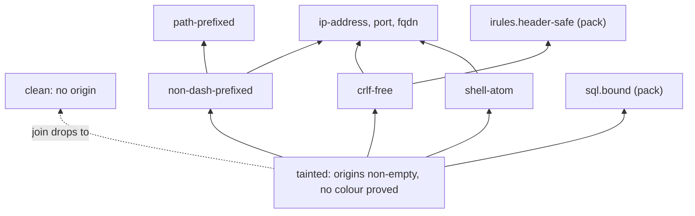
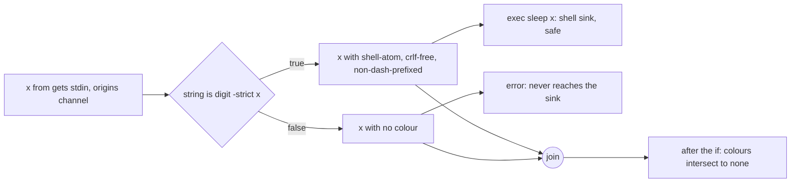
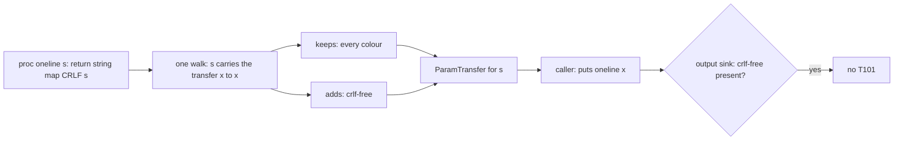
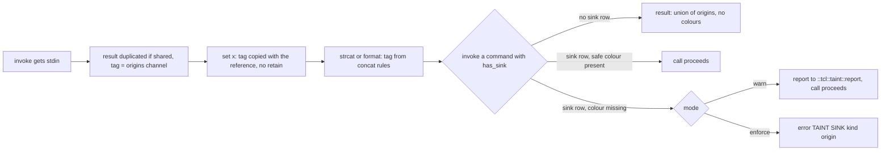

# Taint as SpecTcl 3 content: colours, origins, sinks and sanitisers

**Status:** designed 26 November 2026. Design 393; its steps are plan items 465–479 (spec chapter 12).
See Plan numbers.

**Plan numbers** (26 November 2026): 393a → 465, 393b → 466, 393c → 467, 393d → 468, 393e → 469, 393f → 470, 393g → 471, 393h → 472, 393i → 473, 393j → 474, 393x1 → 475, 393x2 → 476, 393x3 → 477, 393x4 → 478, 393x5 → 479. The [consolidated SpecTcl 3 specification](../spectcl-3/README.md) supersedes this design in detail, and its [crosswalk](../spectcl-3/12-plan-crosswalk.md) maps every proposed number.

**Builds on:**
- [SpecTcl 3](305-spectcl-3.md), for the grammar, the `check` form and facets;
- [consumer hooks](313-consumer-hooks.md), for the gate's abstention rule;
- [Rust and SpecTcl parity](332-rust-spectcl-parity.md), for the field map and the round-trip gate;
- [SpecTcl codegen, VM and runtime](334-spectcl-codegen-vm-runtime.md);
- [F5 integration](360-spectcl-f5-integration.md), for connection-field origins;
- [package surfaces](390-package-surfaces.md) area D, [typed handles](391-handle-types.md) and [typed error codes](392-error-codes.md).

The analyser's current internals are described in
[taint-analysis.md](../../compiler/taint-analysis.md). This doc designs the
model that the registry, SpecTcl 3, the analyser, the VM and the runtime share.

## Problem

Taint is the richest security model in the registry, and SpecTcl spells it
field by field. 332 maps the 15 taint fields to "the same words"
(`332-rust-spectcl-parity.md:236`). That keeps parity, but it carries six
structural limits into 3.0:

1. **The colour set is closed and copied six times.**
   - `TaintColour` is a 17-bit `bitflags` (`tcl-registry/src/taint.rs:50`) whose atoms are `TaintColourAtom` (`taint.rs:96`, `ALL` at `:135`).
   - The compiler keeps its own bitflags (`tcl-compiler/src/taint.rs:137`), bridged atom by atom (`taint/registry_colours.rs:198`, asserted equal at `:220`).
   - `TaintBasis` repeats the 17 by hand for summaries (`taint_interproc.rs:87`, `ALL` at `:110`).
   - Hover labels 13 of them (`tcl-lsp-core/src/hover/variables.rs:518`).
   - The SpecTcl catalogue has its own name table (`tcl-spectcl/src/catalogue.rs:885`), and the loader drops any other name (`loader/value_parsers.rs:222`).

   `TaintColourAtom`'s doc comment (`taint.rs:89-94`) promises that a new atom breaks every exhaustive match. Only `compiler_colour_atom` is one; the other four copies would silently miss it. A library can't add `sql.bound` at all.
2. **Sinks are diagnostic codes, not kinds.**
   - `taint_output_sink` holds `"T101"`, `"IRULE3001"`, `"IRULE3002"` or `"IRULE3004"` (`puts_.rs:164`, `http__respond.rs:120`, `http__cookie.rs:342`, `http__redirect.rs:37`), and `taint_log_sink` holds `"IRULE3003"` (`irules/log.rs:44`).
   - Which colour makes a value safe at which sink lives in the consumer: `sink_colour_mitigated` matches on `DiagCode` (`taint/sink_warnings/sink_emission.rs:44-56`) over masks `T102_SAFE`, `CRLF_SAFE` and `REDIRECT_SAFE` (`tcl-compiler/src/taint.rs:201`, `:221`, `:229`).
   - `Traits::TAINT_SINK` (`traits.rs:557`) marks code sinks (`exec_.rs:53`), path sinks (`cd.rs:71`, `load.rs:94`) and `puts` (`puts_.rs:113`) with one bit.
3. **Origin and mitigation share one set.** `TAINTED` is a "may" bit and every other colour is a "must" bit, so the join special-cases it (`tcl-compiler/src/taint.rs:324-346`). There is no way to say where a value came from, so a secret and an attacker's string are the same thing.
4. **Sources are partly hardcoded.** `IRULES_TAINT_SOURCE_PREFIXES` (`taint.rs:351`), `TAINTED_REFS` (`tcl-mcp/src/irule_test.rs:53`), and `is_taint_source` ignores its dialect (`taint.rs:381`).
5. **Validators don't exist.** `if {[string is integer -strict $x]} { exec sleep $x }` still warns (repro in *Bugs*). The only refinement is `is_sanitiser`, which launders any call whose return type is `Int` or `Boolean` (`taint.rs:548-556`).
6. **Secrets are literal-only.** `credential_options` (one use, `http__geturl.rs:257`), `DEFAULT_CREDENTIAL_OPTION_NAMES` (`spec.rs:257`) and `sensitive_headers` (`http__cookie.rs:138`, `:312`) drive W310, which fires only on a literal (`kcs-diagnostic-w310-hardcoded-credential.md`). A token read from `env` and printed draws T101 "injected content", not "secret disclosed".

The 2.x spelling is the field name with upper-case colours:
`taint_source {TAINTED}` (`docs/design/spec-dsl-examples/irules-http-header.tclspec:17`),
read by `loader/command/body_statements.rs:492-553`. `taint_sink_gate` is a hook
row (`body_statements.rs:766`, `HookFamily::TaintSinkGate` at `pack_hooks.rs:109`,
abstention "the sink applies" at `:196`). `security_floor.rs:118` keeps an
override from weakening any shipped taint fact; this design keeps that floor.

## The model

A value's taint fact is a pair:

- **origins**, a "may" set: where the value may have come from (`client`, `channel`, `env`, `argv`, `secret`, a pack's own). An empty set is clean.
- **colours**, a "must" set: properties proved of every tainted contributor (`crlf-free`, `shell-atom`, `sql.bound`).

At a control-flow join, origins union and colours intersect over the tainted
inputs only, which is today's rule (`tcl-compiler/src/taint.rs:315-346`) with `TAINTED` replaced
by "origins non-empty". A sink fires when the value has an origin the sink
cares about and lacks every colour the sink accepts.

### Colours: a closed core plus an open table

```spectcl
colour crlf-free        { core ; concat all   ; hover { summary {No CR or LF octet.} } }
colour path-prefixed    { core ; concat first ; implies non-dash-prefixed }
colour ip-address       { core ; concat none  ; implies {non-dash-prefixed crlf-free shell-atom} }
colour shell-atom       { core ; concat none }
colour sql.bound        { concat none ; hover { summary {Reaches SQL only as a bound parameter.} } }
colour xpath.escaped    { concat all }
colour redis.key-safe   { concat all ; implies crlf-free }
colour irules.header-safe { concat all ; implies crlf-free ; available iRules 11.0- }
```

- **`implies`** edges replace `augment_source_colours` (`taint.rs:509-518`). The loader takes the closure, and a cycle is a load error.
- **`concat`** says what concatenation does to the colour: `all` (kept when every tainted part has it), `first` (kept from the first part only, so `/$x` stays path-prefixed) or `none` (dropped). `strcat`, `format`, `append`, `string cat`, `subst` and the VM's opcodes all read it, so one row serves the analyser and the run-time mode.
- **Meet and join.** Colour sets form a powerset lattice under the implication closure. The join at a merge is closed intersection. The meet, used when a validator adds a fact to an already coloured value, is closed union.
- **Names.** Core colours are bare (`crlf-free`). Pack colours carry a dotted library prefix (`sql.bound`), checked against the declaring library's name, so two packs can't collide.
- **`core`** is legal only in the trusted tier, like `dialect` rows (`305-spectcl-3.md:126`).

`channel` is not a colour. It is "has a handle type under `channel`" (391), and
it leaves the colour table when 391c lands (`391-handle-types.md:315`).



An arrow points from a weaker fact to a stronger one: `ip-address` implies the
three colours below it. A join moves down; a sanitiser or validator moves up.

### Origins

```spectcl
origin client  { hover { summary {Sent by the network peer.} } }
origin channel { hover { summary {Read from a channel.} } }
origin env     { }
origin argv    { }
origin user    { hover { summary {Typed by the local user: stdin, Tk entry callbacks.} } }
origin secret  { discloses }          ;# sinks marked -discloses fire on it
```

Where origins attach:

| Place | Spelling | Replaces |
|---|---|---|
| command result | `result -origin channel` | `taint_source`, `Traits::TAINT_SOURCE` |
| result of the zero-argument form | `form get { result -origin client -colour path-prefixed }` | `TAINT_SOURCE_ZERO_ARGS`, the `only_flags` rule (`taint.rs:436-445`) |
| a variable a command writes | `arg varName -writes -origin channel` | `TAINTS_VAR_WRITES` |
| a callback substitution | `option -validatecommand -callback-origin {%P user}` | `callback_taint_inputs` (`spec.rs:483`) |
| special variable | `variable env -kind Array -access ReadWrite -provider Environment -origin env` (and `argv` the same with `-kind Scalar -provider Interpreter -origin argv`) | `read_taint` (`special_vars.rs:348`) |
| iRules connection field | `field http.request.uri … -origin client` (360) | `IRULES_TAINT_SOURCE_PREFIXES`, `TAINTED_REFS` |
| channel read | `arg channelId -handle channel -reads` (391) | `gets`, `read` and `chan gets` source rows |
| secret | `option -password -secret`, `header-class sensitive {authorization …}` | `credential_options`, `sensitive_headers`, `SENSITIVE_HTTP_HEADERS` (`taint.rs:593`) |

A channel read's origin comes from the handle: a `file` opened from a literal
path is `channel`, a `socket` is `client`, and `stdin` is `user`.
That ties origins to 391's lattice instead of a per-command list.

### Sink kinds

```spectcl
sink code     { -origins any     -safe list-canonical -code T100 -severity warning }
sink shell    { -origins any     -safe shell-atom     -code T100 -severity warning }
sink path     { -origins any     -safe {path-bounded path-normalised} -code W313 -severity warning }
sink option   { -origins any     -safe non-dash-prefixed -code T102 -severity warning }
sink network  { -origins any     -safe {ip-address fqdn} -code T104 -severity warning }
sink interp   { -origins any     -safe list-canonical -code T105 -severity warning }
sink regex    { -origins any     -safe regex-literal  -code T103 -severity info }
sink numeric  { -origins any     -safe {}             -code T100 -severity warning }
sink output   { -origins any     -safe crlf-free      -code T101 -severity warning -discloses }
sink log      { -origins any     -safe crlf-free      -code {T101 f5-tcl IRULE3003} -discloses }
sink header   { -origins any     -safe crlf-free      -code IRULE3002 -discloses }
sink html     { -origins any     -safe html-escaped   -code IRULE3001 -discloses }
sink redirect { -origins any     -safe {path-prefixed path-normalised} -code IRULE3004 }
sink sql      { -origins any     -safe sql.bound      -code T107 -severity warning }   ;# library sqlite3
```

- **`-safe`** lists colours, any one of which makes the value safe. It replaces the three masks and the `DiagCode` match. A pack can widen a core sink's `-safe` only by a colour that implies one already there, which keeps `security_floor` meaningful.
- **`-discloses`** makes the sink fire on the `secret` origin with T108 ("secret reaches output"), whatever the colours.
- **Severity and code** are per sink and per dialect (`-code {T101 f5-tcl IRULE3003}` picks by dialect family; the first code is the default), so the four iRules codes stop being strings on commands.

A command names the kind on the word that reaches it:

```spectcl
command exec   { arg * -sink shell }
command eval   { arg * -sink code }
command apply  { arg func -sink code }                         ;# taint_code_sink_args {0}
command socket { arg host -sink network ; arg port -sink network }
command puts   { arg string -sink output }
command {HTTP::header} { subcommand insert { arg name -sink header -safe+ irules.header-safe ; arg value -sink header } }
command {interp eval} { arg * -sink interp }
command {switch} { versions {core tcl 9.1-} { arg string -sink numeric -when {present -integer} } }
handle sqlite3-db { kind command ; subcommand eval { arg sql -embedded sql -dialect sqlite -sink sql } }   ;# 390 area D
```

### Sanitisers, transforms and validators

```spectcl
command {uri::encode} { result -adds url-encoded ; arg 0 -double-encodes url-encoded }
command {file join}   { result -adds path-joined }
command {string map}  { result -adds crlf-free -when {native MappingDeletesCrlf} }
command regsub        { result -adds regex-literal -when {native RegsubQuotesRegexMetacharacters} }
command {string is}   { refines {arg end} -adds {shell-atom non-dash-prefixed crlf-free} \
                            -when {all {present -strict} {value {arg 0} in {digit alnum}}} \
                            -switches {-strict -failindex} -on true }
command regexp        { arg exp ; arg string
                        refines {arg string} -adds-from-pattern {arg exp} -switches {-nocase --} -on true }
command {string length} { result -clean }                       ;# replaces is_sanitiser's Int rule
```

- **`-adds`** is `taint_transform`; `-when {native ID}` is `taint_transform_when`. `native` is a new `check` atom that names a member of a closed Rust catalogue (`TaintTransformCondition::ALL`, `taint.rs:825`), so the two conditions keep their proofs and need no Tcl body.
- **`refines … -on true|false`** is new: a validator adds colours to the named word's variable on the branch where the call returned true (or false). The analyser applies it at the `Terminator::Branch` that reads the call (`sink_warnings/branch_conditions.rs:45`), so `if {![regexp {^[a-z]+$} $x]} { error bad }` colours `$x` on the fall-through. A validator is sound in three ways, each checked by worked example 7:
  - **per class.** `string is integer -strict` is true for `-5`, ` 5`, `"5\n"` and `"\n5\n"` (and `1_000` on 9.1), so `integer` adds no colour. `digit` and `alnum` with `-strict` accept only letters or digits, so they add the three colours; without `-strict` the empty string passes, so the `-when` requires `-strict`.
  - **per switch.** `-switches LIST` lists the switches with which the refinement holds; at a call with any other switch the refinement does not apply. `regexp -line {^[a-z]+$} "abc\nrm -rf"` returns 1 (and `-lineanchor` on Tcl), so `regexp` allows only `-nocase` and `--`. A row with no `-switches` applies only to calls with no switch.
  - **per condition shape.** `Terminator::Branch` carries the whole condition. The refinement applies only when the condition is the call or `![call]`, or decomposes: the true arm of `A && B` refines by both A's and B's true results, and the false arm of `A || B` by both false results. Any other shape refines nothing, so `if {[string is digit -strict $x] || $force} {exec sleep $x}` keeps its T100, as Tcl runs that arm with `x="1; touch …"`.
- **`-adds-from-pattern`** reads a literal pattern anchored with `^` and `$` and maps its class to colours: `^[a-z]+$` gives `shell-atom crlf-free non-dash-prefixed`, `^[0-9]+$` the same, and an unanchored pattern gives nothing. Without `-line` or `-lineanchor`, `$` matches only at the end of the string (`regexp {^[a-z]+$} "abc\nrm -rf"` is 0). The map is one table in the registry.
- **`result -clean`** names fixed-width results. `is_sanitiser` stays only as the default for a row with no taint facts and a numeric `returns`.
- **Numeric coercion** is the `numeric` sink, so `taint_numeric_coercion` becomes `arg … -sink numeric -when {present -integer}`.



### Propagation

The default stays today's: a command with no taint row passes the union of
its arguments' origins and keeps no colour (`shape_unproven`,
`tcl-compiler/src/taint.rs:380`). Rows refine it:

| Construct | Rule | Spelling |
|---|---|---|
| `set`, `return`, `upvar` targets | identity; a callee's writes through `upvar`, `global`, `uplevel` or `namespace upvar` reach the caller as summary frame effects (integration C24), and an unknown callee may write any variable it can reach | built in |
| `strcat`, `append`, `string cat`, `format` | per-colour `concat` | built in, reads `concat` |
| `list`, `lappend`, `dict create` | element facts kept; the whole gains `list-canonical` | `result -elements-from {arg *} -adds list-canonical` |
| `lindex`, `dict get`, `lassign` | the element's facts, or the container's when the key is unknown | `result -element-of {arg 0}` |
| `foreach` and `lmap` variables, any stride and any number of lists | each variable gets the join (origins union, colours intersect) over every element of the lists it iterates, or the container's fact when element facts are unknown; `lmap`'s result is a list of the body's results and gains `list-canonical` | built in |
| `dict for {k v}` | `k` gets the join over the dict's keys and `v` over its values, or the container's fact | built in |
| arrays | per literal key, else the array's join (391's bounded rule) | built in |
| `subst` of a literal template | origins of every variable and command it reads; colours by `concat`, then drop `crlf-free` if backslashes are on | `result -from {arg end} -unescapes` |
| `subst` of a non-literal template | origins of the template and of every variable in the frame; **no colour**, whatever the switches: the template can name any variable, whose value can hold a newline (worked example 7) | built in |
| handle reads | origin from the handle type (391) | `arg channelId -reads` |
| error messages | `catch`'s message variable gets the origins of the words the raising command saw | `errors -message-from {arg *}` (392) |

The last row matters: `catch {open $userPath} m` puts `$userPath` into `m`, and
`puts $m` is an output sink.

### Interprocedural summaries

`ProcTaintSummary` (`taint_interproc.rs:185`) runs the body once per parameter
per `TaintBasis`, 17 runs each. With an open set that does not scale. The
summary becomes a gen/kill transfer per parameter, and per parameter and sink:

```rust
// design sketch: proposed in this doc; keyed by identity (D-D), never display text
ProcTaintSummary {
    body: BodyUnitRef(/* the proc's body */ b1),
    returns: TaintTransfer { base: TaintFact::CLEAN,
        from_params: &[ParamTransfer { param: 0, passes_origins: true,
                                       keeps: ColourSet::ALL, adds: ColourSet::of(&["crlf-free"]) }] },
    param_sinks: &[ParamSink { param: 0, sink: SinkKindId::SHELL,       // the transfer from entry to the sink
                               keeps: ColourSet::ALL, adds: ColourSet::EMPTY }],
    validates: &[(0, OnResult::True, ColourSet::of(&["shell-atom"]))],   // a predicate proc
}
```

`keeps` and `adds` come from **one walk**. The walk carries, for each
parameter, a transfer `x ↦ (x ∩ K) ∪ G` in place of a fact, with `K` and `G`
closed under `implies` (so the result of a closed `x` stays closed). Transfers
compose, and the join of two transfers is a transfer:
`(x∩K1 ∪ G1) ∩ (x∩K2 ∪ G2) = x∩((K1∩K2) ∪ (K1∩G2) ∪ (G1∩K2)) ∪ (G1∩G2)`.
So a body visit is one walk, as the integration design's one-walk rule
requires, and the summary is the transfer at the return and at each sink.
`param_sinks` keeps the transfer to the sink, not only its kind, so a caller
applies it to the argument's own colours and checks the sink's `-safe`: a
caller passing a `shell-atom` value into `p` draws no T100. The same shape is
a pack row, so a library proc the analyser can't read is declared:
`command mylib::clean { result -from {arg 0} -adds crlf-free }`.



### Gates

`taint_sink_gate` has one use, `subst_evaluates_commands` (`subst_.rs:272`,
wired at `:347`). It becomes a `-when` predicate on the sink row:

```spectcl
command subst {
    arg string -sink code -when {not {all {present -nocommands} {present -novariables}}}
    versions {core tcl 9.1-} {
        arg string -sink code -when {any {present -commands} {present -variables}
                                         {not {any {present -backslashes} {present -nocommands}}}}
    }
}
```

313's rule holds: a sink `-when` suppresses the sink only when the predicate is
proved false, so an unknown or an abstaining predicate leaves the sink in
force. This is the reverse of every other `check`, and the image marks the rule
`SinkWhen` so the evaluator can't get it backwards. `-native ID` stays
available for a gate the predicate language can't say; none is known.

The predicate also fixes a bug: the old gate treats `-nocommands` alone as
safe, but `$a([cmd])` inside the template runs `cmd` whenever variables are
substituted. Worked example 3 shows it.

### Versioned facets

| Fact | Tcl 8.4–9.0 | Tcl 9.1 | Jim 0.84 | f5-tcl (iRules) |
|---|---|---|---|---|
| `subst` switches | `-no*` only | adds `-backslashes`, `-commands`, `-variables` | `-no*` only | `-no*` only |
| `subst -nocommands` with `$a([cmd])` | runs `cmd` | runs `cmd` | runs `cmd` | not run (design sketch) |
| `exec` argv redirection (`>f`, `<f`, `2>@1`) | yes | yes | yes | no `exec` |
| `switch -integer` numeric sink | absent | present | absent | absent |
| `interp eval` sink | yes | yes | no `interp` | no `interp` |
| header, html, redirect, log sinks | — | — | — | `HTTP::header`, `HTTP::respond`, `HTTP::redirect`, `log`, `HSL::send` |

The 9.1 and Jim rows are real runs in examples 1 and 3. Each row is a `versions`
block; nothing is a dialect test in the analyser.

## The Rust side

```rust
// design sketch: proposed in this doc
#[repr(u16)]
pub enum CoreColour { NonDashPrefixed, PathPrefixed, CrlfFree, ShellAtom, ListCanonical,
                      RegexLiteral, PathNormalised, PathBounded, HeaderTokenSafe, HtmlEscaped,
                      UrlEncoded, IpAddress, Port, Fqdn, PathJoined }      // closed, exhaustive
pub struct TaintColourId(u16);           // < CORE_COUNT is a CoreColour; above is the image's table
pub struct ColourSet { inline: u64, spill: Option<Box<[u64]>> }   // a bitset over ids
pub struct ColourRow { id: TaintColourId, name: &'static str, implies: ColourSet,
                       concat: ConcatRule, library: Option<LibraryId> }
pub struct OriginId(u16);                // Client, Channel, Env, Argv, User, Secret, then packs
pub struct TaintFact { origins: OriginSet, colours: ColourSet }
pub enum CoreSinkKind { Code, Shell, Path, Option, Network, Interp, Regex, Numeric,
                        Output, Log, Header, Html, Redirect }               // closed
pub struct SinkKindId(u16);
pub struct SinkRow { id: SinkKindId, safe: ColourSet, origins: OriginSet,
                     discloses: bool, code: Facet<DiagCode>, severity: Severity }
pub struct TaintTable { colours: Box<[ColourRow]>, origins: Box<[OriginRow]>, sinks: Box<[SinkRow]> }
```

- **Exhaustiveness stays.** A consumer that must treat each core colour or sink kind deliberately (`compiler_colour_atom` today) matches on `CoreColour` or `CoreSinkKind`. Everything else (hover labels, explorer names, the catalogue) iterates `TaintTable`, so there is one list and no copy to forget.
- **The compiler's bitflags go.** `TaintLattice.colours` becomes a `ColourSet` read from the table, and `reg_colour` (`registry_colours.rs:220`) is deleted. The 64 inline bits cover the core and 49 pack colours without allocation.
- **Command rows** become `taint: &'static [TaintRow]` on `CommandSpec` and `SubCommand`, with `TaintRow::{Origin, Sink, Adds, Refines, Clean, Transfer}`, each with an optional `when: CheckRule` and the word it names.

### Field migration

| Today | Where | New form |
|---|---|---|
| `taint_output_sink: Some("T101")` | `spec.rs:957` | `arg … -sink output` |
| `taint_output_sink: Some("IRULE300N")` | same | `-sink html`, `header`, `redirect` |
| `taint_output_sink_subcommands` | `spec.rs:963` | the `-sink` row on the `subcommand` |
| `taint_log_sink` | `spec.rs:967` | `-sink log` |
| `taint_network_sink_args` | `spec.rs:973` | `arg N -sink network`; `Some(&[])` becomes `arg * -sink network` |
| `taint_code_sink_args` | `spec.rs:989` | `arg N -sink code` |
| `taint_interp_eval_subcommands` | `spec.rs:994` | `-sink interp` on each subcommand |
| `taint_source` | `spec.rs:1005` | `result -origin O ?-colour C?` |
| `taint_transform` | `spec.rs:1010` | `result -adds C` |
| `taint_transform_when` | `spec.rs:1022` | `-when {native ID}` |
| `taint_double_encode_colour` | `spec.rs:1027` | `arg N -double-encodes C` |
| `taint_sink_safe_colour` | `spec.rs:1032` | `-safe+ C` on the command's sink row |
| `taint_sink_gate` | `spec.rs:1046` | `-sink … -when PRED` (rule `SinkWhen`) |
| `taint_numeric_coercion` | `spec.rs:1052` | `-sink numeric -when {present -integer}` |
| `taint` (completeness) | `spec.rs:1059` | `taint -complete …`, unchanged |
| `credential_options` | `spec.rs:1063` | `option -headers -secret` |
| `sensitive_headers` | `spec.rs:1070` | `header-class sensitive {…}` plus `-secret-header-of {arg N}` |
| `setter_constraints` | `spec.rs:1075` | a `check` rule over the setter form |
| `callback_taint_inputs` | `spec.rs:483` | `-callback-origin {%P user}` |
| `Traits::TAINT_SOURCE*`, `TAINT_SINK`, `TAINTS_VAR_WRITES` | `traits.rs:557-569` | derived from the rows |
| `ResolvedInvocation::taint_source`, `taint_transform` | `resolved_invocation.rs:187-189` | `taint: &[TaintRow]` of the selected form |
| `SpecialVarSpec::read_taint` | `special_vars.rs:348` | `variable NAME -origin O` |

### The round-trip gate

332's gate renders every `CommandSpec` to SpecTcl 3 and loads it back. For
taint it compares `TaintRow` slices after sorting and the `TaintTable` by
name, so a colour that a pack declares and a core colour can't alias. The 2.x
shim maps each old field to the rows above and keeps `TAINTED` as "origin
`unknown`", so existing packs load unchanged.

## Consumers

- **Diagnostics.** One emitter reads `SinkRow`. T107 ("tainted value in an embedded SQL range") and T108 ("secret reaches an output, log, header or network sink") are new; T100–T106 and IRULE3001–3004 keep their codes through `SinkRow::code`.
- **Hover** on a variable shows origins and colours by name from the table, for example `tainted (channel): crlf-free, shell-atom`. Today it shows 13 labels (`hover/variables.rs:518`).
- **Code actions.** A sink warning offers each registered sanitiser whose `-adds` covers the sink's `-safe`, ranked by library availability at the position (308). For T107 it offers the bind rewrite, `"…'$x'"` to `{… :x}`.
- **Optimiser and minifier.** A call with an `-adds`, `refines` or `-clean` row is a taint barrier. A rewrite may not remove it while its result reaches a sink, or move a sink above it. The check is mechanical: the sink facts before and after a rewrite must be equal (step 393h).
- **Explorer and MCP.** The `taint` view gains per-proc summaries (today only `::top` facts, `tcl explore --show taint`) and the table itself. MCP's `TAINTED_REFS` goes (360).
- **iRules connection graph and test framework (360).** Field origins colour the graph's edges, and the simulator runs with taint mode on (below).
- **Spec Studio** edits colours, origins and sinks as table forms; `render_rs.rs:369` stops mapping a single `taintColour` type.

## Worked examples

### 1. `exec` with one argv word

**Source:**
```tcl
set arg [lindex $argv 0]
catch {exec echo hello $arg} out
puts "out=<$out> exists=[file exists stolen.txt]"
```

**Result:**
```text
$ tclsh8.4 ex1r.tcl '>stolen.txt'
out=<> exists=1
$ tclsh9.1 ex1r.tcl '>stolen.txt'
out=<> exists=1
$ jimsh ex1r.tcl '>stolen.txt'
out=<> exists=1
$ tcl diag ex1r.tcl
ex1r.tcl:2:24: warning T100     Tainted variable $arg flows into exec; possible code injection
ex1r.tcl:3:6: warning T101     Tainted variable $out flows into puts; output may contain injected content
```

No shell runs, yet one word redirects `exec`'s output into a file. This is why
the sink is `shell`, not `code`, and why `shell-atom` (`exec_.rs:133`) must
exclude a leading `<`, `>`, `|` or `2>`.

**Bytecode (tclsh 9.1.0):**
```text
  Command 3: "exec echo hello $arg"
    (27) push 2 	# "exec"
    (32) push 3 	# "echo"
    (37) push 4 	# "hello"
    (42) push 0 	# "arg"
    (47) loadStk 
    (48) invokeStk 4 
```

This is the second line without its `catch`. `invokeStk 4` is where the
run-time mode checks the `shell` sink; with `"echo $arg"` a `strcat` comes
first, and that is where the `concat` rules apply.

### 2. SQL through `db eval`

**Source:**
```tcl
# sqlite3 is not installed for any tclsh here; this stand-in prints the SQL text db eval receives
proc db {sub sql} { puts "db $sub <- $sql" }
set x [lindex $argv 0]
db eval "SELECT name FROM users WHERE name = '$x'"
db eval {SELECT name FROM users WHERE name = :x}
```

**In memory:**
```rust
// design sketch: proposed in this doc and 390 area D
SubCommand { name: "eval", taint: &[TaintRow::Sink { word: Word::Arg(0), kind: SinkKindId(/* sql */ 13),
             embedded: Some(EmbeddedLanguage::Sql), when: None }], .. }
SinkRow { name: "sql", safe: ColourSet::of(&["sql.bound"]), code: Facet::one(DiagCode::T107), .. }
```

**Result:**
```text
$ tclsh9.1 ex2.tcl "x' OR '1'='1"
db eval <- SELECT name FROM users WHERE name = 'x' OR '1'='1'
db eval <- SELECT name FROM users WHERE name = :x
$ tcl diag ex2.tcl
no diagnostics
```

tclsh 8.4 and jimsh print the same. Python's sqlite3 3.53.1 runs that first
string against a two-row table and returns both rows. The sink is a Tcl
substitution inside the `-embedded sql` word: `$x` in a quoted word is one,
while `:x`, and also `$x` inside a braced word, are SQLite bind parameters.
Today `db` is unknown, so nothing fires.

### 3. `subst` with and without `-nocommands`

**Source:**
```tcl
array set a {}
set x {$a([puts INJECTED])}
puts [catch {subst -nocommands $x} m]:$m
```

**Result:**
```text
$ tclsh8.4 ex4b.tcl          (8.6, 9.0, 9.1 and jimsh print the same)
INJECTED
1:can't read "a()": no such element in array
$ tcl diag --source 'set x [gets stdin]
subst -nocommands $x'
<inline:1>:2:19: warning W102     subst with a variable argument enables code injection: any $var in the string will be evaluated. …
```

`-nocommands` still runs the command in an array index. The analyser drops
T100 because the gate says no command substitution happens. The new `-when`
keeps the sink unless both `-nocommands` and `-novariables` are present.

**Bytecode (tclsh 9.1.0):**
```text
  Command 3: "subst -nocommands $x..."
    (15) push 0 	# "subst"
    (20) push 1 	# "-nocommands"
    (25) loadScalar %v0 	# var "x"
    (30) invokeStk 3 
```

Neither form is compiled inline when the template is a variable, so the run-time
check sits on `invokeStk`.

### 4. A sanitiser through a proc summary

**Source:**
```tcl
proc oneline {s} {
    return [string map {"\r" "" "\n" ""} $s]
}
set x [gets stdin]
puts [oneline $x]
```

**Bytecode (tclsh 9.1.0):**
```text
  Command 2: "string map {\"\r\" \"\" \"\n\" ..."
    (0) push 0 	# "::tcl::string::map"
    (5) push 1 	# "\"\r\" \"\" \"\n\" \"..."
    (10) loadScalar %v0 	# var "s"
    (15) invokeStk 3 
    (20) done 
```

**Result:**
```text
$ tcl diag p1.tcl
p1.tcl:5:6: warning T101     Tainted variable $x flows into puts; output may contain injected content
$ tcl diag --source 'set x [gets stdin]
puts [string map {"\r" "" "\n" ""} $x]'
no diagnostics
```

Inline, the condition proves `crlf-free`; through the proc it is lost, because
each `TaintBasis` run seeds a colour and asks what survives, never what the
body adds. The gen/kill summary records `adds: crlf-free`, and the T101 goes.

### 5. iRules header injection (design sketch)

**Source:**
```tcl
when HTTP_REQUEST {
    set l [HTTP::host]
    HTTP::header insert X-L [string map {"\r" "" "\n" ""} $l]
}
```

**In memory:**
```rust
// design sketch: proposed in this doc and 360
Field { name: "http.request.headers", origin: OriginId::CLIENT, .. }   // HTTP::host reads it
TaintFact { origins: {client}, colours: {crlf-free} }                 // after string map
SinkRow { name: "header", safe: ColourSet::of(&["crlf-free"]), code: Facet::one(DiagCode::Irule3002), .. }
```

**Result:**
```text
$ tcl diag --dialect f5-irules a.irul
a.irul:3:5: warning IRULE3002 Tainted variable $l in HTTP header/cookie value (HTTP::header insert); risk of header injection
```

With `set m [string map … $l]; HTTP::header insert X-L $m` there is no warning,
so the inline form is a false positive (*Bugs*). There is no appliance run.

### 6. A secret reaching `puts`

**Source:**
```tcl
set tok $::env(API_TOKEN)
set hdrs [list Authorization "Bearer $tok"]
puts "request headers: $hdrs"
```

**Result:**
```text
$ API_TOKEN=s3cr3t tclsh9.1 ex6.tcl      (tclsh8.4, jimsh and tclvm print the same)
request headers: Authorization {Bearer s3cr3t}
$ tcl diag ex6.tcl
ex6.tcl:3:6: warning T101     Tainted variable $hdrs flows into puts; output may contain injected content
```

The warning is right for the wrong reason. Under this design, `variable env
-origin env` plus `header-class sensitive {authorization}` gives the list
element the `secret` origin, and `puts` is `-discloses`, so T108 reads "secret
from `env(API_TOKEN)` reaches `puts`".

### 7. Validators that are not

**Source:**
```tcl
foreach v [list -5 " 5" "5\n" "\n5\n" "12\n" 0x1F 1_000 +3 "" 007] {
  set i [string is integer -strict $v]; set d [string is digit -strict $v]; set a [string is alnum -strict $v]
  puts [format "%-8s integer=%s digit=%s alnum=%s" [string map {"\n" \\n} "<$v>"] $i $d $a]
}
puts "regexp -line: [regexp -line {^[a-z]+$} "abc\nrm -rf"]"
puts "regexp -lineanchor: [catch {regexp -lineanchor {^[a-z]+$} "abc\nrm -rf"} r] $r"
puts "regexp plain: [regexp {^[a-z]+$} "abc\nrm -rf"]"
set x "1; touch /tmp/g1-pwn"; set force 1
if {[string is integer -strict $x] || $force} { puts "or-branch ran with x=<$x>" }
set t [string map {"\r" "" "\n" ""} {$x}]
set x "A\nB"
puts "subst: [string map {"\n" \\n} [subst -nobackslashes -nocommands $t]]"
```

**Result:**
```text
$ tclsh8.6 validate.tcl      (tclsh9.1 the same, except 1_000 is an integer there)
<-5>     integer=1 digit=0 alnum=0
< 5>     integer=1 digit=0 alnum=0
<5\n>    integer=1 digit=0 alnum=0
<\n5\n>  integer=1 digit=0 alnum=0
<12\n>   integer=1 digit=0 alnum=0
<0x1F>   integer=1 digit=0 alnum=1
<1_000>  integer=0 digit=0 alnum=0
<+3>     integer=1 digit=0 alnum=0
<>       integer=0 digit=0 alnum=0
<007>    integer=1 digit=1 alnum=1
regexp -line: 1
regexp -lineanchor: 0 1
regexp plain: 0
or-branch ran with x=<1; touch /tmp/g1-pwn>
subst: A\nB
$ tmp/jimtcl-oracle/jimsh validate.tcl
(as tclsh8.6, except regexp -lineanchor: 0 0)
```

Every line breaks one of the old rules. `integer` accepts a leading `-`, white space and a newline, so it proves none of `non-dash-prefixed`, `shell-atom` or `crlf-free`; `digit` and `alnum` with `-strict` do. `-line` lets `^…$` match one line of a multi-line value. The `||` arm runs with a value no validator passed. And `$t` is `crlf-free`, yet `subst` of it brings in `$x`'s newline, so a non-literal template keeps no colour. Under this design each of these keeps its T100 or T101.

## Taint at run time: the VM and the runtime

No design under `docs/design/runtime/`, nor `compiler/vm-tcl-9-1.md`,
`compiler/bytecode-image.md` or 334, mentions taint (`rg -il taint` finds none),
and `rust/tcl-vm` has no taint code. The only hits are Jim's `tainted`
`info` probe strings (`tcl-vm/src/cmd_info/native_jim.rs:258`).

### Recommendations

1. **A build feature and a mode.** The `taint` cargo feature in `tcl-vm` and `runtime/rust` adds the code. Without it nothing changes, so release WASM builds cost nothing. With it, `tclvm --taint=off|warn|enforce` picks the mode. With `off`, each invoke costs one test of a per-command `has_sink` bit, precomputed when the command is registered.
2. **Colours live beside the value, not in it.**
   - Each object gets a feature-gated `taint: Cell<TaintTag>` (a `u32`, 0 meaning clean). The runtime puts it in `ObjectAuxiliary` (`runtime/rust/src/obj.rs:251`), outside the ABI `TclObj` header (`obj.rs:240`); the VM puts it on `Obj` (`tcl-vm/src/value.rs:319`).
   - The tag indexes an interned, append-only `TaintFact` table per interpreter. Distinct facts are few, so the table stays small.
   - The tag is not a reference: no retain and no release. The refcount contract and MM-B are unchanged, with one added note: duplicating an object copies its tag.
   - **Shared and literal values.** Literals are always clean. A source never colours an object in place when it is shared: it duplicates first, the same rule as Tcl's copy-on-write `Tcl_IsShared`. So one literal `stdin`, or an interned empty string, never picks up a colour from another use.
3. **One table.** The VM reads the same `TaintTable` and `TaintRow`s from the image that the analyser reads. Sources and `-adds` rows run after a successful invoke. Sinks are checked before the invoke, against the selected form. Propagation is conservative: an unrowed command's result takes the union of its arguments' origins and no colours, and `strcat`, `concat`, `list`, `lappend`, `append`, `dict set`, `format`, `string map` and `subst` follow each colour's `concat` rule. Refinement (`refines`) does not run at run time: the VM sees the validator's result value, not the branch, so it only checks sinks.
4. **A violation is a typed error.** `enforce` raises `TAINT SINK <kind> <origin>` with the message `tainted value (client) reaches header sink without crlf-free`. This is a 392 `errorclass TAINT`, so `catch` and `try … trap {TAINT SINK}` see it. `warn` writes the same line through `::tcl::taint::report`, which by default goes to stderr, and the call goes ahead.
5. **Conformance stays green.** With `off` the code path is unchanged. With `warn`, results must be byte-identical to C Tcl. The conformance harness (`tcl-conformance-harness.md`) gains a warn-mode lane over the same corpus, which compares stdout and results with C and sends reports to a side file. Only `enforce` may change a result, and only where a sink fires.
6. **Compiled code.**
   - Codegen reads no taint facts. 334's "facts only" list (`334-spectcl-codegen-vm-runtime.md:196`) gains one VM-use row: sink rows at dispatch.
   - The optimiser and minifier keep the barrier rule above. A compiled inline form of a sink command, such as `expr` or `string map`, calls the same check in taint builds.
   - tbcx images carry no taint, because taint is run-time state.
7. **Jim and iRules.** Jim mode uses the Jim facets, so it has no `interp` sink and no 9.1 `subst` switches. The iRules simulator (360) runs with `enforce`, and its findings say "simulator". The appliance has no taint mode, so no claim is made about BIG-IP behaviour.

### Uses

- **The iRules test framework** checks every simulated path dynamically. A `TAINT SINK header client` error becomes a failing case with the path that reached it.
- **The differential fuzzer** (`rust/tcl-fuzz`, `contracts/differential-fuzzing.md`) runs `tclvm --taint=warn` beside the analyser on each seed. A static warning that no run confirms is a false-positive candidate. A run-time report with no static warning is a confirmed false negative, like the `foreach` one below.
- **Safe and child interpreters** (`runtime/child-interp.md` section 6). Each interpreter keeps its own fact table. A value crossing `interp alias` or `interp eval` keeps its tag, so a parent can't launder taint through a child.
- **Tcl hook bodies** (313) run in the VM with their input words tagged from the analyser's static facts, so a hook that echoes a tainted word into a fix template is caught.



### Worked example: `enforce` mode (design sketch for tclvm)

**Source:**
```tcl
set cmd [lindex $argv 0]
set safe [list string toupper $cmd]
foreach script [list $safe $cmd] {
    if {[catch {eval $script} m o]} {
        puts "error: $m ec=[dict get $o -errorcode]"
    } else {
        puts "ran: $m"
    }
}
```

**Result:**
```text
$ tclsh9.1 rt1.tcl 'string toupper pwned'     (tclsh8.5, jimsh and today's tclvm print the same)
ran: STRING TOUPPER PWNED
ran: PWNED
$ tclvm --taint=enforce rt1.tcl 'string toupper pwned'     (design sketch: no such flag yet)
ran: STRING TOUPPER PWNED
error: tainted value (argv) reaches code sink without list-canonical ec=TAINT SINK code argv
$ tcl diag rt1.tcl
rt1.tcl:4:22: warning W101     eval with substituted arguments risks code injection. …
```

`$safe` is `list-canonical`, so `eval` runs it. `$cmd` is not, so `enforce`
raises. The analyser reports only W101: the T100 is lost through `foreach`
(*Bugs*), which is exactly the false negative the fuzzer lane would confirm.

## Proposed steps

- **393a. Colour table.** `CoreColour`, `TaintColourId`, `ColourSet` and `TaintTable` in `tcl-registry`; the `colour` form with `implies` and `concat`. Done when `rg 'TaintBasis|TAINT_BITS|flag_labels' rust` is empty, the compiler has no `bitflags!` for colours, and `colour sql.bound` loads from a pack.
- **393b. Sink kinds.** `CoreSinkKind`, `SinkRow` and the `sink` form; every `taint_*sink*` field becomes a row. Done when `sink_colour_mitigated`, `T102_SAFE`, `CRLF_SAFE` and `REDIRECT_SAFE` are gone and the T/IRULE corpus reports the same set, and item 244a's rows are conformance rows of 465 and 466, green under `tcl8.6`, `tcl9.0` and `tcl9.1`: `set x [gets stdin]; eval $x` draws T100, and so do the same source with `read stdin`, `chan gets stdin` and `exec cat` as the source; `argv` keeps T100; the integration design's `save` example draws T101 under all three. 244a is marked "verified by 466" (deep review W12): its fix lands on the 465 colour table, not on the `TaintBasis` path 465 deletes.
- **393c. Origins and secrets.** Split `TAINTED` into origins; `secret`, `header-class` and T108. Done when example 6 reports T108, and W310 reads `-secret` rows instead of `credential_options`.
- **393d. Spelling and parity.** The 3.0 forms, the 2.x shim and 332's round-trip for `TaintRow`. Done when every shipped spec round-trips and `body_statements.rs` has no `taint_` field arm.
- **393e. Validators.** `refines`, `-adds-from-pattern`, `-switches`, and refinement at `Terminator::Branch` for the call, `!call`, and decomposed `&&`/`||` shapes. Done when `if {[string is digit -strict $x]} { exec sleep $x }` and the anchored `regexp` guard draw no T100, and worked example 7's `integer`, `-line`, `||` and `subst` cases still draw it.
- **393f. Summaries.** Gen/kill `ProcTaintSummary` computed in one walk, with per-sink transfers, and pack-declared transfers. Done when example 4 draws no T101, and the explorer's taint view lists each proc's summary.
- **393g. Gates.** `-sink … -when` with `SinkWhen`; delete `taint_sink_gate`. Done when `TaintSinkGate` is gone from `pack_hooks.rs` and example 3 draws T100.
- **393h. Optimiser barrier.** A test that compares sink facts before and after every rewrite over the taint corpus. Done when it runs in `make test` and passes.
- **393i. Package and F5 sinks.** 390d's `-sink sql`, 360's field origins, 391's channel-read origins. Done when example 2 with a real `sqlite3` spec draws T107, and `rg 'IRULES_TAINT_SOURCE_PREFIXES|TAINTED_REFS' rust` is empty.
- **393j. Consumers.** Hover names, the sanitiser code action, MCP view and Spec Studio forms. Done when hover on example 1's `$arg` reads `tainted (argv)` and the T107 action rewrites to `:x`.
- **393x1. Run-time tag.** The `taint` feature, `TaintTag` on `Obj` and `ObjectAuxiliary`, copy-on-colour, and the refcount note. Done when a feature-off build is byte-identical in size to today's and the leak counters (MM-C) stay at zero with the feature on.
- **393x2. Sinks at dispatch.** `has_sink`, the `TAINT` errorclass, and `off`, `warn` and `enforce`. Done when the worked example prints as sketched.
- **393x3. Propagation.** Concat rules in the string, list and dict opcodes and in the built-in commands. Done when a test table of 40 constructs matches the analyser's facts.
- **393x4. Conformance lane.** The warn-mode run of the conformance corpus. Done when it is byte-identical to C on every test that passes with taint off.
- **393x5. Oracles.** The iRules simulator in `enforce` and a `tcl-fuzz` taint lane. Done when the fuzzer reports the `foreach` false negative from a seed.

## Corrections to other designs

- **332** (`:236`): the 15 fields are not "the same words"; they map as the migration table above, and `taint_sink_gate` moves out of the `-native` row at `:241`. `callback_taint_inputs` (`:232`) and `taint` (`:234`) map to `-callback-origin` and `taint -complete`.
- **313** (`:939`): the rule stands, but the gate is now a `-when` on a sink row with rule `SinkWhen`, not a hook family.
- **360** (`:240-243`): field origins are `origin client`, one of several origins. `sensitive_headers` becomes `header-class sensitive`, shared with core `http`.
- **390** (`:221`, `:311`): the safe forms are `:x` and also `$x` inside a braced word, because SQLite binds both. The diagnostic is T107, and the sink kind is declared by a `sink sql` row in the sqlite3 library.
- **391** (`:20`, `:315`, `:487`): `CHANNEL` leaves the colour table entirely; channel reads give an origin from the handle type.
- **392**: add `errorclass TAINT { code {SINK} -fields {kind origin} }`, and `errors -message-from` so `catch` messages carry their origins.
- **334** (`:196`): the VM-use column gains "sink rows at dispatch, taint builds only"; codegen stays at facts only.
- **`runtime/refcount-contract.md` and `memory-management.md`**: add that the taint tag is copied by duplication and never retained.
- **`runtime/child-interp.md`** section 6: values keep their tags across `interp alias` and `interp eval`.
- **`compiler/vm-tcl-9-1.md` and `compiler/bytecode-image.md`**: state that taint is not in the image and is checked at invoke in taint builds.
- **`compiler/taint-analysis.md`**: the `TaintColour flags` section describes the table, not 17 bits.
- **`tcl-registry/src/taint.rs:89-94`**: the exhaustiveness promise is wrong today (four copies are not matches); 393a makes it true for `CoreColour`.

## Bugs found with today's analyser

Each line runs `./target/debug/tcl diag` (or `dataflow`).

1. **Tcl 9.0 and 9.1 lose every command source.** `--dialect tcl9.1 --source 'set x [gets stdin]; eval $x'` reports nothing; 8.6 reports T100. `read`, `chan gets` and `exec` are the same; `argv` still works.
2. **A sink after a one-argument `puts` is lost.** `--source 'set x [gets stdin]
puts $x
exec sh -c $x'` reports only T101. With `puts stdout $x`, or with the lines swapped, both fire. An unrelated `set z [gets stdin]; exec sh -c $z` after it is lost too.
3. **A code sink nested in a command substitution is silent.** `--source 'set n [gets stdin]; list [exec sh -c $n]'` reports nothing; `set r [exec sh -c $n]` reports T100.
4. **`eval` and `subst` results lose taint.** `--source 'set x [gets stdin]; set y [subst $x]; puts $y'` reports only W102: no T100 and no T101. The same holds for `eval` and for `subst -nocommands -novariables`, whose backslash pass can add CR and LF.
5. **`subst -nocommands` is gated as safe.** Example 3: `$a([cmd])` runs `cmd` on 8.4–9.1 and Jim, but T100 is suppressed (`subst_.rs:272`).
6. **An unresolved `package require` silences the file.** `dataflow --source 'package require foo
set x [gets stdin]
puts $x'` reports zero tainted variables with `"complete": true`.
7. **The CRLF sanitiser is ignored inline in iRules sinks.** `--dialect f5-irules --source 'when HTTP_REQUEST { set l [HTTP::host]; HTTP::header insert X-L [string map {"\r" "" "\n" ""} $l] }'` reports IRULE3002; the two-statement form does not. `log local0. [string map …]` gives IRULE3003 the same way.
8. **A proc sanitiser is not recognised.** Example 4.
9. **`foreach` drops taint.** `--source 'set c [lindex $argv 0]; foreach s [list $c] { eval $s }'` reports only W101; `eval [lindex $l 0]` reports T100.
10. **Validators are not recognised.** `--source 'set x [gets stdin]
if {[string is digit -strict $x]} { exec sleep $x }'` reports T100 at 2:48, and so does the guard `[regexp {^[0-9]+$} $x]`. (With `integer` the T100 is right: worked example 7.)
11. **iRules getters are sources in every dialect.** `is_taint_source` discards its dialect (`taint.rs:381`), as its doc comment says (`:368-373`); 393i scopes field origins to the iRules library.

## Review fixes (26 November 2026)

- **A7, G16.** `integer` adds no colour; `digit` and `alnum` need `-strict`; `-switches` makes validators sound per switch; refinement only for the call, `!call` and decomposed `&&`/`||`; a non-literal `subst` template drops every colour; `foreach`, `lmap` and `dict for` take the join over elements; worked example 7 is a real run.
- **A13 (C26).** Summaries are one walk over gen/kill transfers, whose join is closed; `param_sinks` carries per-sink transfers so callers check `-safe`.
- **G12.** `{string is}` refines `{arg end}` with the class at `{arg 0}`; `regexp` names `{arg exp}` and `{arg string}`.
- **G15.** Sink codes pick by dialect family (`f5-tcl`); `variable` carries its required flags and `-provider`.
- **R13.** `db eval` is a `subcommand` of the `sqlite3-db` handle.

## Review fixes (26 November 2026, deep review)

- **M2 (D-D).** `ProcTaintSummary` is keyed by `BodyUnitRef`.
- **W12.** 244a's rows (`gets`, `read`, `chan gets`, `exec` sources and `argv` under 8.6, 9.0 and 9.1; re-run today: T100 on 8.6, none on 9.0 and 9.1 except `argv`) are 465/466 conformance rows.
