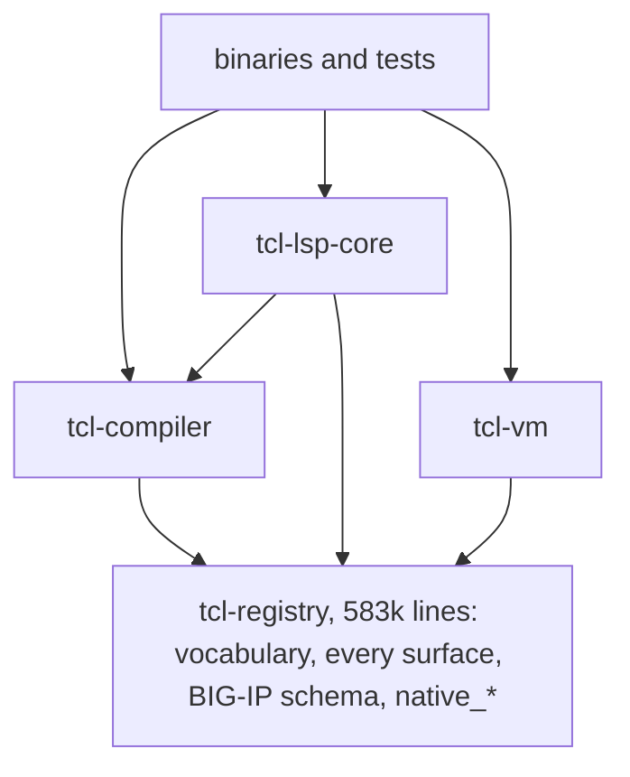
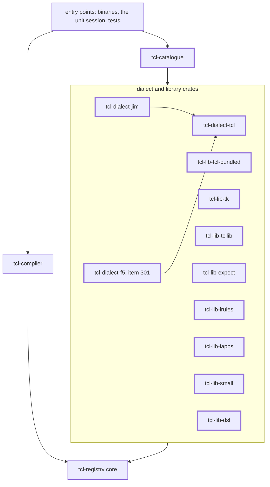

# Splitting tcl-registry: a core plus one crate per surface

Status: designed 26 November 2026. Plan item 261 leads it, with steps 262–265, each with its design in [`registry-split/`](registry-split/); items 117 and 118 have theirs there too. The crate units follow [dialects, libraries and environments](dialects-and-libraries.md) (items 301–307). Where this overview and a step design disagree, the step design holds.
It is a companion to [splitting tcl-compiler](../compiler/crate-split-design.md),
and runs ahead of the other stages for the same reason: build and iteration
time. It builds on the four-layer model in
[dialects, packages and environments](dialect-and-package-registry-redesign.md#0-the-model-in-four-layers).

## Problem

`tcl-registry` is 583k lines and sits under every Tcl-facing crate. The
registry rule sends every per-command fix there. As a result:

- An edit to one iRules command spec rebuilds `tcl-compiler` and the whole
  stack above it.
- Every worktree compiles all of it, whatever part of the stack it works on.

| Part | Lines | What it is |
|---|---|---|
| `commands/` | 185k | per-surface command data: `irules` 64k, `tcl` 48k, `tcllib` 27k, `tk` 22k, `stdlib` 12k, `expect`, `iapps`, `spectcl`, `sslictcl`, `bpf`, `thread`, `itcl`, `argparse`, `ticklecharts` |
| `bigip/`, `base_objects/`, `profile_defaults/` | 171k | BIG-IP schema data (item 118) |
| `f5/` | 5k | the f5-tcl evidence model, which `tcl-compiler` reads in 20 files; not schema, so item 301 moves it to `tcl-dialect` |
| `native_*` | 58k | interpreter algorithms (item 117a; 61k counts every file with `native` in its path) |
| the rest | ~163k | the vocabulary (`CommandSpec`, roles, arity, evaluation contexts, effects, forms, hooks), lookup and resolution, the dialect, package and environment glue; about 14k lines of surface data outside `commands/` (the definer grammars and the iRules event and profile tables), which moves with its surface; `value_transfer` and `resolved_invocation` (35k: item 117b moves their analysis driver to `tcl-analysis` and their per-command semantics to the surface crates) |

The command data is already one module per surface, behind
`commands::SpecPack { id, specs: fn() -> Vec<CommandSpec> }`. Two couplings
keep it inside the core:

1. **The surface list is in the core.** It is written out in six places
   that disagree (`SPEC_PACKS`, the `shared_group!` cells in `registry.rs`,
   `authored_groups`, `build_default`, `load_surface` and
   `compiled_command_names` in `registry/lookup.rs`), and Jim's surface comes
   in through a seventh door ([step 1](registry-split/01-surface-input.md)).
2. **The core calls into the Tcl surface: 52 references in 13 files**
   ([step 2](registry-split/02-behaviour-to-surfaces.md)).
   - `pack_hooks/native_catalogues.rs` maps hook names to `commands::tcl::fold_*`
     constant folds.
   - `native_try.rs` and `registry/control_arms.rs` read `NATIVE_TRY_GRAMMAR`,
     a fact the `try` spec already carries, so they need no registration.
   - `substitution.rs` reads `subst_::OPTIONS`.
   - `definer/property_accessors.rs` and `native_tcloo_info.rs` use TclOO kinds.
   - `native_compilation/*` reads the `if` shape checks.
   - `variable_output.rs`, `value_transfer/regex.rs` and `spec/subcommand.rs`
     call individual helpers.

   No surface names another surface: the `tcl` module has no reference to
   `irules` or `bigip`.

## Design

The crates follow [the target model](dialects-and-libraries.md): a registry
core, one crate per dialect, one crate per library package (owner decision,
26 November 2026), and a catalogue. The table below names the crates by
today's modules. Each row that holds several packages becomes one crate per
package: every tcllib package, each bundled Tcl library (http, msgcat,
tcltest, …), iApps and tmsh separately, and Itcl, Thread, argparse and
ticklecharts separately. After item 307 a package crate is an image plus its
hooks, so most of these crates are generated scaffolding.

| Crate | Takes today | Depends on |
|---|---|---|
| `tcl-registry` (core) | the vocabulary (`CommandSpec`, roles, arity, effects, forms, hooks API); the library, compatibility and environment model and its resolution; lookup over the dialects and libraries it is given | `tcl-dialect`, `tcl-lexer`, `tcl-syntax`, `tcl-core-types`, `tcl-cmd-core`, `tcl-runtime-api`, `tcl-regex` |
| `tcl-dialect-tcl` | `commands/tcl` (48k): the Tcl 8.4–9.1 core surface, its folds, grammars and hooks. The Jim and iRules logic that sits there today moves out. | core, `tcl-cmd-core` |
| `tcl-dialect-jim` | Jim's Rust rows (`commands/jim`, `definer/jim_source_stock.rs`). Jim's roster and own commands (today SpecTcl in `tcl-spectcl/core-surfaces`) join only after items 251 and 281 move the loader onto `tcl-source` | core, `tcl-dialect-tcl` (its roster narrows Tcl 8.6's surface) |
| `tcl-dialect-f5` | the f5-tcl core surface (the 8.4.6 fork as it ships in BIG-IP), for both builds; created by item 301, not by step 3 | core, `tcl-dialect-tcl` |
| `tcl-lib-tcl-bundled` | `commands/stdlib` (12k): http, msgcat, tcltest and the other libraries Tcl releases bundle | core |
| `tcl-lib-tk`, `tcl-lib-tcllib`, `tcl-lib-expect` | `commands/tk` (22k), `commands/tcllib` (27k) + `TCLLIB_MODULES`, `commands/expect` | core |
| `tcl-lib-irules` | `commands/irules` (64k), the iRules event and profile tables, and the iRules policy | core (no command spec reads the BIG-IP schema, so no edge to item 118's crate) |
| `tcl-lib-iapps` | `commands/iapps`: iApps and tmsh | core |
| `tcl-lib-small` | `itcl`, `thread`, `argparse`, `ticklecharts` (each under 1k lines); split further only if a measurement shows the need | core |
| `tcl-lib-dsl` | `spectcl`'s own vocabulary, `bpf` (a restricted library on tcl 9.0), `sslictcl` (internal; changed freely with its consumers) | core |
| `tcl-catalogue` | the shipped list of dialects and libraries, and the compiled-in environments | every dialect and library crate, and never `tcl-spectcl`, which would put `tcl-compiler` under it |

The EDA vendor libraries stay SpecTcl packs, in the root `specs/` directory,
loaded by `tcl-spectcl`.

Today every Tcl-facing crate sits on the whole registry:



After the split the surfaces sit beside the core, and only entry points
reach them, through the catalogue (one crate per package where the table
groups several):



### Rules

- **The core names no dialect or library.** It builds its tables from what it
  is given: `Registry::from_surfaces(&[Surface])`, where a `Surface` is a
  dialect's core surface or a library distribution. A `Surface` is today's
  `SpecPack` plus its hook table.
- **A surface's behaviour lives with its data.**
  - The `fold_*` folds, `NATIVE_TRY_GRAMMAR`, `subst_` options and TclOO kinds
    move into `tcl-dialect-tcl`, which registers them through its hook table.
  - Where one is a pure command kernel, it moves to `tcl-cmd-core` instead
    (item 81's plan).
- **The registry rule is unchanged.** Per-command knowledge lives in a dialect
  or library crate, which is still "the registry" for that rule.
  `registry-axes` treats those crates as registry.
- **Generic consumers depend on the core only.** `tcl-compiler` (and, after
  item 90, `tcl-binding`, `tcl-diagnostics` and the rest) depends on
  `tcl-registry`, never on a dialect or library crate.

  - Only entry points select surfaces: binaries, the unit crate's session, and
    tests. Entry points depend on `tcl-catalogue`, or on just the surfaces they
    need.
  - Tests of generic crates take `tcl-dialect-tcl`, or the surface they
    exercise, as a dev-dependency. No surface crate depends on a generic crate,
    so this causes no cascade (see step 0 of the compiler split).
- **Selection is explicit.** The process-wide registry is installed once by
  the entry point from the surfaces it links.
  - An uninstalled registry fails loudly rather than silently serving an empty
    table.
  - `tcl-catalogue` offers the full set; tests and isolated tools pass the subset
    they need.
  - Tests install it through a dev-only `ctor` macro, one line per test
    harness.

In `tcl-compiler`'s manifest the rules come to this. The line naming
`tcl-registry` is unchanged; what it names shrinks:

**Before:**

```toml
[dependencies]
tcl-registry = { path = "../tcl-registry" }   # the core and every surface
```

**After:**

```toml
[dependencies]
tcl-registry = { path = "../tcl-registry" }   # the core only

[dev-dependencies]
tcl-dialect-tcl = { path = "../tcl-dialect-tcl" }
```

### What it buys

| Edit | Rebuilds today | Rebuilds after |
|---|---|---|
| one iRules command spec | `tcl-registry`, `tcl-compiler` and everything above | `tcl-lib-irules`, `tcl-catalogue`, the binaries |
| one Tk spec | the same | `tcl-lib-tk`, `tcl-catalogue`, the binaries |
| the analyser | `tcl-compiler` and above | unchanged by this split; item 90 covers it |

A worktree on the analyser or binding compiles the registry core and
`tcl-dialect-tcl` (for tests), not about 356k lines of other surfaces' and
BIG-IP data.

## Steps

Each step has its design in [`registry-split/`](registry-split/), building
on the previous one. The tree may stay broken between steps. Gates and
failset comparisons run when the crates build again.

1. **Item 262: invert the surface list**
   ([design](registry-split/01-surface-input.md)).
   - The core takes surfaces as input, and the six copies of the list become
     one installed `Surface` set, assembled by the entry point.
   - Everything stays in one crate for now; this is the cut that makes the move
     possible.
2. **Item 263: move behaviour to its surface**
   ([design](registry-split/02-behaviour-to-surfaces.md)). The 52 core →
   `tcl` references in 13 files become hook-table registrations or move to
   `tcl-cmd-core`.
3. **Item 264: extract the dialect and library crates and `tcl-catalogue`**
   ([design](registry-split/03-extract-crates.md)). Every consumer is moved
   to the core plus the surfaces it names, and `registry-axes` is re-pointed.
   `tcl-dialect-f5` waits for item 301, and `tcl-dialect-jim` takes Jim's
   SpecTcl roster only after items 251 and 281.
4. **Item 265: dependency hygiene**
   ([design](registry-split/04-dependency-hygiene.md)). A gate rejects a generic crate's
   normal dependency on a surface crate. `tcl-compiler`'s cone (and after item
   90 each split crate's) contains no surface crate.

Items 117 (native algorithms out,
[design](registry-split/117-native-model.md)) and 118 (BIG-IP schema crate,
[design](registry-split/118-bigip-schema.md)) are independent of these steps
and can run in parallel; 117b waits for compiler-split item 255. Neither
`tcl-registry` nor any surface crate depends on 118's crate. The model changes (items 301–304) follow
step 3, because they change types the new crates already hold. Whether a library
crate holds Rust data or a SpecTcl-sourced image is decided by item 306.

## Risks

- **Install order.** Code that reads the registry before an entry point
  installs it. Mitigation: the loud failure above, and one test per entry point
  that it installs before first use.
- **Cross-surface helpers.** A surface that borrows another's helpers
  (f5-tcl's from Tcl) depends on that crate, never on a copy. Step 3 found no
  Tk helper borrowed from Tcl in today's code.
- **Lazy construction.** Today's lazily built, leaked spec groups keep their
  laziness per surface. The SpecTcl compiled-surface work
  ([plan](spectcl-compiled-surface-plan.md)) is unaffected, because it reads
  surfaces through the same core.
