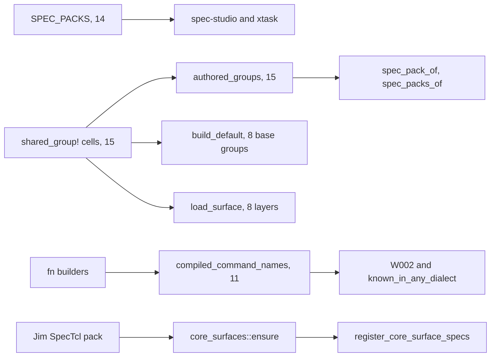
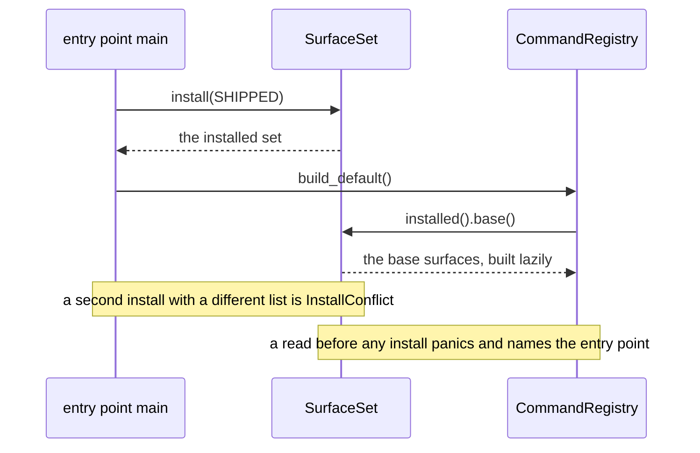

# Step 1: the registry takes its surfaces as input

Part of [splitting tcl-registry](../registry-split-design.md). Plan item 262,
step 1 of item 261. Nothing before it. [Step 2](02-behaviour-to-surfaces.md)
(item 263) builds on the `Surface` type and its hook table, and
[step 3](03-extract-crates.md) (item 264) moves each surface into its own crate.

Everything stays in `tcl-registry` in this step. It changes who names the
surfaces, not where they live.

## Problem

The list of shipped surfaces is written out by hand in six places, verified on
26 November 2026. They disagree.

| Place | What it lists |
|---|---|
| `SPEC_PACKS` (`commands/mod.rs:88`) | 14 packs, `thread` first, no `tmsh` |
| the `shared_group!` cells (`registry.rs:308–343`) | 15 cells: the 14 plus `tmsh_specs`, a filtered view of `iapps` |
| `authored_groups` (`registry.rs:444`) | the 15 cells again, `tcl` first; backs `spec_pack_of` and `spec_packs_of` |
| `build_default` (`registry/construction.rs:37`) | 8 always-loaded groups: `tcl`, `stdlib`, `tcllib`, `argparse`, `ticklecharts`, `itcl`, `thread`, `tk` |
| `load_surface` (`registry/construction.rs:90`) | 8 layers mapped from `SurfaceLayer`: `bpf`, `irules`, `iapps`, `tmsh`, `Tk`, `expect`, `spectcl`, `sslictcl` |
| `compiled_command_names` (`registry/lookup.rs:98`), W002's candidate source | 11 groups, rebuilt from the `fn` builders rather than the shared cells |

The disagreements a reader cannot see from any one place:

- `compiled_command_names` leaves out `thread`, `spectcl` and `sslictcl`. Only
  the `spectcl` omission has a comment saying why. `known_in_any_dialect`
  therefore answers `false` for `thread::send`, although every Tcl registry
  holds its spec.
- `spec_packs_by_name` documents its order as "`SPEC_PACKS` order", but it
  iterates `authored_groups`, whose order is different.
- Jim's core surface is not in any of the six. It is a SpecTcl pack that
  `tcl_spectcl::core_surfaces::ensure()` registers through a second door,
  `register_core_surface_specs` (`cache.rs:338`). If nothing calls `ensure()`,
  Jim silently loses its own commands. That is the failure this step must not
  copy.
- `xtask`'s `semantics_matrix.rs` and `tcl-spec-studio` keep further partial
  lists (5 packs, and `SPEC_PACKS` plus a path built from the pack id).

Each reader takes its own list, so nothing makes them agree:



The core also reads these lists from global state that no caller installs.
Every registry in the process starts from `CommandRegistry::build_default()`.
Outside `tcl-registry` there are 588 production calls to it and 1,305 in
tests, plus 666 inside the crate.

## Design

### The `Surface` type

A `Surface` is today's `SpecPack` plus the facts the four lists spread out:
how it is placed, its views, its hook table and its universe membership.

**Source:**

```rust
pub struct Surface {
    pub id: &'static str,               // "tcl", "irules"; the provenance key
    pub label: &'static str,
    pub blurb: &'static str,
    pub source_dir: &'static str,       // replaces spec-studio's path formula
    pub specs: SpecSource,
    pub placement: Placement,
    pub views: &'static [SurfaceView],  // tmsh over iapps
    pub hooks: &'static HookTable,      // empty in this step; filled by step 2
    pub document_grammar: Option<&'static DefinitionBodyGrammar>,
    pub in_universe: bool,              // counted by known_in_any_dialect
}

pub enum SpecSource {
    Built(fn() -> Vec<CommandSpec>),              // shipped Rust, built once and leaked
    Registered(fn() -> Vec<&'static CommandSpec>), // run-time sources (Jim's SpecTcl pack)
}

pub enum Placement {
    Base,                  // always loaded, as build_default does today
    Layer(SurfaceLayer),   // loaded when a profile's base_layers names it
}

pub struct SurfaceView { pub layer: SurfaceLayer, pub filter: fn(&CommandSpec) -> bool }
```

**In memory:**

```rust
// design sketch: types proposed above; labels and blurbs are today's SPEC_PACKS rows
Surface {
    id: "tcl",
    label: "Tcl core",
    blurb: "The core interpreter's own commands, across the 8.4-9.1 ladder.",
    source_dir: "rust/tcl-registry/src/commands/tcl",
    specs: SpecSource::Built(tcl::tcl_command_specs),
    placement: Placement::Base,
    views: &[],
    hooks: &HookTable::EMPTY,
    document_grammar: None,
    in_universe: true,
}
Surface {
    id: "iapps",
    label: "F5 iApps & tmsh",
    specs: SpecSource::Built(iapps::iapps_command_specs),
    placement: Placement::Layer(SurfaceLayer::Package("iapps")),
    views: &[SurfaceView { layer: SurfaceLayer::Package("tmsh"), filter: is_tmsh_spec }],  // today's tmsh_command_specs
    ..
}
```

The `shared_group!` cells become one cell per `Surface`, held by the installed
set. Laziness is kept: a surface's specs are built on first use and leaked
once.

### The constructor and the process-wide install

```rust
impl CommandRegistry {
    pub fn from_surfaces(surfaces: &[&'static Surface]) -> Self; // no global read
    pub fn build_default() -> Self; // == from_surfaces(installed().base())
}

pub struct SurfaceSet { /* surfaces, cells, universe index, provenance index */ }

pub fn install(surfaces: &'static [&'static Surface]) -> Result<&'static SurfaceSet, InstallConflict>;
pub fn installed() -> &'static SurfaceSet;          // panics if nothing is installed
pub fn try_installed() -> Option<&'static SurfaceSet>;
```

- `install` is idempotent for the same list. A second, different list is an
  `InstallConflict`, never a silent replacement: every cache in `cache.rs` and
  `model/assembly.rs` is keyed by profile and assumes one surface set per
  process.
- `installed()` panics with a message that names the entry point's duty and
  this document.


 It does not fall back to an empty table, and it does not fall
  back to "everything".
- `load_surface(layer)` looks the layer up in the installed set. An unknown
  layer keeps today's answer (`&[]`) only when no installed surface claims it.
- `SurfaceSet` owns the derived indexes that are built once from all
  surfaces: the W002 universe (`compiled_command_names`), the provenance
  index (`spec_pack_by_identity`, `spec_packs_by_name`), the iRules
  taint-source index and the safe-interpreter hidden list.
- Jim's run-time surface becomes a `SpecSource::Registered` surface that
  `tcl-spectcl` builds. `register_core_surface_specs` and its generation
  counter go away. `ensure()` also seeds Jim's rosters into `tcl-dialect`'s
  inherited-surface store, and the pack-reload path (`install.rs`
  `register_with`) re-seeds them. That roster half stays, and is called by the
  install instead of by each reader.

### Where the list lives in this step

One `SHIPPED: &[&Surface]` table in `commands/mod.rs` replaces `SPEC_PACKS`,
the cells and `authored_groups`. `build_default`, `load_surface` and
`compiled_command_names` stop naming packs and read the installed set instead.
In step 3 `SHIPPED` moves to `tcl-catalogue`. `tcl_registry::commands` keeps
no list.

### Every global read that needs an install

| Reader | Path | What it reads today |
|---|---|---|
| `build_default`, `load_surface` | `registry/construction.rs:37, 90` | the cells |
| `default_registry`, `registry_for_profile`, `registry_for_profile_if_built`, `registry_for_profile_with_overlay`, `build_profile_store` | `cache.rs:93, 138, 188, 244, 268` | `build_default` |
| `registry_for_environment`, `_if_built`, `_with_surfaces` | `model/assembly.rs:594, 616, 631` | `build_profile_store` |
| `context_for_profile`, `static_context_for*`, `irules_context` | `model/ingress.rs:432–618` | the two above |
| `known_in_any_dialect`, `command_names_in_any_dialect`, `providers_in_any_dialect` | `registry/lookup.rs:98–349` | `compiled_command_names` |
| `spec_pack_of`, `spec_packs_of` | `registry.rs:404–490` | `authored_groups` |
| `fixed_math_function_metadata` | `registry.rs:313`, from `mathfunc.rs:621` | `tcl_specs()` directly |
| `taint_source` | `registry/irules.rs:88–129` | a `const` index over `IRULES_SPECS` |
| `safe_interp_hidden_commands` | `cache.rs:501` | `build_default` |
| `core_surface_for`, `private_registry_with_core_surface` | `cache.rs:375, 449` | the Jim side door |
| `SPEC_PACKS`, `SpecPack::by_id` | spec-studio `lib.rs:201, 287`; `xtask` `evaluation_contexts.rs:33` | the pack list |

The taint-source index changes kind: today a compile-time `const` array over
iRules specs, after this step an index built once at install from every
surface's `taint_source`. This drops a direct `commands::irules` reference
from the core.

### Entry points

Each of these installs once, before its first registry read.

| Entry point | Kind | Surfaces it needs |
|---|---|---|
| `tcl-lsp-server`, `tcl-lsp-server-wasm`, `tcl-lsp-server-wasi`, `tcl` (`tcl-cli`), `tcl-mcp` | binaries and WASM hosts | all |
| `f5-query` (`f5-cli`), `bigip-report-gen` (and its python and wasm builds), `bigip-query-wasm` | binaries | tcl, irules, iapps, tmsh |
| `bpf-tcl` | binary | tcl, bpf |
| `tclvm` (`tcl-vm-cli`), `tcl-vm-wasm`, `tcl-debug` | binaries | tcl, Jim |
| `tcl-runtime` (`runtime/rust`, cdylib and staticlib) | library artefact | tcl, Jim (after item 117a: none) |
| `tcl-fuzz`, `tcl-irule-test` | binaries | tcl, Jim, irules |
| `sslictcl-data` | binary | tcl, sslictcl |
| `tcl-spec-studio-wasm`, `tcl-explorer-wasm` | WASM hosts | all |
| `xtask` | binary | all |
| test harnesses | about 173 targets in the 33 crates that reach `tcl-registry` | see below |

The libraries that only run inside one of these (`tcl-engine-tclvm`,
`tcl-engine-wasm`, `tcl-cshim`) do not install. The overview's "the unit
crate's session" means the same: the session receives the installed set from
its binary and never selects one itself.

### How tests get a registry

- **A test that needs one fixed set** builds it with
  `CommandRegistry::from_surfaces(&[...])` and touches no global. This is the
  form for new tests and for any test that wants a subset.
- **The existing 1,971 `build_default` call sites in tests** keep working once
  their harness has installed. Each test harness installs once, at start-up,
  with a single line:
  `tcl_registry::testing::install_shipped!();` in this step, and
  `tcl_catalogue::testing::install!(...)` from step 3 on. The macro expands to
  a `ctor` start-up function in the harness, so it runs once per process. That
  covers both `cargo test` (one process per binary) and nextest (one process
  per test).
- `ctor` is a new dev-only dependency, reached only through the `testing`
  macro. It costs one line per harness (about 173) instead of an edit at each
  of the 1,971 sites.
- A harness that installs two different sets fails at start-up with
  `InstallConflict`.

A test file changes by one line per harness, not per test:

**Before:**

```rust
#[test]
fn lsort_is_known() {
    let registry = CommandRegistry::build_default();
    assert!(registry.get("lsort").is_some());
}
```

**After:**

```rust
tcl_registry::testing::install_shipped!();   // once, at the top of the harness

#[test]
fn lsort_is_known() {
    let registry = CommandRegistry::build_default();
    assert!(registry.get("lsort").is_some());
}
```

## Decisions

1. **`build_default` keeps its name.** It becomes "the base surfaces of the
   installed set". Renaming 2,559 call sites buys nothing in this step, and
   the panic message says where the set comes from. `from_surfaces` is the
   explicit form.
2. **The install is global, not passed down.** Several hundred `&'static
   CommandRegistry` users (`cache.rs:128`) depend on one registry per profile
   for the process. Threading a surface set through every caller is item 286's
   database work, not this step's.
3. **The universe membership is a field, not a rule.** `in_universe = false`
   records the `spectcl` and EDA decisions in data. `thread` and `sslictcl`
   get `true` and `false` explicitly (open question 1).
4. **No silent fallback.** An empty registry gives wrong answers that look
   right (every command unknown), which is the Jim `ensure()` failure. A panic
   on first use is found by the entry point's own test.

## Open questions

1. Should `thread` and `sslictcl` count in the W002 universe? Today they do
   not. Settled by one fixture calling `thread::send` under `f5-irules` and
   `tcl8.6` without `package require Thread`, the diagnostics it draws today,
   and the owner's choice. The
   step reproduces today's answer until the owner decides.
2. Does a `ctor` start-up run before `tracing` or allocator set-up in any
   harness that cares? Settled by running the `tcl-registry` and
   `tcl-compiler-it` suites under nextest with the macro in place.

## Work list

1. Add `Surface`, `SpecSource`, `Placement`, `SurfaceView`, an empty
   `HookTable`, `SurfaceSet`, `install`, `installed`, `try_installed` and
   `from_surfaces` in a new `registry/surfaces.rs`.
2. Replace `SPEC_PACKS` and `SpecPack` with `SHIPPED: &[&Surface]`
   (`commands/mod.rs`). Give `iapps` its `tmsh` view and `spectcl` and
   `sslictcl` their document grammars.
3. Rewrite `build_default` and `load_surface` over the installed set. Delete
   the `shared_group!` macro and the 15 cells (`registry.rs:280–343`).
4. Move `compiled_command_names`, `spec_pack_by_identity`, `spec_packs_by_name`,
   `authored_groups`, `TAINT_SOURCE_INDEX` and `safe_interp_hidden_commands`
   onto `SurfaceSet`. `fixed_math_function_metadata` reads the `tcl` surface
   from it.
5. Give Jim's SpecTcl surface a `Surface` in `tcl-spectcl`. Delete
   `register_core_surface_specs` and `core_surface_generation`. The 42
   `ensure()` calls (36 of them in `tcl-compiler`'s and `tcl-spectcl`'s tests)
   become installs or `from_surfaces`.
6. Add the install to each entry point in the table above. Add the `testing`
   macro and the line to each harness.
7. Re-point `tcl-spec-studio` (`lib.rs:201, 210, 287, 293`) and `xtask`
   (`evaluation_contexts.rs`, `semantics_matrix.rs`) at the installed set and
   `Surface::source_dir`.

## Verification

- **Same answers.** A test enumerates, for every profile in the catalogue, the
  `(name, spec identity)` pairs visible in `registry_for_profile`, and
  `known_in_any_dialect` over every shipped name. Its output on the base
  commit and on this step is identical, apart from changes the owner accepts
  under open question 1.
- **Loud failure.** A test that calls `build_default` in a process with no
  install panics with the documented message. A test per entry point checks
  that it installs before its first registry read.
- **One list.** `rg 'commands::(tcl|irules|tk|tcllib|stdlib|bpf|iapps|expect|thread|itcl|spectcl|sslictcl|argparse|ticklecharts)::[a-z_]+_command_specs'`
  outside `commands/` returns only the `SHIPPED` table.
- **Failsets** for `tcl-registry`, `tcl-compiler` and `tcl-lsp-core` match the
  base commit (`failset.py compare`).
- **Measured:** start-up time of `tcl-lsp-server` to its first diagnostic,
  before and after. The lazy cells are kept, so it should not move.

## Risks

- **A reader before the install.** A `static` initialiser or a `LazyLock` in a
  consumer that builds a registry (`xtask`'s `audit_option_dialects.rs:682` is
  one) runs before `main` installs. Mitigation: the panic names the reader.
  The entry-point tests exercise the first read.
- **Two sets in one process.** A harness with mixed tests that each want a
  subset. Mitigation: `InstallConflict` at start-up, and `from_surfaces` for
  the subset.
- **Behaviour hidden in the lists.** The order of `authored_groups` decides
  `spec_packs_of`'s order. The table keeps the `authored_groups` order, which
  is the one the answers come from.

## Corrections to the overview

- The overview names two copies of the list (`registry.rs` and `lookup.rs`),
  and the task names four. There are six (table above), and Jim's surface
  has a seventh door.
- The core's dependencies also include `tcl-core-types` and `tcl-regex`
  (`Cargo.toml`), which the overview's table leaves out.
