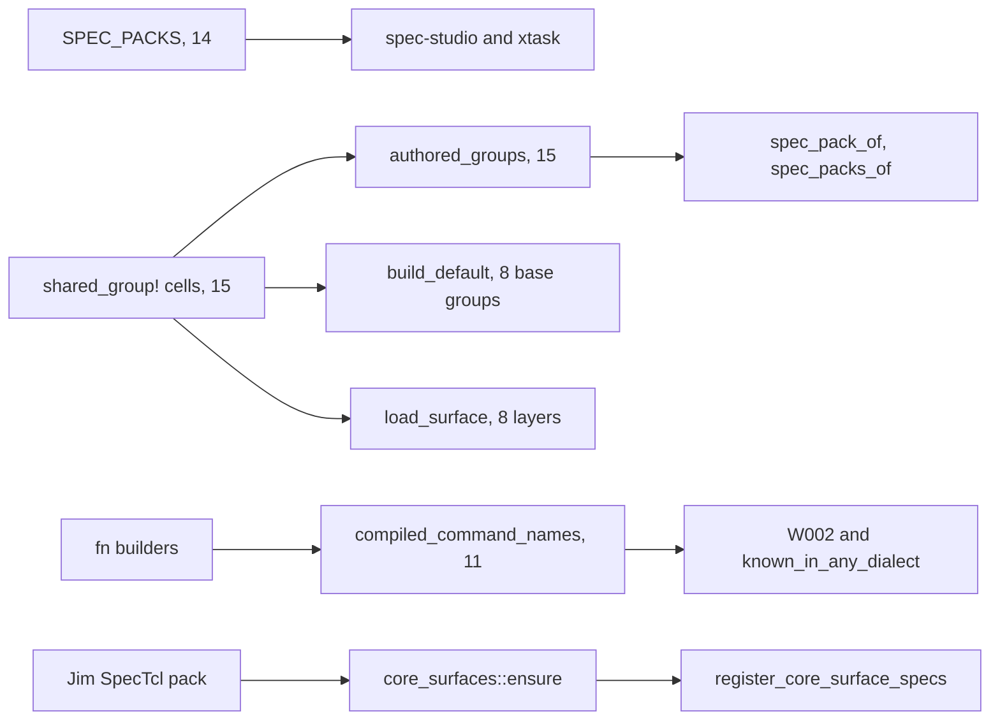
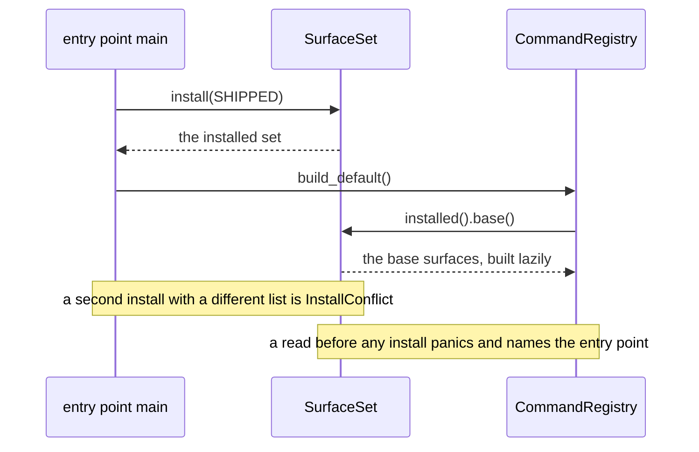

# Step 1: the registry takes its surfaces as input

Part of [splitting tcl-registry](../registry-split-design.md). Plan item 262,
step 1 of item 261. Nothing before it. [Step 2](02-behaviour-to-surfaces.md)
(item 263) builds on the `Surface` type and its hook table, and
[step 3](03-extract-crates.md) (item 264) moves each surface into its own crate.

Everything stays in `tcl-registry` in this step. It changes who names the
surfaces, not where they live.

## Problem

The list of shipped surfaces is written out by hand in six places, verified on
26 November 2026. They disagree.

| Place | What it lists |
|---|---|
| `SPEC_PACKS` (`commands/mod.rs:88`) | 14 packs, `thread` first, no `tmsh` |
| the `shared_group!` cells (`registry.rs:308–343`) | 15 cells: the 14 plus `tmsh_specs`, a filtered view of `iapps` |
| `authored_groups` (`registry.rs:444`) | the 15 cells again, `tcl` first; backs `spec_pack_of` and `spec_packs_of` |
| `build_default` (`registry/construction.rs:37`) | 8 always-loaded groups: `tcl`, `stdlib`, `tcllib`, `argparse`, `ticklecharts`, `itcl`, `thread`, `tk` |
| `load_surface` (`registry/construction.rs:90`) | 8 layers mapped from `SurfaceLayer`: `bpf`, `irules`, `iapps`, `tmsh`, `Tk`, `expect`, `spectcl`, `sslictcl` |
| `compiled_command_names` (`registry/lookup.rs:98`), W002's candidate source | 11 groups, rebuilt from the `fn` builders rather than the shared cells |

The disagreements a reader cannot see from any one place:

- `compiled_command_names` leaves out `thread`, `spectcl` and `sslictcl`. Only
  the `spectcl` omission has a comment saying why. `known_in_any_dialect`
  therefore answers `false` for `thread::send`, although every Tcl registry
  holds its spec.
- `spec_packs_by_name` documents its order as "`SPEC_PACKS` order", but it
  iterates `authored_groups`, whose order is different.
- Jim's core surface is not in any of the six. It is a SpecTcl pack that
  `tcl_spectcl::core_surfaces::ensure()` registers through a second door,
  `register_core_surface_specs` (`cache.rs:338`). If nothing calls `ensure()`,
  Jim silently loses its own commands. That is the failure this step must not
  copy.
- `xtask`'s `semantics_matrix.rs` and `tcl-spec-studio` keep further partial
  lists (5 packs, and `SPEC_PACKS` plus a path built from the pack id).

Each reader takes its own list, so nothing makes them agree:



The core also reads these lists from global state that no caller installs.
Every registry in the process starts from `CommandRegistry::build_default()`.
Outside `tcl-registry` there are 588 production calls to it and 1,305 in
tests, plus 666 inside the crate.

## Design

### The `Surface` type

A `Surface` is today's `SpecPack` plus the facts the four lists spread out:
how it is placed, its views, its hook table and its universe membership.

**Source:**

```rust
pub struct Surface {
    pub id: &'static str,               // "tcl", "irules"; the provenance key
    pub label: &'static str,
    pub blurb: &'static str,
    pub source_dir: &'static str,       // replaces spec-studio's path formula
    pub specs: SpecSource,
    pub placement: Placement,
    pub views: &'static [SurfaceView],  // tmsh over iapps
    pub hooks: &'static HookTable,      // empty in this step; filled by step 2
    pub document_grammar: Option<&'static DefinitionBodyGrammar>,
    pub in_universe: bool,              // counted by known_in_any_dialect
}

pub enum SpecSource {
    Built(fn() -> Vec<CommandSpec>),              // shipped Rust, built once and leaked
    Registered(fn() -> Vec<&'static CommandSpec>), // run-time sources (Jim's SpecTcl pack)
}

pub enum Placement {
    Base,                  // always loaded, as build_default does today
    Layer(SurfaceLayer),   // loaded when a profile's base_layers names it
}

pub struct SurfaceView { pub layer: SurfaceLayer, pub filter: fn(&CommandSpec) -> bool }
```

**In memory:**

```rust
// design sketch: types proposed above; labels and blurbs are today's SPEC_PACKS rows
Surface {
    id: "tcl",
    label: "Tcl core",
    blurb: "The core interpreter's own commands, across the 8.4-9.1 ladder.",
    source_dir: "rust/tcl-registry/src/commands/tcl",
    specs: SpecSource::Built(tcl::tcl_command_specs),
    placement: Placement::Base,
    views: &[],
    hooks: &HookTable::EMPTY,
    document_grammar: None,
    in_universe: true,
}
Surface {
    id: "iapps",
    label: "F5 iApps & tmsh",
    specs: SpecSource::Built(iapps::iapps_command_specs),
    placement: Placement::Layer(SurfaceLayer::Package("iapps")),
    views: &[SurfaceView { layer: SurfaceLayer::Package("tmsh"), filter: is_tmsh_spec }],  // today's tmsh_command_specs
    ..
}
```

The `shared_group!` cells become one cell per `Surface`, held by the installed
set. Laziness is kept: a surface's specs are built on first use and leaked
once.

### The constructor and the process-wide install

```rust
impl CommandRegistry {
    pub fn from_surfaces(surfaces: &[&'static Surface]) -> Self; // no global read
    pub fn build_default() -> Self; // == from_surfaces(installed().base())
}

pub struct SurfaceSet { /* surfaces, cells, universe index, provenance index */ }

pub fn install(surfaces: &'static [&'static Surface]) -> Result<&'static SurfaceSet, InstallConflict>;
pub fn installed() -> &'static SurfaceSet;          // panics if nothing is installed
pub fn try_installed() -> Option<&'static SurfaceSet>;
```

- `install` is idempotent for the same list. A second, different list is an
  `InstallConflict`, never a silent replacement: every cache in `cache.rs` and
  `model/assembly.rs` is keyed by profile and assumes one surface set per
  process.
- `installed()` panics with a message that names the entry point's duty and
  this document.
- **This global is interim.** The target owner of the surface set is the
  registry generation (item 47; [integration
  § 1](../../compiler/compiler-analyser-spectcl-integration.md#the-interface)):
  one `SurfaceSet` per `Generation`, so a user-pack reload builds a new
  generation instead of a second `install`. Once step 14 removes the global
  caches, `install` and `installed()` survive only in entry points, as
  `install_host` does, and no generic crate calls them.


 It does not fall back to an empty table, and it does not fall
  back to "everything".
- `load_surface(layer)` looks the layer up in the installed set. An unknown
  layer keeps today's answer (`&[]`) only when no installed surface claims it.
- `SurfaceSet` owns the derived indexes that are built once from all
  surfaces: the W002 universe (`compiled_command_names`), the provenance
  index (`spec_pack_by_identity`, `spec_packs_by_name`), the iRules
  taint-source index and the safe-interpreter hidden list.
- Jim's run-time surface becomes a `SpecSource::Registered` surface that
  `tcl-spectcl` builds. `register_core_surface_specs` and its generation
  counter go away. `ensure()` also seeds Jim's rosters into `tcl-dialect`'s
  inherited-surface store, and the pack-reload path (`install.rs`
  `register_with`) re-seeds them. That roster half stays, and is called by the
  install instead of by each reader.

### Where the list lives in this step

One `SHIPPED: &[&Surface]` table in `commands/mod.rs` replaces `SPEC_PACKS`,
the cells and `authored_groups`. `build_default`, `load_surface` and
`compiled_command_names` stop naming packs and read the installed set instead.
In step 3 `SHIPPED` moves to `tcl-catalogue`. `tcl_registry::commands` keeps
no list.

### Every global read that needs an install

| Reader | Path | What it reads today |
|---|---|---|
| `build_default`, `load_surface` | `registry/construction.rs:37, 90` | the cells |
| `default_registry`, `registry_for_profile`, `registry_for_profile_if_built`, `registry_for_profile_with_overlay`, `build_profile_store` | `cache.rs:93, 138, 188, 244, 268` | `build_default` |
| `registry_for_environment`, `_if_built`, `_with_surfaces` | `model/assembly.rs:594, 616, 631` | `build_profile_store` |
| `context_for_profile`, `static_context_for*`, `irules_context` | `model/ingress.rs:432–618` | the two above |
| `known_in_any_dialect`, `command_names_in_any_dialect`, `providers_in_any_dialect` | `registry/lookup.rs:98–349` | `compiled_command_names` |
| `spec_pack_of`, `spec_packs_of` | `registry.rs:404–490` | `authored_groups` |
| `fixed_math_function_metadata` | `registry.rs:313`, from `mathfunc.rs:621` | `tcl_specs()` directly |
| `taint_source` | `registry/irules.rs:88–129` | a `const` index over `IRULES_SPECS` |
| `safe_interp_hidden_commands` | `cache.rs:501` | `build_default` |
| `core_surface_for`, `private_registry_with_core_surface` | `cache.rs:375, 449` | the Jim side door |
| `SPEC_PACKS`, `SpecPack::by_id` | spec-studio `lib.rs:201, 287`; `xtask` `evaluation_contexts.rs:33` | the pack list |

The taint-source index changes kind: today a compile-time `const` array over
iRules specs, after this step an index built once at install from every
surface's `taint_source`. This drops a direct `commands::irules` reference
from the core.

### Entry points

Each of these installs once, before its first registry read.

| Entry point | Kind | Surfaces it needs | Hook runner (D-I) |
|---|---|---|---|
| `tcl-lsp-server`, `tcl` (`tcl-cli`, which also serves the native Spec Studio), `tcl-mcp` | binaries | all | linked |
| `tcl-lsp-server-wasm`, `tcl-lsp-server-wasi` | WASM hosts | all | not linked: tabulated answers only |
| `f5-query` (`f5-cli`), `bigip-report-gen` (and its python and wasm builds), `bigip-query-wasm` | binaries | tcl, irules, iapps, tmsh | not linked |
| `bpf-tcl` | binary | tcl, bpf, linux-ebpf | not linked |
| `tclvm` (`tcl-vm-cli`), `tcl-vm-wasm`, `tcl-debug` | binaries | link `tcl-catalogue-core` and install tcl and Jim at interpreter creation; no library facts ([334 §3](../model/334-spectcl-codegen-vm-runtime.md#3-what-each-engine-installs-and-where-accelerators-report)) | the VM is the engine itself |
| `tcl-runtime` (`runtime/rust`: cdylib, staticlib, WASI) | library artefact | links `tcl-catalogue-core` and installs tcl and Jim at interpreter creation (334 §3); a compiled WASM program links no catalogue and gets a per-module fact projection from codegen | — |
| `tcl-fuzz`, `tcl-irule-test` | binaries | tcl, Jim, irules | not linked |
| `sslictcl-data` | binary | tcl, sslictcl | not linked |
| `tcl-spec-studio-wasm`, `tcl-explorer-wasm` | WASM hosts | all (the explorer installs the server's set) | Studio: linked, for the author tier; explorer: not linked |
| `xtask` | binary | all | not linked |
| test harnesses | about 173 targets in the 33 crates that reach `tcl-registry` | see below | only the hook crates' own tests |

The libraries that only run inside one of these (`tcl-engine-wasm`,
`tcl-cshim`) do not install a registry. `tcl-engine-tclvm` installs the
same as `tclvm` (tcl and Jim from `tcl-catalogue-core`, at interpreter
creation), with library facts from its host's `SurfaceSet` (334 §3). The
overview's "the unit crate's session" means the same: the session receives
the installed set from its binary and never selects one itself.

**How the engines get facts (D-B).** No engine links `tcl-catalogue`, which
would embed tcllib's 214 images, iRules and Tk in every compiled program.
`tcl-catalogue-core` embeds only the Tcl and Jim core images. Library facts
the engines read (`errorclass` rows, taint sinks, `LIBRARY_UNITS`,
`library_versions`) reach `tcl-engine-tclvm` through its host's installed
`SurfaceSet` (standalone `tclvm` installs none), and reach a compiled WASM program as the
projection codegen stamps into the module. `cargo xtask-backing command-backing`
reads the core image's `runtime_backing` rows and asks `Interp::backing_report`
and `Vm::backing_report` as before. Today the engines read
`tcl_registry::default_registry()` at run time (`runtime/rust/src/cmd_namespace.rs:239`,
`tcl-vm/src/cmd_namespace.rs:277`) and register builtins from
`&CommandSpec` (`registration.rs:180`); item 291 moves those reads to the
installed core image.

### How tests get a registry

- **A test that needs one fixed set** builds it with
  `CommandRegistry::from_surfaces(&[...])` and touches no global. This is the
  form for new tests and for any test that wants a subset.
- **The existing 1,971 `build_default` call sites in tests** keep working once
  their harness has installed. Each test harness installs once, at start-up,
  with a single line:
  `tcl_registry::testing::install_shipped!();` in this step, and
  `tcl_registry::testing::install!(...)` from step 3 on (the module stays in
  the core, unconditional; step 4, rule 1). The macro expands to
  a `ctor` start-up function in the harness, so it runs once per process. That
  covers both `cargo test` (one process per binary) and nextest (one process
  per test).
- `ctor` is a new dev-only dependency, reached only through the `testing`
  macro. It costs one line per harness (about 173) instead of an edit at each
  of the 1,971 sites.
- A harness that installs two different sets fails at start-up with
  `InstallConflict`.

A test file changes by one line per harness, not per test:

**Before:**

```rust
#[test]
fn lsort_is_known() {
    let registry = CommandRegistry::build_default();
    assert!(registry.get("lsort").is_some());
}
```

**After:**

```rust
tcl_registry::testing::install_shipped!();   // once, at the top of the harness

#[test]
fn lsort_is_known() {
    let registry = CommandRegistry::build_default();
    assert!(registry.get("lsort").is_some());
}
```

## Decisions

1. **`build_default` keeps its name.** It becomes "the base surfaces of the
   installed set". Renaming 2,559 call sites buys nothing in this step, and
   the panic message says where the set comes from. `from_surfaces` is the
   explicit form.
2. **The install is global, not passed down.** Several hundred `&'static
   CommandRegistry` users (`cache.rs:128`) depend on one registry per profile
   for the process. Threading a surface set through every caller is item 286's
   database work, not this step's.
3. **The universe membership is a field, not a rule.** `in_universe = false`
   records the `spectcl` and EDA decisions in data. `thread` and `sslictcl`
   get `true` and `false` explicitly (open question 1).
4. **No silent fallback.** An empty registry gives wrong answers that look
   right (every command unknown), which is the Jim `ensure()` failure. A panic
   on first use is found by the entry point's own test.

## Open questions

1. Should `thread` and `sslictcl` count in the W002 universe? Today they do
   not. Settled by one fixture calling `thread::send` under `f5-irules` and
   `tcl8.6` without `package require Thread`, the diagnostics it draws today,
   and the owner's choice. The
   step reproduces today's answer until the owner decides.
2. Does a `ctor` start-up run before `tracing` or allocator set-up in any
   harness that cares? Settled by running the `tcl-registry` and
   `tcl-compiler-it` suites under nextest with the macro in place.

## Work list

1. Add `Surface`, `SpecSource`, `Placement`, `SurfaceView`, an empty
   `HookTable`, `SurfaceSet`, `install`, `installed`, `try_installed` and
   `from_surfaces` in a new `registry/surfaces.rs`.
2. Replace `SPEC_PACKS` and `SpecPack` with `SHIPPED: &[&Surface]`
   (`commands/mod.rs`). Give `iapps` its `tmsh` view and `spectcl` and
   `sslictcl` their document grammars.
3. Rewrite `build_default` and `load_surface` over the installed set. Delete
   the `shared_group!` macro and the 15 cells (`registry.rs:280–343`).
4. Move `compiled_command_names`, `spec_pack_by_identity`, `spec_packs_by_name`,
   `authored_groups`, `TAINT_SOURCE_INDEX` and `safe_interp_hidden_commands`
   onto `SurfaceSet`. `fixed_math_function_metadata` reads the `tcl` surface
   from it.
5. Give Jim's SpecTcl surface a `Surface` in `tcl-spectcl`. Delete
   `register_core_surface_specs` and `core_surface_generation`. The 42
   `ensure()` calls (36 of them in `tcl-compiler`'s and `tcl-spectcl`'s tests)
   become installs or `from_surfaces`.
6. Add the install to each entry point in the table above. Add the `testing`
   macro and the line to each harness.
7. Re-point `tcl-spec-studio` (`lib.rs:201, 210, 287, 293`) and `xtask`
   (`evaluation_contexts.rs`, `semantics_matrix.rs`) at the installed set and
   `Surface::source_dir`.

## Verification

- **Same answers.** A test enumerates, for every profile in the catalogue, the
  `(name, spec identity)` pairs visible in `registry_for_profile`, and
  `known_in_any_dialect` over every shipped name. Its output on the base
  commit and on this step is identical, apart from changes the owner accepts
  under open question 1.
- **Loud failure.** A test that calls `build_default` in a process with no
  install panics with the documented message. A test per entry point checks
  that it installs before its first registry read.
- **One list.** `rg 'commands::(tcl|irules|tk|tcllib|stdlib|bpf|iapps|expect|thread|itcl|spectcl|sslictcl|argparse|ticklecharts)::[a-z_]+_command_specs'`
  outside `commands/` returns only the `SHIPPED` table.
- **Failsets** for `tcl-registry`, `tcl-compiler` and `tcl-lsp-core` match the
  base commit (`failset.py compare`).
- **Measured:** start-up time of `tcl-lsp-server` to its first diagnostic,
  before and after. The lazy cells are kept, so it should not move.

## Risks

- **A reader before the install.** A `static` initialiser or a `LazyLock` in a
  consumer that builds a registry (`xtask`'s `audit_option_dialects.rs:682` is
  one) runs before `main` installs. Mitigation: the panic names the reader.
  The entry-point tests exercise the first read.
- **Two sets in one process.** A harness with mixed tests that each want a
  subset. Mitigation: `InstallConflict` at start-up, and `from_surfaces` for
  the subset.
- **Behaviour hidden in the lists.** The order of `authored_groups` decides
  `spec_packs_of`'s order. The table keeps the `authored_groups` order, which
  is the one the answers come from.

## Corrections to the overview

- The overview names two copies of the list (`registry.rs` and `lookup.rs`),
  and the task names four. There are six (table above), and Jim's surface
  has a seventh door.
- The core's dependencies also include `tcl-core-types` and `tcl-regex`
  (`Cargo.toml`), which the overview's table leaves out.

## Review fixes (26 November 2026)

- **R4:** the process-wide `install` is interim; the surface set's owner is the generation, one per `Generation` (chapter 7's naming table).

## Review fixes (26 November 2026, deep review)

- **E5, C4, O11 (D-B):** the entry-point table gives the engines `tcl-catalogue-core`'s images at interpreter creation and a codegen projection for WASM programs; *How the engines get facts* adds the `command-backing` source.
- **C8 (D-I):** the table gains a hook-runner column.
- **New:** the test macro from step 3 on is `tcl_registry::testing::install!`, not `tcl_catalogue::testing` (R2/R6 had left this line stale).
- **Engine fixer handoff (D-B):** the engine rows follow 334 §3.

## As built (27 November 2026)

What landed, in two commits on `work`, and where it departs from the design
above.

**Built as designed.** `registry/surfaces.rs` holds `Surface`, `SpecSource`,
`Placement`, `SurfaceView`, an empty `HookTable`, `SurfaceSet`, `install`,
`installed`, `try_installed` and `InstallConflict`, re-exported at the crate
root with `CommandRegistry::from_surfaces`. `commands::SHIPPED` is the one
list; `SPEC_PACKS`, `SpecPack`, the `shared_group!` cells, `authored_groups`,
`compiled_command_names`, `TAINT_SOURCE_INDEX` and `tmsh_command_specs` are
gone. `build_default` is `from_surfaces(installed().base())`; `load_surface`
asks the installed set which surface claims the layer; the W002 universe, the
two provenance indexes, the taint-source index (now built from every
installed surface) and the safe-interpreter hidden list are `SurfaceSet`
indexes; `fixed_math_function_metadata` reads the `tcl` surface. Spec Studio
and `xtask` (`evaluation_contexts`, `semantics_matrix`, `audit_option_dialects`)
and `xtask-backing` read the installed set and `Surface::source_dir`. Every
binary and example installs first in `main`; the WASM hosts install in their
`start` function or constructor, the Python module in its init, and
`runtime/rust` and `tcl-vm-wasm` at interpreter creation unless the host has
installed. About 200 test harnesses carried `tcl_registry::testing::install_shipped!()` (replaced in part 3, below),
and the doctests of `tcl-registry`, `tcl-compiler` and `tcl-lsp-core` a hidden
`install_shipped()` line. A read before any install panics with
`surfaces::NOT_INSTALLED`.

**Decisions taken where the design was silent or wrong against the code.**

1. *No `ctor`.* The workspace sets `unsafe_code = "forbid"`, and `ctor`'s
   expansion carries `#[allow(unsafe_code)]`, which a `forbid` rejects
   (E0453). The `testing` macro places the start-up function in the
   platform constructor section itself (`.init_array`, `__mod_init_func`,
   `.CRT$XCU`), as `ctor` does. The lint is not reported inside an external
   macro's expansion, so harnesses compile under the `forbid`; inside
   `tcl-registry` the macro cannot be used, and the crate's own unit tests
   install `SHIPPED` on the first `installed()` under `cfg(test)`. This is a
   life-before-main hook the `forbid` does not see; the owner should confirm
   it or choose another mechanism before step 3 relies on it. A harness with
   a conflicting second install aborts at start-up with the conflict.
   Superseded: the owner rejected the hook, and the test-install fallback
   below replaced it.
2. *The cell lives in the `Surface`.* Each `Surface` and `SurfaceView` is a
   `static` with a `SpecCell`, so `from_surfaces` builds no copy and reads no
   global, and a subset registry shares the leaked specs.
3. *`Placement::BaseLayer`.* Tk is loaded by every default build and also
   counts the `Tk` layer as loaded; a third variant says so. Layers are
   claimed by provider, so `SurfaceLayer::Core(F5Irules, _)` at any release
   finds the iRules surface, as the old `match` did.
4. *The tmsh view filters by name* (`tmsh::` prefix) over the iApps
   surface's own specs, so the tmsh layer's specs are now the very iApps
   specs rather than a second leaked copy.
5. *Provenance covers built surfaces only*, as `authored_groups` did; a
   `Registered` surface reports no pack.
6. *`SHIPPED` order is the old `authored_groups` order* (`tcl` first), so
   `spec_packs_of` and the default build are unchanged. Spec Studio's pack
   list now follows it too (`thread` moved from first to after `itcl`).
7. *Universe order.* The universe now adds surfaces in `SHIPPED` order, so
   the `providers` and `rows` vectors of `providers_in_any_dialect` list
   `bpf` and `expect` in a different position for five names (`close`,
   `loop`, `map`, `next`, `send`). Membership is unchanged, the only reader
   tests membership, and `dialect_names_for_rows` sorts before it renders.
8. *Engines.* `runtime/rust` and `tcl-vm-wasm` install `SHIPPED` when nothing
   is installed, standing in for `tcl-catalogue-core` until item 291.
9. *Done-when glob.* The plan's `--glob '!commands/**'` matches nothing under
   `rust/tcl-registry/src`; the check is run as `--glob '!**/commands/**'`.

**Verification.**

- *Same answers:* a throwaway test dumped, for the default registry and every
  catalogue profile, each name's specs (provenance and a digest of the spec's
  `Debug` with addresses removed), the document grammar, and for every name
  `known_in_any_dialect`, `providers_in_any_dialect`, `taint_source` and
  `spec_packs_of`, plus the hidden list. Base and this step differ only in
  decision 7's five lines (53,671 lines compared).
- *Loud failure:* `tcl-registry/tests/install_contract.rs` (no harness
  install) checks the panic message, `from_surfaces` without an install,
  idempotence and `InstallConflict`.
- *Entry points:* `tests/installs_surfaces.rs` in `tcl-cli`, `f5-cli`,
  `tcl-vm-cli`, `tcl-debugger` and `bpf-tcl` run the binary from a harness
  that installs nothing. With `tclvm`'s install removed the test fails with
  the not-installed message.
- *Failsets:* `tcl-registry` (lib, integration, examples) and
  `tcl-spec-studio` fail the same tests as the base commit.
- `cargo clippy --workspace --all-targets -D warnings`, `cargo fmt --check`
  and `make xtask-gates` pass (the `memo-type` ledger is updated).

**Build cost** of an edit to one spec (`commands/tcl/lsort_.rs`) followed by
`cargo test -p tcl-compiler --no-run`, warm target, `CARGO_INCREMENTAL=0`:

| | crates rebuilt | seconds |
|---|---|---|
| before | 3 (`tcl-registry`, `tcl-vm`, `tcl-compiler`) | 392 |
| after | 3 (the same) | 415 |

The step moves no code between crates, so the cost is unchanged by design
(the 6% difference is within run-to-run noise on this shared machine); steps
263 and 264 are what move it.

**Not done in this step.** Jim's side door and the remaining entry-point
tests were done next (below).

- Open question 1 stands: `thread` and `sslictcl` keep `in_universe: false`.

## As built, part 3 onward (27 November 2026)

**Jim's side door is gone (work list 5).** `Placement::Family` is a fourth
placement: never in a default build, and in a registry assembled for a
document whose environment has a core family, the specs with a core row for
that family (`SurfaceSet::family_specs`). `tcl_spectcl::core_surfaces::JIM` is
a `Registered` surface with that placement, counted in the W002 universe and
absent from provenance, as before. `tcl_spectcl::core_surfaces::SURFACES` is
`SHIPPED` plus `JIM`, and `core_surfaces::install()` installs it.
`register_core_surface_specs`, `core_surface_generation`,
`register_builtin_commands` and `core_surfaces::ensure` are deleted, and with
them the core-surface generation in the promotion, generation and
core-surface-store cache keys: the installed set does not change in a
process. A `Surface` gains `on_install`, run once by the first install of a
list that holds it; Jim's seeds its rosters into the dialect model, which is
the roster half of the old `ensure`. Pack publication still folds the rosters
in with each set's own.

Every entry point that links `tcl-spectcl` installs `SURFACES`: `tcl`,
`tcl-lsp-server` (its `initialize` handler no longer seeds anything),
`tcl-mcp`, `xtask`, the two `tcl-spectcl` examples, and the WASM and WASI
hosts of the server, the explorer and Spec Studio (which gain a direct
`tcl-spectcl` dependency; CI-verified, this container has no
`wasm32-unknown-unknown` target). The rest install `SHIPPED` as before. A
process that links `tcl-spectcl` but installs `SHIPPED` has no Jim commands
and no Jim rosters; that is the entry point's choice, not a reader's.

**The Jim tests install their own list.** `tcl-spectcl/tests/jim/` and
`tcl-compiler-it/tests/jim/` are harnesses with no start-up install: each test
installs `SURFACES` first. The `tcl-spectcl` Jim modules moved there from
`it_2` and `it_4`; the `tcl-compiler-it` `spectcl_seeded_tests!` bodies moved
from `it_4`. `tcl-registry/tests/family_surface.rs` installs `SHIPPED` plus a
probe family surface and replaces the registry's own core-surface unit tests
(the pack-row ranking test stays a unit test over the store builder).

**Ordering rule.** A process installs one list. A test that needs a list
other than its harness's lives in a harness whose every test installs that
list before its first registry read; a second, different install is an
`InstallConflict`.

**Entry-point tests (work list 6).** `tests/installs_surfaces.rs` now also
exists for `tcl-lsp-server` (initialize, open a document, wait for its
diagnostics), `tcl-mcp` (call `analyze`), `tcl-fuzz` (`bpf-diff`, one
iteration), `sslictcl-data` (`testssl-to-dsl` on the shared sample),
`bigip-report-gen` (a configuration with an iRule, `--json`; built with
`cli`), `xtask` (`evaluation-contexts --check`) and `xtask-backing`
(`command-backing --check`). Each runs the binary from a harness that
installs nothing. The WASM and Python hosts are CI-verified. Every
`installs_surfaces`, `install_contract`, `family_surface` and `jim` harness is
in `scripts/dev/rust-test-binary-shards.tsv`.

**The test-install fallback (part 3).** The owner rejected the
constructor-section hook. A dev-only `testing` cargo feature was measured
first and rejected too: with `module-layers`' duplicate measure over the 39
workspace crates whose harnesses carried the hook line, every crate in
`tcl-lsp-server`'s cone that reaches `tcl-registry` (17 of 17) would be built
twice, once with the feature for tests and once without for the binary; 15
of 15 for `xtask` (so `make xtask-gates` after a test run would rebuild the
compiler stack) and 16 of 16 for `tcl`. Resolver 2 also turns a
dev-dependency feature on in the binaries a package's own tests run, so the
`installs_surfaces` tests could not have seen a missing install.

What landed instead has no cargo feature. When nothing is installed,
`installed()` installs `SHIPPED` if `TCL_REGISTRY_TEST_INSTALL` is set and
not empty, and panics with `NOT_INSTALLED` otherwise. The repository's
`.cargo/config.toml` sets the variable in `[env]`, so every cargo-run
process gets it: `cargo test`, nextest and doctests need no harness line and
build nothing twice. The hook, the `testing` module, the 223 harness lines
and the hidden doctest installs are gone, and so is the crate's own
`cfg(test)` install. A test that needs another list installs it itself (the
ordering rule above), and the fallback's `SHIPPED` install then conflicts
with nothing.

- *The checks still see a missing install.* Every `installs_surfaces` test
  starts its binary with the variable removed (checked: with `xtask-backing`'s
  install taken out its test fails with `NOT_INSTALLED`, as does `tcl`'s).
  `tcl-registry/tests/install_contract.rs` runs each case in a child process
  of its own harness, with the variable removed and with it set.
- *`cargo run` falls back too.* A binary run through cargo (`cargo run`,
  `cargo xtask`) installs `SHIPPED` on an uninstalled read, so in everyday
  development a missing install in an entry point shows only in that entry
  point's `installs_surfaces` test, and an entry point that installs another
  list (`tcl_spectcl::core_surfaces::SURFACES`) gets `SHIPPED` instead if it
  reads before installing. A test binary run directly, outside cargo, has no
  fallback and panics with `NOT_INSTALLED`.
- *Release bundles have no fallback.* The owner required that a release
  bundle cannot contain it, so a stray variable cannot turn it on. Every
  bundle builds with the `release` profile: the native binaries
  (`cargo build --release` in `build-server-matrix` and the Makefile's
  cross targets), the WASM and WASI hosts (`build-wasm.sh`/`build-wasi.sh`,
  `wasm-pack --release`), and the Python module (`maturin build --release`);
  the `ci` profile, which inherits `release`, builds only the extension
  suite's server. None turns `debug-assertions` on, so the fallback and the
  variable's name are under `cfg(debug_assertions)` and are not compiled
  into a bundle. `make check-release-install-guard` runs the install contract
  under `--release` with the variable set and fails if a release build still
  installs; `build-server-matrix` runs it on its `linux-x64` server leg.
