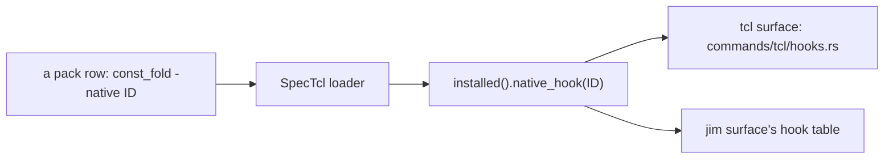
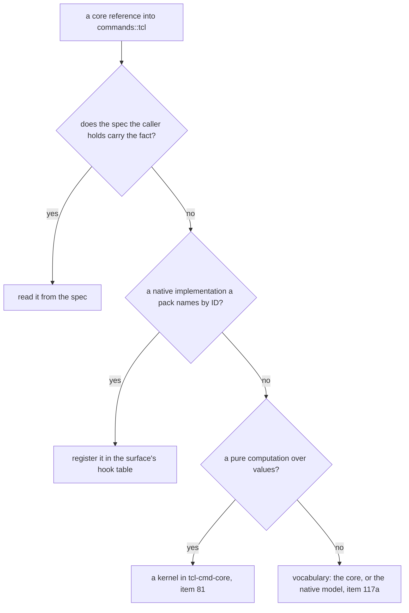

# Step 2: behaviour moves to its surface

Part of [splitting tcl-registry](../registry-split-design.md). Plan item 263,
step 2 of item 261. Builds on [step 1](01-surface-input.md) (item 262), which
gives every `Surface` an empty `HookTable`. [Step 3](03-extract-crates.md)
(item 264) builds on it: once no core module names `commands::*`, each surface
can leave the crate.

Everything still stays in `tcl-registry`. The test of this step is a grep: no
module outside `commands/` names a surface module.

## Problem

After step 1 removes the surface lists, the core still calls into
`commands::tcl` by name. Counted on 26 November 2026 with
`rg 'commands::' --glob '!commands/**'` over `rust/tcl-registry/src`,
excluding comments and the lists step 1 removes, there are 52 references in
13 files.

| Reference | Site | Count |
|---|---|---|
| `fold_*` constant folds | `pack_hooks/native_catalogues.rs:59–265` | 35 (24 unversioned, 11 versioned) |
| `TclOoPropertyKind` | `definer/property_accessors.rs:139, 160, 204` | 3 |
| `subst_::OPTIONS` | `substitution.rs:340, 431` | 2 |
| `NATIVE_TRY_GRAMMAR` | `native_try.rs:136`, `registry/control_arms.rs:157` | 2 |
| `native_if_shape_error`, `native_if_compile_shape_message` | `native_compilation/grammar_selection.rs:737`, `word_selection.rs:553` | 2 |
| `IRULES_SPECS` | `registry/irules.rs:88, 102` | 2 (removed by step 1) |
| `InfoOoEnsembleKind` | `native_tcloo_info.rs:30` | 1 |
| `scan_::fold_scan` | `variable_output.rs:91` | 1 |
| `regsub_names_a_callback` | `value_transfer/regex.rs:369` | 1 |
| `fold_is_jim` | `spec/subcommand.rs:740` | 1 |
| `bpf_conditional_operands` | `registry/lookup.rs:473` | 1 |
| `STATIC_DISPLAY_*` (7 constants) | `source_navigation/static_display.rs:21` | 1 |

Two more groups are the same fault without the `commands::` spelling:

- **Tcl behaviour written in core modules.**
  - `native_catalogues.rs` also registers 26 list and dict folds from
    `literal_folds.rs` (655 lines).
  - It registers `proc`'s state-transition resolver from
    `state_transition::command_binding`.
- **Callers outside the crate.**
  - `bpf-tcl-ir` calls `commands::thread::is_thread_command`
    (`lower.rs:830`), which rebuilds the whole Thread spec vector on every call
    (`commands/thread/mod.rs:800`).
  - The VM, the runtime, `tcl-compiler` and `tcl-lsp-core` name 12 items in
    `commands::tcl` (listed in [step 3](03-extract-crates.md#consumer-rewrites)).

No surface names another surface. The only cross-module references inside
`commands/` are to `closed_evidence`, the shared generator output (`tcl` and
`tcllib`, two each).

## Design

### The hook table

`HookTable` holds the native implementations a surface ships, one slice per
hook family, keyed by the `SCOPE::FIELD` ids SpecTcl's `-native ID` already
uses (`pack_hooks.rs`, `HOOK_FAMILIES`, 13 families):

**Source:**

```rust
pub struct HookTable {
    pub const_fold: &'static [(&'static str, ConstFoldFn)],
    pub const_fold_versioned: &'static [(&'static str, VersionedConstFoldFn)],
    pub state_transition_resolver: &'static [(&'static str, StateTransitionResolver)],
    // ... one slice per HookFamily, as native_catalogues.rs has today
    pub static_display: Option<&'static StaticTclSourceDisplay>,
}

impl SurfaceSet {
    pub fn native_hook<F: HookFamilyFn>(&self, id: &str) -> Option<F>;
}
```

**In memory:**

```rust
// design sketch: the tcl surface's table; the ids and functions are today's
// rows in tcl-registry/src/pack_hooks/native_catalogues.rs
HookTable {
    const_fold: &[
        ("list::const_fold", literal_folds::fold_list),
        ("lindex::const_fold", literal_folds::fold_lindex),
        ("llength::const_fold", literal_folds::fold_llength),
        ("regsub::const_fold", commands::tcl::fold_regsub),
        ..
    ],
    const_fold_versioned: &[..],
    state_transition_resolver: &[..],
    ..
    static_display: None,
}
// native_hook::<ConstFoldFn>("llength::const_fold") -> Some(fold_llength)
```

`native_catalogues.rs` becomes the Tcl surface's table,
`commands/tcl/hooks.rs`. `pack_hooks` keeps the types, the slot machinery and
the lookup. The SpecTcl loader resolves `-native ID` through
`installed().native_hook`, not through the `tcl_registry::pack_hooks::*_NATIVE`
constants. That changes three loader sites: `loader/command/body_statements.rs:742`,
`loader/subcommand.rs:640` and `catalogue.rs:478–529`.

A pack's `-native ID` then resolves through the installed set:



A shipped Rust spec does not go through the table. It holds its function
pointers directly (`const_fold: Some(fold_cat)`), so moving the table changes
nothing for the 185k lines of shipped Rust specs.

### Where each reference goes

The rule, in order: if the spec the caller already holds carries the fact,
read it from the spec. If it is a native implementation a pack names by id,
register it in the surface's hook table. If it is a pure computation over
values, it is a kernel in `tcl-cmd-core` (item 81). If it is a type several
crates name, it is vocabulary and moves to the core or, for the runtime's
types, to the native model (item 117a).

The rule as a flow:



| Reference | Becomes | Reason |
|---|---|---|
| 35 `fold_*`, 26 `literal_folds`, `proc`'s resolver | registrations in `commands/tcl/hooks.rs` | They exist only to answer `-native ID`. |
| the fold bodies | thin policy wrappers over `tcl-cmd-core` | Six already call it (case maps, comparisons, `scan_match`, `string_is`). The bounds and ASCII-only refusals are fold policy and stay with the surface. The string `first`, `last`, `index`, `totitle`, `replace` and `format` computations and `literal_folds`' list and dict operations move to `tcl-cmd-core` under item 81, whose done-when wants no `const_fold.rs` in the registry. |
| `NATIVE_TRY_GRAMMAR` | read from the caller's `try` spec: `spec.clause_grammar` (`try_.rs:201`) | The spec already carries it. `selected_try_control_invocation` and `native_try::layout` take the spec. |
| `subst_::OPTIONS` | read from the `subst` spec's `options` (`subst_.rs:345`) | The same: `compiler_template_kinds` is called with the spec in hand. |
| `if` shape checks | read from the `if` spec's `clause_shape_check` (`if_.rs:280`) | The checker is already on the spec. Its `ClauseShapeError` gains the compile-time message `native_if_compile_shape_message` builds today, so one hook answers both callers. |
| `bpf_conditional_operands` | a `conditional_operands` registration in the Tcl hook table, reached through the spec whose `bpf_op` is `Conditional` | It projects `if`'s operand layout for BPF. Open question 2. |
| `fold_scan` in `variable_output.rs` | `tcl_cmd_core::scan::scan_literal` | It is the scan kernel over literals. `fold_scan` becomes a wrapper over it. |
| `regsub_names_a_callback` | internal to the surface | Its caller, `RegsubSemantics` (`value_transfer/regex.rs`), is `regsub`'s own value semantics and moves into `commands/tcl/regsub_` with it. Item 117b follows the same rule. |
| `fold_is_jim` | a `const_fold_versioned` on Jim's own `string is` row | It removes the `Family::Jim` test from `spec/subcommand.rs:734`, a generic module. |
| `TclOoPropertyKind` | core vocabulary, in `definer::property_accessors` | The core, `tcl-compiler`, `tcl-lsp-core`, the VM and the runtime all name it. |
| `InfoOoEnsembleKind`, `info_oo_subcommands` | `native_tcloo_info` | Only that module, the VM and the runtime use them: they are runtime protocol, and item 117a carries them out. |
| `STATIC_DISPLAY_*` | `HookTable::static_display` | It is Tcl surface data a generic display reads. Deriving it from the `proc`, TclOO and `regexp` specs is left for later (open question 3). |
| `is_thread_command` in `bpf-tcl-ir` | a trait on the Thread specs, asked through the universe index | `bpf-tcl-ir` already asks `Traits::COROUTINE_PRIMITIVE` the same way (`lower.rs:262`). A new `Traits::THREAD_PRIMITIVE`, set on the Thread specs, answers `providers_in_any_dialect(cmd)`. The BPF registry need not load Thread. |

`try` shows the first branch. `native_try.rs` names the grammar the `try`
spec already holds (`try_.rs:201`, `clause_grammar: Some(&GRAMMAR)`), so the
function takes the spec instead:

**Before:**

```rust
fn layout(
    words: InvocationWords<'_>,
    dialect: InvocationDialect,
) -> Option<crate::TryControlInvocation> {
    let plan = crate::commands::tcl::NATIVE_TRY_GRAMMAR
        .walk_arguments(
            words.arguments().with_dialect(dialect),
            &[],
            dialect.authoring_query(),
        )?
        .ok()?;
```

**After:**

```rust
fn layout(
    spec: &CommandSpec,
    words: InvocationWords<'_>,
    dialect: InvocationDialect,
) -> Option<crate::TryControlInvocation> {
    let plan = spec
        .clause_grammar?
        .walk_arguments(
            words.arguments().with_dialect(dialect),
            &[],
            dialect.authoring_query(),
        )?
        .ok()?;
```

### The Jim and iRules logic inside `commands::tcl`

| What | Where | Goes to |
|---|---|---|
| ten `jim_spec()` rows | `catch_`, `concat_`, `error_`, `expr_`, `interp`, `lappend_`, `namespace_`, `package_`, `regexp_`, `source_` | the Jim surface, `commands/jim/` |
| Jim's own commands: `info_jim.rs` (1,154 lines), `jim_arithmetic.rs`, `jim_loop.rs` | `commands/tcl/` | `commands/jim/`, except the runtime protocol types below |
| `NativeJimInfo*`, `NativeJimCommandInventory*`, `NativeJimVariableInventoryKind` (`info_jim.rs`), `NativeJimExistsKind` (`exists_.rs:26`) | named by the VM (21 sites) and the runtime (22) | `native_jim_*` beside `native_jim_lookup`, then the native model (item 117a) |
| `fold_is_jim` | `string_/is_classes.rs:43` | the Jim surface's hook table |
| 49 `ALL_TCL_AND_IRULES` and 9 `SpecSurface::core(Family::F5Irules)` rows | 46 files | stay as data on the Tcl specs (decision 3) |

The Jim surface is a `Placement::Base` surface, like `tcl`, so every registry
holds the same Jim rows as today. Its rows still need their `SpecSurface`
windows to be visible only under Jim.

### What this step leaves for step 3

Other core modules are surface data even though they never spell
`commands::`. They need no code change in this step, only a destination, which
[step 3](03-extract-crates.md#module-assignment) assigns: the class-system
grammars in `definer/`, the iRules event and profile tables, `tk_geometry`,
`model/tcllib.rs`, the special-variable rows and `value_transfer`'s `irules`
and `tcllib` semantics.

## Decisions

1. **Read from the spec before registering.** Three of the references
   (`try`, `subst`, `if`) are facts the spec already holds. A registration
   would state them twice.
2. **Fold policy stays with the surface; computation goes to the kernel.** A
   fold's refusals (output caps, ASCII-only, a 10,000 repeat bound) say when a
   compile-time answer is safe for a command. That is per-command knowledge
   under the registry rule. The computation is not, and `tcl-cmd-core` already
   holds most of it.
3. **The f5-tcl rows stay on the Tcl specs.** They state the f5-tcl/tmm core
   surface, which is today's Tcl rows plus a family. A separate f5-tcl roster is
   item 301's model change. Moving the rows now would change visibility
   answers in a step that must keep them.
4. **Jim's runtime types go to the native model, not to the Jim surface.** The
   VM and the runtime execute Jim, and a generic engine may not depend on a
   dialect crate (item 265).

## Open questions

1. Can `literal_folds`' list and dict folds call `tcl-cmd-core`'s list and
   dict kernels unchanged? Settled by the `lists-dicts-arrays/folds/` rows and
   `constants/execution.tsv` giving identical results across 8.4–9.1 (item
   81's done-when).
2. Does a walk of `if`'s clause grammar already give the operand positions
   `bpf_conditional_operands` computes? If it does, the registration is
   unnecessary. Settled by comparing both over every `bpf-tcl-ir` test input.
3. Can the static display be derived from the specs? Settled by a test
   comparing the derived lists with today's seven constants.

## Work list

1. Add `HookTable` and `SurfaceSet::native_hook`. Move
   `native_catalogues.rs` to `commands/tcl/hooks.rs`, and attach it to the
   `tcl` surface.
2. Re-point the SpecTcl loader and `catalogue.rs` at `native_hook`.
   `catalogue.rs` builds its picker lists at run time from the installed set,
   because a `const` block cannot read another crate's table after step 3.
3. Pass the resolved spec to `native_try::layout`,
   `selected_try_control_invocation`, `compiler_template_kinds`,
   `subst_switches` and the two `native_compilation` shape checks. Widen
   `ClauseShapeError` with the compile message.
4. Move `TclOoPropertyKind` to `definer::property_accessors`, and
   `InfoOoEnsembleKind` and `info_oo_subcommands` to `native_tcloo_info`.
5. Move `scan_literal` into `tcl-cmd-core`. Move `RegsubSemantics` into
   `commands/tcl/regsub_`.
6. Create `commands/jim/`. Move the ten `jim_spec()` rows, `info_jim`,
   `jim_arithmetic`, `jim_loop` and `fold_is_jim` into it. Move the native Jim
   protocol types to `native_jim_*`.
7. Add `Traits::THREAD_PRIMITIVE` to the Thread specs. Rewrite
   `bpf-tcl-ir/src/lower.rs:830`, and delete `is_thread_command`.
8. Move `STATIC_DISPLAY_*` into the Tcl surface's `static_display`.
9. Item 81's kernel moves for the fold bodies, one family at a time.

## Verification

- **Done when** `rg 'commands::' rust/tcl-registry/src --glob '!commands/**'`
  finds only the `SHIPPED` table and comments, and
  `rg 'commands::' rust/bpf-tcl-ir` finds nothing.
- **Same answers.**
  - The fold rows (`constants/folds/`, `constants/execution.tsv`) and the
    native-compilation tests give identical results.
  - `tcl-spectcl`'s `native_hook_tables_cover_their_catalogues` passes with
    the tables in their new home.
  - The registry-snapshot tests (`registry/registry_snapshot_tests.rs`) are
    unchanged.
- **Failsets** for `tcl-registry`, `tcl-spectcl`, `tcl-compiler` and
  `bpf-tcl-ir` match step 1's (`failset.py compare`).
- **Measured.** BPF lowering time over `bpf-tcl`'s test corpus, before and
  after. Dropping the per-call spec rebuild in `is_thread_command` should
  lower it.

## Risks

- **A fold whose spec path differs from its id path.** A SpecTcl pack names
  `string::range::const_fold`. The table keeps the ids byte for byte, and the
  loader test above fails on any mismatch.
- **Jim rows that depended on sharing a file.** The `jim_spec()` rows reuse
  constants from their Tcl twins. Those constants become `pub(crate)` in the
  Tcl module now, and the Jim crate's dependency on `tcl-dialect-tcl` in step 3
  makes that edge explicit.

## Corrections to the overview

- The overview's "about 60 sites" is 52 references in 13 files. The difference
  is the surface lists, which step 1 removes. `variable_output.rs`,
  `value_transfer/regex.rs` and `spec/subcommand.rs` each have one.
- The overview groups `native_try.rs` and `registry/control_arms.rs` with the
  registrations. Both read a fact the `try` spec already carries, so neither
  needs a registration.

## As built (27 November 2026)

**Recount.** On the base of this step,
`rg 'crate::commands::' rust/tcl-registry/src --glob '!**/commands/**'` found
52 references in 14 files: the 51 of the table above less `IRULES_SPECS`
(gone with step 1) plus the test-install fallback's `crate::commands::SHIPPED`
in `registry/surfaces.rs`, which step 1 added. The 35 folds,
`TclOoPropertyKind` (3), `subst_::OPTIONS` (2), `NATIVE_TRY_GRAMMAR` (2), the
two `if` checks, `InfoOoEnsembleKind`, `fold_scan`,
`regsub_names_a_callback`, `fold_is_jim`, `bpf_conditional_operands` and
`STATIC_DISPLAY_*` were all still there. After this step the grep finds
nothing, and `rg 'commands::' rust/bpf-tcl-ir` finds nothing. (As in step 1,
the plan's `--glob '!commands/**'` matches nothing under that root, so the
check runs with `--glob '!**/commands/**'`.)

**What moved where.**

| Reference | Now |
|---|---|
| `pack_hooks/native_catalogues.rs` (35 `fold_*`, 26 `literal_folds`, `proc`'s resolver) | `commands/tcl/hooks.rs`, the Tcl surface's `HOOKS`. The file is gone; `pack_hooks` keeps the types, the slots and `TaintSinkGateFn`. |
| the 15 `*_NATIVE` tables | slices of `HookTable` (`registry/surfaces.rs`), one per `-native ID` family; `SurfaceSet::native_hook(id, family)` and `native_hook_ids(family)` look across the installed set |
| SpecTcl loader (`native_fold`, `semantics::native_id`) | `tcl_registry::installed().native_hook(id, \|table\| table.FAMILY)` |
| `tcl_spectcl::catalogue::*_NATIVE` | `catalogue::*_native()`, built once at run time from the installed set; the label lists stay in the catalogue |
| `NATIVE_TRY_GRAMMAR` (`native_try.rs`, `registry/control_arms.rs`) | `HookTable::try_clauses`, read with `installed().try_clauses()` |
| `native_if_shape_error`, `native_if_compile_shape_message`, `bpf_conditional_operands` | `HookTable::conditional` (`ConditionalClauseHooks`: `shape_error`, `compile_message`, `condition_bodies`), the `if_.rs` functions registered |
| `STATIC_DISPLAY_*` | one `StaticDisplayRecipe` (`source_navigation`), registered as `HookTable::static_display` |
| `subst_::OPTIONS` | `substitution::SUBST_OPTIONS` with `SUBST_NEGATED_FAMILY` / `SUBST_POSITIVE_FAMILY`; the `subst` spec imports them |
| `TclOoPropertyKind`, `TclOoPropertyOption`, their two tables and `resolve_tcloo_property_*` | `definer::property_accessors`, re-exported from `definer` |
| `InfoOoEnsembleKind` | `native_tcloo_info`; `info_oo_subcommands` stays in `info_.rs` |
| `fold_scan`'s body | `tcl_cmd_core::scan::scan_literal`; `fold_scan` and `variable_output.rs` call it |
| `fold_is_jim`, `legacy_double_class` | `tcl_cmd_core::string_is::jim_literal_class` and `legacy_double_class`; `spec/subcommand.rs` calls the kernel |
| `regsub_names_a_callback` | `RegsubSemantics::new(names_a_callback)`: the static `REGSUB` lives in `regsub_.rs` and hands the route its callback test |
| `is_thread_command` (`bpf-tcl-ir/src/lower.rs`) | `Traits::THREAD_PRIMITIVE` on every Thread spec, asked through `SurfaceSet::traits_in_any_surface`; `is_thread_command` is deleted |
| the fallback's `crate::commands::SHIPPED` | `crate::install_shipped()` |

`commands::tcl` re-exports the moved TclOO and `info` types from their new
homes, so the VM, `tcl-compiler` and `tcl-lsp-core` compile unchanged; step 3
rewrites those consumers.

**Where this departs from the design.**

1. *`try` and `if` are registrations, not reads from the spec.* The design
   assumed the callers hold the spec. They do not: `native_try::select`,
   `conditional_grammar` and `failure_for_selection_with_source` are reached
   from `NativeCompilationSpec`'s public methods (`select`,
   `select_for_facts`, `compiled_bodies`, `body_context_for_invocation_operand`
   and the others), which take only the `NativeCompilationSpec` and are
   called from about 225 sites in the compiler, the VM and the tests;
   `selected_try_control_invocation` is public and called from
   `script_body_flow`. Threading the `CommandSpec` through would change that
   whole API, and putting the grammar in `NativeCompilationGrammar::Try`'s
   payload would need `Hash` on the clause-grammar types and rewrite every
   pattern and test that names the variant. So the native `try` and `if`
   compilers' facts are registered once, by the Tcl surface, keyed by the
   compiler they serve. `it_5/surface_hooks.rs` holds the registration to
   the specs: every installed spec whose native grammar is `Try` has exactly
   the registered clause grammar, and the registered `if` shape check agrees
   with the `if` spec's `clause_shape_check`. `ClauseShapeError` is not
   widened.
2. *`bpf_conditional_operands`* is the `condition_bodies` registration
   rather than a walk of the spec's grammar (open question 2 stays open; the
   registered function is that walk, of `if`'s grammar).
3. *`subst_::OPTIONS` moved to the core.* `compiler_template_kinds` and
   `NativeSubstitutionOptions::kinds` (called by the VM) do not hold the
   `subst` spec either. The table is the native substitution protocol's
   switch table, which `NativeSubstitutionOptions` already spelled in the
   core, so it is core vocabulary (the design's fourth branch).
4. *`RegsubSemantics` stays in `value_transfer::regex`* with the route
   machinery it shares with `regexp`; only the surface's callback test moved,
   as a constructor argument. Moving the type would have widened a dozen
   `value_transfer` internals.
5. *`fold_is_jim`* went to `tcl-cmd-core` as a kernel, not to a Jim hook
   table: the Jim surface (work list 6) is not built in this step, so the
   `Family::Jim` test in `spec/subcommand.rs` stays.
6. *`traits_in_any_surface`* is a new `SurfaceSet` index (the union of every
   installed spec's traits by unrooted name), because the Thread surface is
   not in the W002 universe (`in_universe: false`), so
   `providers_in_any_dialect` cannot answer for it. It is built once, where
   `is_thread_command` rebuilt the Thread spec vector on every call.
7. *`HookTable::native_hook`* takes the family as a field selector
   (`|table| table.const_fold`), not a type parameter: two families share a
   function-pointer type, so a type cannot pick the slice.

8. *Definition-body grammars are `static`s.* `tcl-lsp-core` matches a
   selected grammar against an expected one by address (`std::ptr::eq` in
   `source_structure/command_bodies.rs`, `definition_grammar.rs` and
   `declaration_outline.rs`), but `TCLOO_GRAMMAR` and the other
   `DefinitionBodyGrammar` items were `const`s, and each `&CONST` is a
   promoted copy whose address the compiler need not share. Moving code in
   this step changed how those copies were merged, and
   `references::tests::self_dispatch_scan::idx63_two_block_class_my_dispatch_already_fixed_by_idx52`
   started failing; a probe that only added an unrelated function did not.
   Every `DefinitionBodyGrammar` item in `definer/` is now a `static`, so
   each has one address.

**Not done in this step.** Work list 6 (the `commands/jim/` surface, the ten
`jim_spec()` rows, `info_jim`, `jim_arithmetic`, `jim_loop`, the native Jim
protocol types) and work list 9 (item 81's kernel moves for the remaining
fold bodies) are left open; neither is needed for the done-when grep. The
BPF lowering-time measurement was not taken.

**Verification.**

- *Contract tests on the public API* (`tcl-registry/tests/it_5/surface_hooks.rs`):
  the `try` registration matches every `try` spec and selects a literal
  `try` call's clauses; the `if` registrations agree with the `if` spec's
  clause check, give the C 8.4 compile message and BPF's condition/body
  pairs through `CommandRegistry::bpf_conditional_operands`; a `-native` id
  resolves to the shipped folder and runs, unknown ids and wrong families
  resolve to nothing, and no id is registered twice; the static display
  reads the registered recipe; Thread commands, rooted or not, are
  `THREAD_PRIMITIVE` in the installed set and others are not.
- *The loader through the table*: `tcl-spectcl`'s
  `a_native_fold_id_installs_the_shipped_folder` (unchanged) loads
  `const_fold -native` and `const_fold_versioned -native` ids through
  `native_hook`; `native_hook_catalogues_are_the_installed_registrations`
  replaces `native_hook_tables_cover_their_catalogues` and also requires a
  picker label for every registered id, which gave ten ids that had none
  (`lsort::const_fold` and nine `const_fold_versioned` rows) their labels. The semantics
  loader's `a_native_id_a_table_holds_installs_its_value`, which called the
  private `native_id` with a synthetic table, is deleted: no shipped
  `semantics` id exists, and the shared lookup is covered above.
- *Failsets* (`scripts/dev/failset.py`, lib harnesses, against a baseline at
  `767b4dc6`): `tcl-registry`, `tcl-spectcl`, `tcl-compiler` (skipping the
  known stack-overflow scaling test) and `tcl-lsp-core`
  (`RUST_MIN_STACK=67108864`) fail exactly the baseline's tests: no new
  failures, none fixed. The integration harnesses this step touches pass
  (`tcl-registry` `it_5::surface_hooks`, `family_surface`,
  `install_contract`; `bpf-tcl`'s `diagnostics`, which rejects `thread::*`
  and `tsv::*` heads, rooted or not; `bpf-tcl-ir`; `tcl-cmd-core`); the two
  `it_5::dialect_profile` failures and the `tcl-spec-studio` `it_3` / `it_4`
  failures are the same on the base commit.
- `cargo clippy --workspace --all-targets -D warnings`, `cargo fmt --check`,
  `cargo xtask plan-rows` and `make xtask-gates` pass, except
  `owner-resolution`, which fails on the base commit too
  (`tcl-vm/src/cmd_oo/construction.rs`). The `memo-type` ledger counts the
  new `traits_by_name` cell. `THREAD_PRIMITIVE` is the last trait, so no
  existing trait's bit moves (a mid-list insertion changed the `if` pack
  golden's spec digest, which prints the trait bits).

**Build cost** of an edit to one spec (`commands/tcl/lsort_.rs`) followed by
`cargo test -p tcl-compiler --no-run`, warm target, `CARGO_INCREMENTAL=0`:

| | crates rebuilt | seconds |
|---|---|---|
| before | 3 (`tcl-registry`, `tcl-vm`, `tcl-compiler`) | 448 |
| after | 3 (the same) | 437 |

Workspace-wide, an edit under `commands/tcl` still rebuilds `tcl-registry`
and every workspace crate that depends on it, 39 crates in all, before and
after. This step moves no code between crates, so neither number moves;
step 3, which takes `commands/` out of the core, is what changes them.
