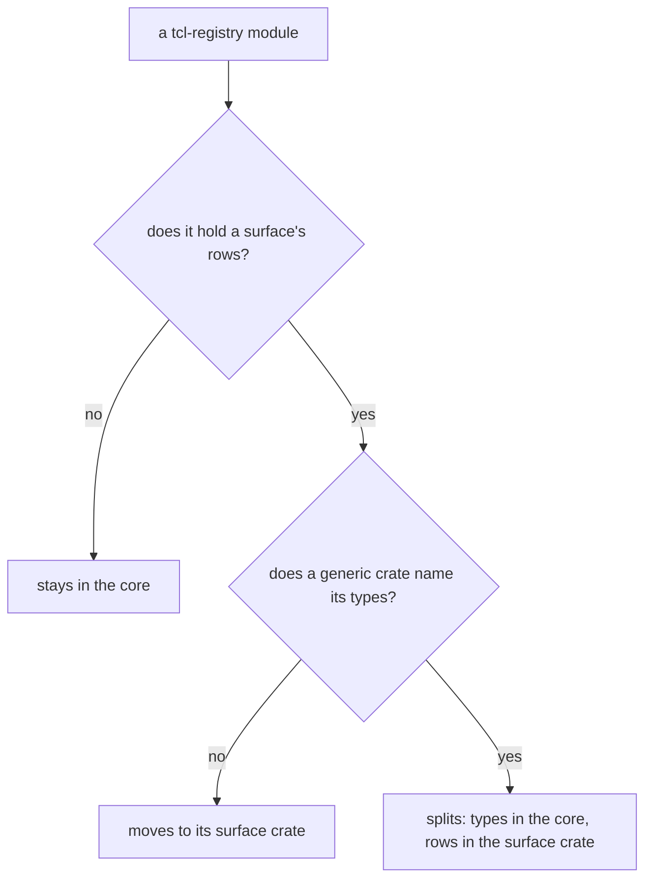
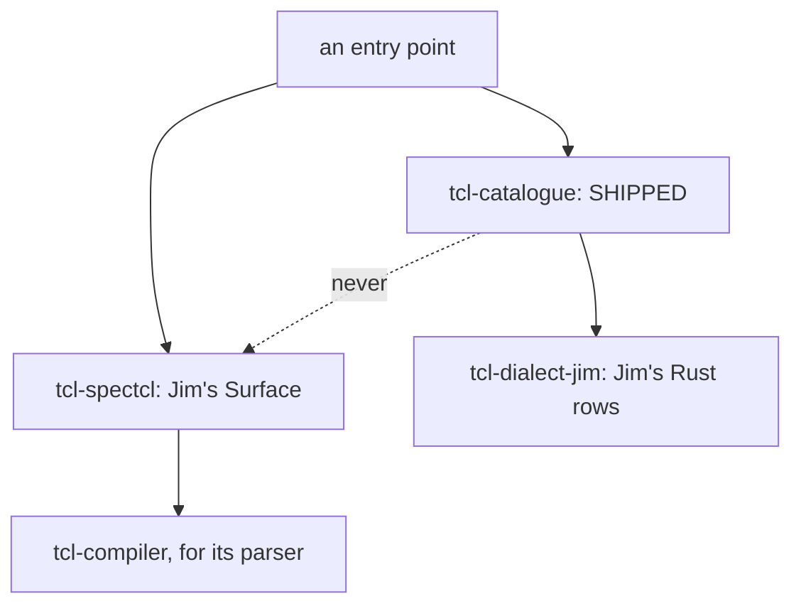

# Step 3: extract the dialect and library crates and `tcl-catalogue`

Part of [splitting tcl-registry](../registry-split-design.md). Plan item 264,
step 3 of item 261. Builds on [step 2](02-behaviour-to-surfaces.md) (item
263): after it, no core module names a surface module. [Step 4](04-dependency-hygiene.md)
(item 265) adds the gate that keeps generic crates off the new crates. The
model items 301–304 follow, because they change types these crates hold.

## Problem

After steps 1 and 2 the surfaces are separable, but they are still modules of
one 583k-line crate. An edit to one iRules spec still rebuilds `tcl-registry`
and the 30 crates that depend on it directly (`cargo tree -i tcl-registry
--depth 1`: 29 workspace members and `tcl-runtime`), `tcl-compiler` among
them.

`commands/` holds 185k lines (verified with `wc -l`):

| Module | Lines | Module | Lines |
|---|---|---|---|
| `irules` | 63,551 | `spectcl` | 2,071 |
| `tcl` | 47,569 | `closed_evidence` | 1,395 |
| `tcllib` | 27,052 | `sslictcl` | 1,046 |
| `tk` | 22,072 | `bpf` | 1,028 |
| `stdlib` | 11,725 | `thread` | 979 |
| `expect` | 2,742 | `itcl` | 536 |
| `iapps` | 2,250 | `ticklecharts`, `argparse` | 533, 356 |

Surface data also sits outside `commands/`. That includes the class-system
grammars in `definer/` (7.2k lines with their tests) and the iRules event and
profile tables (`events/`, `profiles/`, `event_facts/`: 7.2k).

## Design

### Crates

| Crate | Takes | Depends on |
|---|---|---|
| `tcl-registry` (core) | the vocabulary, lookup, the environment model, `pack_hooks`, `Surface` and `SurfaceSet`; for now also `native_*` (item 117a), `value_transfer` and `resolved_invocation` (117b), and the BIG-IP schema (118) | `tcl-dialect`, `tcl-lexer`, `tcl-syntax`, `tcl-core-types`, `tcl-cmd-core`, `tcl-runtime-api`, `tcl-regex` |
| `tcl-dialect-tcl` | `commands/tcl` (after step 2), its hook table, the TclOO grammars (`definer/tcloo.rs`), `tcl`'s closed-evidence rows | core, `tcl-cmd-core` |
| `tcl-dialect-jim` | `commands/jim` (step 2), `definer/jim_source_stock.rs` | core, `tcl-dialect-tcl` |
| `tcl-lib-tcl-bundled` | `commands/stdlib` | core |
| `tcl-lib-tk` | `commands/tk`, the geometry-manager rows of `tk_geometry.rs` | core |
| `tcl-lib-tcllib` | `commands/tcllib`, `model/tcllib.rs`'s module table, `definer/snit.rs`, `definer/clay.rs`, `value_transfer/tcllib.rs`, `tcllib`'s closed-evidence rows | core |
| `tcl-lib-expect` | `commands/expect` | core |
| `tcl-lib-irules` | `commands/irules`, the event and profile tables (`events/event_props_table.rs`, `events/flow_chains.rs`, `profiles/profile_table.rs`, `profiles/protocol_namespace_table.rs`, `event_facts/generated.rs`), `value_transfer/irules.rs` | core |
| `tcl-lib-iapps` | `commands/iapps` with its `tmsh` view, `f5/iapp_metadata.rs`, `f5/tmsh_syntax.rs` | core |
| `tcl-lib-small` | `itcl` (with `definer/itcl.rs`), `thread`, `argparse`, `ticklecharts` | core |
| `tcl-lib-dsl` | `spectcl` and `sslictcl` (with `definer/spectcl.rs`, `definer/sslictcl.rs`), `bpf` | core |
| `tcl-catalogue` | `SHIPPED: &[&Surface]` (step 1's table), `install()`; after item 307, every image | every crate above that has hooks |

`tcl-dialect-f5` is not created in this step (decision 2).

### Module assignment

The rule: rows go with their surface. Types that a generic crate names stay
in the core. Where a module holds both, it splits along that line.



| Module | Assignment | Why |
|---|---|---|
| `definer.rs`, `definer/member_effect.rs`, `member_arguments.rs`, `object_system_profile.rs`, `property_accessors.rs`, `slots.rs`, `builtin_methods.rs` | core | `MemberKind`, `MemberEffect` and `DefinitionBodyGrammar` are the vocabulary AGENTS.md names. |
| the `*_GRAMMAR` constants | their surface crates | They are per-library data. Three production files in `tcl-compiler` name one by constant, and six test files do. They read it from `spec.definition_body` instead. |
| `events.rs`, `events/` except the tables, `profiles.rs`, `irules_policy.rs`, `registry/irules.rs` | core, until item 304 | `tcl-compiler` names `events` in 24 files and `irules_policy` in 4. Item 304 replaces those checks with queries on the resolved environment. The tables move now. |
| `f5/execution_context.rs`, `evidence`, `naming`, `storage`, `rule_identity` | core, until item 301 | They model f5-tcl's builds and evidence, and `tcl-compiler` names them in 20 files. Under 301 they move to `tcl-dialect`. |
| `f5/corpus` | `tcl-lib-irules`'s tests | It is a conformance corpus over appliance transcripts. |
| `tk_geometry.rs` | types and path helpers in core, the three manager rows in `tcl-lib-tk` | `tcl-compiler`, `tcl-lsp-core`, `tcl-spectcl` and the studio name the types. |
| `special_vars.rs` and `special_vars/` | vocabulary in core, rows by provider | The runtime reads them 468 times. The row split follows each row's provider. |
| `mathfunc.rs`, `authored_math_functions.rs`, `literal_folds.rs`, `private_tcl_namespaces.rs`, `channel_options*`, `channel_protocols*` | `tcl-dialect-tcl`'s data, behind core lookups | They are Tcl's own functions, namespaces and channel options. Each keeps a core query (`mathfunc::qualified_name` and so on) over the installed surface. |
| `commands/closed_evidence.rs` | the `apply` mechanism in core, `table.rs` split per surface | `scripts/dev/gen_closed_evidence.py` emits one table per surface. |
| `bpf_op.rs` | core | It is the type of the `CommandSpec::bpf_op` field. |

Everything not named here stays in the core. A ledger,
`docs/work/name-handling/ownership/registry-modules.tsv` (columns `module`,
`crate`), records the assignment. The `module-layers` gate (item 247) runs
over `tcl-registry` with it, so the back-edges from core modules into surface
modules are listed before the move, not found by the compiler after it.

### Consumer rewrites

These consumers name `tcl_registry::commands::` today (`rg`, 26 November 2026,
multi-line `use` lists included):

| Consumer | Files (prod / test) | Names | Rewrite |
|---|---|---|---|
| `tcl-vm` | 8 / 0, 21 sites | `NativeJim*` (`command.rs`, `cmd_info.rs`, `cmd_info/native_jim.rs`), `InfoOoEnsembleKind`, `info_oo_subcommands`, `TclOoPropertyKind` (`cmd_oo*`, `cmd_info/native_oo.rs`), `resolve_fconfigure_option` (`cmd_chan.rs:922, 933`) | the native modules and core vocabulary step 2 moved them to |
| `runtime/rust` | 10 / 0, 22 sites | the same set, plus `native_jim_lookup.rs` (10) and `cmd_jim_exists.rs` | the same |
| `tcl-compiler` | 2 / 1 | `string_is_member_type*` (`tcl_expr_eval/condition_facts.rs:559, 602`), `TclOoPropertyKind` (`analyser/types/original_properties.rs`) | `tcl_cmd_core::string_is::member_type`, a kernel, and core vocabulary |
| `tcl-lsp-core` | 1 / 0 | `TclOoPropertyKind` | core vocabulary |
| `bpf-tcl-ir` | 1 / 0 | `thread::is_thread_command` | `Traits::THREAD_PRIMITIVE` (step 2) |
| `tcl-spec-studio` | 1 / 1 | `SPEC_PACKS`, `SpecPack::by_id`, the pack path formula | the installed set and `Surface::source_dir` |
| `xtask` | 4 / 0 | `tcl_command_specs` (`command_backing.rs`, `audit_option_dialects.rs`), `SPEC_PACKS` (`evaluation_contexts.rs`), five packs (`semantics_matrix.rs`) | `tcl_catalogue::SHIPPED` |
| `tcl-spectcl` | 0 / 1 | `spectcl_command_specs` (`loader/dialect_block.rs:683`) | `tcl_lib_dsl::spectcl` as a dev-dependency |
| `tcl-sslictcl`, `tcl-lsp-server` | 0 / 1 each | `sslictcl` | `tcl_lib_dsl::sslictcl` as a dev-dependency |

`resolve_fconfigure_option` (`commands/tcl/fconfigure_.rs:69`) is the one
runtime-facing function the VM and the runtime both call. Step 2 leaves it in
the Tcl module. Here it splits: the generic resolution of a word against a
spec's option table goes to the core's `channel_options`, over the `options`
of the `fconfigure` spec the engine holds. The typed `ConfigOption` mapping
goes to `tcl-cmd-core`'s `channel`.

Two of the rewrites, from `tcl-lsp-core` and `tcl-compiler`:

**Before:**

```rust
use tcl_registry::commands::tcl::TclOoPropertyKind;
let member = tcl_registry::commands::tcl::string_is_member_type(texts.get(1..)?)?;
```

**After:**

```rust
use tcl_registry::definer::property_accessors::TclOoPropertyKind;
let member = tcl_cmd_core::string_is::member_type(texts.get(1..)?)?;
```

No production crate except `xtask`, `tcl-spec-studio` and the entry points
needs a surface crate as a normal dependency. The entry points reach them
through `tcl-catalogue`.

### Jim's SpecTcl surface

Jim's roster and own commands are two SpecTcl packs in
`tcl-spectcl/core-surfaces/`, and the loader parses with
`tcl_compiler::parsing`. `tcl-dialect-jim` cannot hold them until the loader
moves to `tcl-source` (items 251 and 281). Until then `tcl-spectcl` exports
their `Surface`, and each entry point installs `tcl_catalogue::SHIPPED` plus
that one surface. `tcl-catalogue` must not depend on `tcl-spectcl`: that edge
would put `tcl-compiler` under the catalogue and under every test that uses
it.



### `registry-axes` and the other gates

`rust/xtask/src/registry_axes.rs`:
- `is_scanned` (line 518) excludes `rust/tcl-registry/` only. It also excludes
  `rust/tcl-dialect-*/`, `rust/tcl-lib-*/` and `rust/tcl-catalogue/`, which
  are "the registry" for the rule.
- `full_registry` (line 390) builds from `build_default` plus a loop over
  `LOADABLE_DIALECTS`. It builds from `from_surfaces(tcl_catalogue::SHIPPED)`
  and the bundled packs instead.
- The fixtures in `a_registry_owner_file_is_never_scanned` (line 1371) add one
  path per new crate. `rust/tcl-registry/src/commands/tcl/if_.rs` becomes
  `rust/tcl-dialect-tcl/src/if_.rs`.

The other path-bound gates and scripts:
- in `xtask`: `retired_api_gate.rs`, `catalogue_callers.rs`,
  `owner_resolution/interpreter_consumers.rs`, `dialect_drift.rs`,
  `bigip_data_schema.rs`, `value_transfers.rs`, `main.rs`;
- elsewhere: the `Makefile`'s `REGISTRY_SRCS` and `_TMLANGUAGE_KEYWORD_DEPS`
  (lines 1974, 2029), `scripts/dev/gen_closed_evidence.py`,
  `scripts/dev/license-header-exempt.txt` and `scripts/dev/smoke-targets.tsv`.

`retired_api_gate` gains the retired `tcl_registry::commands::` path, so no
re-export can return.

## Decisions

1. **One crate per package** (owner decision, 26 November 2026, replacing
   this doc's earlier per-distribution rule). Each tcllib package, each bundled
   Tcl library, iApps and tmsh get their own crates. The `tmsh` view becomes the
   `tcl-lib-tmsh` crate's own surface. After item 307 these crates hold their
   `.tclspec` and hooks only, as generated scaffolding; their images are
   compiled per build and embedded by `tcl-catalogue`.
2. **`tcl-dialect-f5` waits for item 301.** Today f5-tcl's core surface is 58
   `SpecSurface` rows on Tcl specs, not data of its own (step 2, decision 3).
   Its evidence types are named by `tcl-compiler` and must stay below it. An
   empty crate buys no build time, and item 301 gives f5-tcl its releases and
   builds, which are the crate's content.
3. **`tcl-lib-irules` and `tcl-lib-iapps` do not depend on the BIG-IP
   schema.** No command spec reads `bigip`, `base_objects` or
   `profile_defaults`: `rg 'crate::(bigip|base_objects|profile_defaults)'
   commands` returns nothing. The overview's edge is not needed (see
   [item 118](118-bigip-schema.md)).
4. **No re-exports.** Each move rewrites its consumers in the same change, as
   item 90 requires of the compiler split.
5. **Laziness per surface.** Each crate's specs are built on first use and
   leaked once, by the core's cell for that `Surface` (step 1).

## Open questions

1. Does `tcl-lib-small` need splitting? The overview says only if a
   measurement shows the need. Settled by the rebuild time of `tcl-lib-small`
   after a one-spec edit, against `tcl-lib-expect`'s (2.7k lines).
2. Should `bpf` sit with the DSLs or in its own crate? It is a restricted
   library on tcl 9.0, not an authoring DSL. Settled by whether any consumer
   other than `bpf-tcl` and the catalogue needs it without SpecTcl's words.
3. Is `closed_evidence`'s one generated table better split per surface, or
   generated into each crate from one manifest? Settled by the generator's
   `--check` gate (item 119) being simpler in one form.

## Work list

1. Seed `registry-modules.tsv` and run the `module-layers` gate over
   `tcl-registry`. Clear the back-edges it lists, starting with the
   grammar-constant consumers and the split modules above.
2. Create the crates in dependency order: `tcl-dialect-tcl`, then
   `tcl-dialect-jim`, then the library crates in any order. Add each to
   `[workspace] members`.
3. Move each module, rewriting its consumers in the same change (table above).
4. Create `tcl-catalogue` with `SHIPPED` and `install()`. Re-point every
   entry point (step 1's table) to it. Harnesses keep `tcl_registry::testing`,
   now an unconditional module (step 4, rule 1), so no generic crate needs a
   catalogue edge for its tests.
5. Split the `closed_evidence` table, and update its generator.
6. Re-point `registry-axes` and the path-bound gates and scripts above.
7. Add the new crates to the nextest shard map
   (`scripts/dev/rust-test-binary-shards.tsv`) and the heavy-test table.

## Verification

- **Done when:**
  - `rust/tcl-registry/src/commands/` holds only `closed_evidence`'s mechanism;
  - `rg 'tcl_registry::commands' rust runtime` returns nothing;
  - `cargo tree -p tcl-compiler -e normal` lists no `tcl-dialect-*`,
    `tcl-lib-*` or `tcl-catalogue` crate;
  - `registry-axes` passes with the same ratchet counts.
- **Same answers.** Step 1's visibility enumeration is unchanged for every
  profile. So are the registry-snapshot tests and the failsets of
  `tcl-registry`, the new crates' moved tests, `tcl-compiler` and
  `tcl-lsp-core`.
- **Measured** with item 259's script, against its baseline:

  | Measurement | What it records |
  |---|---|
  | rebuild after one iRules spec edit | crates rebuilt and wall time; the overview expects `tcl-lib-irules`, `tcl-catalogue` and every crate that links it: the binaries, the WASM hosts, `xtask` and the `-it` test crates |
  | rebuild after one Tk spec edit | the same |
  | `cargo build -p tcl-compiler` cone | must list the core and no surface crate |
  | `tcl-registry`'s own compile time | the core after the move |
  | binary size of `tcl-lsp-server` and `tcl-vm-wasm` | `tcl-vm-wasm` can now install fewer surfaces |

## Risks

- **A consumer this step misses.** The compiler finds every one at first
  build, and the tree may stay broken until then.
- **Install drift between entry points.** Two binaries that install different
  sets give different answers for the same file. Mitigation: the full-catalogue
  binaries (`tcl-lsp-server`, `tcl`, `tcl-mcp`) install
  `tcl_catalogue::SHIPPED` and nothing narrower. A test compares their
  installed ids.
- **Cross-surface helpers.** The overview expects Tk to borrow helpers from
  Tcl. Today `commands/tk` names only itself. The risk stands for Jim, whose
  `jim_spec()` rows share their Tcl twins' constants.

## Corrections to the overview

- `tcl-lib-irules` and `tcl-lib-iapps` need no edge to the BIG-IP schema crate
  (decision 3).
- `tcl-dialect-f5` belongs to item 301, not this step (decision 2).
- `tcl-dialect-jim` cannot take Jim's SpecTcl roster and commands until items
  251 and 281 move the loader. Until then it takes only the Rust rows. The
  overview's table puts both in it now.
- The overview's risk "Tk's from Tcl" is not seen in today's code.
- About 14k lines of surface data sit outside `commands/` (the definer
  grammars and the iRules tables). The overview counts them in the core's
  "rest".

## Review fixes (26 November 2026)

- **R2, R6:** the test macro stays in the core as `tcl_registry::testing`, an unconditional module; `tcl-catalogue` holds no testing macro.
- **R12:** the measured rebuild set names `xtask`, the WASM hosts and the `-it` crates.
- **R14:** line 180 and the crate table: after item 307 a package crate holds its `.tclspec` and hooks; images are in `tcl-catalogue`.
