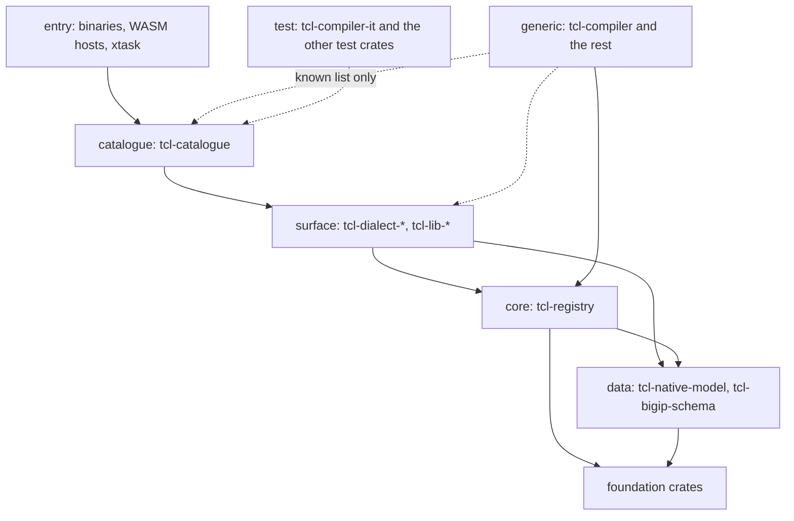

# Step 4: dependency hygiene for the surface crates

Part of [splitting tcl-registry](../registry-split-design.md). Plan item 265,
step 4 of item 261. Builds on [step 3](03-extract-crates.md) (item 264), which
creates the surface crates and `tcl-catalogue`. The gate is the registry
split's equivalent of the compiler split's `module-layers` dev-dependency
check (item 247), and shares its known-list form.

## Problem

Step 3 makes the cut, and nothing keeps it.

- **A normal edge brings the whole cascade back.** One `tcl-lib-irules` line
  in `tcl-compiler`'s `[dependencies]` returns every iRules spec edit to the
  compiler's cone, and no gate would notice.
- **The existing gate cannot express the rule.** The `crate-layer` gate
  (`rust/xtask/src/semantic_ownership/layering.rs`) reads `deny.toml`'s
  `[bans] deny` wrappers for four protected crates (`PROTECTED`, line 26:
  `tcl-compiler`, `tcl-codegen`, `tcl-lsp-core`, `tcl-lsp-db`).
  - It checks every direct edge in `cargo metadata --no-deps`, whatever its
    kind. Its `Dependency` struct (line 52) has no `kind` field.
  - cargo-deny 0.20.2 (pinned in the `Makefile`, `rust-deny`) counts dev edges
    too: `deny.toml` does not set `[graph] exclude-dev`.
  - So today a wrapper list is the union of normal and dev parents. The
    `tcl-codegen` entry lists `tcl-vm`, whose edge is a dev-dependency (item
    272).
- **The rule for surfaces turns on edge kind.** A generic crate may take a
  surface as a dev-dependency for its tests, but never as a normal one. Neither
  tool can check that today.
- **Nothing says which surfaces a test should take.** Generic crates' tests
  exercise many surfaces. Counted coarsely over test files on 26 November 2026,
  by files that name a non-Tcl environment or layer:

  | Crate | iRules | iApps / tmsh | Tk | Expect | BPF | Jim |
  |---|---|---|---|---|---|---|
  | `tcl-compiler` | 135 | 15 | 16 | 6 | 3 | 104 |
  | `tcl-lsp-core` | 47 | 9 | 9 | 6 | 1 | 41 |
  | `tcl-vm` | 5 | 0 | 1 | 0 | 1 | 97 |
  | `tcl-lsp-db` | 9 | 3 | 0 | 1 | 1 | 9 |
  | `tcl-codegen` | 4 | 0 | 0 | 0 | 0 | 10 |

  In `tcl-compiler`, 94 of those files are `src` test modules and 44 are under
  `tests/`.

Cargo compiles every dev-dependency into every test target of a package,
`--lib` included, and fingerprints the target on all of them. So a
dev-dependency on `tcl-lib-irules` makes an iRules spec edit recompile
`tcl-compiler`'s whole `--lib` test target. That target is the compiler
itself, built with `cfg(test)`.

## Design

### Crate roles

One ledger, `docs/work/name-handling/ownership/crate-roles.tsv`, with columns
`crate` and `role`, gives each workspace crate (and each crate in
`runtime/rust` and the out-of-workspace WASM hosts) one role:

| Role | Members | May depend normally on a surface crate | May depend on `tcl-catalogue` |
|---|---|---|---|
| `core` | `tcl-registry` | no | no |
| `surface` | `tcl-dialect-*`, `tcl-lib-*` | the surfaces its own rows borrow from (`tcl-dialect-jim` → `tcl-dialect-tcl`) | no |
| `catalogue` | `tcl-catalogue` | every surface | — |
| `data` | `tcl-native-model` ([item 117](117-native-model.md)), `tcl-bigip-schema` ([item 118](118-bigip-schema.md)) | no; it may depend only on foundation crates, and any crate may depend on it | no |
| `entry` | the binaries and WASM hosts in [step 1's table](01-surface-input.md#entry-points), `xtask` | through the catalogue | yes |
| `test` | `tcl-compiler-it` and the other test-only crates of items 266 and 269–272 | as dev-dependencies | as a dev-dependency |
| `generic` | every other crate that reaches `tcl-registry` | dev-dependencies only | no |

The allowed edges between roles. A dashed edge is a dev-dependency:



Two crates sit near the line, and both are `generic`:

- `tcl-spec-studio` lists the shipped surfaces, but `tcl-cli-support` and
  `tcl-mcp` link it as a library. It reads the installed set at run time
  (step 1), so it needs no edge.
- `tcl-spectcl` resolves `-native ID` through `SurfaceSet::native_hook`
  (step 2), not through a crate edge.

### The gate

The `crate-layer` gate becomes kind-aware and reads the ledger:

```rust
struct Dependency { name: String, kind: Option<String> } // None = normal, "dev", "build"

enum Verdict { Allowed, Violation(&'static str), Known }

fn surface_edge(from: Role, to: Role, kind: EdgeKind) -> Verdict;
```

- **Rules.**
  - A normal or build edge from a `generic` or `core` crate to a `surface`
    or `catalogue` crate is a violation.
  - A dev edge from a `generic` crate to a surface is allowed. To the
    catalogue it is allowed only while the edge is on the known list below.
  - An edge from a `surface` crate to any crate outside the core, the
    `data` crates, the foundation crates and the surfaces it borrows from is a
    violation. This keeps surface crates leaves, so a dev edge to one can never
    form a cycle or a cascade. The foundation crates are the ones below the
    core: `tcl-dialect`, `tcl-lexer`, `tcl-syntax`, `tcl-core-types`,
    `tcl-numeric`, `tcl-cmd-core`, `tcl-runtime-api`, `tcl-regex` and their own
    dependencies.
- **Worked verdicts.** Some edges and what the gate says about each:

  | From (role) | To (role) | Kind | Verdict |
  |---|---|---|---|
  | `tcl-compiler` (generic) | `tcl-lib-irules` (surface) | normal | violation |
  | `tcl-compiler` (generic) | `tcl-dialect-tcl` (surface) | dev | allowed |
  | `tcl-compiler` (generic) | `tcl-catalogue` (catalogue) | dev | known: a row in `surface-dev-edges.tsv` |
  | `tcl-codegen` (generic) | `tcl-catalogue` (catalogue) | dev | violation: not on the known list |
  | `tcl-dialect-jim` (surface) | `tcl-dialect-tcl` (surface) | normal | allowed: it borrows Tcl's rows |
  | `tcl-lib-irules` (surface) | `tcl-compiler` (generic) | normal | violation: surfaces stay leaves |
  | `tcl-registry` (core) | `tcl-lib-tk` (surface) | build | violation |
  | `tcl-cli` (entry) | `tcl-catalogue` (catalogue) | normal | allowed |
- **`deny.toml` is generated, not hand-kept.**
  `cargo xtask crate-layer --write` emits one `[bans] deny` entry per surface
  crate and for `tcl-catalogue`, with `wrappers` set to every crate the
  ledger allows: normal and dev parents together, because that is what
  cargo-deny can check. The generated block is fenced by marker comments.
  `cargo xtask crate-layer` fails when it differs from the ledger, the way
  the other `--check` gates do.
- **Two layers, one source.** cargo-deny then catches any edge from a crate
  outside the wrapper list, for example from an external audit run. The
  xtask gate adds the one thing cargo-deny cannot see, the edge kind. Both
  read the same ledger, so they cannot disagree.
- **`PROTECTED` grows.** It takes every `core`, `surface` and `catalogue`
  crate, and its "needs cargo-deny wrappers" check covers them.

### How generic crates choose their test surfaces

1. **The default is `tcl-dialect-tcl`.** A generic crate's
   `[dev-dependencies]` name `tcl-dialect-tcl`, and its harnesses install it
   with `tcl_catalogue::testing::install!(tcl_dialect_tcl::SURFACE)`.
2. **A test that exercises another surface lives in the crate's test crate.**
   That is `tcl-compiler-it` (item 266), or the test crates items 269–272
   create for `tcl-registry`, `tcl-lsp-core`, `tcl-lsp-db` and `tcl-vm`. The
   test crate takes `tcl-catalogue` and installs the full set. An iRules spec
   edit then rebuilds that small test binary, not the generic crate's own
   test target.
3. **A dev edge to one more surface is allowed** where a crate's tests are
   mostly about it and moving them would split one subject in two. Jim is the
   case: 97 of `tcl-vm`'s test files name it. That crate then pays the
   recompile on that surface's edits, and the ledger records the choice.
4. **Known list.** Today's tests do not follow rule 2. Until they move, a
   crate whose `src` tests need the full set takes `tcl-catalogue` as a
   dev-dependency, as a row in `docs/work/name-handling/ownership/surface-dev-edges.tsv`
   (columns `crate`, `surface`, `reason`). The list may only shrink. A new row
   fails the gate. The first rows are `tcl-compiler`, `tcl-lsp-core` and
   `tcl-lsp-db`, which the table above shows using four or more surfaces.
5. **The surface crates' own tests** take only `tcl-registry`'s
   `test-support` and the surfaces they borrow from. A spec's behaviour under
   the analyser is tested in `tcl-compiler-it`, which already takes everything.

## Decisions

1. **Kind-aware in xtask, kind-blind in cargo-deny.** cargo-deny's `wrappers`
   apply to every edge kind, and `exclude-dev = true` would drop dev-only
   crates from the advisory and licence audit too. The kind check belongs to
   the gate that already runs first.
2. **A ledger, not a naming rule.** Treating `tcl-lib-*` as surface by prefix
   would work for the crates step 3 creates, but not for `tcl-catalogue` or
   the test crates, and it would let a misnamed crate through. The ledger also
   feeds item 247's crate order.
3. **Rule 2 over a lighter dev-dependency.** A smaller surface set on the
   generic crate's own target cuts the recompile it pays. Only moving the test
   out removes it, because Cargo cannot scope a dev-dependency to one target.

## Open questions

1. How many of `tcl-compiler`'s 94 `src` test files that name a non-Tcl
   surface can move to `tcl-compiler-it` without widening internals? Settled
   by item 267's visibility count for those files. Each moved file shrinks the
   known list's reason, and the row goes when the count reaches zero.
2. Does `tcl-vm` keep a dev edge to `tcl-dialect-jim`, or move its Jim tests
   out? Settled by item 259's script: the recompile time of `tcl-vm`'s test
   target after a Jim spec edit, against its share of edits that touch Jim.

## Work list

1. Seed `crate-roles.tsv` from `cargo metadata`, and review the `generic`
   and `entry` rows by hand.
2. Add `kind` to `layering.rs`'s `Dependency`, the role rules, the known list
   and `--write`. Extend `PROTECTED`.
3. Generate the surface and catalogue `[bans] deny` entries into `deny.toml`.
   Check that `make rust-deny` and `cargo xtask crate-layer` pass on the tree.
4. Set each generic crate's `[dev-dependencies]` per the rules above, and
   seed `surface-dev-edges.tsv` with the edges that remain.
5. Add the harness install lines step 3's macro needs, one per harness.

## Verification

- **Unit tests** in `layering.rs`:
  - a normal edge from a generic crate to a surface fails;
  - a dev edge passes;
  - a dev edge to the catalogue fails unless listed;
  - a surface crate with an edge to a generic crate fails;
  - a stale generated `deny.toml` block fails.
- **Done when:**
  - `cargo tree -p tcl-compiler -e normal`, and the same for each crate item
    90 splits out, lists no `tcl-dialect-*`, `tcl-lib-*` or `tcl-catalogue`;
  - so do `tcl-lsp-core`, `tcl-codegen`, `tcl-vm` and `tcl-runtime`;
  - `make rust-deny` passes;
  - the gate passes with the seeded known list.
- **Measured** with item 259's script:

  | Edit | What to record |
  |---|---|
  | one `tcl-compiler` source file | crates rebuilt by `cargo test -p tcl-compiler --lib --no-run`; no surface crate may be among them |
  | one iRules spec | crates rebuilt by the same command; with `tcl-compiler` on the known list its test target recompiles, and the figure is the cost the list's removal will save |
  | one iRules spec | crates rebuilt by `cargo test -p tcl-compiler-it --no-run` |

## Risks

- **A surface crate grows a generic dependency.** For example, a hook in
  `tcl-lib-irules` reaching for a compiler type. The surface-leaf rule fails
  it at once. The fix is a core type or a hook signature, never the edge.
- **The known list stops shrinking.** The rows name their reason, and item
  287 (the test crate's own dependencies) revisits them once the compiler
  split's crates exist.
- **A harness that installs too little.** It fails at its first registry read,
  with step 1's message. Nothing silently serves an empty table.
