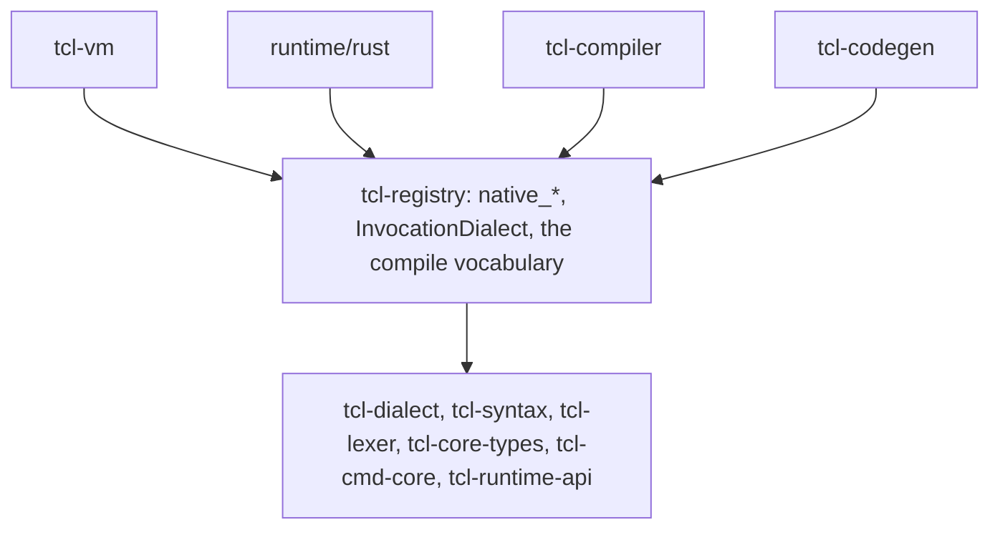
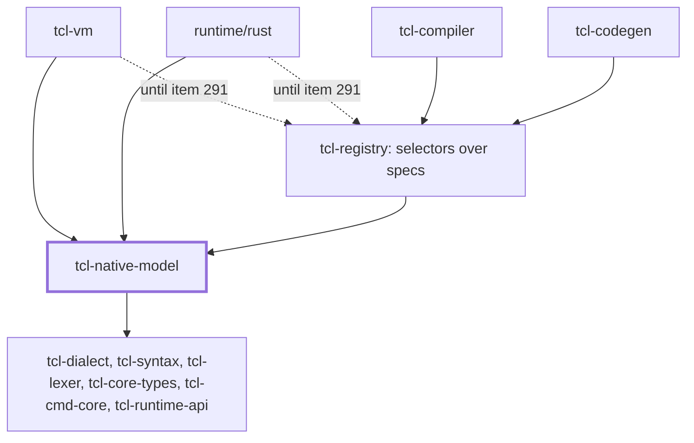
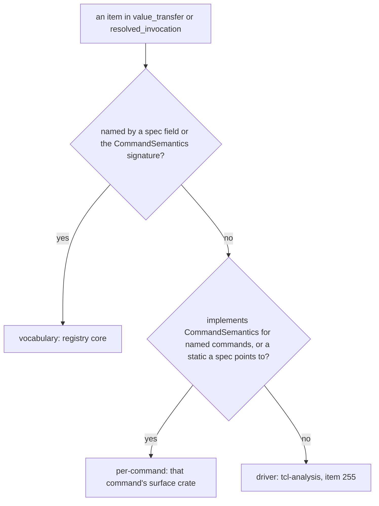

# Item 117: the native model out of the registry

Plan item 117, split here into 117a (the native-model crate) and 117b (the
evaluation move). 117a can start at any time and runs beside the registry
split's steps 1–4. 117b follows the compiler split's step 10 (item 255,
`tcl-analysis`). Item 291 (`tcl-vm` after 117) builds on both. The overview
is [splitting tcl-registry](../registry-split-design.md); the registry rule
it must keep is in `AGENTS.md`.

## Problem

### The `native_*` modules

`tcl-registry/src` has 110 top-level `native_*.rs` files and 12 `native_*`
directories, 58,443 lines (`wc -l`, 26 November 2026), of which 6,953 are
tests. They model C Tcl and Jim internals: result protocols, eval objects,
procedure bodies, TclOO method caches, Jim lookup tables and per-release
compile recipes.

They fall into two groups by name and by coupling:

| Group | Entries | Lines | Couples to registry types |
|---|---|---|---|
| compile recipes (`*compilation*`, `*compiler*`, `native_instruction_plan`, `native_bytecode`, `native_lowering`, `native_control_instructions`) | 48 | 32,854 | mostly |
| runtime model (the rest) | 75 | 25,589 | 16 of them |

By file, 34 production files (21,839 lines) name `CommandSpec`,
`CommandRegistry`, `InvocationWords`, `InvocationArguments`, `crate::spec`,
`crate::registry`, `value_transfer` or `resolved_invocation`. The other 88
production files (29,651 lines) name none of them. What they do need from the
core is narrower:

- **`InvocationDialect`.** Fifteen native files add 16 `impl
  InvocationDialect` blocks of protocol selectors (`eval_object_protocol` and
  the like). There are 19 such blocks in all. The type is built only from
  `tcl-dialect` and `tcl-syntax` values (`invocation_words.rs:250`). The VM
  names it 216 times and the runtime 193.
- **Other core modules:** `hooks` (16 references), `representation` (11),
  `mathfunc` (9), `completion` (9), `invocation_words` (8) and a long tail.
- **External crates:** `tcl_dialect` (570), `tcl_syntax` (457), `tcl_lexer`
  (236), `tcl_runtime_api` (80), `tcl_core_types` (68), `tcl_cmd_core` (50).

### Who imports them

Counted with multi-line `use` lists included:

| Crate | Files naming `tcl_registry::native_*` (production) | Of them, compile-recipe modules |
|---|---|---|
| `tcl-vm` | 164 (127), 488 sites | 17 |
| `runtime/rust` | 202 (161) | 51 |
| `tcl-compiler` | 251 (209) | 165 |
| `tcl-codegen` | 65 (41) | 40 |
| `tcl-lsp-core` | 22 (14) | 6 |

The plan's "157 files" for the VM is now 164. The VM also reaches 12 of the
34 coupled modules, `native_procedure` (44 sites) above all.

### The compile vocabulary and the specs

The compile recipes are also spec data. 155 core files outside `native_*`,
128 of them in `commands/`, name the compile vocabulary:

| Type | References |
|---|---|
| `NativeCompilationSpec` | 223 |
| `NativeCompilationGrammar` | 195 |
| `NativeBodyCompilation` | 192 |
| `NativeCompilerImplementationLookup` | 132 |
| `SuccessfulHandlerSpec` | 90 |

The types are the `CommandSpec::native_compilation` field's vocabulary, and
the selectors that walk `InvocationWords` are the algorithm.

### `value_transfer` and `resolved_invocation`

`value_transfer` (21,155 lines) and `resolved_invocation` (13,542 lines plus
`resolved_invocation.rs`'s 1,089) are not one kind of code either:

- **Per-command semantics in specs.** 334 files in `commands/` attach
  per-command semantics objects to their specs. `value_transfer::builtins::STATE_DECIDED`
  is named 354 times, `ROUTE_UNAUTHORED` 217 times, through
  `CommandSpec::semantics` (`spec.rs:702`).
- **Per-command evaluation.** `CommandSemantics` (`value_transfer/mod.rs:199`)
  is a per-command trait with `evaluate`, `transfer` and `structure`.
- **Surface-specific implementations:** `regex.rs`, `selection.rs`,
  `template.rs`, `completion.rs`, `irules.rs` and `tcllib.rs`.
- **Folds through the evaluator.** Three Tcl folds call
  `value_transfer::evaluate_literal` (`literal.rs:300`): `fold_range`,
  `fold_match_versioned` and `fold_regsub_versioned`. It runs a command's own
  `CommandSemantics::evaluate` over literal inputs.
- **Consumers outside the registry:** `tcl-compiler` names `value_transfer`
  in 111 files, and 15 other crates name it in 1–12 each. `resolved_invocation`
  is named in `tcl-compiler` (34 files), `tcl-spec-studio` (4),
  `tcl-lsp-core` (3) and `tcl-spectcl` (2).

### The contract conflict

`project-layout.md` rule 3 says "the registry is data … they do not reach
into compiler internals". `shared-utility-contracts-rust.md` names
`rust/tcl-registry/src/native_*` files as owners in 94 of its rows (223 rows
name `tcl-registry/src`), and `xtask-owner-resolution` checks those rows.

## Design

### 117a: `tcl-native-model`

A crate beside `tcl-runtime-api`:

- **Its dependencies:** `tcl-dialect`, `tcl-syntax`, `tcl-lexer`,
  `tcl-core-types`, `tcl-cmd-core` and `tcl-runtime-api`.
- **It never depends on `tcl-registry`.** `tcl-registry` depends on it.

What moves in:

| From | What | Note |
|---|---|---|
| `invocation_words.rs` | `InvocationDialect`, and every `impl` block whose body needs nothing from the core | The selectors stay methods, now in their defining crate. `InvocationWords` and `InvocationArguments` stay in the core. |
| the 88 uncoupled `native_*` production files | the whole module | Each of their remaining core references (`hooks`, `representation`, `mathfunc`, `completion`) is resolved per module: the referenced item moves down if it is runtime protocol, or the reference inverts if it is spec vocabulary. |
| the 34 coupled files | the runtime-protocol half | Each splits. The types and functions the VM and the runtime call go down, and the selection over specs and words stays in the core, in a module of the same name. `native_procedure`, `native_dictionary`, `native_rmw`, `native_stock_list` and `native_vwait` are the first, because the engines name them most. |
| the compile vocabulary | `NativeCompilationSpec`, `NativeCompilationGrammar`, `NativeBodyCompilation`, `SuccessfulHandlerSpec`, `NativeLowering`, `CellUpdate` and their enums | They are data. A spec holds them, and an engine executes them. |
| `commands::tcl`, after step 2 of the registry split | `NativeJim*`, `InfoOoEnsembleKind`, `info_oo_subcommands`, the typed `ConfigOption` mapping | runtime protocol |

The engines' edges today:



And after 117a, with the engines' remaining core edges left to item 291:



In the engines' 400-odd sites the change is the path:

**Before:**

```rust
use tcl_registry::InvocationDialect;
```

**After:**

```rust
use tcl_native_model::InvocationDialect;
```

The selection algorithms that read specs and walk `InvocationWords` stay in
the registry core. They are per-command compile knowledge, read through the
specs the registry hands out. Whether they later move up into
`tcl-native-plan` (compiler split step 11, item 256) is that step's decision.

An inventory ledger, `docs/work/name-handling/ownership/native-model.tsv`
(columns `module`, `item`, `destination`), is seeded from the tree and drives
the work list. The `module-layers` gate (item 247) runs over `tcl-registry`
with it, so the back-edges are counted before each move.

### 117b: the evaluation move

The plan's wording, "`value_transfer`/`resolved_invocation` evaluation into
the analysis layer", needs a precise reading, because much of what is called
evaluation there is per-command knowledge. The registry rule keeps that in the
registry, which after the split includes the surface crates. Every item in
both modules is classified into one of three kinds:

| Kind | Test | Destination |
|---|---|---|
| vocabulary | a spec field or the `CommandSemantics` trait's signature names it | registry core |
| per-command | it implements `CommandSemantics` for named commands, or is a static a spec points to | that command's surface crate (`builtins.rs`'s statics by command, `irules.rs` to `tcl-lib-irules`, `tcllib.rs` to each command's tcllib package crate, `regex.rs` with `regsub`) |
| driver | only the analysis layer calls it: the fixpoint over IR facts, the CFG-bound `AnalysisInputs` implementations, publication, lifting, partial answers | `tcl-analysis` (item 255) |



`evaluate_literal` and `LiteralInputs` are vocabulary. They adapt a command's
own semantics to literal words, the folds in `tcl-dialect-tcl` call them, and
a surface crate may not depend on `tcl-analysis` (item 265's surface-leaf
rule). The `ConstValue` domain in `value_transfer/const_ops.rs`, which
`registry-axes`' `constant_owner_verdicts` already names as an owner, goes
with the driver unless the trait signature names it. If the signature does,
it goes to `tcl-values` (item 280) only if `tcl-values` sits below the core;
otherwise it stays in the core.

`resolved_invocation` resolves a call against its spec: its arguments,
options, subcommand and form. That is lookup, and lookup is the core's. Only
the parts that compute over abstract values, which the ledger finds by the
same test, move.

## Decisions

1. **Split 117 at the coupling line, not at the file line.** A module that
   reads specs and serves the engine splits in two. Moving it whole either way
   keeps the VM on the registry or puts spec reading below the registry.
2. **`InvocationDialect` moves down whole.** All its parts are dialect and
   syntax values, and the engines use it more than any other registry type.
   Leaving it in the core would keep the VM on the core for a type that needs
   none of it.
3. **The compile vocabulary goes down; the selectors stay.** Specs and engines
   share the vocabulary, and only the selection reads specs.
4. **The registry rule bounds 117b.** Per-command semantics never move to
   `tcl-analysis`. The plan's done-when changes to say so (see the
   corrections).

## Open questions

1. Can each of the 34 coupled files split without a cycle? Settled by the
   ledger's back-edge count from the native-model rows into core rows reaching
   0.
2. Is `special_vars` (the runtime names it 468 times, the VM 68) runtime
   protocol or spec data? It decides how much of the runtime's registry edge
   item 291 can remove. Settled by classifying its consumers' uses.
3. Does `tcl-values` sit below or above the registry core? It decides where a
   trait-named `ConstValue` lives. Settled by item 280's design.

## Work list

117a:

1. Seed `native-model.tsv`, and run `module-layers` over `tcl-registry`.
2. Create `rust/tcl-native-model`. Move `InvocationDialect` with the `impl`
   blocks that can go, and rewrite its 400-odd engine sites and the core's users in
   the same change.
3. Move the uncoupled modules in dependency order, leaves first:
   `native_numeric_error`, `native_index_lookup`, `native_string_materialization`,
   then their dependants.
4. Split the coupled modules, the five the engines name most first.
5. Move the compile vocabulary types, and rewrite `commands/` and the
   compiler's users.
6. Re-point the 94 manifest rows in `shared-utility-contracts-rust.md` and the
   `xtask` paths that name `native_*` files (`catalogue_callers.rs:124`,
   `owner_resolution/interpreter_consumers.rs:572, 670`).
7. Rewrite `project-layout.md` rule 3 (below). Give `tcl-native-model` a
   `deny.toml` wrappers entry, checked by the crate-layer gate.

117b, after item 255:

1. Seed the three-kind classification of `value_transfer` and
   `resolved_invocation` as ledger rows.
2. Move the per-command implementations into their surface crates (most land
   in `tcl-dialect-tcl`).
3. Move the driver into `tcl-analysis`, and rewrite its 111 `tcl-compiler`
   users, which by then are `tcl-analysis` and `tcl-binding` files.

Rule 3 then reads: the registry core holds the command vocabulary and its
resolution; surface crates hold per-command data and hooks;
`tcl-native-model` holds the interpreter model; none of them depends on a
compiler or analysis crate.

## Verification

- **117a is done when:**
  - `rg 'tcl_registry::native_' rust/tcl-vm runtime/rust` returns zero sites;
  - `rust/tcl-registry/src` holds only the spec-reading halves the ledger
    lists, and each is named in the ledger;
  - `cargo tree -p tcl-native-model` contains no `tcl-registry`;
  - the manifest and rule 3 name `tcl-native-model`, and the crate-layer gate
    checks it.
- **117b is done when** every `value_transfer` and `resolved_invocation`
  ledger row is at its destination, and `rg` finds driver code only in
  `tcl-analysis`.
- **Same answers.** The VM conformance suites and the runtime port's tests,
  the native-compilation tests and the `constants/` rows give the same results
  before and after, by `failset.py compare`.
- **Measured** with item 259's script:

  | Measurement | Expectation |
  |---|---|
  | crates rebuilt by `cargo test -p tcl-vm --no-run` after a registry-core edit | unchanged by 117a alone; item 291 then removes the core edge |
  | the same after a `tcl-native-model` edit | records the new edge's cost |
  | `tcl-registry`'s own compile time | after 117a and the registry split together |
  | VM benchmarks (the `tcl-vm` bench suite) | a pure move must not change them; `InvocationDialect`'s inherent methods stay inlinable in their own crate |

## As built: 117a, first part (27 November 2026)

**Landed.** `rust/tcl-native-model` exists, beside `tcl-runtime-api`. Its
only workspace dependencies are the six foundation crates the design names
(`tcl-test-support` as a dev-dependency), and `cargo xtask crate-layer`
rejects any other edge from it. It holds:

- `invocation_dialect`: `InvocationDialect`, every `impl` block that was in
  `invocation_words.rs`, its policy enums, and `TemplateParseErrors` (from
  `substitution`, because the engines and a dialect selector return it);
- the 47 `native_*` modules whose production code named nothing in the core,
  plus `logical_core_simulation`, moved whole with their unit tests, their
  `tests/data` fixtures and the Jim namespace helper bodies;
- the runtime-protocol halves of `source_file`, `native_ensemble`,
  `native_command_literal` and the clock bootstrap selectors
  (`native_clock`), in modules of the same name, with the selection over
  words and specs left in the core.

The engines' `tcl_registry::native_` sites fall from 1,120 to 496 (169
files). [`native-model.tsv`](../../../work/name-handling/ownership/native-model.tsv)
lists every module and split item with its destination; 62 rows are
`pending`.

**Departures from the design.**

1. *Extension traits.* Sixteen core modules carry `impl InvocationDialect`
   selectors over types that stay in the core (`native_dictionary`,
   `native_package`, `native_rmw`, `special_vars`, `completion` and others).
   They are extension traits in those modules, as the orphan-rule risk
   foresaw, named in the ledger. A caller imports the trait. Moving each
   selector down with its types is the remaining split work.
2. *Inversions.* `catch_positional_arity` returns `Arity` and
   `NativeVariableTraceProtocol::callback_compilation` returns
   `NativeCompilationContext`, both spec vocabulary still in the core. They
   are free functions in the core: `catch_invocation::catch_positional_arity`
   and `native_compilation::trace_callback_compilation`.
3. *No `deny.toml` wrappers entry.* A wrappers layer marks an analysis layer
   that consumers enter through listed crates; making the native model one
   turned `tcl-pkg`'s existing dev-dependency on the registry into an upward
   dev-edge in `module-layers`. The contract that matters, that the crate
   never depends on the registry, is the crate-layer gate's foundation-owner
   check instead.
4. *Shared Jim bodies.* `native_jim_lookup` and the core's
   `native_scripted_distribution` both read the `namespace info` and
   `namespace ensemble` bodies. The bodies moved with `native_jim_lookup`,
   which exports them as `JIM_NAMESPACE_INFO_BODY` and
   `JIM_NAMESPACE_ENSEMBLE_BODY`; the dictionary and ensemble bodies stay in
   the registry's `native_scripts`.

**Tests.** The moved modules' 105 unit tests run in `tcl-native-model`.
They resolve profiles from the compiled environment catalogue through a
`cfg(test)` module that mirrors the registry ingress's profile choice.
Two tests asserted registry behaviour through a native module (the `array
default` compile recipe and Jim command admission); they moved to the
registry's `it_4` harness, rewritten against its public API. The
`InvocationDialect` tests in `invocation_words/tests.rs` moved with the
type. No assertion was dropped. The registry failset (lib and every
integration harness) and the `tcl-vm` and `runtime/rust` failsets match
their baselines; the `tcl-codegen`, `tcl-compiler`, `tcl-lsp-core` and
`tcl-spectcl` failsets did not run (disk exhaustion, then the owner's
minimal-check direction for the split), and wait for the end-of-stage pass.

**Rebuild cost.** From `Cargo.lock`, every dependency kind:

| Edit | local packages rebuilt |
|---|---|
| `tcl-registry` (before and after) | 39 |
| `tcl-native-model` | 40: itself and the registry's cone |

An edit to the native model still rebuilds everything the registry does,
as the design expects: the engines and the compiler keep their registry
edge until item 291. `cargo check -p tcl-registry --lib`, warm dev target,
after touching one file: 12.4 s for a registry edit, 14.9 s for a native-model
edit (2.5 s of it the new crate).

**Open.** The done-when is not met: 496 engine sites remain, almost all in
the compile recipes (`native_compilation` and the 40 modules that read
it, the compile vocabulary of work-list step 5) and the coupled modules the
engines name most (`native_procedure`, `native_package`,
`native_scripted_distribution`, `native_dictionary`, `native_rmw`).

## Risks

- **Orphan rules.** A selector written as an inherent `impl
  InvocationDialect` in a module that stays in the core cannot remain inherent.
  It becomes a free function or an extension trait in the core. The two
  blocks in `source_file.rs` (lines 127 and 232) are known cases, and the
  ledger lists any native block that turns out the same.
- **Moving under a moving tree.** 117a touches the VM, the runtime and the
  compiler at once, while item 90's extractions rewrite the compiler. Do 117a's
  `InvocationDialect` move before item 90's step 3 (`tcl-names`), or after its
  step 8, never during a compiler extraction.
- **The manifest's checks.** The `owner-resolution` gate parses each row's
  paths. A path re-pointed in the manifest but not in the tree fails it, which
  is the intended check.

## Corrections to the plan

- **Item 117's VM count.** "157 files" is now 164 (127 production), with
  488 sites.
- **Item 117's done-when.** "`rg` finds `value_transfer` and
  `resolved_invocation` evaluation only in the analysis layer" should read:
  "… finds their analysis driver only in `tcl-analysis`; per-command
  semantics live in the surface crates and the trait in the registry core."
- **The overview's 61k.** The overview's 61k counts every file with `native`
  in its path (61,398 lines), including `pack_hooks/native_catalogues.rs` and
  `registry/native_registration.rs` (2,955 lines between them and the other
  such files outside `native_*`). The `native_*` modules themselves are 58.4k,
  which is the plan's figure.

## Review fixes (26 November 2026, deep review)

- **W11:** `tcllib.rs`'s statics go to each command's tcllib package crate, not one `tcl-lib-tcllib`.
