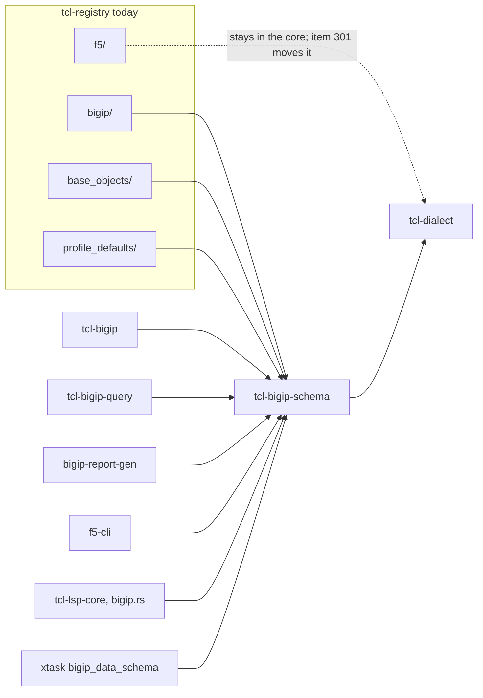
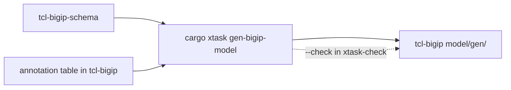

# Item 118: the BIG-IP configuration-schema crate

Plan item 118, under its Q4 decision, split here into 118a (move) and 118b
(data form, item 300's lever applied to this crate). It runs beside the
registry split's steps and depends on none of them. Item 119 (generators with
`--check` gates) shares its generated files, and item 111 (BIG-IP domain data
from one owner) consumes the crate. The overview is
[splitting tcl-registry](../registry-split-design.md).

## Problem

The registry carries a BIG-IP configuration schema that no command spec
reads. Counted with `wc -l` on 26 November 2026:

| Module | Lines | Form |
|---|---|---|
| `bigip/` | 126,137 | 121k hand-maintained `BigipObjectSpec` statics under `bigip/data/` (30 tmsh modules; each file says "Hand-maintained: edit them directly"), plus `bigip/references.rs`, 5,061 lines marked `@generated` |
| `base_objects/` | 42,349 | `generated_names.rs` and `generated_objects.rs`, both `@generated`: a 17.1 base-configuration snapshot as `BaseObject` tables |
| `profile_defaults/` | 2,862 | `generated.rs` (`@generated`), version-ranged profile field defaults |
| `f5/` | 4,913 | not schema (below) |

The first three are a leaf:

- **What they need.** `bigip/` names one item outside itself:
  `tcl_dialect::VersionKey::BigipVersion` (`bigip/mod.rs:618`).
  `base_objects` reads `profile_defaults`. `profile_defaults` names
  `crate::profiles` only in a doc comment (`profile_defaults/mod.rs:178`).
- **Who reads them inside the registry.** `snapshot.rs`
  (`object_graph_snapshot`, `snapshot.rs:177`), which only the registry's
  tests call (`tests/it_2/snapshot.rs`), and one test in `f5/iapp_metadata.rs`
  (line 402, under the `#[cfg(test)]` at line 283).
- **No command spec reads them.**
  `rg 'crate::(bigip|base_objects|profile_defaults)' commands` returns
  nothing. The iRules hits on `Bigip` are the `SideEffectTarget::BigipConfig`
  effect, which is core vocabulary.

Outside the registry they are read by `tcl-bigip` (13 files),
`bigip-report-gen` (3), `tcl-bigip-query` (2), `f5-cli` (1), `tcl-lsp-core`
(`bigip.rs`, 1) and `xtask` (`bigip_data_schema.rs`, which validates
`bigip/data/` by path).

`f5/` is a different thing. It is the f5-tcl evidence layer: execution contexts
(`BigIpExecutionContext::TmmIRule` and others), measured builds, variable
storage domains, name policy, rule identity, a conformance corpus, iApp
metadata and the tmsh syntax-version axis. It depends on `events`,
`irules_policy`, `state_transition`, `invocation_words`, `special_vars`,
`profiles` and `model`. Its readers are `tcl-compiler` (20 files), `tcl-vm`
(5), `runtime/rust` (2), `tcl-irule-test` (2), `tcl-lsp-db` and `tcl-diagram`.

`tcl-bigip` (57,992 lines) keeps a second statement of the schema:

- **`model/gen/`.** 17,133 lines of generated parsers, canonical forms and
  dispatch (`canon.rs` 7,088, `parsers.rs` 3,645, `dispatch.rs` 1,852), with
  no gate between them and the registry's specs. Q2 recovered the original
  generator from git (`553b71b6dd:scripts/codegen/gen_bigip_model_rust.py`).
- **Word comparisons.** The `registry-axes` ratchet holds 216 comparisons in
  `tcl-bigip` today (the plan says 219). Most are schema words that collide
  with registry words: `graph.rs` 33, `parser/bespoke.rs` 27,
  `model/gen/dispatch.rs` 16, `parser/driver.rs` 13. Examples are
  `kind == "pool"` and the `"client-ssl" => ProfileType::ClientSsl` arms.

## Design

### 118a: `tcl-bigip-schema`

A data crate that depends only on `tcl-dialect`:

- **Holds** `bigip/`, `base_objects/`, `profile_defaults/`, and
  `snapshot.rs`'s object-graph half.
- **Does not hold `f5/`.** It stays in the core (decision 1).

```rust
// tcl-bigip-schema
pub use bigip::{BigipObjectSpec, BigipObjectKindSpec, BigipPropertySpec, BigipRegistry, ValueKind};
pub mod base_objects;     // shipped base identities (17.1)
pub mod profile_defaults; // version-ranged profile field defaults
pub mod references;       // reference edges
pub fn object_graph_snapshot() -> Json;
```

Consumers rewrite `tcl_registry::bigip::…`, `tcl_registry::base_objects::…`
and `tcl_registry::profile_defaults::…` to `tcl_bigip_schema::…` in the same
change. In `tcl-bigip`, for example:

**Before:**

```rust
use tcl_registry::bigip::BigipRegistry;                         // tmsh_emit.rs
use tcl_registry::profile_defaults::{BigipVersion, profile_field_defaults}; // tls.rs
```

**After:**

```rust
use tcl_bigip_schema::BigipRegistry;
use tcl_bigip_schema::profile_defaults::{BigipVersion, profile_field_defaults};
```

Where the parts go, and who reads the new crate:



`tcl-registry`'s root re-export (`lib.rs:448`) goes. `tcl-registry`
has no edge to the new crate.

In step 4's [crate roles](04-dependency-hygiene.md#crate-roles) the crate has
a role of its own, `schema`. It may depend only on foundation crates, and
only `tcl-bigip`, `tcl-bigip-*` and `xtask` may depend on it. It is a leaf
edited rarely, unlike a surface, but at 171k lines it must not sit under the
core or a generic crate. `tcl-lsp-core`, which needs it for one file, reads
it through `tcl-bigip`.

### `tcl-bigip`'s model from the schema

`tcl-bigip`'s generic model is generated from `tcl-bigip-schema` plus explicit
annotations, as Q4 decided:

- **The generator** is the recovered one, ported to `cargo xtask
  gen-bigip-model`, which reads the schema as a Rust dependency.
- **The annotations** live in one checked-in table in `tcl-bigip`. They are
  the bespoke parsers and the profile-type mapping the comparisons spell out
  today.
- **The gate** is `--check`, which `xtask-check` runs as for the other
  generators (item 119). It fails when `model/gen/` differs from what the
  schema and the annotations produce.



The 216 comparisons move onto typed schema facts. A kind is compared by
`BigipObjectKindSpec` identity, a property by its `BigipPropertySpec`, and a
profile type by a schema-owned enum instead of a string arm. `registry-axes`
then reports zero for `tcl-bigip`. The schema crate is the words' owner, so
`registry-axes` excludes it as it excludes the registry.

### 118b: data, not compiled Rust

Item 300 asks that a generated file which is a table be embedded as data and
parsed once. The answer differs by part:

| Part | Lines | Form after 118b | Why |
|---|---|---|---|
| `base_objects/generated_*` | 42k | data: one checked-in file per base-configuration build, embedded with `include_bytes!` and decoded once into leaked `&'static` tables | It is a table of strings. Q3 wants snapshots per exact build (17.1.x, 17.5.x, 21.1.x live; 15.1.x and 16.1.x historical). As Rust, each new build adds about 40k compiled lines; as data it adds a file. |
| `profile_defaults/generated.rs` | 2.9k | data, the same way | It is a version-ranged table, and item 119 ports its extractor to Rust over the SCF parser, which can write data as easily as Rust. |
| `bigip/references.rs` | 5k | derived at start-up from the property descriptors | Q2 decided to derive the edges, which removes the file rather than re-encoding it. |
| `bigip/data/` | 121k | Rust, unchanged | It is authored by hand, structured (properties nest, enums and references are typed), and read through `&'static` statics by `tcl-bigip`'s generator. A data format would trade compile-time checks for a loader and a schema of its own, for a crate that is a leaf and rarely edited. Revisit with the measurement below. |

The decode keeps the consumers' types: `BaseObject` and the profile-default
rows stay `&'static`, built once in a `LazyLock`, so no consumer changes.

## Decisions

1. **`f5/` stays out of the schema crate.** It is the f5-tcl evidence model,
   which `tcl-compiler` and the engines read, and it depends on core modules.
   In a crate below the core it would need half the core. In a surface crate
   it would put a surface under the compiler. Its place is the dialect model:
   item 301 moves it to `tcl-dialect` with f5-tcl's builds. Its conformance
   corpus goes with `tcl-lib-irules`'s tests ([step 3](03-extract-crates.md#module-assignment)),
   and its `iapp_metadata` and `tmsh_syntax` with `tcl-lib-iapps`.
2. **Move first, change form second.** 118a alone takes 171k lines out of
   every registry rebuild. 118b is a separate measurement-driven change inside
   a crate nobody else's edits rebuild.
3. **The registry does not consume the schema.** Q4 said "consumed by both
   `tcl-registry` and `tcl-bigip`". Today the registry's only readers are a
   snapshot its tests call and one test. Both move with the crate or into its
   tests.

## Open questions

1. Is `bigip/data/`'s compile time worth a data form? Settled by `cargo build
   -p tcl-bigip-schema --timings` cold, the crate's rlib size, and the
   rebuild time after a one-property edit. If a worktree that edits it pays
   less than a minute, it stays Rust.
2. What does the data form cost at run time? Settled by the decode time and
   resident memory of the base snapshot on first use in `f5-query`, against
   the `static` tables, and by the size of `bigip-query-wasm` with and without
   it. The WASM build pays the embedded bytes either way.
3. Should `tcl-bigip` derive its model at start-up from the schema instead of
   generating code? It would remove `model/gen/` altogether. Settled by
   `tcl-bigip`'s configuration-parse benchmark under both.

## Work list

118a:

1. Create `rust/tcl-bigip-schema`. Move `bigip/`, `base_objects/`,
   `profile_defaults/` and the object-graph part of `snapshot.rs` and its
   test.
2. Rewrite the consumers (`tcl-bigip`, `tcl-bigip-query`, `bigip-report-gen`,
   `f5-cli`, `tcl-lsp-core`, `xtask`'s `bigip_data_schema.rs` `DATA_DIR`), and
   drop the registry's re-export.
3. Add the crate to `crate-roles.tsv` as `data`, and to the shard map.
4. Port the model generator to `cargo xtask gen-bigip-model --check`. Add the
   annotation table, and regenerate `model/gen/`.
5. Rewrite the 216 comparisons onto schema facts, file by file, lowering the
   `registry-axes` ratchet as each file clears.

118b:

1. Measure open questions 1 and 2.
2. Emit the base snapshot and profile defaults as data from item 119's
   generators, and decode them once.
3. Derive the reference edges from the descriptors, and delete
   `references.rs`.

## Verification

- **118a is done when:**
  - `tcl-bigip-schema` holds `bigip/`, `base_objects/` and `profile_defaults/`,
    and none of them remain in `tcl-registry`;
  - `cargo tree -p tcl-registry` lists no `tcl-bigip-schema`;
  - `tcl-bigip`'s `model/gen/` is generated from the schema under
    `--check`;
  - `registry-axes` reports zero comparisons in `tcl-bigip` (216 today).
- **118b is done when** the base snapshot and profile defaults load from
  embedded data, `references.rs` is gone, and the answers are unchanged.
- **Same answers.**
  - `tcl-bigip`'s and `tcl-bigip-query`'s test suites and the
    `bigip-report-gen` output on the shipped fixtures are identical before
    and after.
  - `object_graph_snapshot` is byte-identical.
- **Measured** with item 259's script:

  | Measurement | Expectation |
  |---|---|
  | `tcl-registry`'s compile time | down by its share of 171k lines |
  | rebuild after one registry-core edit | `tcl-bigip-schema` is not rebuilt |
  | `cargo build -p tcl-bigip-schema --timings`, cold | recorded for open question 1 |
  | `f5-query` start-up and first base-object lookup | within noise of today for 118a; recorded for 118b |
  | `bigip-query-wasm` and `tcl-lsp-server` binary size | recorded for open question 2 |

## Risks

- **A hidden registry reader.** Something in the registry reaching the schema
  through a re-export. The compiler finds it at first build. The `rg` above
  says there is none in production code.
- **Generator drift during the port.** The recovered Python generator
  predates today's `model/gen/`. Mitigation: the first regenerated output must
  match the checked-in files exactly before any comparison moves. Each
  difference is recorded as an annotation, never hand-edited into `gen/`.
- **Base snapshot provenance.** The 17.1 snapshot's extractor was not
  recovered (Q2). The data form must carry the build stamp and source
  manifest Q2 asks for, or adding 17.5 and 21.1 repeats the problem.

## Corrections to the plan and the overview

- **`f5/` is not configuration schema.** Item 118's done-when lists it among
  the schema crate's contents. It is the f5-tcl evidence model, which
  `tcl-compiler` reads. The done-when should name `bigip/`, `base_objects/`
  and `profile_defaults/` only, with `f5/` assigned to item 301. The
  schema's line count is then 171k, not 176k.
- **The ratchet count.** "219 vocabulary comparisons" is 216 in today's
  ratchet (`registry_axes.rs`, `RATCHET`).
- **No registry edge.** Q4's "consumed by both `tcl-registry` and
  `tcl-bigip`": `tcl-registry` needs no edge to the crate.
- **No library edge.** The overview's "`tcl-lib-irules` and `tcl-lib-iapps`
  depend on the BIG-IP schema crate" is not needed: no command spec reads
  the schema.

## Review fixes (26 November 2026)

- **R7:** the crate's role is `schema`, not `data`: only `tcl-bigip`, `tcl-bigip-*` and `xtask` may depend on it, and `tcl-lsp-core` reads it through `tcl-bigip`.
