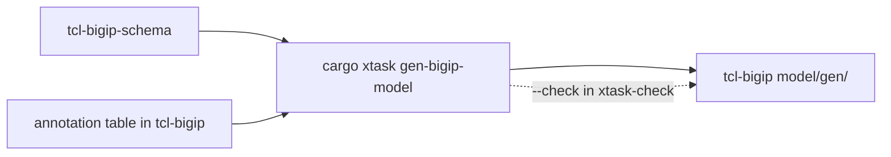

# Item 118: the BIG-IP configuration-schema crate

Plan item 118, under its Q4 decision, split here into 118a (move) and 118b
(data form, item 300's lever applied to this crate). It runs beside the
registry split's steps and depends on none of them. Item 119 (generators with
`--check` gates) shares its generated files, and item 111 (BIG-IP domain data
from one owner) consumes the crate. The overview is
[splitting tcl-registry](../registry-split-design.md).

## Current boundary

`tcl-bigip-schema` owns `bigip/`, `base_objects/`, `profile_defaults/`
and the object-graph snapshot. It depends on `tcl-dialect` and `serde_json`,
with no command-registry edge. `tcl-registry` neither contains nor re-exports
these tables, including through dev-dependencies.

The schema exports typed descriptors, `BigipRegistry`, base identities,
profile defaults and `object_graph_snapshot() -> serde_json::Value`.
Registry profile/event snapshots retain their existing canonical ASCII JSON
writer; the CLI converts the object JSON at that presentation boundary.
Neither snapshot producer depends on the other.

Direct consumers are `tcl-bigip`, `tcl-bigip-query` and `xtask`.
`tcl-bigip::schema` exposes the model's schema contract to LSP, CLI and
report adapters. `deny.toml` and `crate-layer` enforce this incoming boundary;
`crate-layer` also rejects workspace dependencies beyond the schema's
foundation owner. Schema-only golden queries, complete property sweeps and
iApp-property checks live in the schema crate's public integration harness.

The data remains Rust, including generated base snapshots and defaults.
The F5 execution evidence model remains in the command registry. 118b owns
model generation, vocabulary-comparison cleanup and any change of data form.

### Planned 118b: `tcl-bigip`'s model from the schema

118b will generate `tcl-bigip`'s generic model from `tcl-bigip-schema` plus explicit
annotations, as Q4 decided:

- **The generator** is the recovered one, ported to `cargo xtask
  gen-bigip-model`, which reads the schema as a Rust dependency.
- **The annotations** live in one checked-in table in `tcl-bigip`. They are
  the bespoke parsers and the profile-type mapping the comparisons spell out
  today.
- **The gate** is `--check`, which `xtask-check` runs as for the other
  generators (item 119). It fails when `model/gen/` differs from what the
  schema and the annotations produce.

The 216 comparisons move onto typed schema facts. A kind is compared by
`BigipObjectKindSpec` identity, a property by its `BigipPropertySpec`, and a
profile type by a schema-owned enum instead of a string arm. `registry-axes`
then reports zero for `tcl-bigip`. The schema crate is the words' owner, so
`registry-axes` excludes it as it excludes the registry.

### 118b: data, not compiled Rust

Item 300 asks that a generated file which is a table be embedded as data and
parsed once. The answer differs by part:

| Part | Lines | Form after 118b | Why |
|---|---|---|---|
| `base_objects/generated_*` | 42k | data: one checked-in file per base-configuration build, embedded with `include_bytes!` and decoded once into leaked `&'static` tables | It is a table of strings. Q3 wants snapshots per exact build (17.1.x, 17.5.x, 21.1.x live; 15.1.x and 16.1.x historical). As Rust, each new build adds about 40k compiled lines; as data it adds a file. |
| `profile_defaults/generated.rs` | 2.9k | data, the same way | It is a version-ranged table, and item 119 ports its extractor to Rust over the SCF parser, which can write data as easily as Rust. |
| `bigip/references.rs` | 5k | derived at start-up from the property descriptors | Q2 decided to derive the edges, which removes the file rather than re-encoding it. |
| `bigip/data/` | 121k | Rust, unchanged | It is authored by hand, structured (properties nest, enums and references are typed), and read through `&'static` statics by `tcl-bigip`'s generator. A data format would trade compile-time checks for a loader and a schema of its own, for a crate that is a leaf and rarely edited. Revisit with the measurement below. |

The decode keeps the consumers' types: `BaseObject` and the profile-default
rows stay `&'static`, built once in a `LazyLock`, so no consumer changes.

## Decisions

1. **`f5/` stays out of the schema crate, and splits by owner.** It is not
   one thing, and no single crate can hold it: `tcl-dialect` is a layer-0
   leaf below `tcl-syntax`, which `naming.rs` uses, and `evidence.rs` reads
   the iRules library's command lists. So:
   - **builds and releases** (`BigIpBuild`, `MEASURED_BUILDS`,
     `RELEASE_DISCRIMINATORS`, the measured runtime evidence keyed by build)
     go to `tcl-dialect`'s f5-tcl types with item 301;
   - **the cross-cutting execution model** (`BigIpExecutionContext`,
     `naming`, `storage`, `rule_identity`) stays in the registry core, which
     `tcl-compiler` and the engines already reach;
   - **command presence** (`CommandPresence` over `IRULES_INTERPRETER_ABSENT`
     and `IRULES_COMPILER_REFUSED`) and the conformance corpus go to
     `tcl-lib-irules` (the corpus to its tests, [step 3](03-extract-crates.md#module-assignment));
   - `iapp_metadata` goes to `tcl-lib-iapps` and `tmsh_syntax` to
     `tcl-lib-tmsh`.

   Each part moves as it is, with the extraction that carries its owner (264
   for the library parts, 301 for the builds); none gates another
   extraction.
2. **Move first, change form second.** 118a alone takes 171k lines out of
   every registry rebuild. 118b is a separate measurement-driven change inside
   a crate nobody else's edits rebuild.
3. **The registry does not consume the schema.** Q4 said "consumed by both
   `tcl-registry` and `tcl-bigip`". Today the registry's only readers are a
   snapshot its tests call and one test. Both move with the crate or into its
   tests.

## Open questions

1. Is `bigip/data/`'s compile time worth a data form? Settled by `cargo build
   -p tcl-bigip-schema --timings` cold, the crate's rlib size, and the
   rebuild time after a one-property edit. If a worktree that edits it pays
   less than a minute, it stays Rust.
2. What does the data form cost at run time? Settled by the decode time and
   resident memory of the base snapshot on first use in `f5-query`, against
   the `static` tables, and by the size of `bigip-query-wasm` with and without
   it. The WASM build pays the embedded bytes either way.
3. Should `tcl-bigip` derive its model at start-up from the schema instead of
   generating code? It would remove `model/gen/` altogether. Settled by
   `tcl-bigip`'s configuration-parse benchmark under both.

## Work list

118a:

1. Create `rust/tcl-bigip-schema`. Move `bigip/`, `base_objects/`,
   `profile_defaults/` and the object-graph part of `snapshot.rs` and its
   test.
2. Rewrite the consumers (`tcl-bigip`, `tcl-bigip-query`, `bigip-report-gen`,
   `f5-cli`, `tcl-lsp-core`, `xtask`'s `bigip_data_schema.rs` `DATA_DIR`), and
   drop the registry's re-export.
3. Add the crate to the workspace, dependency policy and shard map.

118b:

1. Port the model generator to `cargo xtask gen-bigip-model --check`. Add the
   annotation table, and regenerate `model/gen/`.
2. Rewrite the 216 comparisons onto schema facts, file by file, lowering the
   `registry-axes` ratchet as each file clears.

3. Measure open questions 1 and 2.
4. Emit the base snapshot and profile defaults as data from item 119's
   generators, and decode them once.
5. Derive the reference edges from the descriptors, and delete
   `references.rs`.

## Verification

- **118a is done when:**
  - `tcl-bigip-schema` holds `bigip/`, `base_objects/` and `profile_defaults/`,
    and none of them remain in `tcl-registry`;
  - `cargo tree -p tcl-registry` lists no `tcl-bigip-schema`;
  - schema public golden tests and property sweeps pass;
  - workspace consumers use the schema directly or through `tcl-bigip::schema`.
- **118b is done when** the model generator has a `--check` gate,
  `registry-axes` reports zero model vocabulary comparisons, the base snapshot
  and profile defaults load from
  embedded data, `references.rs` is gone, and the answers are unchanged.
- **Same answers.**
  - `tcl-bigip`'s and `tcl-bigip-query`'s test suites and the
    `bigip-report-gen` output on the shipped fixtures are identical before
    and after.
  - `object_graph_snapshot` is byte-identical.
- **Measured** with item 259's script:

  | Measurement | Expectation |
  |---|---|
  | `tcl-registry`'s compile time | down by its share of 171k lines |
  | rebuild after one registry-core edit | `tcl-bigip-schema` is not rebuilt |
  | `cargo build -p tcl-bigip-schema --timings`, cold | recorded for open question 1 |
  | `f5-query` start-up and first base-object lookup | within noise of today for 118a; recorded for 118b |
  | `bigip-query-wasm` and `tcl-lsp-server` binary size | recorded for open question 2 |

## As built: 118a's rebuild cost (27 November 2026)

118a landed in `ea249768` as designed: the three trees moved unchanged,
`tcl-registry` has no edge to `tcl-bigip-schema`, including dev-dependencies,
and the crate's only direct dependants are `tcl-bigip`, `tcl-bigip-query`
and `xtask`.

**What a schema edit rebuilds.** Before the move, the schema was part of
`tcl-registry`, so an edit to it rebuilt the registry's whole reverse cone.
After it, an edit rebuilds the schema crate's cone. The package lists come
from each revision's `Cargo.lock`, with every dependency kind, so they are
what `cargo test --workspace` rebuilds:

| | local packages rebuilt | of 62 or 64 local packages |
|---|---|---|
| before (`ea249768^`, an edit in `tcl-registry`) | 40 | 62 |
| after (an edit in `tcl-bigip-schema`) | 20 | 64 |

The 20 are `tcl-bigip-schema`, `tcl-bigip`, `tcl-bigip-io`,
`tcl-bigip-query`, `bigip-report-gen-rust`, `f5-cli`, `f5-xc`, `tcl-cli`,
`tcl-cli-support`, `tcl-compiler-it`, `tcl-explorer`, `tcl-irule-test`,
`tcl-lsp-core`, `tcl-lsp-db`, `tcl-lsp-db-it`, `tcl-lsp-server`, `tcl-mcp`,
`tcl-spec-studio`, `tcl-spectcl` and `xtask`. The 20 that drop out include
`tcl-registry`, `tcl-compiler`, `tcl-codegen`, `tcl-vm`, `tcl-runtime` and
`tcl-vm-it`.

**Wall time.** `cargo check --workspace --all-targets`, warm dev target,
`CARGO_INCREMENTAL=0`, after appending one comment line, on the shared
agent machine:

| Edit | packages checked | seconds |
|---|---|---|
| `tcl-bigip-schema/src/bigip/mod.rs` (after) | 20 | 61 |
| `tcl-registry/src/lib.rs` (today's registry, without the schema) | 39 | 123 |

Before the move, a schema edit cost at least the second row, plus
recompiling the 171k schema lines inside `tcl-registry`. A cold
`--timings` build of the schema crate (open question 1) was not measured.

## Risks

- **A hidden registry reader.** Something in the registry reaching the schema
  through a re-export. The compiler finds it at first build. The `rg` above
  says there is none in production code.
- **Generator drift during the port.** The recovered Python generator
  predates today's `model/gen/`. Mitigation: the first regenerated output must
  match the checked-in files exactly before any comparison moves. Each
  difference is recorded as an annotation, never hand-edited into `gen/`.
- **Base snapshot provenance.** The 17.1 snapshot's extractor was not
  recovered (Q2). The data form must carry the build stamp and source
  manifest Q2 asks for, or adding 17.5 and 21.1 repeats the problem.

## Corrections to the plan and the overview

- **`f5/` is not configuration schema.** Item 118's done-when lists it among
  the schema crate's contents. It is the f5-tcl evidence model, which
  `tcl-compiler` reads. The done-when should name `bigip/`, `base_objects/`
  and `profile_defaults/` only, with `f5/` split by decision 1 (item 301
  takes the builds, item 264 the library parts). The schema's line count is
  then 171k, not 176k. Item 301's "moves to `tcl-dialect`" covers only the
  builds and releases.
- **The ratchet count.** "219 vocabulary comparisons" is 216 in today's
  ratchet (`registry_axes.rs`, `RATCHET`).
- **No registry edge.** Q4's "consumed by both `tcl-registry` and
  `tcl-bigip`": `tcl-registry` needs no edge to the crate.
- **No library edge.** The overview's "`tcl-lib-irules` and `tcl-lib-iapps`
  depend on the BIG-IP schema crate" is not needed: no command spec reads
  the schema.

## Review fixes (26 November 2026)

- **R7:** the crate's role is `schema`, not `data`: only `tcl-bigip`, `tcl-bigip-*` and `xtask` may depend on it, and `tcl-lsp-core` reads it through `tcl-bigip`.

## Review fixes (26 November 2026, deep review)

- **O6:** decision 1 splits `f5/` by owner, with production and test dependencies separated (`evidence.rs:31`, `tmsh_syntax.rs:58-59`, `naming.rs:22`); the diagram and the plan correction follow.
