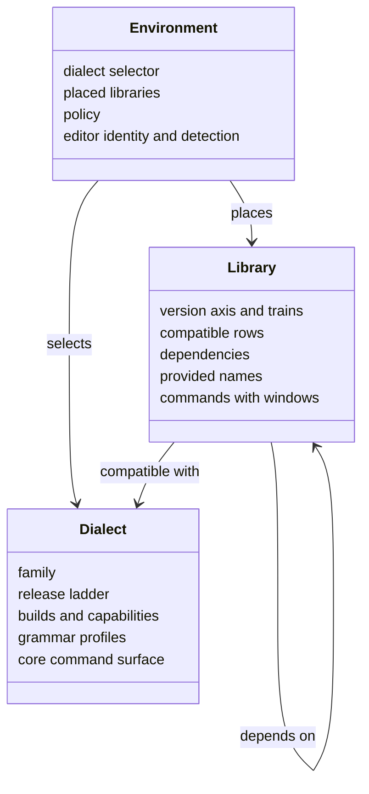
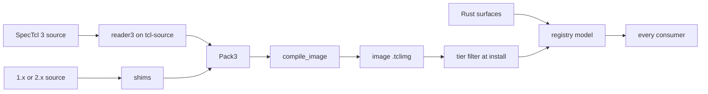

# 1. Overview and principles

Status: consolidated specification, 26 November 2026. This chapter states
what SpecTcl 3 is for, the principles every later chapter follows, and the
conflicts between the source designs that this specification settles.

SpecTcl 3 is the declarative pack language of tcl-lsp. A pack describes
dialects, libraries, environments and the commands they provide. It is
**read, never run**. Packs are compiled to binary images once per build, and
the Rust registry and SpecTcl 3 describe one model at parity, so every
consumer reads the same facts whichever front end wrote them:

- the analyser and diagnostics, and the LSP (hover, completion, rename,
  references);
- the formatter, minifier, optimiser and refactors;
- codegen, the VM and the runtime;
- the iRules test framework and the CLI and MCP tools.

It covers the C Tcl 8.4–9.1, Jim and f5-tcl dialects and the libraries above
them. The source designs (305 to 392 in [`../model/`](../model/), the
[overview](../dialects-and-libraries.md) and today's
[2.x loader](../spec-packs.md)) stay as rationale and evidence. Where a
source and this specification differ, this specification wins.

## Principles

1. **Read, never run.** A 3 pack is a fixed grammar over Tcl's word syntax.
   It has no command or variable substitution, no `proc`, no loops and no
   `set`. `[…]` and `$` are literal text. A pack that needs repetition is
   generated by a tool outside the pack (chapter 10).
2. **One model, two front ends.** Rust struct literals and SpecTcl 3 rows
   produce the same registry values. One printer prints any value of the
   model, and a gate holds the two at parity (chapter 7).
3. **Facts first.** An answer climbs five rungs only as far as it must: facts,
   `check` rules, a native hook ID, a Tcl hook body, tabulated answers
   (chapter 5). Codegen reads facts only.
4. **A missing fact abstains.** No consumer guesses. A missing role costs a
   rename, a fold or a reflow, never a wrong answer (chapter 6).
5. **Versions are sets.** Every range is read with Tcl's own `package
   vsatisfies` algebra. An answer over a target range or a conditional
   require is a set with provenance, never a floor (chapter 3).
6. **Compiled once per build.** Every shipped pack is an image embedded with
   `include_bytes!` or shipped beside its source. The LSP never parses a
   shipped pack at run time (chapter 7).
7. **Trust is provenance.** Who wrote a row decides what it may say. There
   is no signing in 3.0.

## The three kinds of thing

A **dialect** is a fundamental language: a family (`tcl`, `jim`, `f5-tcl`) at
a release under a build. It owns how source is read: every grammar profile
(chapter 4) and the core command surface. A **library** provides commands on
top of dialects. It has its own version axis with trains, compatibility rows,
dependencies on other libraries, and commands with windows. An **environment**
is a selectable combination: a dialect selector plus placed libraries, a
policy, editor identity and detection. Only an environment names both of the
others.



## The rungs, in brief

| Rung | Form | Evaluated by | Example |
|---|---|---|---|
| 1 | facts | the registry core | `arity 1..`, `arg 0 -role VarWrite`, `throws {POSIX}` |
| 2 | `check` rules | a closed predicate language in Rust | "with `-legacy`, `-mode` must be `fast` or `slow`" |
| 3 | native hook ID | the owning crate's hook table | `const_fold -native math::max` |
| 4 | Tcl hook body | the hook VM, from tbcx bytecode | an `arg_role_resolver` body |
| 5 | tabulated answers | a table in the image | a shape-only resolver's answer per word count |

There is one `hook_abi` number for every native hook table. Whole-file passes
(`irules_checks`, Tk's checks, the eBPF front end) are registered analyser
contributions, not a rung (Reconciliation R2).

## Images, in brief

`cargo xtask spec-images` compiles every shipped pack once per build. Core
dialect and library images are embedded in their crate with `include_bytes!`.
Replaceable vendor packs ship as `specs/NAME.tclimg` beside
`specs/NAME.tclspec`. Every editor bundle carries the pre-compiled images and
the sources. A user or workspace pack is compiled once, without a VM, and
cached by source hash. The format is chapter 7's.



## Trust tiers

Provenance is today's `Provenance`
(`rust/tcl-dialect/src/model/environment.rs:259`). A package's dependency
tier (root, direct, transitive, development) narrows a workspace pack further,
as today ([spec-packs](../spec-packs.md#loading-and-tooling)).

| Provenance | Facts, `check` | `-native` refs | Tcl hook bodies | `rewrite` | Native-contract and codegen rows | Native implementations | Define a dialect | Change `tcl`, `jim`, `f5-tcl` |
|---|---|---|---|---|---|---|---|---|
| BuiltIn (Rust), BundledPack | yes | yes | yes | yes | yes | yes, if the host opts in | yes | yes, with conformance rows |
| User, WorkspaceTrusted | yes | to compiled-in IDs | sandboxed | yes, when proved | no: refused with a notice | no | yes, namespaced | no |
| WorkspaceUntrusted | yes | dormant | dormant | no | no | no | no | no |
| StudioOverride, Document (inline stub) | yes | dormant | the author's own edit runs | no | no | no | no | no |

Native-contract rows are `successful_handler`, `native_compilation`,
`procedure_definition`, `completion`, `body_execution` and the codegen hook
IDs (chapter 5). They are spelled for parity and accepted only from the first
row. Images are compiled **tier-neutral** and filtered at install, so the
same bytes serve every tier.

## Where packs come from

| Source | Tier | Form at run time |
|---|---|---|
| dialect and library crates (`tcl-dialect-*`, `tcl-lib-*`) | BuiltIn | image embedded with `include_bytes!` |
| `specs/NAME.tclspec` beside the executable, or `TCL_LSP_SPEC_PACK_DIR` | BundledPack | `specs/NAME.tclimg` beside it; demand-loaded |
| the user config directory (`$XDG_CONFIG_HOME/tcl-lsp/specs/`) | User | compiled once, cached by hash |
| `tclLsp.specPacks`, `.tcl-lsp/`, beside a `tclpkg.tcl` (its `spec` directive) | WorkspaceTrusted or WorkspaceUntrusted, narrowed by the lockfile tier | compiled once, cached by hash |
| a Spec Studio edit | StudioOverride | compiled in memory |
| a `# tcl-lsp: stub` declaration | Document | not a pack: read per document |

Discovery is nearest-wins (workspace, then user, then bundled), and a name
already shipped wins unless the pack says `-override`, as in 2.x. Images a
workspace ships beside its packs are never trusted from disk (chapter 7).

## Example: a pack is read, never run

**Source:**

```spectcl
speclib itcl-example 3 {
    library Itcl {
        versions 3.4.5 4.3.5
        train 3 {3.4-4}
        train 4 {4-5}
        compatible Itcl 3.4-4 {tcl 8.4-8.7}
        compatible Itcl 4- {tcl 8.6-}
    }
    command itcl::local { available Itcl 4.0- ; arity 2.. }
}
```

**In memory:**

```rust
// design sketch: chapter 7's types
Library {
    id: LibraryId("Itcl"), axis: LibraryAxis::Own,
    trains: &[Train { name: "3", versions: VersionSet("3.4-4"), latest: Version("3.4.5") },
              Train { name: "4", versions: VersionSet("4-5"), latest: Version("4.3.5") }],
    compatible: &[CompatibilityRow { library: VersionSet("3.4-4"), dialect: DialectRange { family: Family::Tcl, releases: VersionSet("8.4-8.7") }, build: None, requires_caps: &[] },
                  CompatibilityRow { library: VersionSet("4-"), dialect: DialectRange { family: Family::Tcl, releases: VersionSet("8.6-") }, build: None, requires_caps: &[] }],
    requires: &[], provides: &[], conflicts: &[], provides_early: VersionSet::EMPTY,
}
VersionedSpec {                                   // itcl::local
    availability: Availability { providers: &[ProviderRow { library: Some(LibraryId("Itcl")), window: ItemHistory("4.0-"), dialect: None }] },
    arity: Facet { rows: &[(FacetKey::ANY, Arity::new(2, None))] },
    ..
}
```

**Result:**

```text
$ tclsh9.1 itcl.tclspec
invalid command name "speclib"
    while executing
"speclib itcl-example 3 {
$ tmp/jimtcl-oracle/jimsh itcl.tclspec
itcl.tclspec:1: Error: invalid command name "speclib"
```

The file is well-formed Tcl words, so every Tcl editor and lexer reads it,
but nothing defines `speclib`: a 3 pack is data. The 2.x loader evaluates a
pack in a sandbox with 24 extra commands (`PACK_EVAL_EXTRA_COMMANDS`,
`rust/tcl-spec-hooks/src/pack_eval.rs:67`). The 3 reader needs no VM. There
is no bytecode block because the pack compiles to an image, not to Tcl.

## Owner decisions this specification applies

These are binding and not reopened here:

- versions use `package vsatisfies` everywhere;
- packs are declarative; 1.x and 2.x load through shims; `tcl spec upgrade`
  converts with an equivalence proof; no templating in 3; generators are user
  tooling and hand edits are the user's or the AI tooling's to re-apply;
- images are compiled once per build and embedded; vendor images ship beside
  their `.tclspec`; editor bundles ship pre-compiled packs; one crate per
  package (`tcl-lib-*`, `tcl-dialect-{tcl,jim,f5}`, `tcl-catalogue`);
- the rungs are facts, `check`, native hook ID, Tcl hook body, tabulated
  answers; one `hook_abi`; Tcl hook bodies are tbcx format 93 bytecode on a
  VM rebased onto Tcl 9.1;
- codegen gets facts only, no hooks;
- proved user-pack optimiser rewrites are on by default;
- iRules events, flows and profiles are pack content;
- localisation is prepared for (`message LOCALE`, `doc LOCALE`), English only;
- no signing in 3.0;
- f5-tcl keeps its name; iRules load-time failures are errors matching the
  appliance; only BIG-IP releases in public support per F5's K5902 article
  are modelled; F5-bundled iApp packages have unknown versions (Q12);
- Jim is supported at 0.84 only; a dialect gets release boundaries only where
  a release changes the language;
- dialects configure every lexer and parser through grammar profiles;
- embedded languages get ranges and editor injection metadata, never a parser;
- all thirteen package-surface areas are planned; handles and error codes are
  typed and tracked;
- SslicTcl is internal and changes with its consumers, with no shims and a new
  `SSLIC1013`;
- Tk command keys are rekeyed from the real Tk sources.

## Reconciliations

Each row is a conflict between sources, and what this specification says.

| # | Source A said | Source B said | The spec says | Why |
|---|---|---|---|---|
| R1 | 305: ranges have redesign §5.4's whole-line reading (`8.4-8.6` includes 8.6.x) | 333: recommend the targets reading in packs | Tcl's algebra: `A-B` is `[A, B)`, `A-` is open, `V` is `[V, next major)`, `A-A` is exactly A. 302's Itcl 3.4 row becomes `{tcl 8.4-8.7}`; the environment row `tcl 8.4-9.1` becomes `tcl 8.4-` | owner decision; `package vsatisfies 8.6.18 8.4-8.6` is 0 on 8.5–9.1 (chapter 2) |
| R2 | 305: rung 5 is "native contributions" (whole-file passes) | 310 and 313: four rungs | rungs 1–5 are facts, `check`, native ID, Tcl body, tabulated answers; whole-file passes are registered contributions outside the ladder | owner decision on the rungs |
| R3 | 305, 306: Tcl hook bodies keep source and compile on first call | 311, 313: `BODIES` holds `TbcxUnit` | `BODIES` holds a tbcx format-93 interop unit per body, with its source kept for the hash and the fallback; source-only images are allowed until item 311 lands | owner decision on tbcx and the 9.1 VM |
| R4 | 305: word `kinds` are `literal var command script expand` | shipped: `literal known-bytes dynamic expanded opaque` (`pack_hooks/hook_inputs.rs`) | one set: `literal known-bytes var command script expand opaque` | 333 gap 14; a rewrite must tell `var` from `command` |
| R5 | 302: `Availability.library: Option<LibraryId>` | 331: `providers: &[ProviderRow]` | providers, OR'd | one item, several providers (`file home`) |
| R6 | 302: `Requirement`, and compatibility rows that fold a guard and a source require | 331: `Dependency`; guards and requires apart | `Dependency`; `compatible` is the index guard only, `requires … {core R}` is the source's require | tclsh treats them differently (it never backtracks) |
| R7 | 302, 305: `alias NAME` on a library, `Library.aliases` | 331: `provides` rows | `alias` is sugar for `provides … same -via exact-chain`; `Library.aliases` is gone | identity chains (`Itcl`/`itcl`, `Tk`/`tk`) carry predicates |
| R8 | 305: `available core RANGE` | 350: `core FAMILY RANGE` | `core FAMILY RANGE`; bare `core RANGE` only in a pack whose rows name one family | a pack may declare two families |
| R9 | 305: `axis NAME VALUE` in `dialect` | 370: `grammar` blocks | `grammar` blocks; `axis` is a shim row | every parser needs a profile, not one axis list |
| R10 | 334: codegen takes facts, no recipes or templates | 380: "334's `RECIPE` gains a target form" | codegen reads facts only; `compile ebpf OP` is a fact naming an op in `bpf-tcl-ir`'s closed catalogue, not a template or hook; no Tcl target has recipes | owner decision (334) |
| R11 | 335: `example` rows for consumers | 333/342, 360, 380: `test` rows | one `test` form with `-consumer`; stays in source, dropped from the image | one test syntax for every runner |
| R12 | 335: `-appends N` on a body or prefix | 390f: `-callback -appends {name…}` | one `-appends` row taking names or a count | same fact, two spellings |
| R13 | 390: `handle X -kind command {…}`, `result -creates X`, `HandleId` | 391: `handle X { kind command }`, `result -handle X`, `HandleTypeId` | 391's | 391 is the full design |
| R14 | 333 gap 7: `channel-driver NAME` | 391c: channel kinds are handle types with option tables | handle types; no `channel-driver` form | one handle model retires `ChannelKind` |
| R15 | 333 gap 8: a `class` form | 390a, 391: classes are handles of kind `object` | `handle T { kind object; superclass…; mixin…; method… }` | one engine (`HandleFacts`) |
| R16 | registry split: `tcl-lib-small`, `tcl-lib-dsl`; 304: tmsh inside `tcl-lib-iapps` | owner: one crate per package | `tcl-lib-itcl`, `-thread`, `-argparse`, `-ticklecharts`, `-spectcl`, `-bpf`, `-linux-ebpf`, `-sslictcl`, `-iapps`, `-tmsh`, `-f5-iapp` | owner decision |
| R17 | 301, 303, 350: jim 0.76–0.84, `jim-minimal` 0.82–0.84 | owner: latest only | `jim` is the single point 0.84, builds `full` and `minimal` | owner decision |
| R18 | 301: f5-tcl ladder from evidence, 9.0–21.1; 303: default 16.1, baseline 15.0 | owner: K5902 lines only | the ladder is the K5902 list; the baseline is its oldest line; the default is open decision D15 | owner decision |
| R19 | 313: codegen hook IDs are rung 3 for packs | 334: no library hooks | codegen and lowering IDs are spellable only as BuiltIn or BundledPack parity rows of core Rust fields | owner decision (334); parity (332) |
| R20 | 313: User packs may rewrite with "templates and native only" | owner: proved user rewrites on by default | User and WorkspaceTrusted rewrites apply when proved, by template, native ID or tabulated body; WorkspaceUntrusted none | owner decision |
| R21 | 306: `ROLE_TABLES`, `HOOKS` | 313: `TABLES`, `BODIES`, `IMPLEMENTATIONS`, `PROOFS`; 333: `META`; 334: `LIBRARY_UNITS`; 365: `DATA` | one section table (chapter 7) | one format, one version |
| R22 | 306: cache key `<hash>-<format>-<vocabulary>` | 333: tier and trust must enter it | images are tier-neutral; key adds the reader build; tier applies at install | one image serves every tier |
| R23 | 305: shim emits `deprecated -from V` | 333: `deprecated core 8.4 -message … -fix …` and `retired` | `deprecated LIB-RANGE ?-message? ?-fix?` and `retired LIB-POINT` lower to `ItemHistory` | a retired item stays known (W139) |
| R24 | 305: `versions {iRules -21.1}` | 333: write `0-21.0` | `0-21.1` | under the algebra `0-21.0` would drop 21.0.x; "before 21.1" is `0-21.1` |
| R25 | 305: `check … emit W160` | 333: `DiagCode` is closed | pack codes `PACK/ID` (chapter 5) | 337 |
| R26 | 313: folds run "on an engine pinned to each release" | 311: bodies are 9.1 units; 350: no Jim or F5 engine | bodies run on the 9.1 VM; the release reaches them as `ctx dialect` and through dialect kernels; with no kernel they abstain | 350 §5; owner decision on the 9.1 VM |
| R27 | 305: `Pack3` lowers directly and through `compile_image` | 333 gap 40: one path | every pack becomes an image, in memory when not cached | one lowering, one test surface |
| R28 | 305: shim `tcl8.x` → `core 8.4-9.0` | 333: admits 9.0 under §5.4 | `core tcl 8.4-9` | algebra: excludes 9.0 |
| R29 | 303: `f5-tmsh` builds `Canonical` today | 301: `Scriptd` until Q11 | `Scriptd`, pending Q11 | 301's open question owns it |
| R30 | 350: an `expansion {word inert}` axis | 370: script axis `expand off` | 370's `expand off`; the inert-`{*}` diagnostic reads it | one axis |
| R31 | today: f5-tcl characters as UTF-16 (`family.rs:918`) | 350: `BmpCharsElseUtf8Bytes` with `Inherited` evidence; 370: unmeasured | `chars model` is unmeasured for f5-tcl, and character-count answers abstain until a probe | no appliance evidence |
| R32 | 360: events with no row inherit baseline 15.0 | owner: K5902 only | they inherit the ladder's oldest line | owner decision |
| R33 | 390: `throws {POSIX ENOENT} … -detail`, `throws-prefix` | 392: `errorclass`, `throws PATTERN -when -on` | 392's; a `throws` pattern is already a prefix, so `throws-prefix` is dropped | 392 is the full design |
| R34 | 390: `token` and `snippet` are a later 3.x minor (area M) | 319/320: `snippet` and `presentation` rows before 321 and 328 | `snippet` and `presentation` are 3.0 (item 320); `token` categories are 3.1 | the editor generators need them first |
| R35 | 313: `-scope local\|caller\|global\|namespace` | 335: adds `object`, `connection`, caller levels, `-resolve`, access, container | 335's | 335 is the full design |
| R36 | 313: `Layout` | 335: `LayoutRows` | `Layout` | the shorter name; same fields |
| R37 | 313: `NativeId` for accelerators | 332: `NativeHookId`; 334: `NativeImplId` | `NativeHookId` for hooks, `NativeImplId` for accelerators | two tables, two key spaces |
| R38 | 335: `ConformanceExample`; 380: `PackTest` | — | `PackTest` | one test row type (R11) |
| R39 | 360: `EventSpec`; 380: `EbpfEvent` | — | one `event` form, `EventSpec` with a domain payload | one form serves both |
| R40 | 334 work items 1 and 3 (`library_versions`, `implementation`) | 313 already carries them | they stay in 313 | duplicate work |
| R41 | 365: SslicTcl in `tcl-lib-dsl` (registry split) and grouped with `spectcl`, `bpf` (307) | 365: `tcl-lib-sslictcl` | `tcl-lib-sslictcl` (R16) | owner decision |
| R42 | 305: hooks are rung 3 native in crates, Tcl bodies for third parties | 306: the Tcl core's docs stay native unless measured | the Tcl core's hover and documentation are an image; its hooks stay native | owner decision (306, 307) |
| R43 | 391: `TaintColour::CHANNEL` derived from handle types | 393: `channel` leaves the colour table | `channel` is a handle fact; a channel read's origin comes from its handle type | 393 is the full taint design |
| R44 | 390: a `-sanitiser` role on embedded sinks, `TAINTED` as a colour | 393: origins and colours apart; sanitisers are `result -adds`; validators are `refines` | 393's | a secret and an attacker's string must differ |
| R45 | 313: `taint_sink_gate` is a hook family with "the sink applies" silence | 393: a `-when` on the sink row, rule `SinkWhen` | `SinkWhen`; the hook family goes | the gate is a predicate, and its old form missed `$a([cmd])` under `-nocommands` |
| R46 | 334: the VM reads facts at admission only | 393: the VM also reads sink rows at dispatch, in taint builds | both; codegen still reads no taint facts | owner decision (334) holds for codegen |
| R47 | 390: `-sink sql` safe form is `:id` only | 393: `$x` inside a braced word is bound by SQLite too; the code is T107 | 393's | real SQLite binding |

Chapter 12 records the plan-number conflicts and their crosswalk.
