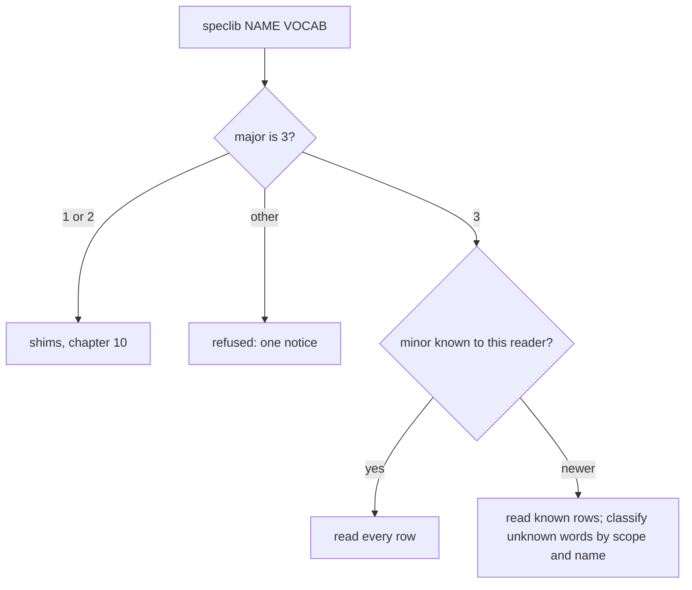

# 2. Lexical rules and the complete grammar

This chapter is the closed grammar of SpecTcl 3: every form any source design
proposes, in one EBNF, with the vocabulary minor each form arrives in. The
vocabulary manifest (item 400) is generated from this grammar, and the
reader, printer, LSP surface, Studio schema and `registry-axes` vocabulary are
generated from the manifest. Every nonterminal is defined here, in a
production or in the lexical-terminals table, and every name means one thing.

## Lexical rules

A pack is a sequence of Tcl words, lexed by `tcl-source` (compiler split item
251) under a fixed grammar profile: `tcl` 9.0's script profile with
substitution set to `literal` (chapter 4).

- **Words.** Braces, double quotes, backslash-newline and `;` and newline
  separators are Tcl's. A braced word is verbatim except that a
  backslash-newline and the white space after it become one space, as in Tcl
  (`puts [list {a\` newline `b}]` prints `{a b}` on tclsh 8.6 and 9.1; Jim
  keeps the backslash, which is why the profile is `tcl` 9.0's). A quoted word
  decodes backslash escapes under the `tcl90` escape grammar (open decision
  D18), so any prose has a spelling.
- **No substitution.** `$`, `[` and `]` are literal characters in every word.
  `{*}` is a literal word. Nothing a pack says is evaluated.
- **Comments.** `#` where a row may start, to the end of the line, with
  Tcl's backslash-newline continuation. `;#` ends a row and starts a comment.
- **Encoding.** UTF-8. A leading BOM is skipped.
- **Limits.** The reader caps bytes, nesting depth, rows per pack and `check`
  tree depth (item 407), and reports a coded notice when it stops.

### The three word contexts

Every word is read in exactly one of three contexts, and the production that
holds it says which:

| Context | Where | Split by | Example |
|---|---|---|---|
| **row block** | `speclib`'s body and every `'{' x-row* '}'` in a production | Tcl **script** rules with substitution off: a newline or `;` outside braces and quotes ends a row; a row is a keyword and then words | `command puts { arity 1..3 ; arg string -sink output }` |
| **list word** | every other `'{' … '}'` in a production: a pattern, a predicate, a range union, a flag's list value | Tcl **list** rules (`Tcl_SplitList`): white space separates elements, including newlines; braces and quotes group | `{TCL LOOKUP DICT}`, `{all {present -mode} {argc >= 2}}`, `{8.6 9}` |
| **word** | every other terminal | one word | `8.4-`, `-releases`, `{name sub}` read as a `CMDPATH` |

Consequences, each checked by the reader's tests:

- **A row ends at a newline.** A row that continues on the next line needs a
  trailing backslash or an open brace, as in Tcl. `refines {arg end} -adds {…}`
  followed on the next line by `-on true` is two rows, and the second is an
  unknown row starting with `-on` in a command block, which the reader refuses with
  `SPEC_ROW_FLAG_START` and a fix that joins the lines.
- **List and script splitting differ.** `llength {x [a b] y}` is 4 on every
  tclsh, so a list word never treats `[…]` as one element.
- **A `KEY`, `RANGE` or `NEED` may be one braced list word.** `versions {core
  tcl 9.0-} {…}` and `versions core tcl 9.0- {…}` are the same row: in a
  `facet-block` the block is the last word and the words before it form the
  key, and a single word there is split as a list.

### Lexical terminals

Each is one word unless the definition says list word.

| Terminal | Definition |
|---|---|
| `ANYWORD` | any one word |
| `TEXT` | any one word, read as prose |
| `NAME` | any one word naming a thing declared elsewhere: a command, variable, namespace, option value, field or profile |
| `ID` | `[a-z][a-z0-9_.-]*` |
| `NS-ID` | `ID '/' ID`, one word, for example `sslictcl/decl`: a namespaced pack dialect |
| `PACKNAME` | `ID` |
| `MINOR` | `N` |
| `N` | a decimal integer, `0` or more; `-N` is never a count |
| `LIBRARY` | a `NAME` declared by a `library` row (`Tk`, `struct::graph`) |
| `CMDPATH` | a command name, or a list word of a command name and its subcommand path (`{string is}`, `{HTTP::header insert}`) |
| `OPTNAME` | a word starting with `-` |
| `VERSION` | a Tcl version number: decimal components separated by `.`, with at most one `a` or `b` in place of a `.` (`8.6.18`, `9.0b1`, `21.1.0.1`) |
| `REQ` | one Tcl requirement: `VERSION`, `VERSION-` or `VERSION-VERSION` |
| `RANGE` | a `REQ`, or a list word of `REQ`s (their union): `8.4-`, `{8.6 9}` |
| `LINE` | a `VERSION` naming a dialect release line (`8.6`, `17.1`) |
| `BUILD`, `CAP`, `TRAIN`, `CATEGORY`, `GRAMMAR-ID`, `CONDITION-ID`, `DOMAIN`, `LANG`, `COLOUR`, `ORIGIN`, `SINK-KIND`, `ERRCLASS`, `HEADER-CLASS`, `OBJECT-KIND`, `SYMBOL-KIND`, `CAT`, `CHECK`, `EVENT`, `PROFILE`, `PHASE`, `PROTO`, `SIDE`, `LIFETIME` | an `ID`, or an uppercase word for `ERRCLASS` (`POSIX`), an uppercase or mixed word for `EVENT` (`HTTP_REQUEST`); the closed sets are chapter 4's (axes, builds, capabilities), chapter 8's (events, profiles, phases, sides) and 393's (colours, origins, sinks) |
| `AXIS`, `VALUE` | chapter 4's closed axis tables; `VALUE` is one word of the axis's value set, and every axis also accepts `unmeasured` |
| `EVIDENCE` | `measured`, `documented`, `inherited` or `unmeasured` |
| `CODE-TABLE` | a list word of `N NAME` pairs |
| `HANDLE-TYPE` | an `ID` declared by a `handle` row, or a TclOO class name |
| `VALUE-TYPE` | `string`, `integer`, `double`, `boolean`, `list`, `dict` or a `HANDLE-TYPE` |
| `FIELD-TYPE` | `command`, `variable`, `integer`, `path` or `text` |
| `FIELD` | a word `NAME` or `NAME:FIELD-TYPE`, one word: `name:command`, `pid:integer` |
| `CODEPATH` | an uppercase word, or a list word of them, after the class: `ENOENT`, `{LOOKUP COMMAND}` |
| `CONN-FIELD` | a dotted field name (`http.request.uri`) |
| `TEMPLATE` | a word with chapter 5's placeholders (`{arg N}`, `{value WORDREF}`, `{library L}`, `{dialect}`) |
| `PARAMS`, `BODY` | a Tcl parameter list word and a Tcl script word, compiled to tbcx (rung 4); never evaluated by the reader |
| `NATIVE-ID`, `IMPL-ID` | `crate::path::name`, one word, naming a compiled-in hook or implementation |
| `OP-ID` | a variant name in the closed Rust catalogue the `OPERATION` head names (`INTRINSICS` for `intrinsic`, `LOWERING_HOOKS` for `structured`; `rust/tcl-spectcl/src/loader/value_parsers/descriptor_values.rs:598`), spelt as 2.x's `semantic_operation` spells it: `StringRange` |
| `DIAGCODE` | a built-in diagnostic code word: `[A-Z]+[0-9]+` (`W144`, `T100`, `IRULE3003`) |
| `SEVERITY` | `error`, `warning`, `info` or `hint` |
| `FILE` | a sibling file name: no `/`, no `..` |
| `PATH`, `DIR`, `URL`, `URL-TEMPLATE`, `PAGE`, `EXT`, `DISPLAY`, `HINT`, `DBNAME`, `DBCLASS`, `VERB`, `PREFIX`, `LABEL`, `LOCALE`, `PROPERTY`, `ENV`, `NS`, `CLAUSE`, `EBPF-TYPE`, `ABSTAIN-CODE`, `CONSUMER`, `RELEASE`, `GRADE`, `HEADER` | one word each, of the kind the name says |
| `LINECOL` | `N:N`, one word |
| `SUBST` | a `%` substitution word (`%P`) |
| `LIST` | a list word of `ANYWORD`s |
| `INT-DOMAIN` | 2.x's integer domain list word, unchanged (`{Range 2 max}`) |
| `EBPF-OP` | a member of `bpf-tcl-ir`'s closed op catalogue (R10) |
| `EXPR-PROFILE` | a value of chapter 4's expr `arithmetic` axis, a closed Rust set: `tcl`, `ebpf-int64` |

## Version ranges

Every `RANGE` is a Tcl requirement read with `package vsatisfies`. The
bounds are on the full version order, in which an alpha or beta sorts before
its release (`package vcompare 8.7a5 8.7` is -1), and the lowest version of a
line is its `a0`:

| Written | Set |
|---|---|
| `V` | `[V a0, (major+1) a0)`: `8.6` holds 8.6.18, 8.6a1 and not 9.0 |
| `A-B` (A < B) | `[A a0, B a0)`: `8.4-8.6` excludes 8.6.18; `8.4-8.7` excludes 8.7a5 and holds 8.4b1 |
| `A-` | `[A a0, ∞)` |
| `A-A` | the versions equal to A under `package vcompare`: `8.6-8.6` holds 8.6 and 8.6.0, not 8.6a1 or 8.6.1 |
| `A-B` (A > B) | empty; the reader refuses it as a load error (`SPEC_RANGE_INVERTED`) |
| `{R1 R2 …}` | the union |

A whole line is written `8.4-8.7` or `8.4-9`. A Tcl requirement list is
translated unchanged: tcllib's `package require Tcl 8.6 9` is `{8.6 9}`, not
`8.6-9`, which excludes 9.0.4. The printer, `tcl spec check` and `tcl spec
upgrade` flag a range that probably meant the whole line (an upper bound
equal to a ladder line the author lists elsewhere, such as `8.5-8.6`), and the
1.x and 2.x shims translate the old whole-line reading into the algebraic
range.

**Source:**

```tcl
foreach {v r} {8.6.18 8.4-8.6  8.6.18 8.4-8.7  8.6.18 8.4-9  9.1.0 8.4-
               9.1.0 8.4-9.1  9.1.0 8.4-9.2  4.2.4 3-4  3.4.0 3.4} {
    puts "$v in $r: [package vsatisfies $v $r]"
}
```

Pre-releases, exact ranges, an inverted range and a requirement list:

```tcl
foreach {v r} {8.7a5 8.4-8.7  8.4b1 8.4-8.6  9.0b1 8.4-9  9.0b1 9  10a0 9
               8.6a1 8.6-8.6  8.6.0 8.6-8.6  8.6.1 8.6-8.6  9.5 9-8.4  9.0.4 {8.6 9}} {
    puts "$v in $r: [package vsatisfies $v {*}$r]"
}
```

**In memory:**

```rust
// VersionSet is real (rust/tcl-dialect/src/model/version_set.rs:337);
// the interval spelling below is this chapter's; A0(v) is v's line at a0
VersionSet("8.4-8.6") == [Interval { min: A0(V(8.4)), max: Excl(A0(V(8.6))) }]
VersionSet("8.4-")    == [Interval { min: A0(V(8.4)), max: Unbounded }]
VersionSet("3.4")     == [Interval { min: A0(V(3.4)), max: Excl(A0(V(4))) }]
VersionSet("8.6-8.6") == [Interval { min: V(8.6), max: Incl(V(8.6)) }]
VersionSet("{8.6 9}") == [Interval { min: A0(V(8.6)), max: Excl(A0(V(9))) },
                          Interval { min: A0(V(9)),   max: Excl(A0(V(10))) }]
```

**Bytecode (tclsh 9.1.0):**

```text
ByteCode
  Source "puts [package vsatisfies 8.6.18 8.4-8.6]\n"
  Cmds 2, src 41, inst 36, litObjs 5, aux 0, stkDepth 5, code/src 0.00
  Commands 2:
      1: pc 0-34, src 0-39        2: pc 5-29, src 6-38
  Command 1: "puts [package vsatisfies 8.6.18 8.4-8.6]..."
    (0) push 0 	# "puts"
  Command 2: "package vsatisfies 8.6.18 8.4-8.6..."
    (5) push 1 	# "package"
    (10) push 2 	# "vsatisfies"
    (15) push 3 	# "8.6.18"
    (20) push 4 	# "8.4-8.6"
    (25) invokeStk 4 
    (30) invokeStk 2 
    (35) done 
```

**Result:**

```text
$ tclsh8.5 ranges.tcl      (tclsh8.6, tclsh9.0, tclsh9.1 and ./target/debug/tclvm print the same)
8.6.18 in 8.4-8.6: 0
8.6.18 in 8.4-8.7: 1
8.6.18 in 8.4-9: 1
9.1.0 in 8.4-: 1
9.1.0 in 8.4-9.1: 0
9.1.0 in 8.4-9.2: 1
4.2.4 in 3-4: 0
3.4.0 in 3.4: 1
$ tclsh8.4 ranges.tcl
expected version number but got "8.4-8.6"
$ tclsh8.5 prerel.tcl      (tclsh8.6, tclsh9.0, tclsh9.1 and ./target/debug/tclvm print the same)
8.7a5 in 8.4-8.7: 0
8.4b1 in 8.4-8.6: 1
9.0b1 in 8.4-9: 0
9.0b1 in 9: 1
10a0 in 9: 0
8.6a1 in 8.6-8.6: 0
8.6.0 in 8.6-8.6: 1
8.6.1 in 8.6-8.6: 0
9.5 in 9-8.4: 0
9.0.4 in 8.6 9: 1
```

Tcl 8.4's `vsatisfies` takes no range at all, which is why tcllib 2.0's
indexes fail to read there. The pack reader runs the algebra itself, so packs
describe 8.4 with the same spelling. Tcl answers an inverted range with 0 for
every version; the reader refuses it instead, because no author means an
empty set.

## The grammar

Notation: `'word'` is a literal keyword, `X?` optional, `X*` any number, `X+`
one or more, `( … )` grouping, `|` alternatives. `'{' x-row* '}'` is a row
block; any other `'{' … '}'` is one list word (the word contexts above). A
bracketed tag `[3.0]` or `[3.1]` names the vocabulary minor a form arrives in;
an untagged production is 3.0.

**Flags are order-free.** Where a production lists `x-flag*`, each flag may
appear at most once, in any order, and takes exactly zero or one word; a
list-valued flag takes one list word (`-needs {writable seekable}`, or
`-needs writable` for one). A flag that is not in the row's flag set is an
error, never the start of a value. The manifest test checks that the row
keywords legal in one row block are distinct terminals, so no row parses two
ways.

### Pack and identity

```text
file        := 'speclib' PACKNAME VOCAB '{' item* '}'
VOCAB       := '3' | '3.' MINOR                       ; '3' means 3.0
item        := pack-block | include | default | dialect | library | extend
             | environment | command | handle | errorclass | check | hook
             | event | flow | precedes | profile | transport-default | connection
             | template-section | apl-variable | domain | document | data
             | context | helper | map-type | limit | limit-facet
             | migrate | test | mock | message
             | colour | origin | sink | header-class | variable | roster | values
             | descriptor
             | catalogue [3.1] | scope [3.1] | virtual-event [3.1]
             | style [3.1] | option-class [3.1] | token [3.1]
pack-block  := 'pack' '{' pack-row* '}'
pack-row    := 'version' VERSION | 'describes' LIB-RANGE | 'license' TEXT
             | 'upstream' URL | 'generated-by' TEXT | 'docs' URL-TEMPLATE
include     := 'include' FILE                         ; sibling file, no '/' or '..'
default     := 'default' '{' cmd-row* '}'             ; unioned into every command at read (chapter 3)
variable    := 'variable' NAME var-flag*
var-flag    := '-kind' ('Scalar'|'Array'|'Namespace') | '-access' ('ReadOnly'|'ReadWrite')
             | '-provider' ('Interpreter'|'AutoLoader'|'Platform'|'Environment'|'Dialect')
             | '-available' LIB-RANGE | '-startup' ANYWORD
             | '-origin' ORIGIN                       ; taint origin (393)
roster      := 'roster' 'from' DFAMILY 'into' DFAMILY ('-available' RANGE)? '{' NAME* '}'
values      := 'values' ID '{' ANYWORD* '}'           ; a named value list
descriptor  := 'descriptor' DESCRIPTOR-KIND ID LIST   ; a named descriptor (DescriptorId)
DESCRIPTOR-KIND := 'state_transitions' | 'world_effects' | 'case_list' | 'body_scope'
             | 'frame_effect' | 'event_requires'
```

`roster` is 2.x's `include from tcl into jim`; `include FILE` is file
composition only. `variable` is 2.x's `special_var`: `-kind`, `-access` and
`-provider` are required, as 2.x requires them, and 2.x's `-origin` (where the
variable comes from) is spelt `-provider` in 3, so `-origin` means one thing,
the taint origin (Reconciliation R53). A `descriptor`'s list holds the words
its legacy row would hold, and a command names it with `LEGACY-WORD -ref ID`.

### Dialects and grammar profiles

```text
DFAMILY     := 'tcl' | 'jim' | 'f5-tcl' | NS-ID       ; a dialect family
dialect     := 'dialect' DFAMILY ('-base' '{' DFAMILY LINE '}')? '{' dia-row* '}'
                                                      ; BuiltIn or BundledPack, or a namespaced new family
dia-row     := 'release' LINE ('-patch' LIST)? ('-evidence' EVIDENCE)?
             | 'build' BUILD ('-capabilities' '{' CAP-SETTING* '}')?
             | 'capability' CAP ('-default' ('on'|'off'|'optional'))?
             | 'grammar' GRAMMAR '{' grow* '}'
             | 'semantics' '{' srow* '}'
             | 'axis' AXIS VALUE ('-from' LINE)?      ; shim, read as a grammar row
GRAMMAR     := 'script' | 'number' | 'expr' | 'list' | 'format' | 'scan'
             | 'regex' | 'glob' | 'binary' | 'clock' | 'chars' | 'values' | 'index'
grow        := AXIS VALUE ('-from' LINE)? ('-build' BUILD)?
srow        := ( 'namespace-eval-frame' ('namespace'|'new-frame')
             | 'creative-writing' ('yes'|'no')
             | 'proc-params' ('tcl'|'jim')
             | 'return-codes' CODE-TABLE
             | 'unknown' ('auto-load'|'none'|'user') ) ('-from' LINE)? ('-build' BUILD)?
CAP-SETTING := a word '+'CAP or '-'CAP, or the two words 'wordSize' N
```

The axes and values are chapter 4's closed tables (among them format
`int_width` and `alternate`, scan `int_width` with its `-build tmm` row,
clock `format` and `units`, chars `bmp-else-bytes`, expr `arithmetic` and the
`index` grammar's `syntax`), and every axis accepts `unmeasured`. A row
without `-from` holds from the first line; a later `-from` row for the same
axis takes over. A namespaced dialect (`NS-ID`) names its base with `-base`
and inherits every axis it does not set: `dialect sslictcl/decl -base {tcl
9.0} { grammar script { substitution reject } }` is SslicTcl (chapter 4).

### Libraries and dependencies

```text
library     := 'library' NAME '{' lib-row* '}'
lib-row     := 'versions' ( VERSION+ | 'unknown' )
             | 'train' TRAIN RANGE
             | 'compatible' LIB-RANGE '{' DFAMILY RANGE compat-flag* '}'
             | 'requires' LIB-RANGE NEED req-flag*
             | 'provides' LIB-RANGE NAME ('same'|VERSION) prov-flag*
             | 'conflicts' LIB-RANGE '{' TARGET RANGE '}' '-message' TEXT
             | 'provides-early' LIB-RANGE
             | 'alias' NAME+                          ; sugar: provides … same -via exact-chain
             | 'tracks-host' DFAMILY ('-build' BUILD)?
             | 'provided-by-core' DFAMILY RANGE
             | 'placement-hint' ('autoload'|'module')
             | 'ifneeded' VERSION '{' 'source' FILE+ '}'   ; informational, never executed
             | 'loaded-by' '{' NAME ANYWORD '}'
             | 'docs' URL-TEMPLATE | 'manual' PAGE
             | 'catalogue' DIR [3.1]
compat-flag := '-build' BUILD | '-requires' LIST       ; LIST of CAP
req-flag    := '-mode' ('load'|'lazy'|'optional') | '-trigger' LIST   ; LIST of CMDPATH
             | '-when' PRED | '-evidence' TEXT
prov-flag   := '-via' ('direct'|'exact-chain') | '-when' PRED
NEED        := '{' TARGET RANGE '}' | '-any' '{' ( '{' TARGET RANGE '}' )+ '}'
TARGET      := LIBRARY | 'core' DFAMILY?
LIB-RANGE   := TARGET RANGE                            ; two or three words, or one list word
LIB-POINT   := TARGET VERSION
```

`versions unknown` says the library exists but its releases are not known
(the F5-bundled iApp packages, Q12); chapter 3 gives its candidate set.
`core` without a `DFAMILY` is legal only in a pack whose rows name one family
(R8). A second `library L` block for the same `L` from another pack is a load
error naming both packs: the pack that declares `library L` owns its rows
(chapter 3's merge table).

### Environments

```text
environment := 'environment' NAME ('-extend')? '{' env-row* '}'
env-row     := 'dialect' DFAMILY RANGE env-dia-flag*
             | 'library' NAME RANGE '-placement' ('ambient'|'hosted'|'bundled')
             | 'policy' ('open'|'closed'|'ambient-plus-require') policy-flag*
             | 'alias' NAME+ | 'editor_identity' ID | 'selecting_identity' ID
             | 'file_extension' EXT DISPLAY | 'filename' NAME | 'shebang' ANYWORD
             | 'signature' TEXT | 'signature' '-header' ANYWORD '-arg' ('integer'|'word')
             | 'document' GRAMMAR-ID
             | 'unknown' ('auto-load'|'none') | 'auto_path' PATH+
             | 'display_name' TEXT | 'short_name' TEXT | 'kind' ('language'|'packages')
             | 'help_terms' ANYWORD+
env-dia-flag := '-default' LINE | '-build' BUILD | '-capabilities' '{' CAP-SETTING* '}'
policy-flag := '-fixed-ensembles' | '-strict-ascii' | '-evaluation' ('never'|'analysis')
```

### Commands, subcommands, options and arguments

```text
command     := 'command' CMDPATH ('-override')? '{' cmd-row* '}'
extend      := 'extend' 'command' CMDPATH ('-override')? '{' cmd-row* '}'
             | 'extend' 'namespace' NAME '{' ( 'command' NAME ('-override')? '{' cmd-row* '}' )* '}'
cmd-row     := avail-row | facet-block | arity-row | arg-row | option | subcommand
             | form | result | throws | effect-row | hook-row | name-row
             | layout | optimise | refactor | report | rewrite | implementation
             | runtime-row | event-row | ebpf-row | presentation | snippet
             | refines | errors-row | 'taint' '-complete' LIB-RANGE
             | test | operation | legacy-row
avail-row   := 'available' LIB-RANGE avail-flag*
             | 'deprecated' LIB-RANGE dep-flag*
             | 'retired' LIB-POINT                      ; gone from this version on (exclusive)
avail-flag  := '-dialect' LIST                         ; LIST of DFAMILY RANGE pairs
             | '-requires' LIST                        ; LIST of CAP
dep-flag    := '-message' TEXT | '-fix' FIX
facet-block := 'versions' KEY '{' cmd-row* '}'           ; facetable rows only (manifest)
KEY         := LIB-RANGE key-flag*                     ; the words before the block; one word is a list
key-flag    := '-dialect' LIST | '-build' BUILD | '-requires' LIST
arity-row   := 'arity' ARITY
             | 'repeat' ROLE-NAME repeat-flag*         ; 2.x, unchanged
ARITY       := a word N, N'..' or N'..'N               ; `2..`, `0..1`
repeat-flag := '-from' N | '-stride' N | '-exclude-trailing' N | '-optional-leading' | '-conditional'
arg-row     := 'arg' ARGREF arg-flag*
arg-flag    := '-role' ROLE-SPEC | '-values' LIST | '-values+' LIST | '-values-' LIST
             | '-domain' DOMAIN | '-optional' | '-optional-first'
             | '-scope' SCOPE | '-resolve' RESOLVE | '-defines' | '-probes' | '-links'
             | '-in' CONTAINER | '-frozen' | '-binds-vars' 'data' | '-object-kind' OBJECT-KIND
             | '-frame' FRAME | '-appends' (N | LIST) | '-percent-subst' | '-concat'
             | '-callback' | '-embedded' LANG | '-dialect' ANYWORD   ; -dialect only with -embedded
             | '-protocol' HANDLE-TYPE                ; only with -callback (D32)
             | '-handle' HANDLE-TYPE | '-needs' LIST                 ; LIST of CAP
             | '-releases' | '-moves-to' WORDREF | '-transforms' | '-stores'   ; at most one of these four
             | '-creates' HANDLE-TYPE | '-reads'
             | '-array-of' LIST | '-expr-profile' EXPR-PROFILE
             | '-declares' SYMBOL-KIND | '-references' SYMBOL-KIND | '-references-each' SYMBOL-KIND
             | taint-flag
option      := 'option' OPTNAME option-flag* ('{' cmd-row* '}')?
option-flag := '-takes' HINT | '-detail' TEXT | '-value-role' ROLE-NAME
             | '-db' '{' DBNAME DBCLASS '}' | '-ends-options' | '-secret'
             | '-aliases' LIST | '-min-abbrev' N | '-effect' ANYWORD | '-family' ID
             | '-deprecation-fix' FIX | '-arity' ARITY | '-arity-hook' NATIVE-ID
             | '-also-role' ROLE-NAME | '-body-kind' ID | '-script-timing' ID
             | '-variable-scope' SCOPE | '-values-from' ID | '-closed' | '-integer' INT-DOMAIN
             | arg-flag
subcommand  := 'subcommand' NAME ('-exported' ('instance'|'class'))? '{' cmd-row* '}'
form        := 'form' NAME TEXT ('{' cmd-row* '}')?
ROLE-SPEC   := ROLE | '{' ROLE+ '}'
ROLE        := ROLE-NAME | '{' 'tmsh-command' '-verb' VERB '}' | '{' 'symbol-def' '-observable' '}'
ROLE-NAME   := 'Body' | 'OpaqueScript' | 'Expr' | 'VarWrite' | 'VarRead' | 'VarCell'
             | 'LoopVarList' | 'ParamList' | 'StaticVarList' | 'Name' | 'Pattern' | 'Option'
             | 'Value' | 'Subcommand' | 'OptionTerminator' | 'FormatString' | 'ScanFormat'
             | 'Channel' | 'Index' | 'Keyword' | 'CommandPrefix' | 'CommandName'
             | 'CommandNameProbe' | 'LambdaLiteral' | 'NamespaceName' | 'Result' | 'Boolean'
             | 'NumericOrBoolean'                     ; the 28 of ArgRole::ALL (arg_role.rs:290)
             | 'MethodName' | 'WindowPath' | 'OptionName' | 'OptionDbValue' | 'tmsh-command'
             | 'symbol-def'
SCOPE       := 'local' | 'caller' | '{' 'caller' N '}' | 'global' | 'namespace' | 'object' | 'connection'
RESOLVE     := 'current' | 'global' | 'ensemble' | '{' 'receiver' WORDREF '}' | 'self'
CONTAINER   := 'word' | 'list' | 'script' | 'percent-script' | 'dict-value'
FRAME       := 'same' | 'global' | 'new' | '{' 'shifted' N '}' | '{' 'namespace' NAME '}' | 'connection'
name-row    := 'constructs' CONSTRUCT ('-from' LIST)?
             | 'transition' 'alias' '-name' WORDREF '-target' WORDREF
                 ('-name-interp' WORDREF)? ('-target-interp' WORDREF)?
             | 'transition' 'tmsh' ('begin'|'commit'|'cancel')
             | 'mode-default' OPTNAME
operation   := 'operation' OPERATION                  ; at most one per command, subcommand or form (D32)
OPERATION   := 'invoke' | '{' 'intrinsic' OP-ID '}' | '{' 'structured' OP-ID '}'
CONSTRUCT   := 'words' | 'script' | 'current-namespace' | 'qualified' | 'which'
             | 'method-prefix' | '{' 'method-prefix' '-receiver' 'self' '}'
legacy-row  := LEGACY-WORD ANYWORD*
LEGACY-WORD := one of the words listed below
```

**Argument references.** `ARGREF` and `WORDREF` have one origin everywhere:

```text
ARGREF      := N | 'end' | 'end-'N | '*' | NAME        ; one word: `0`, `end`, `end-1`, `*`, `string`
WORDREF     := '{' 'arg' ARGREF '}' | '{' 'option' OPTNAME '}' | 'subcommand' | 'command'
```

- `N` counts the words **after the `CMDPATH`**, from 0, option words
  included. For `{dict get}`, `dict get $d k` has `{arg 0}` = `$d` and
  `{arg 1}` = `k`. For `set`, `arg 0` is the variable name.
- `end` and `end-N` count from the last word, as Tcl's indices do.
- `NAME` names a positional argument declared by an `arg NAME` row. Named
  `arg` rows are the positional arguments after the options end, in row
  order, so `regexp`'s `{arg string}` is right whatever switches precede it.
- `*` is every argument word.
- `{argc OP N}` counts the same words as `N`: the words after the `CMDPATH`.

`legacy-row` is every 2.3 command-body word the 2.x loader reads today
(`ROW_WORDS`, `rust/tcl-spectcl/src/loader/eval.rs:227`) that 3 keeps
unchanged: `traits`, `implementation_namespace`, `warn_missing_import`,
`is_namespace_exported`, `unsafe_command`, `excluded_events`,
`safe_on_uninit`, `deprecated_replacement`, `deprecated_replacement_drop_in`,
`source_deprecation_advice`, `alias_of`, `xc_translatable`,
`reserved_trailing_words`, `option_prefix_words`,
`creates_instance_at`, `defines_command_at`, `body_arg_implicit_args`,
`body_kind`, `variable_receivers`, `allow_unknown_subcommands`,
`dynamic_surface`, `unknown_members`, `prefix_matching`,
`self_receiver_words`, `return_type`, `var_write_typing`,
`inferred_storage_type`, `byte_array_effect`, `byte_array_payload`,
`pattern_type`, `format_string_type`, `return_elements`,
`var_elements_effect`, `representation_effect`, `default_form_first_word`,
`defines_symbol`, `deprecation_fix`, `setter_constraint`, `hover`, `refine`,
`command_table_effect`, `frame_effect`, `world_effects`,
`state_transitions`, `result_stability`, `side_switch_target`,
`irules_source_flow`, `event_handler_priority`, `data_collection`,
`event_requirement_form`, `event_requires`, `body_scope`,
`channel_configuration`, `credential_options`, `sensitive_headers`,
`option_conflict`, `option_requires`, `option_requires_one_of`,
`option_forbids`, `option_placement`, `case_list`, `definition_body`,
`manufacturer`, `clause_grammar`, `binds_handle`, `object_class`,
`oo_context_fact`, `detail`, `synopsis`, `header_write`, `destructive`, `returns_path`,
`source_index_bounds`, `source_path_operation`,
`source_configuration_reference`, `is_unescape`, `loop_list_header`,
`creates_scope_alias`, `arg_values_accept_prefix`, `cfg_rewrite_name`,
`min_abbrev`, `max_leading_option_words`, `credential_arg`,
`sub_subcommand`, `tk_geometry`, plus the words 332 adds for the fields no
pack can write today (`evaluation_context`, `callback_protocol`,
`body_interpreter`, `variable_write_min_args`, `event_emits`,
`event_emission_form`, `irules_top_level_effect`, `teardown_argument_layout`,
`remote_method`, `dispatch_dependencies`). Each keeps its
2.x words after the keyword (`ANYWORD*`), and the manifest row for each word
names its own word shape, which the reader checks. `hover` is the one with a
block, spelt in full under *Hover* below.

**One operation, one effect descriptor (D32).** Item 120's single operation
field and item 242's native lowering are 3.0 vocabulary, so the vocabulary
freezes once:

- `operation` is the one statement of what a call does for lowering, codegen,
  native compilation and the successful-completion handler. Its value is
  2.x's `semantic_operation` value in 3.0 spelling (`operation {intrinsic
  StringRange}` for `Intrinsic StringRange`). On a command whose operation is
  not `invoke`, the `lowering_hook`, `codegen_hook`, `inline_codegen_hook`,
  `native_compilation` and `successful_handler` hooks are derived from the
  operation's catalogue entry, and a pack that also writes one of them gets
  a load error. `operation` is facetable (today's
  `semantic_operation_windows`).
- Native lowering (NLIR and AOT) is carried by the operation: it is a
  `Derived` Rust table keyed by `OP-ID`, not by command (D8 keeps it
  Rust-only), so `native_lowering` is no longer a word.
- The effect rows (`side_effects`, `effect`, `effects -complete`, the
  `-writes`/`VarWrite` roles and the per-subcommand taint rows) are the one
  effect descriptor. Purity, the mutator flag, `assigns_variable_at`, the
  effect bits of `traits` and the taint subcommand lists are derived from
  them, never written beside them.
- The synopsis is stated once: when a command has `form` rows, the printer
  omits a `synopsis` equal to the first form, and the reader derives it.
  The words stay legal (332's printed `file home` still parses).

The 2.x words `semantic_operation`, `pure`, `mutator` and
`assigns_variable_at` are shim words in 3.0: `semantic_operation X` reads as
`operation X`, and the other three are checked against what the effect rows
and roles derive (`pure` against `side_effects none`, `assigns_variable_at N`
against a `VarWrite` role at `N`); a disagreement is a shim notice, and the
derived value wins. 2.x's `native_lowering` row is dropped with a notice.

**Protocols and lookup orders (D32).** `-callback -protocol T` says the
prefix is called as `prefix METHOD word…`, one call shape per `subcommand`
row of the `handle T` block, and `required` lists the methods a handler must
answer (item 211's channel handlers). `lookup NATIVE-ID` names an object
system's method resolution order from the closed catalogue (`lookup::c3`,
`lookup::dfs-keep-last`, `lookup::dfs-refuse-repeats`; item 86); a custom
order is a BuiltIn or BundledPack `-native` hook, as D3 allows. In tclsh 8.6,
9.0 and 9.1 a refchan handler whose `initialize` omits `watch` fails `chan
create` with `does not support all required methods`, and 8.6 refuses a
`truncate` method that 9.0 accepts:

```spectcl
speclib refchan-demo 3 {
    handle refchan-handler {
        kind command
        required initialize finalize watch
        subcommand initialize { arity 2 }
        subcommand read { arity 2 }
        subcommand truncate { available core tcl 9.0- ; arity 2 }
    }
    command {chan create} {
        arg 1 -callback -protocol refchan-handler
    }
}
```

The 2.x words `dialects`, `required_package`, `tcllib_package`,
`introduced_version`, `deprecated_version`, `retired_version`,
`versioned_arg_value`, `ambient_package`, `co_provides`,
`const_fold_versioned`, `special_var` and `file_extension -dialect` are shim
words only (chapter 10). The 2.x taint words (`taint_source`, `taint_*sink*`,
`taint_transform*`, `taint_double_encode_colour`, `taint_sink_safe_colour`,
`taint_numeric_coercion`, `taint_sink_gate`, `callback_taint_inputs`) are shim
words too: they map to the taint forms below. The 2.x option flags
`-dialects`, `-available`, `-callback-taint-inputs` and `-taints-var-write`
are shim flags: an `available` row in the option's block, `-callback-origin`
and `-writes -origin` replace them.

### Hover

```text
hover       := 'hover' '{' hover-row* '}'
hover-row   := ('summary'|'synopsis'|'description'|'source'|'example'|'returns') TEXT
```

These are the 2.x hover block's six words
(`rust/tcl-spectcl/src/loader/body_rows.rs:791`). There is no `since` row:
hover derives "since" from the item's `available` rows.

### Results, effects and handles

```text
result      := 'result' result-flag*                  ; at least one shape or taint flag
result-flag := '-handle' HANDLE-TYPE | '-capability' CAPSPEC | '-child-of' 'self'
             | '-dict' '{' (NAME VALUE-TYPE)+ '}' | '-open' | '-list' VALUE-TYPE | '-pairs'
             | '-origin' ORIGIN | '-colour' COLOUR | '-adds' LIST | '-clean'     ; taint (393)
             | '-from' WORDREF | '-unescapes' | '-element-of' WORDREF | '-elements-from' WORDREF
             | '-when' PRED
CAPSPEC     := '{' CAP+ '}' | '{' 'from-mode' WORDREF '}'
effect-row  := 'side_effects' ('none' | NAME+) | 'effects' '-complete' LIB-RANGE
             | 'effect' ('reads'|'writes') ( NAME | 'connection' CONN-FIELD | 'config' ('-verb' VERB)? )
             | 'decision' CATEGORY NAME | 'ends' ('connection'|'message') ('-reset'|'-silent')?
             | ('disables'|'enables') 'events' ('-all' | '-arg' N) ('-this-connection')?
                 ('-scope' ('rule'|'connection'|'unmeasured'))?
             | 'emits' EVENT '-certainty' ('definite'|'possible')
             | 'profile_effect' ('add'|'remove') PROFILE
             | 'releases' 'self' | 'returns' ('config-objects'|VALUE-TYPE) | 'loads' 'library'
handle      := 'handle' HANDLE-TYPE '{' handle-row* '}'
handle-row  := 'kind' HANDLE-KIND
             | 'is' HANDLE-TYPE+ | 'parent' HANDLE-TYPE ('-released-with')?
             | 'lifetime' ('scope'|'interp'|'thread'|'connection'|'event'|'static')
             | 'spelling' ANYWORD | 'instances' NAME+ | 'capability' CAP+
             | 'superclass' HANDLE-TYPE+ | 'mixin' HANDLE-TYPE+ | 'filter' NAME+   ; kind object
             | 'lookup' NATIVE-ID                     ; kind object: the method resolution order (D32)
             | 'required' NAME+                       ; a protocol: the subcommands a handler must have (D32)
             | subcommand | option | hover
HANDLE-KIND := 'token' | 'command' | 'object' | 'path'
errorclass  := 'errorclass' ERRCLASS '{' ec-row* '}'
ec-row      := 'code' CODEPATH ec-flag* ('{' avail-row* '}')?
             | '-fields' '{' FIELD+ '}' | avail-row
ec-flag     := '-fields' '{' FIELD+ '}' | '-message' TEXT
throws      := 'throws' ( PATTERN+ throws-flag* | '-complete' LIB-RANGE )
throws-flag := '-when' PRED | '-on' ('wrong-args'|'unknown-command') | '-default' PATTERN | '-detail' TEXT
PATTERN     := '{' 'arg' ARGREF '}' | '{' ANYWORD+ '}'    ; a list word; the first form names a word of the call
```

A handle method is a `subcommand` in its `handle` block, not a
`command {$type method}` row: `CMDPATH` is a command name, and `$` in it is
an ordinary character. `-capability` and `-child-of` go with `-handle`;
`-open` goes with `-dict`.

`throws -complete RANGE` claims that, for that range, the command raises
nothing outside its `throws` rows and the implicit codes chapter 3 lists.
Without it the command's error set is open (chapter 3, *Certainty*).

### Rules, hooks and consumer rows

```text
check       := 'check' ID '{' check-row* '}'          ; exactly one each of on, when, emit
check-row   := 'on' CMDPATH | 'when' PRED | 'emit' EMIT
PRED        := '{' 'all' PRED+ '}' | '{' 'any' PRED+ '}' | '{' 'not' PRED '}' | ATOM
ATOM        := '{' 'present' OPTNAME '}' | '{' 'argc' CMP N '}'
             | '{' 'kind' WORDREF WORD-KIND '}' | '{' 'known' WORDREF '}'
             | '{' 'value' WORDREF ('in'|'notin') LIST '}' | '{' 'value' WORDREF 'matches' ANYWORD '}'
             | '{' 'value' WORDREF 'prefix' TEXT '}' | '{' 'value' WORDREF 'version-in' RANGE '}'
             | '{' 'value' WORDREF CMP N '}' | '{' 'same' WORDREF WORDREF '}'
             | '{' 'count' OPTNAME CMP N '}' | '{' 'before' WORDREF WORDREF '}'
             | '{' 'within' ('proc' NAME|'event' NAME|'namespace' ANYWORD) '}'
             | '{' 'library' LIBRARY RANGE ('-must')? '}' | '{' 'dialect' DFAMILY RANGE '}'
             | '{' 'build' BUILD '}' | '{' 'capability' CAP '}'
             | '{' 'native' CONDITION-ID '}'          ; a member of a closed Rust catalogue (393)
WORD-KIND   := 'literal' | 'known-bytes' | 'var' | 'command' | 'script' | 'expand' | 'opaque'
CMP         := '<' | '<=' | '==' | '!=' | '>=' | '>'
EMIT        := CODE emit-flag*                          ; -at and -message required
emit-flag   := '-severity' SEVERITY | '-category' CAT | '-at' WORDREF | '-message' TEMPLATE | '-fix' FIX
FIX         := '{' 'replace' WORDREF TEMPLATE '}' | '{' 'delete' WORDREF '}' | '{' 'insert-after' WORDREF TEMPLATE '}'
CODE        := PACKNAME '/' ID | DIAGCODE                ; one word; DIAGCODE from BuiltIn packs only
hook        := 'hook' ID HOOK-FAMILY hook-impl ('-inputs' SHAPE)?
hook-row    := HOOK-FAMILY ( hook-impl | '-ref' ID ) ('-inputs' SHAPE)? ('-proof' RANGE)?
hook-impl   := '-native' NATIVE-ID | '-body' PARAMS BODY
HOOK-FAMILY := 'arg_role_resolver' | 'command_prefix_resolver' | 'script_timing_resolver'
             | 'arg_role_count_resolver' | 'arg_role_layout_resolver' | 'const_fold'
             | 'context_gate' | 'literal_argument_validator' | 'constraints'
             | 'clause_shape_check' | 'state_transitions_resolver' | 'validate'
             | 'lowering_hook' | 'codegen_hook' | 'inline_codegen_hook' | 'analyser_hook'
             | 'return_type_hook' | 'native_compilation' | 'successful_handler'
             | 'procedure_definition' | 'completion' | 'body_execution'   ; BuiltIn and BundledPack only
SHAPE       := '{' ('kinds'|'argc'|'options'|'values'|'libraries'|'dialect')+ '}'
layout      := 'layout' '{' layout-row* '}' | 'layout' '-inputs' SHAPE '-body' PARAMS BODY
layout-row  := 'lead' N | 'pairs' ('options'|N) | 'break' ('fit'|'each'|'never')
             | 'align' ('options'|N) | 'clause' CLAUSE '-break' ('before'|'never')
optimise    := 'optimise' '-no' '{' ('cse'|'hoist'|'dead-call')+ '}'
refactor    := 'refactor' '-no' '{' ('rename'|'extract'|'inline'|'signature'|'move')+ '}'
report      := 'report' 'redundant'
rewrite     := 'rewrite' ID rewrite-flag*              ; -when, -proof and one of -to, -native, -body required
rewrite-flag := '-when' PRED | '-to' TEMPLATE | '-native' NATIVE-ID | '-body' PARAMS BODY | '-proof' RANGE
implementation := 'implementation' '-native' IMPL-ID '-versions' '{' LIBRARY RANGE '}'
runtime-row := 'runtime_backing' ( 'none' | 'host-native' | 'shipped-builtin' ID
                 | 'tcl-body' '{' ('-package-source' PATH | '-pack-text' TEXT) ('-evaluate')? '}' )
```

`layout` and `rewrite` are rows of their own, not hook families: the family
list no longer holds them, and 2.x's `state_transitions` hook family is
spelt `state_transitions_resolver` so it cannot collide with the
`state_transitions` legacy row.

### Domain forms

```text
event       := 'event' EVENT '{' event-row-d* '}'
event-row-d := avail-row | 'side' ('client'|'server'|'both') | '-command-side' SIDE
             | 'transport' NAME+ | 'profiles' '{' ('any'|'all') PROFILE+ '}'
             | 'phase' PHASE | 'message' ('request'|'response') | 'multiplicity' ID
             | 'frame' 'connection' | 'establishes' '{' CONN-FIELD+ '}' | 'setup' EVENT
             | 'collect' PROTO '-side' SIDE | 'hot' | 'common' | 'category' ID
             | 'program-type' ID '-section' NAME '-context' ID ('-link')?          ; eBPF
             | 'capabilities' '{' CAP+ '}' | 'verdict' NAME N | 'default' NAME
             | 'out-of-bounds' NAME | 'attach' NAME '-kind' ATTACH-KIND ('-required')?
             | 'codegen' ('compiled'|'described') | hover
ATTACH-KIND := ID                                     ; 380's attach kinds
flow        := 'flow' ID '-profiles' '{' PROFILE+ '}' '{' flow-row+ '}'
flow-row    := 'step' EVENT PHASE ('-conditional' TEXT)?
precedes    := 'precedes' EVENT EVENT '-evidence' TEXT
profile     := 'profile' PROFILE '{' profile-row* '}'
profile-row := avail-row | 'layer' ID | 'side' SIDE | 'implies' PROFILE+
             | 'forbids' PROFILE+ | 'conflict' PROFILE+ | 'schema-kind' ID+ ('-via' NAME)?
             | 'namespace' NS ('-also' '{' NS+ '}')?
transport-default := 'transport-default' PROFILE '-unless' PRED
connection  := 'connection' '{' conn-row+ '}'
conn-row    := 'field' CONN-FIELD '-side' SIDE '-lifetime' LIFETIME
                 '-origin' ('client'|'server'|'rule') '-target' NAME
event-row   := 'rule_init' ('warn'|'error')
mock        := 'mock' CMDPATH ('-tcl' NAME | '-native' NATIVE-ID)
template-section := 'template-section' PROPERTY '-language' ('tcl'|'apl'|'html') ('-environment' ENV)?
apl-variable := 'apl-variable' '-root' NS '-separator' TEXT
domain      := 'domain' ID '{' dom-row* '}'
dom-row     := 'values' LIST | '-nocase' | '-closed' | 'aliases' LIST
document    := 'document' ID '{' doc-row* '}'
doc-row     := 'header' NAME '-version' N doc-code-flag*
             | ('open'|'closed') ('-unknown' CODE)?
             | 'substitution' ('reject'|'literal') ('-code' CODE)?   ; maps the finding to a code; how words are read is the dialect's
             | 'members' '{' NAME+ '}' | member
             | 'codes' '{' (CHECK CODE)+ '}'
doc-code-flag := '-newer' CODE | '-missing' CODE | '-duplicate' CODE | '-older' CODE
member      := 'member' NAME member-flag* | 'exclusive' '{' NAME+ '}'
member-flag := '-value' DOMAIN | '-block' ID | '-references' SYMBOL-KIND
             | '-read-by' '{' PHASE* '}' | '-required' | '-frozen' | '-validate' NATIVE-ID
data        := 'data' ID '-source' PATH ('-provenance' PATH)?
ebpf-row    := 'compile' 'ebpf' EBPF-OP (OPTNAME ANYWORD)*
context     := 'context' ID '{' ctx-row+ '}'
ctx-row     := 'field' NAME N N ('le'|'be') ('-role' ROLE-NAME)?   ; name, offset, width, order
helper      := 'helper' NAME '{' helper-row* '}'        ; id, args and returns required
helper-row  := avail-row | 'id' N | 'args' LIST | 'returns' EBPF-TYPE | hover
map-type    := 'map-type' NAME '{' ( 'id' N | 'key-size' N | 'preallocated' )* '}'
limit       := 'limit' NAME ANYWORD                    ; a pack-wide limit (380)
limit-facet := 'versions' KEY '{' limit* '}'           ; limits by library version
```

`member` rows sit in a `document` block, the SslicTcl declaration schema
(365). eBPF's expression arithmetic is not a pack form: `-expr-profile
EXPR-PROFILE` on an argument selects a value of the expr `arithmetic` axis,
a Rust value, and `ebpf-int64` is one, so a pack only selects and never
supplies an operator table (chapter 4; Reconciliation R58).

### Package surfaces, tests and localisation

```text
migrate     := 'migrate' ID '{' migrate-row* '}'      ; library and on required
migrate-row := 'library' LIB-RANGE | 'on' CMDPATH | 'when' PRED
             | 'rewrite' TEMPLATE TEMPLATE | 'note' TEXT
test        := 'test' ID '{' test-row* '}'            ; source and expect required
test-row    := 'source' TEXT | '-on' KEY | '-consumer' CONSUMER
             | '-profiles' '{' PROFILE+ '}' | '-setup' TEXT | 'at' LINECOL | 'new' NAME
             | 'expect' EXPECT | 'run' '{' RELEASE+ '}' | '-privileged'
EXPECT      := '{' ( 'diagnostic' CODE 'at' LINECOL | 'hover' 'contains' TEXT
             | 'result' TEXT | 'edits' TEXT | 'abstain' ABSTAIN-CODE | 'output' TEXT
             | 'run' TEXT 'decision' TEXT | 'grade' GRADE | 'finding' CODE )+ '}'
message     := 'message' LOCALE CODE TEXT | 'doc' LOCALE NAME TEXT          ; reserved; English only ships
presentation := 'presentation' '-class' ('control'|'keyword'|'builtin') ('-context-sensitive')?
snippet     := 'snippet' PREFIX LABEL BODY
token       := 'token' CATEGORY [3.1]
catalogue   := 'catalogue' DIR [3.1]
scope       := 'scope' 'project' [3.1]                ; a policy pack placed by tclpkg.tcl
virtual-event := 'virtual-event' NAME '-widget' NAME [3.1]
style       := 'style' NAME ('-element' NAME)* ('-theme' NAME)? [3.1]
option-class := 'option-class' NAME '-widget' NAME [3.1]
```

### Taint

These are design [393](../model/393-taint.md)'s forms. A value's taint fact is
a pair: **origins**, a "may" set (where it may have come from), and
**colours**, a "must" set (properties proved of every tainted contributor).
`TAINTED` is gone: a value is tainted when its origins are non-empty.

```text
colour      := 'colour' COLOUR '{' colour-row* '}'
colour-row  := 'core' | 'concat' ('all'|'first'|'none')
             | 'implies' (COLOUR | '{' COLOUR+ '}') | avail-row | hover
origin      := 'origin' ORIGIN '{' ( 'discloses' | hover )* '}'
sink        := 'sink' SINK-KIND '{' sink-flag+ '}'     ; one list word; -origins, -safe and -code required
sink-flag   := '-origins' ('any' | '{' ORIGIN+ '}') | '-safe' ( COLOUR | '{' COLOUR* '}' )
             | '-code' ( CODE | '{' CODE (DFAMILY CODE)* '}' ) | '-severity' SEVERITY | '-discloses'
header-class := 'header-class' HEADER-CLASS '{' HEADER+ '}'
COLOUR      := a core name (crlf-free) | LIBRARY '.' ID (sql.bound)     ; 'core' is trusted tiers only
taint-flag  := '-sink' SINK-KIND | '-safe+' LIST | '-when' PRED   ; -safe+ and -when need -sink; -when is SinkWhen
             | '-writes' | '-origin' ORIGIN                       ; -origin on an arg needs -writes
             | '-double-encodes' COLOUR | '-secret-header-of' WORDREF
             | '-callback-origin' '{' (SUBST ORIGIN)+ '}'
refines     := 'refines' WORDREF refine-flag*         ; -on and one of -adds, -adds-from-pattern required
refine-flag := '-adds' LIST | '-adds-from-pattern' WORDREF | '-when' PRED | '-on' ('true'|'false')
             | '-switches' LIST                       ; the switches the refinement holds with
errors-row  := 'errors' '-message-from' WORDREF       ; catch messages carry origins
```

A `sink`'s braces hold one list word of flags, so they may share a line or
span several. `-code {T101 f5-tcl IRULE3003}` picks a code by dialect family: the first
code is the default.

- **`implies`** closes colours (a cycle is a load error); **`concat`** says
  what concatenation does to a colour, read by `strcat`, `format`, `append`,
  `subst`, the analyser and the run-time mode alike.
- **`-safe`** lists colours any one of which makes a value safe at the sink. A
  pack may widen a core sink's `-safe` only by a colour that implies one
  already there, so the security floor holds.
- **`-when` on a sink is `SinkWhen`**: the sink is suppressed only when the
  predicate is **proved false**; an unknown leaves it in force. This is the
  one listed exception to chapter 3's "emit only when proved true", and the
  image marks the rule so the evaluator cannot get it backwards. It replaces
  the `taint_sink_gate` hook.
- **`refines … -on true|false`** colours the named word's variable on the
  branch where the call returned true (or false): a validator. It applies
  only at a call whose switches are all in its `-switches` list (none when
  the list is absent), so it is sound per switch, and only where the branch
  condition is the call, `![call]` or a decomposed `&&`/`||` (393).
- `channel` is not a colour; a channel read's origin comes from its handle type
  (391).

## The forms by vocabulary minor

| Minor | Forms |
|---|---|
| 3.0 | everything above not tagged `[3.1]`: identity, `include`, dialects and grammars, libraries and dependencies, `versions unknown`, `extend`, environments, commands and facets, `deprecated`/`retired`, `check`, hooks, consumer rows (`layout`, `optimise`, `refactor`, `rewrite`, `implementation`), name and frame facts, `handle`, `errorclass`/`throws`/`throws -complete`, `result` shapes, `-embedded`, `-callback -appends`, `migrate`, `event`/`flow`/`precedes`/`profile`/`connection`, iApps and tmsh rows, SslicTcl's `domain`/`document`/`data`, eBPF's `compile ebpf`/`context`/`helper`/`map-type`/`limit`, `test`, `mock`, `presentation`, `snippet`, `operation`, `-callback -protocol`, `required`, `lookup` (D32), reserved `message`/`doc LOCALE`, the taint forms (`colour`, `origin`, `sink`, `header-class`, `refines`, `-sink`, `result -origin`/`-adds`) |
| 3.1 | `catalogue`, project `scope`, `virtual-event`, `style`, `option-class`, `token` |

`mock` is a 3.0 form; packaging fakes for `tcltest` users (chapter 9, area K)
is tooling, not a later form.

### Reading a later minor

A new word arrives in the minor its manifest row names (`since 3.N`). A pack
declaring `speclib x 3.1` read by a 3.0 reader keeps loading maximally, under
three rules that make that safe:

1. **An unknown row keyword is classified by scope and name, not by the
   manifest**, because a 3.0 manifest has no row for a 3.1 word. This is
   today's rule (`rust/tcl-spectcl/src/loader/vocabulary_class.rs:38-52`):
   every unknown word inside a `dialect` or `environment` block is
   `Semantic`; elsewhere a closed, ordered table of name substrings
   (`MARKERS`) marks the `Semantic` and `Assistance` families, and a word
   that matches none is `Presentation`. `Presentation` words warn and drop,
   `Assistance` words degrade the command to `Unknown` for that capability,
   and `Semantic` words exclude the command or block from strong analysis.
2. **A new flag on a known row takes exactly one word**, so a 3.0 reader can
   skip it with its value. The same scope-and-name rule classifies it. A
   3.N flag that needs no value is still spelt with one (`-flag yes`).
3. **A minor never changes what an existing word means.** It may add rows,
   flags and flag values; a changed meaning is a new word or a new major.

A major other than 3 is refused with one notice naming the fix.

## The pack header



Item 400 owns this grammar's manifest; items 401 (errors), 408 (identity and
`include`), 409 (`extend`) and 413 (`check` atoms) own its parts.

## Review fixes (26 November 2026)

- **G1.** Overloaded names split: `DFAMILY`, `HOOK-FAMILY`, `ARGREF`/`WORDREF`, `WORD-KIND`, `SINK-KIND`, `HANDLE-KIND`, `SYMBOL-KIND`, `OBJECT-KIND`, `ATTACH-KIND`, `CMP`, `EBPF-OP`, `VALUE-TYPE`; `PATTERN` takes any words; `layout` and `rewrite` left the hook families; `state_transitions_resolver` renamed.
- **G2.** Lexical-terminals table added; `repeat`, role words, 2.x option flags, `hover` and `legacy-row` spelt; `-override` on `command` and `extend`; `extend namespace` holds `command` rows; `member` reachable from `document`; `extend library` removed (R57).
- **G3.** The three word contexts (row block, list word, word); braced words are verbatim except backslash-newline, as in Tcl; a `KEY` may be one braced list word.
- **G4.** Flags are order-free, at most once, zero or one word each; `arg-row := 'arg' ARGREF arg-flag*`.
- **G5.** `versions unknown` added.
- **G6.** `throws -complete LIB-RANGE` added; `default` rows union (chapter 3).
- **G7.** Range table rewritten on the `a0` bounds, with a real run of pre-releases.
- **G12.** `ARGREF` and `argc` defined: 0-based after the `CMDPATH`, options included; `NAME` for positional args after options.
- **G14.** Forward reading restated: scope-and-name classification, one-word new flags, no meaning changes in a minor; `mock` is 3.0.
- **G15.** `retired LIB-POINT`; `variable` flags unified (`-provider` for 2.x's origin); `code … { avail-row* }`; `FIELD` types; sink `-code` by `DFAMILY`; `emit` severity only by `-severity`.
- **G17.** An inverted range is a load error.
- **D8 (grammar side).** `expr-profile` removed as a form; `-expr-profile` selects a value of the expr `arithmetic` axis.
- **Dialect fixer handoffs (399f9915).** `index` grammar; `-base` on namespaced dialects (`sslictcl/decl`); `unmeasured` on every axis; the new chapter 4 axes listed; `enables events` and `-scope` on `disables`/`enables events`; SslicTcl's `substitution reject -code` only maps a code.
- **A7 (grammar side).** `refines … -switches LIST`.

## Review fixes (26 November 2026, deep review)

- **W2, W10 (D32).** `operation` (one operation statement; lowering, codegen, native-compilation and handler hooks derive from it; native lowering keyed by `OP-ID`), the effect rows as the one effect descriptor, `semantic_operation`/`pure`/`mutator`/`assigns_variable_at` as shim words, `native_lowering` dropped, the synopsis stated once by a printer rule; `-callback -protocol` and `required` (item 211), `lookup NATIVE-ID` (item 86), with a refchan example from real runs on tclsh 8.6, 9.0 and 9.1.
