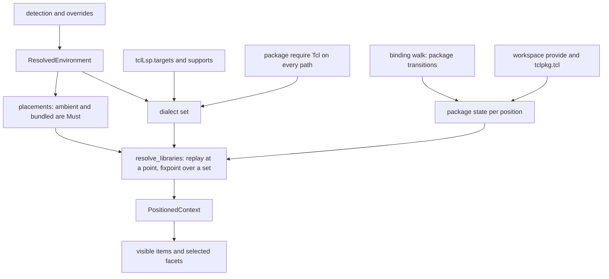
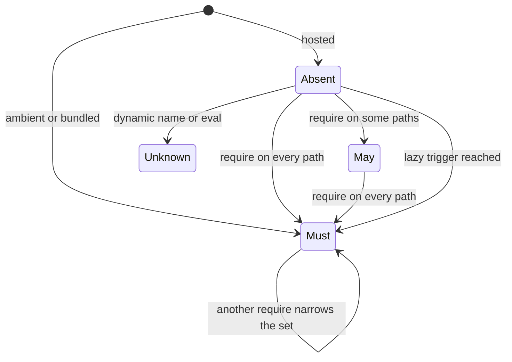

# 3. Semantics

This chapter says what the rows of chapter 2 mean: how versions and facets
select a value, which row wins when several apply, how a document's
libraries resolve, and how certain an answer is at a position. It
consolidates [302](../model/302-libraries.md), [303](../model/303-environments.md),
[308](../model/308-positioned-context.md) and [331](../model/331-library-dependencies.md).

## Versions and axes

Every version lives on an axis: `core(tcl)`, `core(jim)`, the BIG-IP axis for
`f5-tcl`, or `package(L)` for a library with its own axis. A tracks-host
library's versions are its host's releases: the iRules surface of BIG-IP 17.1
is iRules 17.1. Sets are unions of half-open intervals, read with `package
vsatisfies` (chapter 2). Comparison and set algebra never mix axes.

An item's window is an `ItemHistory` (`introduced`, `deprecated`, `retired`;
`rust/tcl-dialect/src/model/version_set.rs:699`). `available L R` sets the
introduction and the upper bound, `deprecated L R` the deprecation, and
`retired L V` the retirement, which is exclusive. A retired item stays known,
so a use reports W139 "removed in 9.0", not "unknown subcommand".

## Facets

Every fact a command carries can vary by library version, dialect release,
build and capability. A facet is a list of `(FacetKey, value)` rows:

- **Selection.** For a resolved context, the first row whose key holds wins.
  An empty facet means the unversioned value.
- **Over a set** (a target range, or a `May` require) the lookup returns every
  distinct value with the keys that select it, `Selected<T>`. Hover renders
  them as a `VersionLine` (`Since`, `Range`, `Differs`, `Unknown`).
- **Deltas.** `-values+` and `-values-` amend the **unversioned** list, not the
  previous block. Blocks are written newest first and each restates every
  change since the base.
- **Unreachable blocks are errors.** A block whose key is covered by an
  earlier block is refused with a coded notice (item 400).
- **Facetable words only.** The manifest marks which rows may sit inside
  `versions`. Availability, arity, options, subcommands, roles, effects,
  returns, value sets, deprecation, documentation, `limit`, `throws` and
  result shapes are facetable; identity rows (`alias_of`, `runtime_backing`)
  are not (open decision D7).

`string is` shows a value-set facet. Each release's `bad class` error lists
its classes:

**Source:**

```spectcl
command {string is} {
    arg class -values {alnum alpha ascii boolean control digit double false graph
                       integer lower print punct space true upper wordchar xdigit}
    versions {core tcl 9.0-} { arg class -values+ {list wideinteger entier dict} }
    versions {core tcl 8.6-} { arg class -values+ {list wideinteger entier} }
    versions {core tcl 8.5-} { arg class -values+ {list wideinteger} }
    versions {core jim 0.84} { arg class -values- {false true wordchar} }
}
```

**In memory:**

```rust
// design sketch: chapter 7's Facet and FacetKey
value_sets: Facet { rows: &[
    (FacetKey { library: core(Tcl, "9.0-"), .. }, &[/* 18 */ .., "list", "wideinteger", "entier", "dict"]),
    (FacetKey { library: core(Tcl, "8.6-"), .. }, &[/* 18 */ .., "list", "wideinteger", "entier"]),
    (FacetKey { library: core(Tcl, "8.5-"), .. }, &[/* 18 */ .., "list", "wideinteger"]),
    (FacetKey { library: core(Jim, "0.84"), .. }, &[/* 15: no false, true, wordchar */]),
    (FacetKey::ANY, &["alnum", "alpha", "ascii", "boolean", .., "wordchar", "xdigit"]),
] }
```

**Bytecode (tclsh 9.1.0):**

```text
ByteCode
  Source "catch {string is bogus x} m\nputs $m..."
  Cmds 2, src 36, inst 38, litObjs 4, aux 0, stkDepth 3, code/src 0.00
  Commands 2:
      1: pc 0-20, src 0-26        2: pc 21-36, src 28-34
  Command 1: "catch {string is bogus x} m..."
    (0) push 0 	# "catch"
    (5) push 1 	# "string is bogus x"
    (10) push 2 	# "m"
    (15) invokeStk 3 
    (20) pop 
  Command 2: "puts $m..."
    (21) push 3 	# "puts"
    (26) push 2 	# "m"
    (31) loadStk 
    (32) invokeStk 2 
    (37) done 
```

**Result:**

```text
$ tclsh8.4 classes.tcl
bad class "bogus": must be alnum, alpha, ascii, control, boolean, digit, double, false, graph, integer, lower, print, punct, space, true, upper, wordchar, or xdigit
$ tclsh8.5 classes.tcl
bad class "bogus": must be alnum, alpha, ascii, control, boolean, digit, double, false, graph, integer, list, lower, print, punct, space, true, upper, wideinteger, wordchar, or xdigit
$ tclsh8.6 classes.tcl
bad class "bogus": must be alnum, alpha, ascii, control, boolean, digit, double, entier, false, graph, integer, list, lower, print, punct, space, true, upper, wideinteger, wordchar, or xdigit
$ tclsh9.0 classes.tcl      (tclsh9.1 and ./target/debug/tclvm print the same)
bad class "bogus": must be alnum, alpha, ascii, control, boolean, dict, digit, double, entier, false, graph, integer, list, lower, print, punct, space, true, upper, wideinteger, wordchar, or xdigit
$ tmp/jimtcl-oracle/jimsh classes.tcl
bad class "bogus": must be alnum, alpha, ascii, boolean, control, digit, double, graph, integer, lower, print, punct, space, upper, or xdigit
```

## Precedence

When several rows could give one fact, the first applicable rule below wins:

1. **Security floor.** An override never weakens a shipped spec's security
   facts or swaps which shipped implementation a command is. Set-valued
   facts union, single-valued ones keep the shipped value
   (`tcl-registry::security_floor`, as today).
2. **Facet order.** Within one item, the first matching `versions` block,
   then the unversioned row.
3. **Merge table** for an `extend` or a second pack declaring the same item
   (item 409; open decision D11):

   | Fact kind | Rule |
   |---|---|
   | library rows (`versions`, `train`, `compatible`, `requires`, `provides`) | the library's owner pack only; another pack's rows are refused |
   | provider rows (`available` naming the extending library) | appended as a new `ProviderRow` |
   | facet rows | the extending pack's rows are prepended |
   | prose (`hover`, `detail`, `synopsis`) | nearest tier wins |
   | security facts | the floor (rule 1) |
   | roles, arity | `-override` only; otherwise refused |

   Two packs extending one library merge to the same model in either load
   order, and hover names the pack and version that supplied each fact.
4. **Tier.** Nearest wins: workspace over user over bundled. A compiled name
   wins over every pack unless the pack says `-override` from a tier allowed
   to.
5. **`default`.** Pack defaults are applied at read; a row on the command
   replaces the default row.

## Resolution

Resolution runs in three steps, once per transition interval (308):



1. **Environment.** Detection (directive, shebang, `package require Tcl`
   guard, content signatures, filename and extension, configured default)
   gives an `EnvironmentId` through the one alias table. Overrides and
   `tclLsp.targets` give the dialect point or target set.
2. **Libraries.** A library is present when it is ambient or bundled, or
   hosted and required. Its candidate set is the intersection of its
   placement range, the union of its `compatible` rows that hold for the
   dialect set (build and capability predicates included), and the require
   ranges.
3. **Visible items.** An item is visible when one of its `ProviderRow`s holds:
   its window meets its library's candidate set and its dialect constraint
   holds. A core item (`library: None`) uses the dialect release.

An empty candidate set is a reported answer (an unsatisfiable require, no
compatible row, a conflict, a cycle), never a fallback. There is no default
release: `TclVersion::V9_1` fallbacks are deleted.

## Library-to-library dependencies

`compatible` rows are the package index's guard: a train they reject is never
offered, and tclsh considers the next. `requires … {core R}` is the source's
own `package require Tcl R`: the train is chosen first and then fails.

**At a point** the resolver replays tclsh, with no backtracking:

1. the candidates are the versions whose `compatible` rows hold;
2. pick the newest candidate meeting the require; mark it loading;
3. run its `load` dependencies in row order. A present target must meet the
   range, or the answer is a conflict. A target on the loading stack is a
   cycle unless it is `provides-early`. Otherwise recurse;
4. never retry a lower version.

**Over a set**, candidate sets shrink to a fixpoint (arc consistency): a
version of A leaves when one of its `load` rows has no candidate of B left,
and B keeps only versions some remaining A needs. The set answer is a superset
of every point answer.

`lazy` edges make their target present only at a trigger item's call site (a
308 transition, `Why::Lazy`). `optional` edges never make a target present.
`-when` predicates are evaluated three-valued over the dialect set.

The diagnostics quote tclsh's own words where it has them, with the chain:

**Source:**

```tcl
lappend auto_path tmp/tcllib-2.0/modules
puts [package require struct::graph 1]
puts [package require struct::graph::op]
if {[catch {package require struct 2.2} m]} { puts $m }
```

**In memory:**

```rust
// design sketch: 308's PositionedContext with 331's Why, after line 4
libraries: {
  "struct::graph":     Must { versions: {1.2.2},  why: Require { at: line 2, exact: false } },
  "struct::graph::op": Must { versions: {0.11.4}, why: Require { at: line 3, exact: false } },
  "struct":            Must { versions: ∅, why: Conflict { needs: ("struct::graph", "2.0"),
                              evidence: "struct.tcl:2", present_from: line 2 } },
}
```

**Bytecode (tclsh 9.1.0):**

```text
  Command 3: "package require struct::graph 1..."
    (22) push 3 	# "package"
    (27) push 4 	# "require"
    (32) push 5 	# "struct::graph"
    (37) push 6 	# "1"
    (42) invokeStk 4 
    (47) invokeStk 2 
    (52) pop 
```

**Result:**

```text
$ tclsh8.6 conflict.tcl      (tclsh9.1 and ./target/debug/tclvm print the same)
1.2.2
0.11.4
version conflict for package "struct::graph": have 1.2.2, need 2.0
```

The second line also earns the stale-train hint: `struct::graph::op`'s bare
require accepts 1.2.2 although tcllib ships 2.4.4.

## The positioned context

`positioned_context(file, offset)` is the one version source for every
consumer (308). It is computed per body unit and per binding transition, not
per offset, and salsa memoises it per interval.

Package state at a program point is the join over the paths that reach it:

- a require earlier in the same block is `Must`;
- a require on one branch is `May` after the join, carried with its range;
- a procedure's entry state is the join of its known call sites' states, or
  the file's top-level end state downgraded to `May`;
- a dynamic name (`package require $p`), an `eval`, or a `package unknown`
  handler makes every hosted library `Unknown` from that point;
- a `package require` transition expands to its dependency closure (331).



## Certainty

Answers are three-valued: true, false or unknown. The rules:

- **`check` atoms** over an unknown value are unknown. A rule emits only when
  its predicate is proved true. Over a version set, `library` and `dialect`
  atoms hold only when they hold for every member.
- **`May` is not `Must`.** The hook context carries each library's state
  (`must`, `may`, `unknown`) with its versions (item 406). A `{library L R}`
  atom is true only on `Must`; `{library L R -must}` is the explicit spelling.
  A `May` library satisfies a visibility question with an annotation
  ("if `package require Tk 8.6` ran, line 12") and never a diagnostic: a
  version-gate warning fires only when every case fails.
- **Facts claimed complete.** `effects -complete`, complete roles and a full
  `throws` set are claims. A consumer that needs completeness and finds a
  claim missing abstains (chapter 6).
- **Unknown stays quiet.** An unknown value, command or handle type produces
  no "cannot match" or "wrong type" diagnostic. Only a proven fact does.
