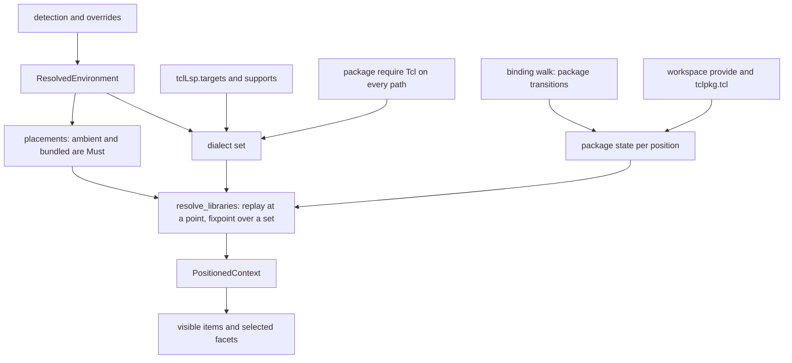
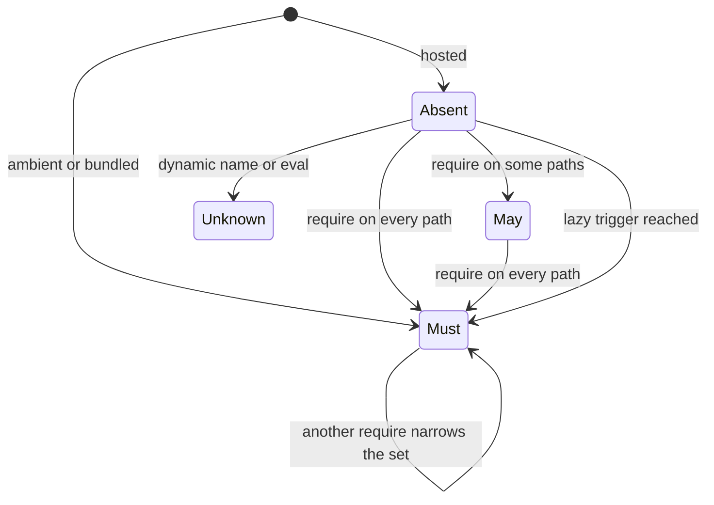

# 3. Semantics

This chapter says what the rows of chapter 2 mean: how versions and facets
select a value, which row wins when several apply, how a document's
libraries resolve, and how certain an answer is at a position. It
consolidates [302](../model/302-libraries.md), [303](../model/303-environments.md),
[308](../model/308-positioned-context.md) and [331](../model/331-library-dependencies.md).

## Versions and axes

Every version lives on an axis: `core(tcl)`, `core(jim)`, the BIG-IP axis for
`f5-tcl`, or `package(L)` for a library with its own axis. A tracks-host
library's versions are its host's releases: the iRules surface of BIG-IP 17.1
is iRules 17.1. Sets are unions of half-open intervals, read with `package
vsatisfies` (chapter 2): a bound is a line's `a0`, so `8.4-8.7` holds 8.4b1
and not 8.7a5, and `A-A` is the one version A. An inverted range is a load
error. Comparison and set algebra never mix axes.

An item's window is an `ItemHistory` (`introduced`, `deprecated`, `retired`;
`rust/tcl-dialect/src/model/version_set.rs:699`). `available L R` sets the
introduction and the upper bound, `deprecated L R` the deprecation, and
`retired L V` (a `LIB-POINT`, one version, not a range) the retirement, which
is exclusive: `retired core tcl 9.0` means gone from 9.0a0 on, in every later
major too. A retired item stays known, so a use reports W139 "removed in 9.0",
not "unknown subcommand".

## Facets

Every fact a command carries can vary by library version, dialect release,
build and capability. A facet is a list of `(FacetKey, value)` rows:

- **Selection.** For a resolved context, the first row whose key holds wins.
  An empty facet means the unversioned value. Selection runs per pack (the
  owner's rows and each extender's, chapter 3's merge table) and per
  `ProviderRow` (below).
- **Over a set** (a target range, or a `May` require) the lookup returns every
  distinct value with the keys that select it, `Selected<T>`. Hover renders
  them as a `VersionLine` (`Since`, `Range`, `Differs`, `Unknown`).
- **Deltas.** `-values+` and `-values-` amend the **same pack's** unversioned
  list, not the previous block. Blocks are written newest first and each
  restates every change since the base. Each pack's selected value is
  computed this way, and the packs' values then union (the merge table), so
  the answer does not depend on load order.
- **Several providers.** An item with several `ProviderRow`s (R5) selects its
  facets per provider: a row keyed on library `L` belongs to the provider
  whose library is `L`, and a `core` key to the core provider. Where more
  than one provider holds, hover shows a `Differs` line when their values
  differ, and a diagnostic fires only when the call fails under every
  provider that holds (Reconciliation R50).
- **Unreachable blocks are errors.** A block whose key is covered by an
  earlier block is refused with a coded notice (item 400).
- **Facetable words only.** The manifest marks which rows may sit inside
  `versions`. Availability, arity, options, subcommands, roles, effects,
  returns, value sets, deprecation, documentation, `limit`, `throws` and
  result shapes are facetable; identity rows (`alias_of`, `runtime_backing`)
  are not (open decision D7).

`string is` shows a value-set facet. Each release's `bad class` error lists
its classes:

**Source:**

```spectcl
command {string is} {
    arg class -values {alnum alpha ascii boolean control digit double false graph
                       integer lower print punct space true upper wordchar xdigit}
    versions {core tcl 9.0-} { arg class -values+ {list wideinteger entier dict} }
    versions {core tcl 8.6-} { arg class -values+ {list wideinteger entier} }
    versions {core tcl 8.5-} { arg class -values+ {list wideinteger} }
    versions {core jim 0.84} { arg class -values- {false true wordchar} }
}
```

**In memory:**

```rust
// design sketch: chapter 7's Facet and FacetKey
value_sets: Facet { rows: &[
    (FacetKey { library: core(Tcl, "9.0-"), .. }, &[/* 18 */ .., "list", "wideinteger", "entier", "dict"]),
    (FacetKey { library: core(Tcl, "8.6-"), .. }, &[/* 18 */ .., "list", "wideinteger", "entier"]),
    (FacetKey { library: core(Tcl, "8.5-"), .. }, &[/* 18 */ .., "list", "wideinteger"]),
    (FacetKey { library: core(Jim, "0.84"), .. }, &[/* 15: no false, true, wordchar */]),
    (FacetKey::ANY, &["alnum", "alpha", "ascii", "boolean", .., "wordchar", "xdigit"]),
] }
```

**Bytecode (tclsh 9.1.0):**

```text
ByteCode
  Source "catch {string is bogus x} m\nputs $m..."
  Cmds 2, src 36, inst 38, litObjs 4, aux 0, stkDepth 3, code/src 0.00
  Commands 2:
      1: pc 0-20, src 0-26        2: pc 21-36, src 28-34
  Command 1: "catch {string is bogus x} m..."
    (0) push 0 	# "catch"
    (5) push 1 	# "string is bogus x"
    (10) push 2 	# "m"
    (15) invokeStk 3 
    (20) pop 
  Command 2: "puts $m..."
    (21) push 3 	# "puts"
    (26) push 2 	# "m"
    (31) loadStk 
    (32) invokeStk 2 
    (37) done 
```

**Result:**

```text
$ tclsh8.4 classes.tcl
bad class "bogus": must be alnum, alpha, ascii, control, boolean, digit, double, false, graph, integer, lower, print, punct, space, true, upper, wordchar, or xdigit
$ tclsh8.5 classes.tcl
bad class "bogus": must be alnum, alpha, ascii, control, boolean, digit, double, false, graph, integer, list, lower, print, punct, space, true, upper, wideinteger, wordchar, or xdigit
$ tclsh8.6 classes.tcl
bad class "bogus": must be alnum, alpha, ascii, control, boolean, digit, double, entier, false, graph, integer, list, lower, print, punct, space, true, upper, wideinteger, wordchar, or xdigit
$ tclsh9.0 classes.tcl      (tclsh9.1 and ./target/debug/tclvm print the same)
bad class "bogus": must be alnum, alpha, ascii, control, boolean, dict, digit, double, entier, false, graph, integer, list, lower, print, punct, space, true, upper, wideinteger, wordchar, or xdigit
$ tmp/jimtcl-oracle/jimsh classes.tcl
bad class "bogus": must be alnum, alpha, ascii, boolean, control, digit, double, graph, integer, lower, print, punct, space, upper, or xdigit
```

## Precedence

When several rows could give one fact, the first applicable rule below wins:

1. **Security floor.** An override never weakens a shipped spec's security
   facts or swaps which shipped implementation a command is. Set-valued
   facts union, single-valued ones keep the shipped value
   (`tcl-registry::security_floor`, as today).
2. **Facet order.** Within one item, the first matching `versions` block,
   then the unversioned row.
3. **Merge table** for an `extend` or a second pack declaring the same item
   (item 409; open decision D11). Every rule is order-free:

   | Fact kind | Rule |
   |---|---|
   | library rows (`versions`, `train`, `compatible`, `requires`, `provides`) | the owner only: the pack whose `library L` block declares `L`; a second `library L` block from another pack is a load error naming both |
   | provider rows (`available` naming the extending library) | a new `ProviderRow` each; providers are a set |
   | set-valued facts (`-values`, options, subcommands, `throws`, effects, result keys), unversioned or in `versions` blocks | each pack's selected value (facet selection above), then the union over packs; an extender's `-values-` is refused, because it would narrow the owner's facts |
   | single-valued facts (arity, roles, result shape) | the owner's, unless an extender says `-override`, which replaces it for that key; two packs overriding one key is a load error naming both |
   | prose (`hover`, `detail`, `synopsis`) | nearest tier wins; equal tiers keep the owner's |
   | security facts | the floor (rule 1) |

   Two packs extending one library merge to the same model in either load
   order, and hover names the pack and version that supplied each fact.
   With an owner's `-values {a b}` and `versions {Tk 8.6-} {arg mode -values+
   {c}}`, and two extenders adding `{x}` and `{y}` under the same key, the
   value on Tk 8.6 is `{a b c x y}` in every load order.
4. **Tier.** Nearest wins: workspace over user over bundled. A `command` that
   names a compiled command wins over it only with `-override` from a tier
   allowed to; otherwise it is refused. `extend` is additive and never
   replaces a compiled command, so this rule does not apply to it (331's
   `extend command file` adds a provider to the core `file`).
5. **`default`.** A pack's `default` rows are **unioned** into each of its
   commands at read, as every set-valued fact is: `default { throws {TCL
   WRONGARGS} -on wrong-args }` and `command open { throws {POSIX} }` give
   `open` both rows. A command drops a default row only with `-override` on
   its own row of the same kind (Reconciliation R49).

## Resolution

Resolution runs in three steps, once per transition interval (308):



1. **Environment.** Detection (directive, shebang, `package require Tcl`
   guard, content signatures, filename and extension, configured default)
   gives an `EnvironmentId` through the one alias table. Overrides and
   `tclLsp.targets` give the dialect point or target set.
2. **Libraries.** A library is present when it is ambient or bundled, or
   hosted and required. Its candidate set is the intersection of its
   placement range, the union of its `compatible` rows that hold for the
   dialect set (build and capability predicates included), and the require
   ranges. A library declared `versions unknown` (the F5-bundled iApp
   packages, Q12) has the candidate set `Unknown`: a require against it makes
   it `May` with no range check, its facets select over the whole axis (hover
   shows `Unknown`), and nothing about its versions is ever reported
   (Reconciliation R48).
3. **Visible items.** An item is visible when one of its `ProviderRow`s holds:
   its window meets its library's candidate set and its dialect constraint
   holds. A core item (`library: None`) uses the dialect release.

An empty candidate set of a library with known versions is a reported
answer (an unsatisfiable require, no compatible row, a conflict), never a
fallback; at a point, a cycle not covered by `provides-early` is reported as
tclsh reports it. There is no default release: `TclVersion::V9_1` fallbacks
are deleted.

## Library-to-library dependencies

`compatible` rows are the package index's guard: a train they reject is never
offered, and tclsh considers the next. `requires … {core R}` is the source's
own `package require Tcl R`: the train is chosen first and then fails.

**At a point** the resolver replays tclsh, with no backtracking:

1. the candidates are the versions whose `compatible` rows hold;
2. pick the newest **stable** candidate meeting the require, or the newest
   candidate when none is stable, as `package prefer stable` (tclsh's
   default) does; under `package prefer latest` pick the newest. Mark it
   loading. With 1.0 and 2.0a1 offered, `package require E` gives 1.0 and
   `package require E 2` gives 2.0a1 on tclsh 8.5 to 9.1;
3. run its `load` dependencies in row order. A present target must meet the
   range, or the answer is a conflict. A target on the loading stack is a
   cycle unless it is `provides-early`. Otherwise recurse;
4. never retry a lower version.

**Over a set**, candidate sets shrink to a fixpoint (arc consistency): a
version of A leaves when one of its `load` rows has no candidate left, and B
keeps only versions some remaining A needs. A `-any` row holds while any one
of its alternatives has a candidate. The sets only shrink and are finite, so
the fixpoint is reached. Arc consistency never empties a set because of a
cycle, so a cycle is reported only by the point replay, never by the set
answer. The set answer is a superset of every point answer.

`lazy` edges make their target present only at a trigger item's call site (a
308 transition, `Why::Lazy`). `optional` edges never make a target present.
`-when` predicates are evaluated three-valued over the dialect set.

The diagnostics quote tclsh's own words where it has them, with the chain:

**Source:**

```tcl
lappend auto_path tmp/tcllib-2.0/modules
puts [package require struct::graph 1]
puts [package require struct::graph::op]
if {[catch {package require struct 2.2} m]} { puts $m }
```

**In memory:**

```rust
// design sketch: 308's PositionedContext with 331's Why, after line 4
libraries: {
  "struct::graph":     Must { versions: {1.2.2},  why: Require { at: line 2, exact: false } },
  "struct::graph::op": Must { versions: {0.11.4}, why: Require { at: line 3, exact: false } },
  "struct":            Must { versions: ∅, why: Conflict { needs: ("struct::graph", "2.0"),
                              evidence: "struct.tcl:2", present_from: line 2 } },
}
```

**Bytecode (tclsh 9.1.0):**

```text
  Command 3: "package require struct::graph 1..."
    (22) push 3 	# "package"
    (27) push 4 	# "require"
    (32) push 5 	# "struct::graph"
    (37) push 6 	# "1"
    (42) invokeStk 4 
    (47) invokeStk 2 
    (52) pop 
```

**Result:**

```text
$ tclsh8.6 conflict.tcl      (tclsh9.1 and ./target/debug/tclvm print the same)
1.2.2
0.11.4
version conflict for package "struct::graph": have 1.2.2, need 2.0
```

The second line also earns the stale-train hint: `struct::graph::op`'s bare
require accepts 1.2.2 although tcllib ships 2.4.4.

## The positioned context

`positioned_context(file, offset)` is the one version source for every
consumer (308). It is computed per body unit and per binding transition, not
per offset, and salsa memoises it per interval.

Package state at a program point is the join over the paths that reach it:

- a require earlier in the same block is `Must`;
- a require on one branch is `May` after the join, carried with its range;
- a procedure's entry state is the join of its known call sites' states, or
  the file's top-level end state downgraded to `May`;
- a dynamic name (`package require $p`), an `eval`, or a `package unknown`
  handler makes every hosted library `Unknown` from that point;
- a `package require` transition expands to its dependency closure (331).



## Certainty

Answers are three-valued: true, false or unknown. "Certain" means a
different thing in each fact family, so each family names its own values,
and a diagnostic needs the strong value of its family:

| Family | Values | What the strong value means | Owner |
|---|---|---|---|
| library presence | `Must`, `May`, `Unknown`, `Absent` | `Must`: required on every path to the position | 308 |
| `check` predicates | true, false, unknown | true: proved over every case of the context | chapter 5 |
| handle bindings | `Must`, `May` | `Must`: on every path the variable holds a handle of this type in this state, and no frame effect since may have changed it | 391 |
| error sets | open or complete; every pattern is "may raise" | complete: every call in the body claims `throws -complete` for the context, and the implicit codes below are included | 392 |
| taint | origins (a "may" set), colours (a "must" set) | a colour holds for every tainted contributor | 393 |

There is no `Must` error pattern: `catch {open $p}` may succeed, so an error
set says what a body *may* raise and whether that list is complete.

- **`check` atoms** over an unknown value are unknown. A rule emits only when
  its predicate is proved true. Over a version set, `library` and `dialect`
  atoms are true when they hold for every member, false when they hold for
  none, and **unknown when they hold for some**, so `{not …}` over a mixed set
  is unknown and emits nothing.
- **The one exception is `SinkWhen`.** A taint sink's `-when` suppresses the
  sink only when the predicate is proved false, so an unknown leaves the sink
  in force (chapter 2, 393). It is the only rule that acts on an unknown, and
  the image marks it.
- **`May` is not `Must`.** The hook context carries each library's state
  (`must`, `may`, `unknown`) with its versions (item 406). A `{library L R}`
  atom is true only on `Must`; `{library L R -must}` is the explicit spelling.
  A `May` library satisfies a visibility question with an annotation
  ("if `package require Tk 8.6` ran, line 12") and never a diagnostic: a
  version-gate warning over uncertainty fires only when every case fails.
- **Portability is a separate class.** A declared target set
  (`tclLsp.targets`, or a `supports` row) is not uncertainty: the user says
  the code must run on every member. A construct that fails on some declared
  target (`try` with a target of 8.5, a code test that misses 8.4 and 8.5) is
  reported in the **portability** class, named with the failing releases. It
  is off unless the targets are declared, never derived from an inferred
  default, and it never fires for a `May` library (Reconciliation R51).
- **Facts claimed complete.** `throws -complete`, `effects -complete`,
  `taint -complete` and complete roles are claims. A consumer that needs
  completeness and finds a claim missing abstains (chapter 6). An error set is
  **open** unless every call in the body carries `throws -complete` for the
  context, and an open set never yields "cannot match" or a dead arm.
- **Implicit error codes.** Every error set includes, whether or not a row
  says so: `TCL LIMIT` at any call (stack depth, `interp limit`);
  `TCL WRITE VARNAME` at a variable write (an array written as a scalar, or a
  write trace that fails, whose own code is replaced); `TCL READ VARNAME` and
  `TCL LOOKUP VARNAME` at a read not proved set. On 8.4 and 8.5 these are
  `NONE`, and on 8.5 a failing read trace passes its own code through; Jim
  raises `NONE`. 392 gives the run.
- **Unknown stays quiet.** An unknown value, command, handle type, library
  version or error code produces no "cannot match" or "wrong type"
  diagnostic. Only a proven fact does: a wrong handle type needs a producer
  row that proves the value's type, never the absence of one.

## Review fixes (26 November 2026)

- **G5.** `versions unknown` gives the candidate set `Unknown`; requires are `May` and never reported (*Resolution*).
- **G6.** `default` rows union; a command drops one only with `-override`; completeness is claimed with `throws -complete` (*Precedence*, *Certainty*).
- **G7, G17.** Bounds are `a0`; `A-A` is exact; inverted ranges are a load error; point resolution prefers stable; `-any`, cycles and the fixpoint are stated (*Versions*, *Library-to-library dependencies*).
- **G9.** The merge table is order-free: per-pack selection then union; deltas amend the same pack's base; `-override` replaces; `extend` is exempt from rule 4.
- **G10.** Facets select per `ProviderRow`; `Differs` in hover; a diagnostic needs failure under every holding provider.
- **G11.** Version-gate warnings over uncertainty need every case to fail; declared-target failures are the opt-in portability class.
- **G13.** Certainty defined per fact family; `SinkWhen` is the one listed exception.
- **G15.** `retired` takes a `LIB-POINT`.
- **A2.** Error sets are open unless claimed complete, and carry the implicit `TCL LIMIT`, `TCL READ`, `TCL WRITE` and `TCL LOOKUP VARNAME` codes.
- **A12 (this chapter's part).** A set atom over a mixed version set is unknown, so `not` does not emit.
