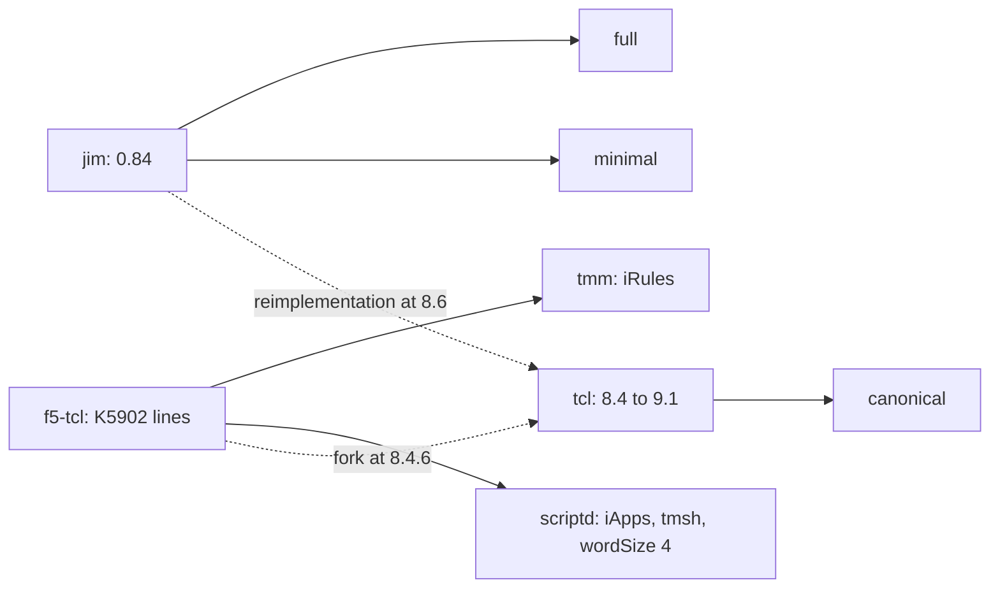
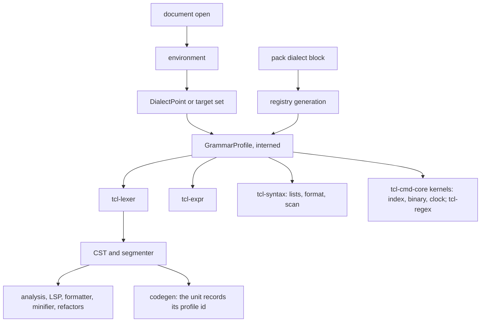

# 4. Dialects and grammar profiles

A dialect owns how source is read and evaluated. This chapter specifies the
three families, their releases and builds, and the grammar profiles that
configure every lexer and parser. It consolidates
[301](../model/301-dialects.md), [350](../model/350-spectcl-across-dialects.md)
and [370](../model/370-dialect-grammars.md).

## Families, releases and builds

| Family | Releases | Builds | Notes |
|---|---|---|---|
| `tcl` | 8.4, 8.5, 8.6, 9.0, 9.1 | `canonical` | the oracle set: 8.4.20, 8.5.19, 8.6.18, 9.0.4, 9.1.0 |
| `jim` | 0.84 | `full`, `minimal` | one point (owner decision); capabilities per extension |
| `f5-tcl` | the BIG-IP lines in public support per F5's K5902 article | `tmm`, `scriptd` | a fork of Tcl 8.4.6; only 21.1.0.1 is appliance-measured |

Today `Family` has four variants, `Tcl`, `F5Tcl`, `F5Irules` and `Jim`
(`rust/tcl-dialect/src/model/family.rs:53`). `F5Irules` is a library posing
as a language and goes (item 301). A dialect gets release boundaries only
where a release makes big language changes, as C Tcl's do, so Jim is one
point until a Jim release changes the language.

```rust
// design sketch: 301 with 370's profile
pub enum Family { Tcl, Jim, F5Tcl }                       // "tcl", "jim", "f5-tcl"
pub enum Build { Canonical, JimFull, JimMinimal, Tmm, Scriptd, Unknown }
pub struct DialectPoint { pub release: Release, pub patch: Option<Version>,
                          pub build: Build, pub capabilities: CapabilitySet }
impl DialectPoint { pub fn grammars(&self) -> &'static GrammarProfile; }
pub enum DialectId { Compiled(Family), Pack(DynamicFamilyId) }
```

- **Capabilities.** `CapabilitySet` keeps today's three answers (UTF-8
  character model, math extension, 64-bit word) and gains one flag per Jim
  extension in `auto.def` (31 names). `JimFull` turns on the default and
  optional extensions, `JimMinimal` the default ones. An environment's
  `-capabilities {+json}` switches one, which covers a `--minimal
  --with-ext=json` build. `scriptd` carries `wordSize 4`.
- **f5-tcl's ladder** is generated with the release facts (items 79 and 202,
  whose generator and grammar axes are Now 6 work beside 417; deep review W3)
  from the K5902 list; its lower bound moves with that article. Its default
  release is open decision D15. Q11 decides whether a tmsh `cli script` runs
  on `scriptd` or a third build; until then `f5-tmsh` is `scriptd`. Q11 also
  covers iCall: every r2286l case ran in an iCall script as well as TMM,
  tmsh and iApp (for example `evidence/tcl/bigip-r2286l-g-expansion.md`),
  but iCall has no build and no environment yet (304).
- **Ancestry.** `f5-tcl` forks `tcl` at 8.4.6; `jim` reimplements `tcl` at 8.6.
  The Jim core surface is a roster of inherited Tcl commands plus measured
  deltas (item 428).



## Grammar profiles

Every grammar a dialect uses has a closed set of typed axes. Each value is an
enum variant implemented natively in the owning crate. A dialect selects one
value per axis per release line and build; a pack only selects. A new value is
a Rust change, reviewed like any trusted contribution.

| Grammar | Owner | Axes |
|---|---|---|
| `script` | `tcl-lexer` | `expand`, `brace_separator`, `quote_termination`, `line_continuation`, `else_lookahead`, `braced_var`, `array_index`, `word_separators`, `brace_backslash_newline`, `var_syntax`, `comment_end`, `bom_skip`, `source_line_endings`, `escapes`, `substitution` |
| `number` | `tcl-numeric` | `syntax` |
| `expr` | `tcl-expr` | `comments`, `operators`, `precedence`, `arity`, `parser`, `arithmetic` |
| `list` | `tcl-value-syntax` | `parse` |
| `index` | `tcl-cmd-core` (`index/reading.rs`) | `syntax` |
| `format` | `tcl-syntax` and `tcl-cmd-core` | `conversions`, `alternate`, `int_width` |
| `scan` | `tcl-syntax` and `tcl-cmd-core` | `conversions`, `int_width` |
| `regex` | `tcl-regex` | `flavour`, `z_anchor` |
| `glob` | `tcl-syntax` | none: identical on every row tried |
| `binary` | `tcl-cmd-core` | `formats` |
| `clock` | `tcl-cmd-core` | `units`, `format` |
| `chars` | `tcl-dialect` | `model` |
| `values` | `tcl-syntax` | `references` |

The `index` grammar has two consumers that select it separately today, and
both read the profile instead: the kernel's reader
(`tcl-cmd-core/src/index/reading.rs:38-55`, by `TclVersion` or by the
`NumberSyntax` proxy that merges 8.5 and 8.6) and codegen's list-index
recipes (`tcl-registry/src/native_list_index_compilation.rs:64`, `:104`, by
`TclVersion`), which emit `listIndexImm` for `end+1` under `--dialect tcl8.6`
and not under 8.4.

The per-family values (370's table, rebuilt from the runs 370 lists under
"How the table was measured": tclsh 8.4.20–9.1.0, jimsh 0.84 and the 21.1
evidence):

| Axis | tcl 8.4 · 8.5 · 8.6 · 9.0 · 9.1 | jim 0.84 | f5-tcl |
|---|---|---|---|
| script `expand` | off · star · star · star · star | `star-or-word` | off |
| script `brace_separator` | required | required | optional |
| script `line_continuation` | backslash | backslash | brace-line |
| script `else_lookahead` | none | none | single-newline |
| script `braced_var` | first-close to 8.6, nesting from 9.0 | first-close | first-close |
| script `escapes` | tcl84 · tcl84 · tcl86 · tcl90 · tcl90 | jim | tcl84 |
| script `comment_end` | newline | newline-or-nul | newline |
| script `bom_skip` | off to 8.6, on from 9.0 | off | off |
| script `substitution` | evaluate | evaluate | evaluate |
| number `syntax` | tcl84 · tcl85 · tcl85 · tcl90 · tcl90 | jim080 | tcl84 |
| expr `operators` | tcl84 · tcl85 · tcl85 · tcl90 · tcl90 | jim080 | f5 (word operators) |
| expr `arity` | concatenating | exactly-one | concatenating |
| expr `arithmetic` | tcl | tcl | tcl |
| index `syntax` | tcl84 · tcl85 · tcl86 · wide · wide | jim | tcl84 (measured) |
| format `conversions` | each release its own | jim | tcl84 |
| format `alternate` | tcl84 · tcl85 · tcl85 · tcl90 · tcl90 | jim | unmeasured |
| format `int_width` | c-long · c-long · c-long · int · int | wide | c-long (`tmm` measured) |
| scan `int_width` | wrap32-narrow · full · full · saturate32 · saturate32 | full-jim | wrap32-narrow; `tmm-long32` under `-build tmm` |
| regex `flavour`, `z_anchor` | are; `z_anchor` on in 9.1 only | jim | are |
| clock `units` | none · tcl8 · tcl8 · tcl9 · tcl9 | none | none (inherited, unmeasured) |
| clock `format` | strftime84 · tcl85 · tcl85 · tcl85 · tcl85 | jim | strftime84 (inherited, unmeasured) |
| chars `model` | bmp-else-bytes · bmp-else-bytes · utf16 · scalars · scalars | jim084-utf8 (UTF-8 build) | bmp-else-bytes (`tmm` measured) |
| values `references` | none | jim | none |

The `substitution` axis has two further values: `literal` (SpecTcl 3's own
reader) and `reject`, which the `sslictcl/decl` pack dialect selects (see
"The negative controls"). The expr `arithmetic` axis has one further value,
`ebpf-int64`, which no dialect selects: a pack selects it on an argument role
(chapter 8's eBPF). Both are Rust values; a pack only selects them.

**The f5-tcl character model is measured.** Under `tmm` on 21.1.0.1, a
literal U+1F600 is 4 characters (`value_hex=f09f9880|chars=4`,
`evidence/tcl/bigip-r2286i-unicode-literal-emoji-grinning.md`), and the flag
and skin-tone pairs are 8 each (`bigip-r2286i-unicode-literal-emoji-flag.md`,
`-skin-tone.md`). tclsh 8.4.20 and 8.5.19 give 4 for the same character,
8.6.18 gives 2 and 9.0.4 gives 1. That is `bmp-else-bytes`. No BMP literal
was probed on the appliance and no `scriptd` channel was, so those carry the
fork's `Inherited` evidence. One `format` difference sits beside it:
`string length [format %c -127]` is 2 under `tmm`
(`bigip-tmm-signed-scan-and-format.md`, `fmt_c_len`) and 1 on tclsh 8.4.20,
so `format %c` of a negative value abstains under f5-tcl.

**The inert `{*}`** of iRules is `expand off`. The appliance accepts it: `list
{*}{a b}` returns `* {a b}` with completion code 0 in TMM, iApp, iCall and
tmsh (`evidence/tcl/bigip-r2286l-g-expansion.md`; measurements §1, "2
elements, no warning"). So item 431's diagnostic, which reads that axis, is a
**warning** about the misparse, never a load-time error.

**Integer widths.** `scan ffffffff %x` is -1 on 8.4 and 9.x and 4294967295 on
8.5, 8.6 and Jim; `scan 1ffffffff %x` is 8589934591 on 8.x and Jim and
2147483647 on 9.x. So 8.4 wraps only a value that fits in 32 bits
(`wrap32-narrow`) and 9.x saturates a wider one (`saturate32`, with `%u`
reading the 32-bit result as unsigned: `scan 3000000000 %u` is
18446744072414584320). Jim reads `%u` signed (`scan -1 %u` is -1), hence
`full-jim`. TMM also truncates `%lx` (`scan_lx|0|-1`), which tclsh 8.4.20
does not (4294967295): `tmm-long32`, the one value a build overrides today.
`format %x -1` is 16 digits on 8.x and Jim and 8 on 9.x, and `format %d
4294967297` is 1 on 9.x: `int_width` `c-long` reads C `long` through the
`wordSize` capability (`scriptd`'s `wordSize 4` makes it 32 bits), `int` is
9.x's 32-bit default, and `wide` is Jim's.

**Alternate forms.** `format %#x 0` is `0` on 8.4, `0x0` on 8.5 and 8.6, and
`0` on 9.x and Jim; `%#o 8` is `0o10` from 9.0. So 8.4 and 8.5 differ, and
neither is plain C. f5-tcl's alternate forms have no probe.

**Clock.** `clock add` does not exist on 8.4 (`bad option "add"`) or Jim
(`units none`); `clock format 0 -format %Ez -gmt 1` is `+0000` on 8.4 and
Jim, which hand the format to strftime, and `%Ez` from 8.5; `clock scan 0
-format %s` is `bad switch "-format"` on 8.4, and Jim's `clock scan` needs
`-format`, so Jim's format grammar is its own value. f5-tcl takes 8.4's
values from the fork, with no probe.

### Semantic axes

Some differences are binding semantics, not grammar. They are `semantics`
rows on the dialect (item 426):

| Axis | tcl | jim | f5-tcl |
|---|---|---|---|
| `namespace-eval-frame` | namespace | new-frame | namespace |
| `creative-writing` | yes to 8.6, no from 9.0 | no | yes |
| `proc-params` | tcl | jim (`&ref`, defaults anywhere, statics) | tcl |
| `return-codes` | 0–4 | 0–7 (`signal`, `exit`, `eval`) | 0–4; code 5 suspends under `tmm` (static analysis, unconfirmed) |
| `unknown` | auto-load | none (a user `unknown` is honoured) | none under `tmm` |

Code 5 under `tmm` comes from Ghidra over the TMM binary, not from a run:
measurements (`docs/design/f5/bigip-irule-parser-measurements.md`, "Suspension
is Tcl return code 5") says the suspend list "needs a runtime confirmation
pass on the appliance". Until that pass, the row carries
`-evidence static-analysis` and every consumer of it says so.

## The `dialect` form and its trust

```spectcl
dialect f5-tcl {
    release 17.1 ; release 17.5 ; release 21.1 -evidence measured
    build tmm ; build scriptd -capabilities {wordSize 4}
    grammar script {
        expand off ; brace_separator optional ; line_continuation brace-line
        else_lookahead single-newline ; escapes tcl84
    }
    grammar number { syntax tcl84 }
    grammar expr { comments none ; operators f5 ; precedence f5 ; parser tcl84 }
    grammar index { syntax tcl84 }
    grammar format { conversions tcl84 ; alternate unmeasured ; int_width c-long }
    grammar scan { int_width wrap32-narrow ; int_width tmm-long32 -build tmm }
    grammar clock { units none ; format strftime84 }
    grammar chars { model bmp-else-bytes }
}
```

The release lines above are illustrative; the shipped ladder is generated
from K5902. 305's `axis NAME VALUE` reads as `grammar script { NAME VALUE }`,
with `irules_brace_separator on` read as `brace_separator optional` and
`brace_line_continuation on` as `line_continuation brace-line`. The reader
rejects the whole block, naming the axis, on any unknown word. `unmeasured`
is a value every axis accepts: an answer that depends on it abstains, and the
writer treats it as the most restrictive value.

| Tier | Define a new, namespaced dialect | Change `tcl`, `jim` or `f5-tcl` |
|---|---|---|
| BuiltIn, BundledPack | yes | yes, with conformance rows for every changed axis |
| User, WorkspaceTrusted | yes | no |
| WorkspaceUntrusted, StudioOverride, Document | no | no |

## Reaching every parser

The dialect selects the grammar; no name lookup does. Every lexer and
parser reads it: script, expr, list, index, format, scan, regex, glob,
binary, clock, chars and values (owner decision). A pack dialect's
profile is published in the registry generation (item 47's salsa input), not
the process-global dynamic store, so it reaches every parser (closing D5).
Today `LexerConfig::default()` (Tcl 9) is named on hundreds of non-test lines
(370's census); each site takes the document's profile.



A target range resolves to the set of distinct profiles in it, and the
analysis lexes once per distinct profile. Any difference between them is a
portability diagnostic (item 425). A tool that writes Tcl writes through the
writer owner, which re-lexes its output under the profile and refuses an edit
whose words change (item 422): it never emits `}{` under `brace_separator
optional`, never starts a line with `{` under `brace-line`, and never emits
`{*}` under `expand off`.

## Example: numerals divide the releases three ways

**Source:**

```tcl
puts [list [catch {expr {017 + 0o17}} m] $m]
```

**In memory:**

```rust
// design sketch (370); NumberSyntax exists today
NumberGrammar { syntax: Tcl84 }   // tcl 8.4: 0o17 is not a numeral
NumberGrammar { syntax: Tcl85 }   // 8.5, 8.6: 017 is octal 15
NumberGrammar { syntax: Tcl90 }   // 9.0, 9.1: 017 is decimal 17
NumberGrammar { syntax: Jim080 }  // jim 0.84: decimal 17
```

**Bytecode (tclsh 9.1.0):**

```text
ByteCode
  Source "puts [list [catch {expr {017 + 0o17}} m] $m]\n"
  Cmds 3, src 45, inst 51, litObjs 4, aux 0, stkDepth 4, code/src 0.00
  Command 3: "catch {expr {017 + 0o17}} m..."
    (14) push 1 	# "catch"
    (19) push 2 	# "expr {017 + 0o17}"
    (24) push 3 	# "m"
    (29) invokeStk 3 
```

**Bytecode (tcl dis):**

```text
$ ./target/debug/tcl dis --dialect tcl8.6 --source 'expr {017 + 0o17}'
    (0) push1 0	# "30"
    (2) done
$ ./target/debug/tcl dis --dialect tcl9.0 --source 'expr {017 + 0o17}'
    (0) push1 0	# "32"
    (2) done
$ ./target/debug/tcl dis --dialect tcl8.4 --source 'puts a; expr {0o17}; puts b'
ByteCode ::top, 12 instructions, 21 bytes, 5 literals, 0 variables
    (0) push1 0	# "puts"
    (2) push1 1	# "a"
    (4) invokeStk1 2	# puts
    (6) pop
    (7) push1 2	# "expr"
    (9) push1 3	# "0o17"
    (11) invokeStk1 2	# expr
    (13) pop
    (14) push1 0	# "puts"
    (16) push1 4	# "b"
    (18) invokeStk1 2	# puts
    (20) done
```

**Result:**

```text
$ tclsh8.4 num.tcl
1 {syntax error in expression "017 + 0o17": extra tokens at end of expression}
$ tclsh8.5 num.tcl      (tclsh8.6 the same)
0 30
$ tclsh9.0 num.tcl      (tclsh9.1, tmp/jimtcl-oracle/jimsh and ./target/debug/tclvm the same)
0 32
```

Our compiler folds the expression per release, so its constant comes from the
number grammar of the unit's profile, as C Tcl's does, for 8.5 to 9.1. Under
8.4, `tcl dis` used to emit an empty unit where the expression does not
parse, dropping the commands either side, and exit 0, while tclsh 8.4.20 and
`tclvm --tcl-version 8.4` print `a` and then fail with `syntax error in
expression "0o17"`. **Required, and now met:** a braced expression that does
not parse under the unit's profile compiles to a runtime error at that
command, with commands 1 and 3 compiled around it; the unit is never empty.
8.4 hands a sourced file to `Tcl_EvalEx`, so its unit is a direct script whose
second command fails when it runs, rather than the `syntax` instruction 8.5
and later compile ([370](../model/370-dialect-grammars.md), worked example 2).
This was in item 423's "Done when".

## The negative controls

Two DSLs over `tcl` 9.0's grammar prove the model needs no new compiled
family for a DSL. Each changes exactly one thing a dialect or a role owns:

| Placement | What differs | Why there |
|---|---|---|
| `sslictcl/decl`, a namespaced pack dialect (BundledPack tier), with environment `sslictcl` | one axis, `grammar script { substitution reject }`; every other axis is `tcl` 9.0's; policy `closed -evaluation never` | how source is read is a dialect's, and `DialectPoint::grammars` takes only the point, so an environment cannot change an axis |
| environment `bpf` over `tcl` 9.0 | no axis; the role option `-expr-profile ebpf-int64` on `setint` and `if` arguments selects the Rust value `expr arithmetic ebpf-int64`; policy `closed -evaluation never` | BPF-Tcl reads every word as Tcl 9.0 does, its subset is availability, and the expression arithmetic belongs to one argument role |

The trust table above lets a BundledPack define a namespaced dialect, so
`tcl-lib-sslictcl` defines `sslictcl/decl` itself; it is internal, with no
shims. The dialect block names its one changed axis over `tcl` 9.0 (the
`-base {tcl 9.0}` spelling goes to chapter 2). The `document` grammar's
`substitution reject -code SSLIC1002` row only maps the finding to a code.

Both are chapter 8's. **Today** `tcl dis` compiles both as Tcl:
`samples/sslictcl/example.sslictcl` gives 68 instructions with exit 0, and
`tcl dis --dialect bpf` gives a plain `invokeStk1 3 # when`. Jim and f5-tcl
units come out as ordinary bytecode with no label (`tcl dis --dialect jim`,
`--dialect f5-irules`). **After** item 457, an engine asked to run an
`evaluation never` environment, `sslictcl` or `bpf`, refuses with a reason;
after item 434, `tcl dis` labels a Jim or f5-tcl unit as an analysis
lowering, because Jim has no bytecode and TMM's is not ours.

## Consumers per dialect

| Consumer | tcl | jim | f5-tcl |
|---|---|---|---|
| analyser, LSP | as today | deltas on inherited commands; `namespace eval` frame | inert `{*}` is a warning about the misparse, since the appliance accepts it; under `tmm` an unknown, absent or refused head and `proc` inside `when` are errors, as the rule loader reports them |
| formatter | as today | statics proc: arg 3 is `Body` | merge `}` newline `else` to `} else`; never put `{` at a line start |
| minifier | chapter 6 | statics names are `-frozen` | `static::*`, data-group and pool names are `-frozen` |
| optimiser | proof sets on tclsh | proofs on jimsh; `ref-liveness` | suspending commands are barriers, from a list that is static analysis and unconfirmed (code 5 above); proofs only against 21.1 evidence |
| hooks | 9.1 VM, `ctx dialect` | kernels, else abstain | kernels or tcl 8.4 with `Inherited` evidence, else abstain |
| VM, runtime | executes | analysis only | analysis only; the iRules simulator runs |

## Review fixes (26 November 2026)

- **D1:** f5-tcl `chars model` is `bmp-else-bytes`, measured under `tmm` from the r2286i files; the "unmeasured" text and R31's abstention are gone here (R31 itself is chapter 1's).
- **D2:** the inert `{*}` is a warning about the misparse, not a load-time error; the appliance accepts it (`bigip-r2286l-g-expansion.md`, measurements §1).
- **D3:** scan `int_width` is `wrap32-narrow`, `full`, `saturate32`, `full-jim`, and `tmm-long32` under `-build tmm`, the one build override.
- **D4:** an `index` grammar with axis `syntax {tcl84 tcl85 tcl86 wide jim}`; its two consumers, `index/reading.rs` and codegen's list-index recipes, read it.
- **D5:** format `int_width {c-long int wide}`, read with `wordSize`; `alternate` split into `tcl84`, `tcl85`, `tcl90` and `jim`; f5-tcl unmeasured.
- **D6:** clock gains a `format` axis (`strftime84`, `tcl85`, `jim`), and 8.4 and f5-tcl take `units none`.
- **D7:** SslicTcl is the namespaced pack dialect `sslictcl/decl`; the negative-controls table says why.
- **D8:** `ebpf-int64` is a Rust value of the expr `arithmetic` axis that a role selects; no pack supplies an operator table. The axis is named `arithmetic`, not `semantics`, so it does not collide with the dialect's `semantics` rows.
- **D11:** the 8.4 `tcl dis` row and the required runtime-error behaviour (item 423).
- **D14:** code 5 under `tmm`, and the optimiser's barriers, are static analysis, unconfirmed.
- **D15:** `tcl dis` labels and engine refusals are future work (items 434 and 457); `bpf` is `evaluation never`; iCall is listed under Q11.

## Review fixes (26 November 2026, deep review)

- **W3.** The release-facts generator and 79's grammar axes are Now 6 work beside 417.
