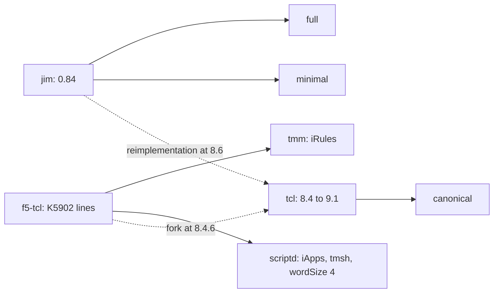
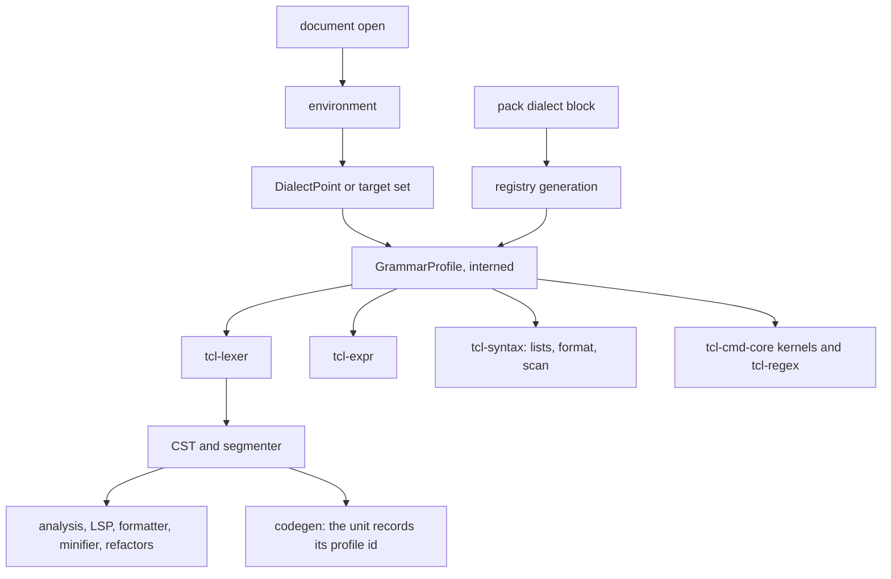

# 4. Dialects and grammar profiles

A dialect owns how source is read and evaluated. This chapter specifies the
three families, their releases and builds, and the grammar profiles that
configure every lexer and parser. It consolidates
[301](../model/301-dialects.md), [350](../model/350-spectcl-across-dialects.md)
and [370](../model/370-dialect-grammars.md).

## Families, releases and builds

| Family | Releases | Builds | Notes |
|---|---|---|---|
| `tcl` | 8.4, 8.5, 8.6, 9.0, 9.1 | `canonical` | the oracle set: 8.4.20, 8.5.19, 8.6.18, 9.0.4, 9.1.0 |
| `jim` | 0.84 | `full`, `minimal` | one point (owner decision); capabilities per extension |
| `f5-tcl` | the BIG-IP lines in public support per F5's K5902 article | `tmm`, `scriptd` | a fork of Tcl 8.4.6; only 21.1.0.1 is appliance-measured |

Today `Family` has four variants, `Tcl`, `F5Tcl`, `F5Irules` and `Jim`
(`rust/tcl-dialect/src/model/family.rs:53`). `F5Irules` is a library posing
as a language and goes (item 301). A dialect gets release boundaries only
where a release makes big language changes, as C Tcl's do, so Jim is one
point until a Jim release changes the language.

```rust
// design sketch: 301 with 370's profile
pub enum Family { Tcl, Jim, F5Tcl }                       // "tcl", "jim", "f5-tcl"
pub enum Build { Canonical, JimFull, JimMinimal, Tmm, Scriptd, Unknown }
pub struct DialectPoint { pub release: Release, pub patch: Option<Version>,
                          pub build: Build, pub capabilities: CapabilitySet }
impl DialectPoint { pub fn grammars(&self) -> &'static GrammarProfile; }
pub enum DialectId { Compiled(Family), Pack(DynamicFamilyId) }
```

- **Capabilities.** `CapabilitySet` keeps today's three answers (UTF-8
  character model, math extension, 64-bit word) and gains one flag per Jim
  extension in `auto.def` (31 names). `JimFull` turns on the default and
  optional extensions, `JimMinimal` the default ones. An environment's
  `-capabilities {+json}` switches one, which covers a `--minimal
  --with-ext=json` build. `scriptd` carries `wordSize 4`.
- **f5-tcl's ladder** is generated with the release facts (items 79 and 202)
  from the K5902 list; its lower bound moves with that article. Its default
  release is open decision D15. Q11 decides whether a tmsh `cli script` runs
  on `scriptd` or a third build; until then `f5-tmsh` is `scriptd`.
- **Ancestry.** `f5-tcl` forks `tcl` at 8.4.6; `jim` reimplements `tcl` at 8.6.
  The Jim core surface is a roster of inherited Tcl commands plus measured
  deltas (item 428).



## Grammar profiles

Every grammar a dialect uses has a closed set of typed axes. Each value is an
enum variant implemented natively in the owning crate. A dialect selects one
value per axis per release line and build; a pack only selects. A new value is
a Rust change, reviewed like any trusted contribution.

| Grammar | Owner | Axes |
|---|---|---|
| `script` | `tcl-lexer` | `expand`, `brace_separator`, `quote_termination`, `line_continuation`, `else_lookahead`, `braced_var`, `array_index`, `word_separators`, `brace_backslash_newline`, `var_syntax`, `comment_end`, `bom_skip`, `source_line_endings`, `escapes`, `substitution` |
| `number` | `tcl-numeric` | `syntax` |
| `expr` | `tcl-expr` | `comments`, `operators`, `precedence`, `arity`, `parser` |
| `list` | `tcl-value-syntax` | `parse` |
| `format`, `scan` | `tcl-syntax` and `tcl-cmd-core` | `conversions`, `alternate`, `int_width` |
| `regex` | `tcl-regex` | `flavour`, `z_anchor` |
| `glob` | `tcl-syntax` | none: identical on every row tried |
| `binary`, `clock` | `tcl-cmd-core` | `formats`; `units` |
| `chars` | `tcl-dialect` | `model` |
| `values` | `tcl-syntax` | `references` |

The per-family values (370's table, measured on tclsh 8.4.20–9.1.0, jimsh
0.84 and the 21.1 evidence):

| Axis | tcl 8.4 · 8.5 · 8.6 · 9.0 · 9.1 | jim 0.84 | f5-tcl |
|---|---|---|---|
| script `expand` | off · star · star · star · star | `star-or-word` | off |
| script `brace_separator` | required | required | optional |
| script `line_continuation` | backslash | backslash | brace-line |
| script `else_lookahead` | none | none | single-newline |
| script `braced_var` | first-close to 8.6, nesting from 9.0 | first-close | first-close |
| script `escapes` | tcl84 · tcl84 · tcl86 · tcl90 · tcl90 | jim | tcl84 |
| script `comment_end` | newline | newline-or-nul | newline |
| script `bom_skip` | off to 8.6, on from 9.0 | off | off |
| script `substitution` | evaluate | evaluate | evaluate |
| number `syntax` | tcl84 · tcl85 · tcl85 · tcl90 · tcl90 | jim080 | tcl84 |
| expr `operators` | tcl84 · tcl85 · tcl85 · tcl90 · tcl90 | jim080 | f5 (word operators) |
| expr `arity` | concatenating | exactly-one | concatenating |
| format `conversions` | each release its own | jim | tcl84 |
| regex `flavour`, `z_anchor` | are; `z_anchor` on in 9.1 only | jim | are |
| chars `model` | bmp · bmp · utf16 · scalars · scalars | jim084-utf8 (UTF-8 build) | unmeasured |
| values `references` | none | jim | none |

The `substitution` axis has two further values used only by the negative
controls: `literal` (SpecTcl 3's own reader) and `reject` (SslicTcl). The
f5-tcl character model is **unmeasured**: character-count answers under
f5-tcl abstain until a probe records it (Reconciliation R31). The inert `{*}`
of iRules is `expand off`; item 431's diagnostic reads that axis.

### Semantic axes

Some differences are binding semantics, not grammar. They are `semantics`
rows on the dialect (item 426):

| Axis | tcl | jim | f5-tcl |
|---|---|---|---|
| `namespace-eval-frame` | namespace | new-frame | namespace |
| `creative-writing` | yes to 8.6, no from 9.0 | no | yes |
| `proc-params` | tcl | jim (`&ref`, defaults anywhere, statics) | tcl |
| `return-codes` | 0–4 | 0–7 (`signal`, `exit`, `eval`) | 0–4, code 5 suspends under `tmm` |
| `unknown` | auto-load | none (a user `unknown` is honoured) | none under `tmm` |

## The `dialect` form and its trust

```spectcl
dialect f5-tcl {
    release 17.1 ; release 17.5 ; release 21.1 -evidence measured
    build tmm ; build scriptd -capabilities {wordSize 4}
    grammar script {
        expand off ; brace_separator optional ; line_continuation brace-line
        else_lookahead single-newline ; escapes tcl84
    }
    grammar number { syntax tcl84 }
    grammar expr { comments none ; operators f5 ; precedence f5 ; parser tcl84 }
    grammar chars { model unmeasured }
}
```

The release lines above are illustrative; the shipped ladder is generated
from K5902. 305's `axis NAME VALUE` reads as `grammar script { NAME VALUE }`,
with `irules_brace_separator on` read as `brace_separator optional` and
`brace_line_continuation on` as `line_continuation brace-line`. The reader
rejects the whole block, naming the axis, on any unknown word.

| Tier | Define a new, namespaced dialect | Change `tcl`, `jim` or `f5-tcl` |
|---|---|---|
| BuiltIn, BundledPack | yes | yes, with conformance rows for every changed axis |
| User, WorkspaceTrusted | yes | no |
| WorkspaceUntrusted, StudioOverride, Document | no | no |

## Reaching every parser

The dialect selects the grammar; no name lookup does. A pack dialect's
profile is published in the registry generation (item 47's salsa input), not
the process-global dynamic store, so it reaches every parser (closing D5).
Today `LexerConfig::default()` (Tcl 9) is named on hundreds of non-test lines
(370's census); each site takes the document's profile.



A target range resolves to the set of distinct profiles in it, and the
analysis lexes once per distinct profile. Any difference between them is a
portability diagnostic (item 425). A tool that writes Tcl writes through the
writer owner, which re-lexes its output under the profile and refuses an edit
whose words change (item 422): it never emits `}{` under `brace_separator
optional`, never starts a line with `{` under `brace-line`, and never emits
`{*}` under `expand off`.

## Example: numerals divide the releases three ways

**Source:**

```tcl
puts [list [catch {expr {017 + 0o17}} m] $m]
```

**In memory:**

```rust
// design sketch (370); NumberSyntax exists today
NumberGrammar { syntax: Tcl84 }   // tcl 8.4: 0o17 is not a numeral
NumberGrammar { syntax: Tcl85 }   // 8.5, 8.6: 017 is octal 15
NumberGrammar { syntax: Tcl90 }   // 9.0, 9.1: 017 is decimal 17
NumberGrammar { syntax: Jim080 }  // jim 0.84: decimal 17
```

**Bytecode (tclsh 9.1.0):**

```text
ByteCode
  Source "puts [list [catch {expr {017 + 0o17}} m] $m]\n"
  Cmds 3, src 45, inst 51, litObjs 4, aux 0, stkDepth 4, code/src 0.00
  Command 3: "catch {expr {017 + 0o17}} m..."
    (14) push 1 	# "catch"
    (19) push 2 	# "expr {017 + 0o17}"
    (24) push 3 	# "m"
    (29) invokeStk 3 
```

**Bytecode (tcl dis):**

```text
$ ./target/debug/tcl dis --dialect tcl8.6 --source 'expr {017 + 0o17}'
    (0) push1 0	# "30"
    (2) done
$ ./target/debug/tcl dis --dialect tcl9.0 --source 'expr {017 + 0o17}'
    (0) push1 0	# "32"
    (2) done
```

**Result:**

```text
$ tclsh8.4 num.tcl
1 {syntax error in expression "017 + 0o17": extra tokens at end of expression}
$ tclsh8.5 num.tcl      (tclsh8.6 the same)
0 30
$ tclsh9.0 num.tcl      (tclsh9.1, tmp/jimtcl-oracle/jimsh and ./target/debug/tclvm the same)
0 32
```

Our compiler folds the expression per release, so its constant comes from the
number grammar of the unit's profile, as C Tcl's does.

## The negative controls

Two environments place a library over `tcl` 9.0's grammar without a dialect
of their own. They prove the model needs no new family for a DSL:

| Environment | Why not a dialect | What differs |
|---|---|---|
| `sslictcl` | it lexes with `GRAMMAR_TCL9X` and evaluates nothing | `substitution reject` on the document grammar; policy `closed -evaluation never` |
| `bpf` | BPF-Tcl reads every word as Tcl 9.0 does; its subset is availability | an argument sublanguage: `-expr-profile ebpf-int64` on `setint` and `if` arguments |

Both are chapter 8's. An engine asked to run an `evaluation never`
environment refuses with a reason, and `tcl dis` labels a Jim or f5-tcl unit
as an analysis lowering, because Jim has no bytecode and TMM's is not ours
(item 434).

## Consumers per dialect

| Consumer | tcl | jim | f5-tcl |
|---|---|---|---|
| analyser, LSP | as today | deltas on inherited commands; `namespace eval` frame | inert `{*}` is an error; under `tmm` an unknown, absent or refused head and `proc` inside `when` are errors, as the rule loader reports them |
| formatter | as today | statics proc: arg 3 is `Body` | merge `}` newline `else` to `} else`; never put `{` at a line start |
| minifier | chapter 6 | statics names are `-frozen` | `static::*`, data-group and pool names are `-frozen` |
| optimiser | proof sets on tclsh | proofs on jimsh; `ref-liveness` | suspending commands are barriers; proofs only against 21.1 evidence |
| hooks | 9.1 VM, `ctx dialect` | kernels, else abstain | kernels or tcl 8.4 with `Inherited` evidence, else abstain |
| VM, runtime | executes | analysis only | analysis only; the iRules simulator runs |
