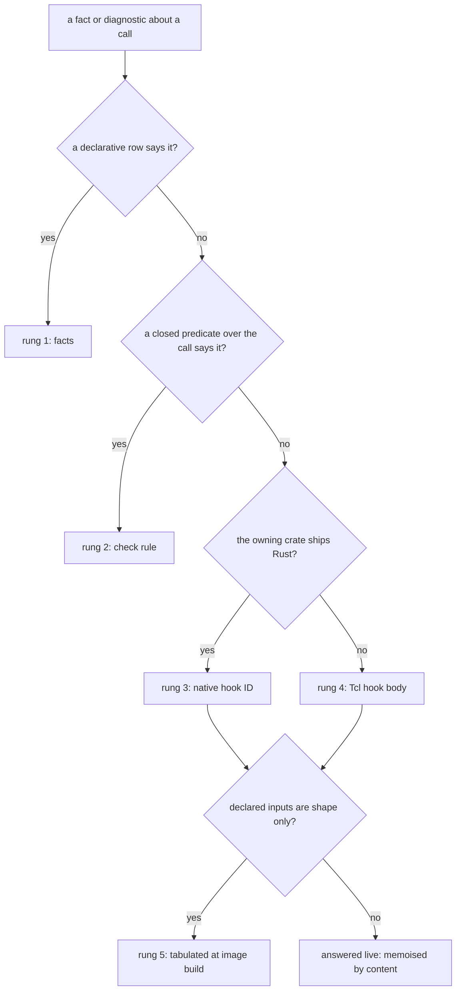
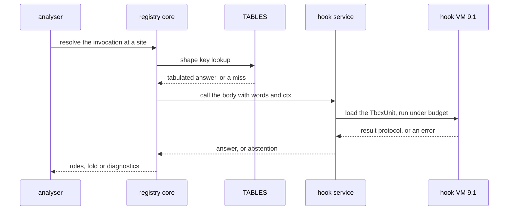

# 5. Checks, hooks and the hook ABI

A fact a pack cannot state declaratively climbs a ladder of five rungs. This
chapter specifies each rung, the hook context and result protocols, the one
hook ABI, how Tcl hook bodies are stored as tbcx bytecode, tabulation, and
the VM that runs them. It consolidates [305](../model/305-spectcl-3.md),
[313](../model/313-consumer-hooks.md), [332](../model/332-rust-spectcl-parity.md),
[333](../model/333-spectcl-3-gap-analysis.md), [350](../model/350-spectcl-across-dialects.md),
[bytecode-image](../../compiler/bytecode-image.md) and
[vm-tcl-9-1](../../compiler/vm-tcl-9-1.md).

## The rungs

| Rung | Form | Runs in | Crates linked at run time |
|---|---|---|---|
| 1 | facts: arity, roles, value sets, option relations, `clause_grammar`, `case_list`, `definition_body`, binding transitions, effects, `throws`, handles | the registry core | the core and the image reader |
| 2 | `check` rules | a closed predicate evaluator in Rust | the same |
| 3 | `-native ID` | the owning dialect or library crate's `HookTable` | that crate |
| 4 | a Tcl hook body | the hook VM (`tcl-vm` on the 9.1 base), from a tbcx unit | `tcl-spec-hooks` → `tcl-vm`, linked only by an entry point that enables Tcl hooks |
| 5 | tabulated answers | a table in the image (`TABLES`) | none beyond rung 1 |

An author, or the `spec-author` skill, climbs only as far as a fact needs.
Rung 5 is what the image compiler makes of a rung 3 or 4 hook whose declared
inputs are shape only: its answers are computed once at image build and
served on any thread with no VM, as `BUNDLED_ROLE_TABLES` does today
(`rust/tcl-spectcl/src/bundled_manifest.rs:92`).



Whole-file passes (`irules_checks`, Tk's checks, the eBPF front end, the
`tmsh-command` resolver in `tcl-bigip`) are not rungs. They are analyser
contributions registered by the entry points through `UnitRule` and
`SiteRule` (compiler split item 285), and they read facts like any consumer.

## Rung 2: `check`

The predicate language is closed: chapter 2's atoms, `all`, `any` and `not`,
and nothing else. No VM, loops, `proc` or general code. A new atom needs a
design note and a `registry-axes` review. A rule compiles to a post-order
expression tree in the image's `RULES` section, so a rule edit is a data edit.

- **Three-valued.** An atom over an unknown value is unknown; a rule emits only
  when its predicate is proved true. Version atoms over a set hold only when
  they hold for every member; `{library L R}` is true only on `Must`.
- **Emit.** A rule emits a pack code `PACK/ID` with a default severity and an
  item 108 category. The policy, user settings and suppression directives
  treat it as any code (item 413; open decision D9 on the spelling). Only
  BuiltIn rows may emit an existing `DiagCode`
  (`rust/tcl-core-types/src/diag_code.rs:287`).
- **Templates** take `{arg N}`, `{value WORD}`, `{library L}` and `{dialect}`.
- **Fixes** are `replace`, `delete` and `insert-after`, over word spans.

## The hook context

A rung 4 body is called as `{words ctx}`; a `check` and a native hook read the
same record natively. The record (item 406 adds certainty):

| `ctx` key | Value |
|---|---|
| `kinds` | per word: `literal`, `known-bytes`, `var`, `command`, `script`, `expand`, `opaque` |
| `values` | per word: the known value, or absent |
| `options` | dict of written option → word index |
| `argc` | the word count after the command path |
| `command` | the resolved command path (`{trace variable}`) |
| `dialect` | `{family F release R build B capabilities {…}}`, or a list of those over a set |
| `libraries` | dict of library → `{state must\|may\|unknown versions {…} placement P provenance K}` |
| `targets` | the declared target set per axis |
| `realm` | the realm id (iRules `RuleLoader` only where iRules is present) |
| `within` | the enclosing proc, event or namespace |

`-inputs SHAPE` declares which keys a body reads. A body that reads only
`kinds`, `argc` and `options` is tabulated; one that reads `values` is
memoised by content; one that declares nothing is legal, correct and
uncacheable.

## Result protocols

| Family | Result | Rungs | Tabulated |
|---|---|---|---|
| roles (`arg_role_resolver`, count and layout resolvers) | `role I R` list | 1, 3, 4 | when shape-only |
| prefix, timing | `prefix I ARITY`; `timing immediate\|deferred\|unknown` per script word | 1, 3, 4 | when shape-only |
| diagnostic (`check`, validators, `constraints`, `context_gate`) | a list of `{code C severity S at {arg N} message M ?fix …?}` | 1, 2, 3, 4 | `check` is data |
| state transitions | `alias LOCAL TARGET ?-level L?`, `namespace-variable NAME` | 1, 3, 4 | when shape-only |
| fold (`const_fold`, `evaluate`) | `value V` or nothing | 3, 4, evaluate routes | no: memoised by content |
| rewrite | `replace TEMPLATE` or nothing | 1, 3, 4 | when shape-only |
| layout | `break-before I`, `keep I`, `group FROM TO` | 1, 3, 4 | when shape-only |
| validate (SslicTcl) | the diagnostic protocol | 3 | no |
| lowering, codegen, inline codegen, return type, native-contract rows | Rust | 3 only, closed sets | n/a |

An error, a blown budget, no result, or an uncovered proof set is an
**abstention**: no fold, no rewrite, no rename, no reflow. The one exception
is a taint sink's `-when` (rule `SinkWhen`, 393): it suppresses the sink only
when proved false, so an unknown leaves the sink in force. It replaces the
`taint_sink_gate` hook family, which had the same non-neutral silence.

## Rung 3: native hooks by ID

Every function-pointer field becomes a `NativeHookId` resolved through the
owning crate's `HookTable` (item 402). Rust writes
`hook!(file::home::native_compilation)` where it writes a `fn` today, and the
printer writes the same ID. Named descriptors (`state_transitions`,
`world_effects`, `case_list`, `body_scope`, `frame_effect`, `event_requires`)
hold a `DescriptorId` in a `DescriptorTable`, or an inline value.

The closed native families are today's `AnalyserHookId`
(`rust/tcl-registry/src/hooks.rs:374`), `LoweringHookId`, `CodegenHookId`,
`InlineCodegenHookId` and `ReturnTypeHookId`, and the pack hook families
(`HookFamily`, `rust/tcl-registry/src/pack_hooks.rs:96`). **Codegen gets facts
only**: no library pack names a codegen, lowering or inline-codegen hook. Those
IDs and the native-contract rows (`successful_handler`, `native_compilation`,
`procedure_definition`, `completion`, `body_execution`) are spelled so the
printer can print the core's Rust, and are accepted only from BuiltIn and
BundledPack provenance (item 403). A user pack writing one gets today's
exclusion notice.

### One `hook_abi`

Every native hook table an image refers to carries one `hook_abi` number in
the image header. A change to any consumer's calling convention bumps it once
and every image regenerates. An image whose `hook_abi` is unknown to the
binary, or which names an ID the binary lacks, is stale and is recompiled
from source.

## Rung 4: Tcl hook bodies

A hook body is a pure function of its declared inputs. It runs per pack in its
own sandboxed engine, under a command limit and a wall-clock cap, inside
`catch_unwind`, with `Engine::confine_stores` refusing any store outside the
body's own activation. A crash quarantines the hook for the session and
writes a crash record, and the command keeps its declarative facts. In an
untrusted workspace no body runs: each is reported dormant on the pack file.

**Bodies run on the 9.1 VM.** The target release reaches a body only as `ctx
dialect` and through the registry's dialect-aware value kernels (numeral and
list parse, glob match, `string is`), called as `kernel::is-integer $w`. The
sandbox's own `expr` and `lsort` never answer for another family. A
release-pinned question with no kernel abstains (item 430). C Tcl folds that
need a release's exact semantics go through the `evaluate` routes, run under
an engine pinned to each release in the target set, and fold only when every
release agrees.

### Bodies as tbcx bytecode

Each body is stored in the image's `BODIES` section as a `TbcxUnit` (item
311): `{ meta_format, meta: UnitMeta, payload }`, where the payload is a tbcx
format-93 **interop** unit stamped for the pinned 9.1.0 (`0x09010002`), at
source policy 1, compiled as tbcx compiles (plain dispatch). The body's source
is kept once beside the unit, for the hash and the fallback. On load the unit
is validated before anything runs (every tbcx check, kind against content,
admission per release, aux kinds, nesting, stack depth); a unit that fails, or
whose `UnitMeta` is stale, falls back to compiling the kept source. When the
Tcl pin or the tbcx format moves, every image re-exports its units.

Until item 311 lands, images may store body source only and compile on the
first call that misses the table (owner decision: 311 does not block 306).

## Example: a fold body, as source and as bytecode

`math::max`'s fold (313) folds only decimal words, because `08` is a string on
8.x and 8 on 9.x, and abstains otherwise.

**Source:**

```spectcl
command math::max {
    available math 1.2-
    arity 1..
    side_effects none ; effects -complete {math 1.2-}
    const_fold -inputs {values} -proof {core tcl 8.5-9.2} -body {words ctx} {
        set m [lindex $words 0]
        foreach w $words {
            if {![regexp {^-?(0|[1-9][0-9]*)$} $w]} return
            if {$w > $m} { set m $w }
        }
        return [list value $m]
    }
}
```

**In memory:**

```rust
// design sketch: chapter 7's Hook and TbcxUnit
Hook {
    family: HookFamily::ConstFold,
    inputs: Inputs { values: true, .. },          // reads values: memoised, not tabulated
    body: HookBody::Tcl {
        params: "words ctx",
        unit: TbcxUnit { meta_format: 1, meta: UnitMeta { profile: TCL_9_1, .. },
                         payload: /* format 93, stamp 0x09010002, policy 1 */ .. },
        source: SourceRef(..),                    // kept for the hash and the fallback
    },
    proof: ProofSet(VersionSet("core tcl 8.5-9.2")),
}
```

**Bytecode (tclsh 9.1.0):** the body compiled as a proc `fold_max {words ctx}`,
header lines trimmed:

```text
  Command 2: "lindex $words 0..."
    (0) loadScalar %v0 	# var "words"
    (5) listIndexImm 0 
    (10) storeScalar %v2 	# var "m"
    (15) pop 
  Command 3: "foreach w $words {\n        if {![regexp {^-?(0|[1-9][0..."
    (16) loadScalar %v0 	# var "words"
    (21) foreach_start 0 
		[jumpOffset=-72, vars=[%v3]]
  Command 5: "regexp {^-?(0|[1-9][0-9]*)$} $w..."
    (26) push 0 	# "^-?(0|[1-9][0-9]*)$"
    (31) loadScalar %v3 	# var "w"
    (36) regexp +3 
    (38) nop 
    (39) jumpTrue +16 	# pc 55
  Command 6: "return..."
    (44) push 1 	# ""
    (49) done 
  Command 7: "if {$w > $m} { set m $w }..."
    (61) loadScalar %v3 	# var "w"
    (66) loadScalar %v2 	# var "m"
    (71) gt 
    (72) jumpFalse +20 	# pc 92
  Command 10: "list value $m..."
    (106) push 2 	# "value"
    (111) loadScalar %v2 	# var "m"
    (116) list 2 
    (121) done 
```

**Bytecode (tcl dis):**

```text
$ ./target/debug/tcl dis --dialect tcl9.1 fold.tcl      # ::fold_max, label lines dropped
ByteCode ::fold_max, 37 instructions, 122 bytes, 3 literals, 4 variables
    (0) loadScalar %v0
    (5) listIndexImm 0
    (10) storeScalar %v2	# var "m"
    (15) pop
    (16) loadScalar %v0
    (21) foreach_start 0
    (26) push 0	# "^-?(0|[1-9][0-9]*)$"
    (31) loadScalar %v3
    (36) regexp +3
```

**Result:**

```text
$ cat fold.tcl     # proc fold_max {words ctx} {…the body…}
puts [list [fold_max {3 7 5} {}] [fold_max {08 3} {}]]
$ tclsh8.6 fold.tcl     (tclsh9.1 and ./target/debug/tclvm print the same)
{value 7} {}
```

Both compilers give 122 bytes for the body. The interop unit `BODIES` stores
is the tbcx shape of the same body (plain dispatch, so `regexp` and `list`
become `invokeStk`), which item 311's byte-identity oracle checks against
`tbcx::save`.

## The hook path at run time



Native processes run every body on one hook-service thread; browser and WASI
hosts run synchronously on their execution thread (as today). Tables belong to
an exact published plan: publishing retires the previous table owner, and
quarantine removes a hook's tables.

## The VM

The hook VM is `tcl-vm` on the Tcl 9.1 base (item 312): `Op` gets C Tcl 9.1's
opcode numbers from the pinned `tclInstructionTable[]`, private opcodes count
down from 255, and a per-release admission table says which opcodes a target
may hold. Every dispatch arm follows 9.1 semantics; deprecated opcodes stay
executable for 8.4–9.0 targets. tbcx validates units against the running 9.1
table, which is why codes 0–210 must equal 9.1.0's. Hook bodies are always
plain `tcl` 9.1 profile units; private opcodes never occur in them.
