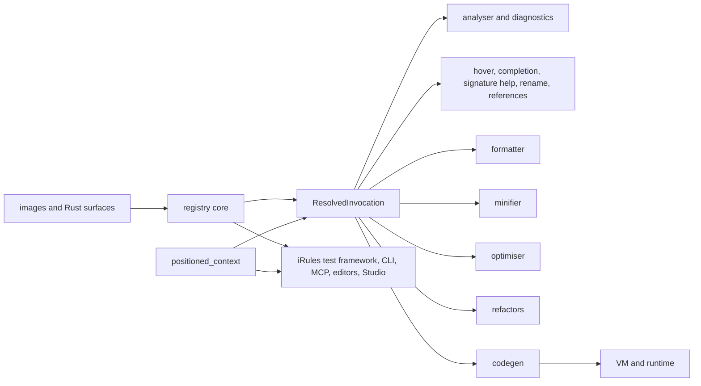
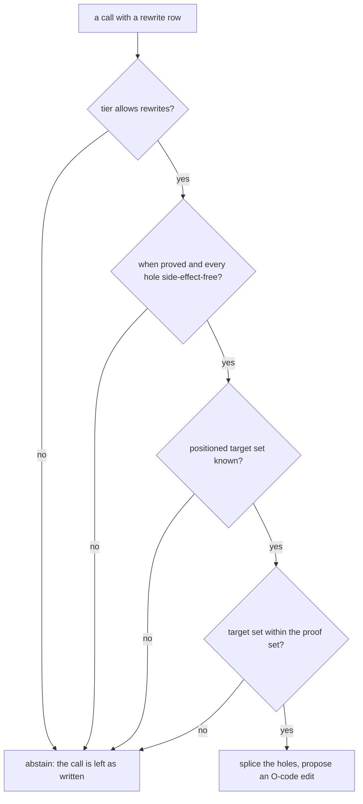

# 6. Consumers

Every consumer reads the same argument-role, effect and binding facts through
`ResolvedInvocation`, the analyser's answer for a call, and the same version
answer through `positioned_context`. Each consumer adds only the facts and
hooks specific to it. No consumer keeps a role table, a command-name match or
a version floor of its own. When a fact it needs is missing, it **abstains**.

This chapter lists, per consumer, what it reads and what it does without it.
It consolidates [313](../model/313-consumer-hooks.md),
[319](../model/319-consumer-migration.md), [334](../model/334-spectcl-codegen-vm-runtime.md)
and [335](../model/335-spectcl-source-tools.md). The crate and pass of the
compiler split that reads each fact family, and the shared interprocedural
framework, are the [integration design](../../compiler/compiler-analyser-spectcl-integration.md)'s;
its steps are plan items 480–487.



## How a consumer receives facts

Every consumer reads the registry through a `FactView` (a generation plus a
`FacetSelection`), with hooks behind `HookDispatch`, and never through a
`&CommandRegistry`. The IDE feature crates (`tcl-ide-*`: hover, completion,
signature help, tokens, the formatter, the minifier) get it in their input,
as the integration design's D-C fixes it:

```rust
// design sketch: tcl-ide-model, over tcl-model and the registry core only
pub struct DocumentInput<'a> {
    pub text: &'a str,
    pub environment: &'a ResolvedEnvironment,
    pub facts: FactView<'a>,               // the generation, document stubs included
    pub context: &'a ContextIntervals,     // the positioned context per transition interval (308)
    pub document: &'a dyn DocumentFacts,   // tcl-model's binding-free projection of AnalysisResult
}
```

So hover's `VersionLine`, completion and the version gate select facets
through the same view and the same intervals, and give the same answer. The
IDE crates depend on `tcl-model` and the registry core, never on `tcl-db`
or `tcl-diagnostics`. The server's session sets the database inputs; the CLI
and MCP use `tcl-db`'s session-free batch constructor. A document's `#
tcl-lsp: stub` lines are a per-file `UserPack` input (chapter 7), so a stub
reaches every consumer through the same `FactView`.

## The table

| Consumer | Facts it reads | Hooks it calls | Without the fact |
|---|---|---|---|
| analyser and diagnostics | availability, arity, roles, option relations, `clause_grammar`, `case_list`, `definition_body`, binding transitions, effects, handles (391), `throws` and `errorclass` (392), taint (393), `check` rules | roles, prefix, timing, diagnostic, state transitions | an unknown command is `Unknown`; no "cannot match", "wrong type" or "dead handle" without a proven fact |
| version gate (W135, W136, W139, W144, W150) | windows, facets, `deprecated`, `retired`, the positioned context | none | a `May` case warns only when every case fails |
| hover, signature help | the facet selected at the position, `VersionLine`, docs, handle state, error sets | none | prints the unversioned value with "version unknown" |
| completion | visible items at the position, value sets, handle subcommands, `trap` codes, result-shape keys, `snippet` rows | none | offers the union over the set, annotated (`(Tk 8.6+)`) |
| semantic tokens, folding, symbols | roles, `presentation`, events, `-embedded` ranges | none | the word is a plain token |
| rename, references | name roles with `-scope`, `-resolve`, access, container; `constructs`; `transition alias`; `-db`; `-object-kind`; handle names | roles | the name abstains with an `Abstain` record |
| extract, inline, change signature, move | `-scope caller N`, `-frame`, `-appends`, effects, `is_frame_sensitive` | roles | the refactor abstains, naming the missing fact |
| formatter | `Body`, `Keyword`, `Expr` roles, `layout` rows, `-frozen`, `else_lookahead`, `template-section` | layout | today's greedy split at depth 0 |
| minifier | roles with `-scope`, `-frozen`, `-binds-vars`, `-value-role`, `case_list`, `symbol-def -observable` | roles, rewrite | that name keeps its spelling; others in scope are still renamed |
| optimiser | effect classes, `optimise -no`, `report redundant`, folds, `rewrite` with proof sets, `throws` for dead `trap` arms | fold, rewrite | `impure`: no CSE, hoist, dead-call removal or rewrite |
| codegen | effects, arity, `semantic_operation`, `alias_of`, `runtime_backing`, admission stamps, `library_versions` | none (facts only) | a plain `invokeStk` |
| VM and runtime | `runtime_backing`, `implementation`, `library_versions`, complete effects with `frame_effect none`, `errorclass` table, taint sinks (393) | none | runs the library's own source; claims fail their guard and invoke |
| iRules test framework | events, flows, `precedes`, profiles, connection fields, `decision`, `ends`, `mock`, through a `FactView` its caller passes in (it selects no surface itself) | none | a hand mock, labelled unmeasured |
| CLI and MCP | the positioned context, facets, events, effects, taint, the catalogue | through the analyser | the environment's start-of-file context |
| packaging (`tcl docker`, `tcl pkg`) | `runtime_backing`, each library's package names (`available`), the lockfile's tiers | none | the extension is listed as unnamed |
| editor generators | the catalogue and every image: keywords per library, `presentation`, `snippet`, pack codes, `-embedded` injections | none | the library's words get no scope |

## Analyser and diagnostics

The analyser reads rung 1 natively and runs rungs 2–5 through the registry.
Of today's 32 `AnalyserHookId`s, 21 become rung 1 descriptors (body scopes,
case lists, binding transitions) and 11 stay rung 3. `irules_checks` and Tk's
checks are contributions registered by the entry points. The version gate,
hover and completion read `positioned_context`; `package_version_floor`,
`DocumentFloor` and the `V9_1` fallbacks are deleted (item 308).

**Handles and error codes** run through one engine: `ObjectHandleFacts`
(`rust/tcl-compiler/src/object_types.rs:248`) becomes `HandleFacts`, with a
handle type lattice, capabilities, a state per CFG point and `Must`/`May`
certainty; proc summaries carry the handle types returned and needed, the
error set and the completion codes. `catch` and `try` sites get `CatchFacts`
(chapter 9).

## Optimiser

Permissions derive from effects and can only be withdrawn:

| Class | From | CSE | Hoist | Dead-call removal | Fold |
|---|---|---|---|---|---|
| pure | a complete, empty effect list | yes | yes | yes | if a fold route exists |
| effect-free | reads the world only | within a world-stable region | no | yes | no |
| impure | anything else, or no complete list | no | no | no | no |

`optimise -no {cse hoist dead-call}` withdraws. `report redundant` replaces
the diagnostic half of `Traits::CSE_CANDIDATE`, which retires. Folds take the
`dialect` key, which absorbs `const_fold_versioned`.

**Rewrites** are templates over the original words (`{arg N}` holes splice
each word's source), native IDs or Tcl bodies, each with a proof set that
`tcl spec prove` records: the release set on which the left side, the right
side and the error cases agree under real `tclsh`. A rewrite applies only when
`-when` is proved, every hole word is side-effect-free (`literal` or `var`),
the positioned target set is known, and it is a subset of the proof set.
Proved rewrites from user packs are on by default.



### Example: a proved rewrite beside an abstaining fold

**Source:**

```spectcl
command {struct::set contains} {          ;# sets_tcl.tcl: expr {[lsearch -exact $set $item] >= 0}
    available struct::set 2.2-
    arity 2
    side_effects none ; effects -complete {struct::set 2.2-}
    rewrite set-contains-in -proof {core tcl 8.5-9.2} \
        -when {all {kind {arg 0} var} {kind {arg 1} var}} \
        -to {expr {{arg 1} in {arg 0}}}
}
```

**In memory:**

```rust
// design sketch: chapter 7's Rewrite
Rewrite {
    id: "set-contains-in",
    when: Pred::All(&[Kind(Word::Arg(0), WordKind::Var), Kind(Word::Arg(1), WordKind::Var)]),
    to: RewriteTo::Template("expr {{arg 1} in {arg 0}}"),
    proof: ProofSet(VersionSet("core tcl 8.5-9.2")),
}
```

**Before:**

```tcl
set hit [struct::set contains $seen $k]
set odd [math::max 08 3]
```

**After:**

```tcl
set hit [expr {$k in $seen}]
set odd [math::max 08 3]
```

**Bytecode before (tclsh 9.1.0):**

```text
  Command 2: "struct::set contains $seen $k..."
    (5) push 1 	# "struct::set"
    (10) push 2 	# "contains"
    (15) push 3 	# "seen"
    (20) loadStk 
    (21) push 4 	# "k"
    (26) loadStk 
    (27) invokeStk 4 
    (32) storeStk 
```

**Bytecode after (tclsh 9.1.0):**

```text
  Command 2: "expr {$k in $seen}..."
    (5) startCommand +22 1 	# next cmd at pc 27, 1 cmds start here
    (14) push 1 	# "k"
    (19) loadStk 
    (20) push 2 	# "seen"
    (25) loadStk 
    (26) listIn 
    (27) storeStk 
```

**Result:**

```text
$ cat run.tcl
lappend auto_path tmp/tcllib-2.0/modules
package require math; package require struct::set
set seen {a b c}; set k b
source [lindex $argv 0]
puts [list $hit $odd]
$ tclsh8.5 run.tcl before.tcl      (tclsh8.6 the same; after.tcl the same)
1 3
$ tclsh9.0 run.tcl before.tcl      (tclsh9.1 and ./target/debug/tclvm the same; after.tcl the same)
1 08
```

The rewrite's proof set covers every release, so it applies. `math::max 08 3`
does not fold: the fold body (chapter 5) abstains on the non-decimal word,
and the run shows why: the answer is 3 on 8.x and 08 on 9.x.

## Minifier

The minifier reuses the analyser's roles and abstains **per name**, not per
file: a name abstains when an unknown command, an expansion or a dynamic word
in its scope could spell it, and every other name in the scope is renamed. A
pack is *minifier-safe* when each command declares complete roles for every
word, every name role has a `-scope`, and every hook declares `-inputs`; `tcl
spec check --consumer minifier` reports the gaps. `-frozen` words (SQL, a
regexp, a key, `static::` names, map names that are `.maps` symbols) are never
rewritten, unquoted or re-escaped.

## Formatter

`layout` rows choose break points and never words: `lead N`, `pairs`, `break
fit|each|never`, `align`, and per-clause breaks. A `layout` hook may only
choose among separator positions. Every edit replaces separator whitespace
with whitespace or `\`-newline plus indent. The formatter checks that the word
sequence is unchanged and that `format(format(x)) == format(x)`, and falls
back to the greedy split otherwise. The writer re-lexes under the document's
grammar profile (chapter 4).

## Refactors

Each word a refactor might touch is classified: **exact** (edit it),
**contained** (inside `constructs words` or a literal script; edit with the
container's quoting, `%%` in a `percent-script`), **bounded** (substitutions
whose literal parts cannot spell the name; ignore), **dynamic-name**,
**missing-fact** or **out-of-reach** (abstain). One record, `Abstain { code,
at, reason, missing }` (a lookup abstention's code is
`AbstainCode::Lookup(UnknownReason)`, 335), replaces `RenameRefusal` and is what `prepareRename`
returns as its error, as MCP already does. A pack can withdraw a refactor
(`refactor -no {rename extract}`), never grant one.

## Codegen

Codegen reads **facts only** (owner decision, 334): effects for folding,
dead-call removal and admission; `semantic_operation` and `alias_of` for the
builtin's own Rust emitter; `runtime_backing tcl-body {-package-source …}` for
the reference-body inliner. No library pack can name a codegen, lowering or
inline-codegen hook, and no template or "compile as call" recipe exists. A
library command compiles to a plain invoke, byte for byte as C Tcl compiles
it. Every claimed site records `PackFactStamp` (`rust/tcl-runtime-api/src/site_claim.rs:41`)
with `library_versions`, the set its facet was selected for. The one
target-specific exception is eBPF, whose `compile ebpf OP` rows name ops in
`bpf-tcl-ir`'s closed catalogue (chapter 8).

## VM and runtime

| Fact | Use |
|---|---|
| `runtime_backing` | identity kind: shipped builtin, Tcl body, host native, none (`rust/tcl-registry/src/runtime_backing.rs:45`) |
| `library_versions` on a claim | at admission the VM checks `package present L` against the set; a mismatch takes the generic path |
| `implementation -native ID -versions {L V}` | opt-in native accelerators through `tcl-engine-api`, in the library's accelerator crate (`tcl-lib-<pkg>-accel`) that engine entry points link (313, 334 §3); they never win version selection |
| complete effects plus `frame_effect none` | keep compiled locals live across that call, under a claim |
| `LIBRARY_UNITS` | a library file whose hash matches loads its precompiled `TbcxUnit` with source kept |
| `errorclass` rows | the one table both engines raise from, replacing the `Native*ErrorCode` enums (392f) |
| taint: the `TaintTable` (colours, origins, sinks) and the taint rows of the selected form | taint builds only (393x1–393x5): each value carries a `TaintTag`; source and `-adds` rows run after an invoke, sink rows are checked before it (a precomputed `has_sink` bit per command), and `concat` rules drive the string, list and dict opcodes; `enforce` raises `TAINT SINK <kind> <origin>`, `warn` reports and proceeds |

**Where the engines get these facts** (D-B). No engine links `tcl-catalogue`.
`tcl-catalogue-core` embeds only the Tcl and Jim core images, and `tclvm`,
`runtime/rust` (cdylib and WASM), `tcl-vm-wasm` and `tcl-engine-tclvm`
install them when an interpreter is created; `runtime_backing` and the
core's `errorclass` rows come from there. Library facts (`errorclass` rows
of a library, taint sinks, `LIBRARY_UNITS`, `library_versions`) reach
`tcl-engine-tclvm` through its host's installed `SurfaceSet`; standalone
`tclvm` installs none and runs library sites plain (334 §3). A compiled WASM program
links no catalogue: codegen stamps a per-module projection of the facts its
claimed sites need. `command-backing` reads the core image (registry split
step 1, *Entry points*).

Execution stays with the library's own source by default: the VM runs
`package ifneeded` and tcllib as tcllib ships. Every claimed site is checked
per site against the live command table, so a `rename`, a `proc` over a
library name, or a library not loaded yet gives the plain invoke.

## Tooling consumers

The iRules test framework, CLI, MCP, editor generators and Spec Studio are
consumers too (319). Only entry points select surfaces: `tcl-irule-test` is
a library, so its caller (the `tcl` binary, `tcl-mcp`) passes in the
registry or `FactView`, and an iRules fact edit rebuilds the catalogue's
consumers, not `tcl-irule-test`. They read events, effects, taint facts, the hook schema
and the catalogue instead of their own copies, and `cargo xtask
registry-axes` becomes the consumer-purity ratchet over every crate (item
319): a consumer site is debt, engines are checked for agreement, and the
ledger only shrinks.

## Review fixes (26 November 2026)

- **P7 (plan review):** the integration design is committed; its steps are plan items 480–487, not a reserved block.
- **Language fixer handoff:** the rewrite example's `-proof {core tcl 8.5-9.2}` is intended: under chapter 2's `a0` bounds it holds every 8.5.x to 9.1.x release and excludes 9.2, which no proof run covers.

## Review fixes (26 November 2026, deep review)

- **O3 (D-C):** *How a consumer receives facts*: every consumer reads a `FactView`; IDE crates take `DocumentInput` with `facts`, `context` and `document`.
- **E5, C4 (D-B):** *VM and runtime*: where the engines get their facts (`tcl-catalogue-core`, the `SurfaceSet`, a codegen projection for WASM programs).
- **C7:** the iRules test framework takes its `FactView` from its caller.
- **O16:** the `implementation` row names the per-library accelerator crate (334 §3).
- **Language fixer handoff:** a lookup abstention's code is `AbstainCode::Lookup(UnknownReason)` (335).
- **Workspace fixer handoff:** the consumer table gains packaging (`tcl docker`, `tcl pkg`), plan consumer 14 in 319.
