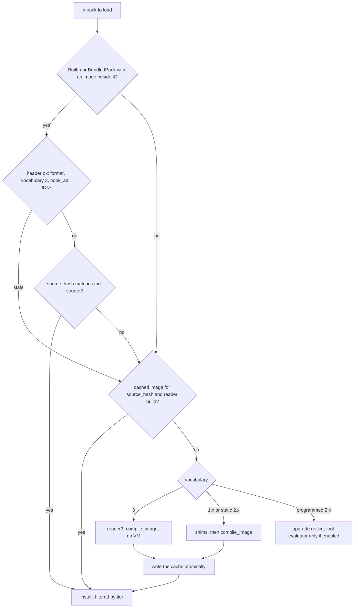
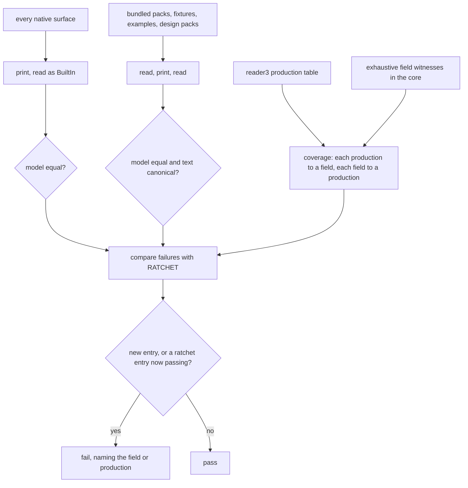

# 7. The image format and Rust parity

This chapter specifies the compiled image, the in-memory model as Rust types
(with one name per concept), the round-trip gate that keeps Rust and SpecTcl 3
at parity, the parity map for every form, and the `TODO(spectcl)` ratchet. It
consolidates [306](../model/306-expect-spike.md), [307](../model/307-libraries-as-data.md),
[313](../model/313-consumer-hooks.md), [332](../model/332-rust-spectcl-parity.md)
and [333](../model/333-spectcl-3-gap-analysis.md). It is the authority on type
names: other designs align to the names below.

## The image, format 1

All integers are little-endian; every reference is a `u32` offset from the
image start; every section is 8-byte aligned. A `&[u8]` view is enough, with
no allocation for reads, and no offset is trusted without a bounds check.

```text
Header (64 bytes)
  magic         8 bytes "TCLSPIMG"
  format        u16 = 1                 image layout version
  vocabulary    u16 = major<<8 | minor  the SpecTcl vocabulary the compiler spoke (3.0 = 0x0300)
  hook_abi      u16                     the one native hook table version
  flags         u16                     bit 0: has BODIES; bit 1: has LIBRARY_UNITS
  source_hash   u64                     xxh3 of the pack source and its includes, in order
  reader_build  u64                     the compiler's own build hash (cache key)
  section_count u32, section_table u32
  total_len     u32, crc32 u32
  reserved to 64 bytes
Section table: (kind u32, offset u32, len u32, count u32)*
```

| Section | Contents | From |
|---|---|---|
| `META` | pack identity: name, version, `describes`, licence, upstream, `generated-by` | 339 |
| `STRINGS` | one string table: names and prose | 306 |
| `VERSIONS` | interned `VersionSet`s: axis, intervals | 306 |
| `DIALECTS` | dialect rows: releases, builds, capabilities, `GrammarRow`s, semantic rows | 301, 370 |
| `LIBRARIES` | `Library` rows: trains, compatible, dependencies, provided names, conflicts | 302, 331 |
| `ENVIRONMENTS` | `EnvironmentDefinition` rows and their alias rows | 303 |
| `SPECS` | fixed-size `SpecRecord`s indexed by `SpecId` | 306 |
| `FACETS` | `(key_id, value_off)*` per facet; first match wins | 302 |
| `NAMES` | sorted `(name, SpecId)` per library, for binary search and the W002 universe | 306, 343 |
| `RULES` | `check` trees, rewrite templates, `layout` rows, as post-order `(op u8, arg u32)*` | 305, 313 |
| `TABLES` | tabulated answers: `(family u16, hook_id, shape_key u64, answer_off)*` | 306 (`ROLE_TABLES`), 313 |
| `HOOKS` | `(family u16, native_id u32 \| body_id u32, inputs u32)*` | 306 |
| `BODIES` | Tcl hook bodies as `TbcxUnit`, with source kept | 311, 313 |
| `IMPLEMENTATIONS` | `(command, backing kind, native impl id or package path, version set)*` | 313 |
| `PROOFS` | per rewrite and fold body: the release set that passed and the corpus hash | 313 |
| `LIBRARY_UNITS` | precompiled library files as `TbcxUnit`, keyed by file hash, release and profile | 334 |
| `DOMAIN` | events, flows, `precedes`, profiles, connection fields, contexts, helpers, map types, limits | 360, 380 |
| `HANDLES` | handle types, producer and consumer rows | 391 |
| `ERRORS` | error classes, codes and fields | 392 |
| `DATA` | data documents in the pack's own vocabulary (SslicTcl catalogue and trust) | 365 |
| `TAINT` | the `TaintTable`: colour rows (`implies`, `concat`), origin rows, sink rows | 393 |


Taint rows on commands live in `SPECS` and `FACETS`; sink `-when` predicates
are stored in `RULES` marked `SinkWhen`. `test` rows and `migrate` notes that
no consumer reads at run time are dropped: tests stay in the source. No image
carries run-time taint state.

**Versioning.** A reader accepts exactly its `format` and a `vocabulary`
whose major is 3. A different format, a newer major, an unknown `hook_abi` or
a named ID the binary lacks marks the image *stale*: the pack is compiled from
source in process, slower and never wrong.

### Example: the header's first sixteen bytes

**Source:**

```tcl
# magic, format 1, vocabulary 3.0, hook_abi 1, flags 0
binary scan [binary format a8ssss TCLSPIMG 1 0x0300 1 0] H* h
puts $h
```

**In memory:**

```rust
// design sketch: tcl-spectcl::image
ImageHeader { magic: *b"TCLSPIMG", format: 1, vocabulary: Vocabulary { major: 3, minor: 0 },
              hook_abi: 1, flags: ImageFlags::empty(), .. }
```

**Bytecode (tclsh 9.1.0):**

```text
  Command 2: "binary format a8ssss TCLSPIMG 1 0x0300 1 0..."
    (5) startCommand +49 1 	# next cmd at pc 54, 1 cmds start here
    (14) push 1 	# "::tcl::binary::format"
    (19) push 2 	# "a8ssss"
    (24) push 3 	# "TCLSPIMG"
    (29) push 4 	# "1"
    (34) push 5 	# "0x0300"
    (39) push 4 	# "1"
    (44) push 6 	# "0"
    (49) invokeStk 7 
```

**Result:**

```text
$ tclsh8.6 hdr.tcl      (tclsh9.1 and ./target/debug/tclvm print the same)
54434c5350494d470100000301000000
```

`54434c5350494d47` is `TCLSPIMG`, `0100` format 1, `0003` vocabulary 3.0
(minor 0, major 3), `0100` hook ABI 1 and `0000` the flags.

## Placement, caching and trust

| Pack | Placement | Opened |
|---|---|---|
| core dialect and library images | `include_bytes!` in their crate | when the library is present in some environment the process resolves |
| replaceable vendor packs | `specs/NAME.tclimg` beside `NAME.tclspec` in every artefact; `include_bytes!` in the bare-binary fallback | lazily, through demand loading |
| user and workspace packs | the user cache: `spec-images/<source_hash>-<format>-<vocabulary>-<reader_build>.tclimg` | after a hash check; mapped read-only |

**Tier-neutral images.** An image holds every row its source wrote. The
install step filters rows by the pack's provenance (chapter 1's trust table),
so one image serves every tier and the cache key needs no tier. Only BuiltIn
and BundledPack images are opened from beside a source; any other image comes
from the user cache only, so a `.tclimg` planted in an untrusted workspace is
ignored and the pack is compiled from source (item 407). Writes are atomic
(temp file, then rename). A corrupt entry fails the header checks and is
rebuilt.



**Load at scale** (item 416). With one crate per package, tcllib alone is 214
images. An image opens only when its library is present; a per-image name
index serves W002's universe without opening specs; cached images are mapped
read-only and shared between the LSP, MCP and CLI processes. Budgets: server
start with 300 images within 10% of today, and 50 user packs under 50 ms warm.

**One lowering path.** Every pack becomes an image, in memory when not cached,
and the registry reads images only (item 406). The registry core gains
`SpecSource::Image(&'static ImageView)` beside today's `Built` and
`Registered`. Whether consumers read a borrowed `SpecRef<'r>` view or a
per-surface arena that materialises a `CommandSpec` on first lookup is open
decision D2; today `resolve_spec` returns `Option<&'static CommandSpec>`.

## The model as Rust types

The model lives in the registry core (`tcl-registry` after item 261), with
`VersionSet`, `ItemHistory` and the dialect types in `tcl-dialect`. Both front
ends produce it and the printer prints it.


```rust
// design sketch: the unified names; a "today" comment marks an existing type
pub struct LibraryId(Interned);
pub struct Library { pub id: LibraryId, pub axis: LibraryAxis, pub trains: &'static [Train],
    pub compatible: &'static [CompatibilityRow], pub requires: &'static [Dependency],
    pub provides: &'static [ProvidedName], pub conflicts: &'static [Conflict],
    pub provides_early: VersionSet, pub distribution: DistributionId }
pub enum LibraryAxis { Own, TracksHost }
pub struct Train { pub name: &'static str, pub versions: VersionSet, pub latest: Version }
pub struct CompatibilityRow { pub library: VersionSet, pub dialect: DialectRange,
    pub build: Option<Build>, pub requires_caps: &'static [Extension] }
pub struct Dependency { pub from: VersionSet, pub need: Need, pub mode: DepMode,
    pub when: Option<Pred>, pub evidence: &'static str }
pub struct Availability { pub providers: &'static [ProviderRow] }      // OR'd
pub struct ProviderRow { pub library: Option<LibraryId>, pub window: ItemHistory,
    pub dialect: Option<DialectConstraint> }
pub struct Facet<T: 'static> { pub rows: &'static [(FacetKey, T)] }   // first match wins
pub struct FacetKey { pub library: VersionSet, pub dialect: Option<DialectRange>,
    pub build: Option<Build>, pub caps: &'static [Extension] }
pub struct EnvironmentDefinition { /* today: tcl-dialect/src/model/environment.rs; reshaped by 303 */ }
pub struct PositionedContext { pub environment: Arc<ResolvedEnvironment>, pub dialect: DialectChoice,
    pub libraries: Map<LibraryId, LibraryChoice>, pub targets: TargetSet, pub hosts: HostChoice }
pub enum LibraryChoice { Absent, Must { versions: VersionSet, why: Why },
    May { cases: SmallVec<[(VersionSet, Why); 2]> }, Unknown { reason: UnknownReason } }
pub struct CheckRule { pub id: RuleId, pub on: CommandPath, pub when: Pred, pub emit: Emit }
pub struct Hook { pub family: HookFamily, pub inputs: Inputs, pub body: HookBody, pub proof: Option<ProofSet> }
pub enum HookBody { Native(NativeHookId), Tcl { params: &'static str, unit: Option<TbcxUnit>, source: SourceRef } }
pub struct Rewrite { pub id: RuleId, pub when: Pred, pub to: RewriteTo, pub proof: ProofSet }
pub struct Implementation { pub id: NativeImplId, pub versions: VersionSet }
pub struct PackTest { pub id: TestId, pub source: &'static str, pub on: Option<FacetKey>,
    pub consumer: Option<Consumer>, pub expect: &'static [Expect] }
```

### Naming conflicts and which name won

| Concept | Names proposed | Winner |
|---|---|---|
| a library's dependency row | `Requirement` (302), `Dependency` (331) | `Dependency` |
| where an item comes from | `Availability.library` (302), `ProviderRow` (331) | `Availability { providers: [ProviderRow] }` |
| library name aliases | `Library.aliases` (302), `ProvidedName` (331) | `ProvidedName` (`alias` is sugar) |
| a compiled `check` | `CheckRule` (305), `CompiledRule` (332) | `CheckRule`; `RULES` stores its encoding |
| tabulated answers | `ROLE_TABLES` (306), `TABLES` (313) | `TABLES`, tagged by family |
| a stored Tcl body | source (306), `tclbc` (313's first draft), `TbcxUnit` (311) | `TbcxUnit` |
| native hook IDs | `NativeId` (313), `NativeHookId` (332) | `NativeHookId` |
| accelerator IDs | `NativeId` (313), `NativeImplId` (334) | `NativeImplId` |
| formatter rows | `Layout` (313), `LayoutRows` (335) | `Layout` |
| a handle type | `HandleId` (390), `HandleTypeId` (391) | `HandleTypeId`, `HandleType` |
| per-site handle facts | `ObjectHandleFacts` (today), `HandleFacts` (391) | `HandleFacts` |
| a dialect over a set | `DialectSelection` (302), `DialectChoice` (308) | `DialectChoice` |
| a test row | `ConformanceExample` (335), `PackTest` (380) | `PackTest` |
| an event | `EventProps` (today), `EventSpec` (360), `EbpfEvent` (380) | `EventSpec { domain: EventDomain::Irules(..) \| Ebpf(..) }` |
| enumerated argument values | `ValueId` sets (302), `ValueDomain` (365) | `ValueDomain`; a value-set facet names a `DomainId` or holds values inline |
| an abstention | `RenameRefusal` (today), `Abstain` (335) | `Abstain` |
| taint colours | `TaintColour` bitflags (today), `TaintBasis` (today) | `CoreColour` plus `TaintColourId` and `ColourSet` (393) |
| a taint fact | `TaintLattice` (today) | `TaintFact { origins: OriginSet, colours: ColourSet }` (393) |
| a sink gate | `taint_sink_gate` hook (today) | `TaintRow::Sink { when }` under `SinkWhen` (393) |
| the run-time tag | — | `TaintTag` (393) |
| the reader's output | `Pack3` (305) | `Pack3` |
| an image view | `ImageView`, `SpecView` (306), `SpecRef` (333) | `ImageView` and `SpecView`; `SpecRef` pending D2 |

## Parity: one model, two front ends, one printer

Rust-authored surfaces can say everything SpecTcl 3 can, and every SpecTcl 3
construct compiles to registry values with no loss. Three changes make that
true (332): native hooks by ID, named descriptors by ID, and tier-gated
vocabulary (a field "a pack may not author" gets a spelling accepted only from
BuiltIn and BundledPack).

**Canonicalisation** for comparisons: rows in grammar order; defaults omitted;
sets sorted; `alias` printed as `provides … -via exact-chain`; adjacent facet
rows with equal values merged; versions in their shortest exact form; prose
re-quoted by one rule. Each rule has a test that it preserves semantics.

### The round-trip gate

`cargo xtask spectcl-parity` (item 405) runs in `xtask-check` and CI:



### The `TODO(spectcl)` ratchet

`RATCHET: &[(&str, Reason)]` in the xtask starts as the gap list and only
shrinks: a new unmapped field fails, and so does an entry that now passes
until it is deleted. Today's equivalence packs carry 2,889 `TODO(spectcl)`
markers over 59 field kinds (333). The studio's `GAPS` and its round-trip
allowance are deleted once the ratchet is empty; an image-backed library
crate holds no `CommandSpec` literal (307's check), and 307 moves a surface
only when its fields are all spelled.

## The parity map

332's construct map covers 305, 313 and 331 and the 2.x fields. The rows
below extend it to every later form. **Every row has a Rust spelling and is
under the round-trip gate** (item 405); "today" marks a type that exists.

| Form | Source | Rust (registry core unless named) | Item |
|---|---|---|---|
| `dialect … { grammar G { AXIS VALUE -from L -build B } }` | 370 | `GrammarRow { axis: GrammarAxis, from: Option<LineId>, build: Option<Build> }`, `GrammarProfile` | 417, 418 |
| `dialect … { semantics { … } }` | 350 | `SemanticRow` on `DialectPoint` | 426 |
| `capability`, `-capabilities {+json}` | 301, 350 | `Extension` (31 names), `CapabilityOverrides` | 429 |
| `available core FAMILY RANGE` | 350 | `ProviderRow { library: None, dialect: Some(..) }` | 400 |
| `mode-default OPT` | 350 | `CommandSpec::mode_default` | 428 |
| `event`, `flow`, `precedes` | 360 | `EventSpec`, `FlowSpec`, `Precedence` (today: `EventProps`, `FlowChain`) | 442 |
| `profile`, `transport-default` | 360 | `ProfileSpec` (today) with `schema_kinds`, `namespaces`; `TransportDefault` | 442 |
| `connection { field … }`, `effect reads\|writes connection F` | 360 | `ConnectionField`, `FormSpec.connection: &[FieldEffect]` | 445 |
| `decision`, `ends`, `disables events`, `emits` | 360 | `SimDecision`, `EventControl`, `EventEmissionForm` (today) | 445 |
| `mock -tcl\|-native` | 360, 390K | `MockSpec` | 446 |
| `template-section`, `apl-variable` | 361 | `TemplateSection`, `AplVariableConvention` | 448 |
| `-role tmsh-command -verb V`, `effect writes config` | 361 | `ArgRole::TmshCommand(TmshVerb)`, `ConfigEffect` | 449 |
| `transition tmsh begin\|commit\|cancel`, `loaded-by` | 361 | `StateTransition::TmshTransaction`, `LibraryLoad::Include` | 449 |
| `domain`, `document`, `member`, `data` | 365 | `ValueDomain`, `DocumentGrammar`, `MemberSpec`, `DataDoc` | 452 |
| `-declares`, `-references`, `-references-each` | 365 | `DeclRef::{Declares, References, ReferencesEach}(DeclKind)` | 452 |
| `policy … -evaluation never`, `signature -header W -arg integer` | 365 | `EnvironmentPolicy.evaluation`, `Signature::Header` | 452 |
| `compile ebpf OP -K V` | 380 | `CompileRecipe::Target(TargetRecipe)` | 459 |
| `context`, `helper`, `map-type`, `limit`, `expr-profile` | 380 | `EbpfContext`, `Helper`, `MapType`, `Limits` facets, `ExprProfileId` | 460 |
| `handle T { … }`, `result -handle`, `arg … -handle -needs -releases -moves-to -transforms -stores -creates` | 390A, 391 | `HandleType`, `ProducerRow`, `ConsumerRow`, `HandleEffect` | 391a |
| `errorclass`, `code`, `throws -when -on` | 390B, 392 | `ErrorClass`, `ErrorCodeId`, `ErrorPattern`, `Throws`, `CompletionCodes` | 392a |
| `result -dict -list -pairs`, `arg … -array-of` | 390C | `ResultShape` | 390c |
| `arg … -embedded LANG` | 390D | `Embedded { lang, dialect }` | 390d |
| `migrate` | 390E | `Migration` | 390e |
| `arg … -callback -appends` | 390F, 335 | `CallbackSig` (with `AppendedArity`) | 390f |
| `catalogue`, `scope project`, `virtual-event`, `style`, `option-class`, `token` | 390G–M | `MsgCatalogue`, `PackScope`, `VirtualEvent`, `TtkStyle`, `OptionClass`, `TokenCategory` | 390g–390m |
| `snippet`, `presentation`, `-ends-options`, `-exported` | 319/320 | `Snippet`, `Presentation`, `OptionSpec::ends_options`, `SubCommand::exported` | 320 |
| `-scope`, `-resolve`, access, `-in`, `-frame`, `constructs`, `transition alias`, `-db`, `refactor -no` | 335 | `NameFacts`, `BodyFrame`, `Construct`, `AliasTransition`, `OptionDbName`, `RefactorPermissions` | 437 |
| `layout`, `optimise -no`, `report redundant`, `rewrite`, `implementation` | 313 | `Layout`, `OptimisePermissions`, `Rewrite`, `Implementation` | 313 |
| `test` | 333, 335, 360, 380 | `PackTest` (tool-time; not in the image) | 414 |
| `pack {…}`, `include`, `extend` | 333, 331 | `PackMeta`, `ProviderRow`, the merge table | 408, 409 |
| `message LOCALE`, `doc LOCALE` | 333 | `LocalisedText` (reserved) | 413 |
| `colour` | 393 | `CoreColour` (closed), `TaintColourId`, `ColourSet`, `ColourRow { implies, concat }` | 465 |
| `sink`, `arg … -sink KIND -safe+ -when` | 393 | `CoreSinkKind` (closed), `SinkKindId`, `SinkRow`, `TaintRow::Sink` with `SinkWhen` | 466, 471 |
| `origin`, `result -origin`, `-writes -origin`, `-callback-origin`, `variable -origin`, `-secret`, `header-class` | 393 | `OriginId`, `OriginSet`, `TaintRow::Origin`, `HeaderClass` | 467 |
| `result -adds -clean -from -element-of -elements-from`, `-double-encodes`, `errors -message-from` | 393 | `TaintRow::{Adds, Clean, Transfer}` | 468 |
| `refines … -on true\|false`, `-adds-from-pattern` | 393 | `TaintRow::Refines` | 469 |
| proc taint summaries and pack-declared transfers | 393 | `ProcTaintSummary { returns: TaintTransfer, param_sinks, validates }` (today: `taint_interproc.rs:185`) | 470 |
| `errorclass TAINT { code SINK -fields {kind origin} }` | 393, 392 | an `ErrorClass` row | 476 |

Each form's done-when includes "prints and re-reads equal under the gate".
