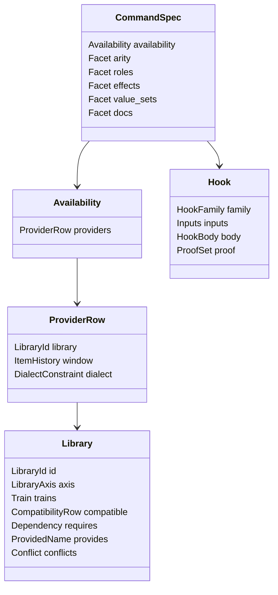
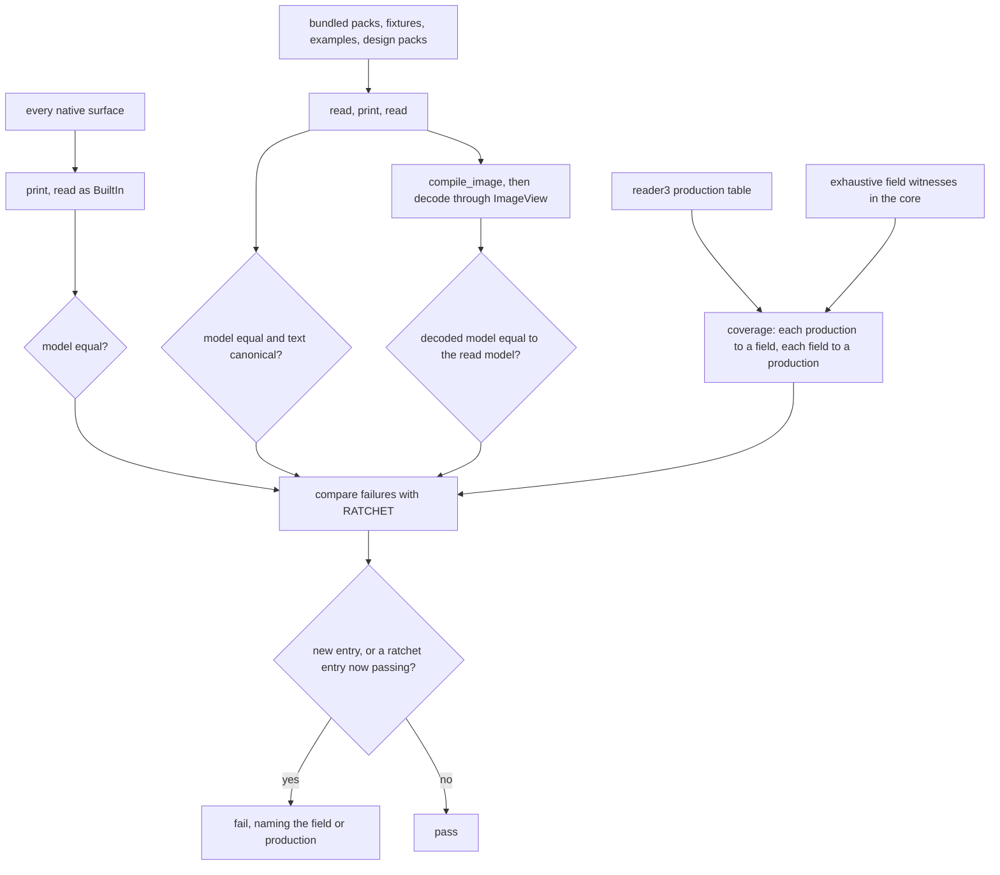

# 7. The image format and Rust parity

This chapter specifies the compiled image, the in-memory model as Rust types
(with one name per concept), the round-trip gate that keeps Rust and SpecTcl 3
at parity, the parity map for every form, and the `TODO(spectcl)` ratchet. It
consolidates [306](../model/306-expect-spike.md), [307](../model/307-libraries-as-data.md),
[313](../model/313-consumer-hooks.md), [332](../model/332-rust-spectcl-parity.md)
and [333](../model/333-spectcl-3-gap-analysis.md). It is the authority on type
names: other designs align to the names below.

## The image, format 1

All integers are little-endian; every reference is a `u32` offset from the
start of its section unless a layout below says otherwise; every section
starts at a multiple of 8. A `&[u8]` view is enough, with no allocation for
reads, and no offset is trusted without a bounds check.

```text
Header (64 bytes)
  0  magic         8 bytes "TCLSPIMG"
  8  format        u16 = 1                 image layout version
  10 vocabulary    u16 = major<<8 | minor  the SpecTcl vocabulary the compiler spoke (3.0 = 0x0300)
  12 hook_abi      u16                     the one native hook table version
  14 flags         u16                     bit 0: has BODIES; bit 1: has LIBRARY_UNITS;
                                           bit 2: tabulated_with_vm; other bits zero
  16 source_hash   u64                     xxh3 of the pack source and its includes, in order
  24 reader_build  u64                     the compiler's identity (below); part of the cache key
  32 section_count u32, 36 section_table u32
  40 total_len     u32, 44 crc32 u32       CRC-32 (IEEE) of bytes 0..total_len, this field read as 0
  48 reserved      16 bytes, zero
Section table: (kind u32, offset u32, len u32, count u32)*, sorted by kind, each kind once
```

**Reads.** Every integer is read with `u16`, `u32` or `u64::from_le_bytes`
from a bounds-checked slice. No reader casts image bytes to a Rust type:
`include_bytes!` data and a fetched `Vec<u8>` are only 1-byte aligned, so the
8-byte section starts serve a memory-mapped file's layout, never a cast.

| Kind | Section | Contents | From |
|--:|---|---|---|
| 1 | `META` | pack identity: name, version, `describes`, licence, upstream, `generated-by` | 339 |
| 2 | `STRINGS` | one string table: names and prose | 306 |
| 3 | `VERSIONS` | interned `VersionSet`s: axis, intervals | 306 |
| 4 | `DIALECTS` | dialect rows: releases, builds, capabilities, `GrammarRow`s, semantic rows, and the Tcl core's release facts | 301, 370 |
| 5 | `LIBRARIES` | `Library` rows: trains, compatible, dependencies, provided names, conflicts | 302, 331 |
| 6 | `ENVIRONMENTS` | `EnvironmentDefinition` rows and their alias rows | 303 |
| 7 | `SPECS` | fixed-size `SpecRecord`s indexed by `SpecId` | 306 |
| 8 | `FACETS` | facet keys, then `(key_id, value_off)*` per facet; first match wins | 302 |
| 9 | `NAMES` | sorted `(name, SpecId)` per library, for binary search and the W002 universe | 306, 343 |
| 10 | `RULES` | `check` trees, rewrite templates, `layout` rows, as post-order ops | 305, 313 |
| 11 | `TABLES` | tabulated Tcl-body answers: `(family u16, pad u16, hook u32, shape_key u64, answer_off u32, pad u32)*` | 306 (`ROLE_TABLES`), 313 |
| 12 | `HOOKS` | `(family u16, kind u16, id u32, inputs u32)*` | 306 |
| 13 | `BODIES` | Tcl hook bodies as tbcx bytes (`TbcxUnit`), with source kept | 311, 313 |
| 14 | `IMPLEMENTATIONS` | `(command, backing kind, native impl id or package path, version set)*` | 313 |
| 15 | `PROOFS` | per rewrite and fold body: the release set that passed and the corpus hash | 313 |
| 16 | `LIBRARY_UNITS` | precompiled library files as tbcx bytes, keyed by file hash, release, profile and extended revision | 334 |
| 17 | `DOMAIN` | events, flows, `precedes`, profiles, connection fields, contexts, helpers, map types, limits | 360, 380 |
| 18 | `HANDLES` | handle types, producer and consumer rows | 391 |
| 19 | `ERRORS` | error classes, codes and fields | 392 |
| 20 | `DATA` | data documents in the pack's own vocabulary (SslicTcl catalogue and trust) | 365 |
| 21 | `TAINT` | the `TaintTable`: colour rows (`implies`, `concat`), origin rows, sink rows | 393 |

A kind with bit 31 set is optional: a reader that does not know it skips
it. Any other unknown kind makes the image stale. A new section is optional
until a vocabulary minor makes a reader need it.

### Record layouts

The layouts a reader needs to find a spec and its rows. `none` is
`u32::MAX`; a `StringId`, `VersionSetId`, `FacetId` or `SpecId` is an index.

```text
STRINGS   count u32, pad u32; (offset u32, len u32) x count; then UTF-8 bytes
VERSIONS  count u32, pad u32; (first u32, axis StringId) x count;
          then intervals (min StringId | none, max StringId | none), none = unbounded
SPECS     count u32, pad u32; SpecRecord x count; then the tail the records point into
SpecRecord, 64 bytes, 16 x u32:
   0 name StringId          4 availability (tail offset: count u32, then
                              (library u32 | none, window VersionSetId, dialect u32 | none) x count)
   8 arity FacetId         12 roles FacetId         16 effects FacetId
  20 value_sets FacetId    24 results FacetId       28 taint FacetId
  32 docs FacetId          36 options (tail offset) 40 first subcommand SpecId | none
  44 subcommand count      48 forms (tail offset)   52 first HOOKS index | none
  56 hook count            60 flags (bit 0 deprecated; others zero)
FACETS    key_count u32, pad u32;
          FacetKey x key_count: (library VersionSetId, dialect u32 | none,
                                 build StringId | none, caps offset), 16 bytes;
          facet_count u32, pad u32; (first_row u32, row_count u32) x facet_count;
          rows (key_id u32, value_off u32); then the value heap.
          The value layout is fixed by the facet: arity is (min u16, max u16), 0xFFFF
          unbounded; roles are count u32, then (word u16, role u16, arg u32) x count;
          the others follow the same count-then-fixed-rows rule in the format's
          reference module (tcl_registry::image::layout)
RULES     rule_count u32, pad u32; (first_op u32, op_count u32) x rule_count;
          ops (op u8, pad 3 bytes, arg u32), 8 bytes each, post-order.
          op 1 ATOM (arg: atom row), 2 ALL (arg: child count), 3 ANY (child count),
          4 NOT, 5 EMIT (emit row), 6 TEMPLATE (template row), 7 SINK_WHEN (marks a
          SinkWhen root). An unknown op makes that rule dormant.
HOOKS     (family u16, kind u16, id u32, inputs u32): kind 0 native, id a StringId
          naming the NativeHookId; kind 1 a Tcl body, id a BODIES index
```

`tcl_registry::image::layout` is the one module that writes these offsets;
the writer in `tcl-spectcl` and the reader in the core both use it, and the
fuzz target on `ImageView::open` covers every section.


Taint rows on commands live in `SPECS` and `FACETS`; sink `-when` predicates
are stored in `RULES` marked `SinkWhen`. `test` rows and `migrate` notes that
no consumer reads at run time are dropped: tests stay in the source. No image
carries run-time taint state.

**Versioning.** A reader accepts exactly its `format`, and a `vocabulary`
whose major is 3 and whose minor is at most its own. A different format, a
newer minor or major, an unknown required section or an unknown `hook_abi`
marks the image *stale*: the pack is compiled from source in process, slower
and never wrong, and the reader classifies a newer minor's words as chapter 2
says (D5).

**Dormant hooks.** A native ID the binary lacks is not staleness, because
recompiling gives the same ID. That hook is *dormant*: it abstains with its
family's polarity (chapter 5), and the install reports it once on the pack.
A test loader binds the same IDs to abstaining stubs and prints each once.

**`reader_build`** is `xxh3(IMAGE_COMPILER_REVISION ‖ hook_abi ‖
HOOK_VM_REVISION ‖ tbcx format ‖ Tcl pin)`. `IMAGE_COMPILER_REVISION` is a
`u32` constant in `tcl-spectcl`'s image compiler, bumped by any change to
the bytes it writes; `spec-images --check` over the fixture corpus fails when
output bytes change without a bump. `HOOK_VM_REVISION` is the same kind of
constant in `tcl-spec-hooks`, bumped when a change alters a Tcl body's
answer. The key is not a binary hash, so the LSP, MCP and CLI of one build
share cache entries. It is not the crate version either, which item 299 makes
`0.1.0-dev` in every dev build. Native hooks answer live and are never
tabulated (chapter 5, rung 5), so the key needs no digest of their code.

### Example: the header's first sixteen bytes

**Source:**

```tcl
# magic, format 1, vocabulary 3.0, hook_abi 1, flags 0
binary scan [binary format a8ssss TCLSPIMG 1 0x0300 1 0] H* h
puts $h
```

**In memory:**

```rust
// design sketch: tcl_registry::image (the core reads; tcl-spectcl only writes)
ImageHeader { magic: *b"TCLSPIMG", format: 1, vocabulary: Vocabulary { major: 3, minor: 0 },
              hook_abi: 1, flags: ImageFlags::empty(), .. }
```

**Bytecode (tclsh 9.1.0):**

```text
  Command 2: "binary format a8ssss TCLSPIMG 1 0x0300 1 0..."
    (5) startCommand +49 1 	# next cmd at pc 54, 1 cmds start here
    (14) push 1 	# "::tcl::binary::format"
    (19) push 2 	# "a8ssss"
    (24) push 3 	# "TCLSPIMG"
    (29) push 4 	# "1"
    (34) push 5 	# "0x0300"
    (39) push 4 	# "1"
    (44) push 6 	# "0"
    (49) invokeStk 7 
```

**Result:**

```text
$ tclsh8.6 hdr.tcl      (tclsh9.1 and ./target/debug/tclvm print the same)
54434c5350494d470100000301000000
```

`54434c5350494d47` is `TCLSPIMG`, `0100` format 1, `0003` vocabulary 3.0
(minor 0, major 3), `0100` hook ABI 1 and `0000` the flags.

## Placement, caching and trust

| Pack | Placement | Opened |
|---|---|---|
| dialect and library images, the Tcl core's included | `include_bytes!` in `tcl-catalogue`, from its untracked `images/` directory, compiled per build by `tcl-spec-images` ([307](../model/307-libraries-as-data.md#images-per-build)) | when the library is present in some environment the process resolves |
| replaceable vendor packs | `specs/NAME.tclimg` beside `NAME.tclspec` in every artefact; `include_bytes!` in `tcl-catalogue` for the bare-binary fallback, handed to the loader by the entry point | lazily, through demand loading |
| user and workspace packs | the user cache: `spec-images/<source_hash>-<format>-<vocabulary>-<reader_build>-<vm>.tclimg`, where `vm` is the `tabulated_with_vm` bit | after a hash check; mapped read-only |

**Tier-neutral images.** An image holds every row its source wrote. The
install step filters rows by the pack's provenance (chapter 1's trust table),
so one image serves every tier and the cache key needs no tier. Only BuiltIn
and BundledPack images are opened from beside a source; any other image comes
from the user cache only, so a `.tclimg` planted in an untrusted workspace is
ignored and the pack is compiled from source (item 407). Writes are atomic
(temp file, then rename). A corrupt entry fails the header checks and is
rebuilt.

**Tabulation and the VM.** A user pack compiled by a process without the
hook VM has no tabulated Tcl-body answers and `tabulated_with_vm` clear; one
compiled with the VM (Spec Studio's author tier) has them and the bit set.
The bit is in the file name, so the same source never gives two byte strings
under one key. A reader prefers the `1` entry and accepts either.

**Eviction.** Opening an entry touches its modification time. At most once a
day a process removes entries unused for 30 days, then the oldest until the
directory is under 256 MiB. Many worktrees then share one bounded cache.


**Load at scale** (item 416). With one crate per package, tcllib alone is 214
images. An image opens only when its library is present; a per-image name
index serves W002's universe without opening specs; cached images are mapped
read-only and shared between the LSP, MCP and CLI processes. Budgets: server
start with 300 images within 10% of today, and 50 user packs under 50 ms warm.

**One lowering path.** Every pack becomes an image, in memory when not cached,
and the registry reads images only (item 406). The registry core gains
`SpecSource::Image(ImageId)` beside today's `Built` and `Registered`; the
generation maps an `ImageId` to its bytes, `'static` for the catalogue and an
`Arc<[u8]>` for a user pack. Consumers read `SpecRef<'g>` views, which closes
open decision D2. The arena would materialise a `CommandSpec`, whose fields
are `&'static`, over bytes loaded at run time: that needs a leak, which step
14 forbids. Today's loader already leaks in 79 places across `tcl-spectcl`,
`tcl-registry` and `tcl-dialect` (for example `tcl-spectcl/src/install.rs:198`).
Today `resolve_spec` returns `Option<&'static CommandSpec>`
(`model/context.rs:875`), and 277 files outside `tcl-registry` name
`CommandSpec`; they move to `SpecRef<'g>` surface by surface (item 406).

## The model as Rust types

The model lives in the registry core (`tcl-registry` after item 261), with
`VersionSet`, `ItemHistory` and the dialect types in `tcl-dialect`. Both front
ends produce it and the printer prints it.

**Lifetimes.** Every borrowed field borrows the generation for `'g`, and the
catalogue's images are the `'g = 'static` case. Consumers hold `SpecRef<'g>`
views. `CommandSpec` is the owned form: what reader3 produces, what the
printer prints and what Rust-authored tests write. A salsa value holds none
of these. It holds IDs (`CommandKey`, `LibraryId`, interned strings) and
facts copied out of a view, so it compares equal across generations and pins
no generation.



```rust
// design sketch: the unified names; a "today" comment marks an existing type.
// 'g is the generation; catalogue images are 'g = 'static.
pub struct LibraryId(Interned);
pub struct Library<'g> { pub id: LibraryId, pub axis: LibraryAxis, pub trains: &'g [Train<'g>],
    pub compatible: &'g [CompatibilityRow<'g>], pub requires: &'g [Dependency<'g>],
    pub provides: &'g [ProvidedName<'g>], pub conflicts: &'g [Conflict<'g>],
    pub provides_early: VersionSet, pub distribution: DistributionId }
pub enum LibraryAxis { Own, TracksHost }
pub struct Train<'g> { pub name: &'g str, pub versions: VersionSet, pub latest: Version }
pub struct CompatibilityRow<'g> { pub library: VersionSet, pub dialect: DialectRange,
    pub build: Option<Build>, pub requires_caps: &'g [Extension] }
pub struct Dependency<'g> { pub from: VersionSet, pub need: Need, pub mode: DepMode,
    pub when: Option<Pred>, pub evidence: &'g str }
pub struct Availability<'g> { pub providers: &'g [ProviderRow] }       // OR'd
pub struct ProviderRow { pub library: Option<LibraryId>, pub window: ItemHistory,
    pub dialect: Option<DialectConstraint> }
pub struct Facet<'g, T> { pub rows: &'g [(FacetKey<'g>, T)] }           // first match wins
pub struct FacetKey<'g> { pub library: VersionSet, pub dialect: Option<DialectRange>,
    pub build: Option<Build>, pub caps: &'g [Extension] }
pub struct SpecRef<'g> { image: &'g ImageView<'g>, id: SpecId }        // the consumer view
pub struct EnvironmentDefinition { /* today: tcl-dialect/src/model/environment.rs; reshaped by 303 */ }
pub struct PositionedContext { pub environment: Arc<ResolvedEnvironment>, pub dialect: DialectChoice,
    pub libraries: Map<LibraryId, LibraryChoice>, pub targets: TargetSet, pub hosts: HostChoice }
pub enum LibraryChoice { Absent,                                        // Certainty: INT-c
    Present { certainty: Certainty, cases: SmallVec<[(VersionSet, Why); 2]> },
    Unknown { reason: UnknownReason } }
pub struct CheckRule { pub id: RuleId, pub on: CommandPath, pub when: Pred, pub emit: Emit }
pub struct Hook<'g> { pub family: HookFamily, pub inputs: Inputs, pub body: HookBody<'g>, pub proof: Option<ProofSet> }
pub enum HookBody<'g> { Native(NativeHookId),
    Tcl { params: &'g str, unit: Option<BodyBytes<'g>>, source: SourceRef } } // tbcx bytes, opaque here
pub struct Rewrite { pub id: RuleId, pub when: Pred, pub to: RewriteTo, pub proof: ProofSet }
pub struct Implementation { pub id: NativeImplId, pub versions: VersionSet }
pub struct PackTest { pub id: TestId, pub source: String, pub on: Option<FacetKey<'static>>,
    pub consumer: Option<Consumer>, pub expect: Vec<Expect> }      // tool time only
```

`BodyBytes` is opaque to the core: `tcl-spec-hooks` decodes it with
`tcl-bytecode`'s `tbcx::read` and `UnitMeta`, so neither the core nor
`tcl-analysis` gains an edge to `tcl-bytecode`, which item 312's opcode work
edits.

### Naming conflicts and which name won

| Concept | Names proposed | Winner |
|---|---|---|
| a library's dependency row | `Requirement` (302), `Dependency` (331) | `Dependency` |
| where an item comes from | `Availability.library` (302), `ProviderRow` (331) | `Availability { providers: [ProviderRow] }` |
| library name aliases | `Library.aliases` (302), `ProvidedName` (331) | `ProvidedName` (`alias` is sugar) |
| a compiled `check` | `CheckRule` (305), `CompiledRule` (332) | `CheckRule`; `RULES` stores its encoding |
| tabulated answers | `ROLE_TABLES` (306), `TABLES` (313) | `TABLES`, tagged by family |
| a stored Tcl body | source (306), `tclbc` (313's first draft), `TbcxUnit` (311) | `TbcxUnit` (`tcl-bytecode`); the core holds it as opaque `BodyBytes<'g>` |
| native hook IDs | `NativeId` (313), `NativeHookId` (332); `HookTable` keyed by `&'static str` (registry split step 2) against `HOOKS`' `native_id u32` (this chapter's first draft) | `NativeHookId` (core): the image stores the ID's name as a `StringId`, `HookTable` is keyed by that name, and `NativeHookId(u32)` is the in-process index resolved at install |
| accelerator IDs | `NativeId` (313), `NativeImplId` (334) | `NativeImplId` |
| formatter rows | `Layout` (313), `LayoutRows` (335) | `Layout` |
| a handle type | `HandleId` (390), `HandleTypeId` (391) | `HandleTypeId`, `HandleType` |
| per-site handle facts | `ObjectHandleFacts` (today), `HandleFacts` (391) | `HandleFacts` |
| a dialect over a set | `DialectSelection` (302), `DialectChoice` (308) | `DialectChoice` |
| a test row | `ConformanceExample` (335), `PackTest` (380) | `PackTest` |
| an event | `EventProps` (today), `EventSpec` (360), `EbpfEvent` (380) | `EventSpec { domain: EventDomain::Irules(..) \| Ebpf(..) }` |
| enumerated argument values | `ValueId` sets (302), `ValueDomain` (365) | `ValueDomain`; a value-set facet names a `DomainId` or holds values inline |
| an abstention | `RenameRefusal` (today), `Abstain` (335) | `Abstain` |
| taint colours | `TaintColour` bitflags (today), `TaintBasis` (today) | `CoreColour` plus `TaintColourId` and `ColourSet` (393) |
| a taint fact | `TaintLattice` (today) | `TaintFact { origins: OriginSet, colours: ColourSet }` (393) |
| a sink gate | `taint_sink_gate` hook (today) | `TaintRow::Sink { when }` under `SinkWhen` (393) |
| the run-time tag | — | `TaintTag` (393) |
| the reader's output | `Pack3` (305) | `Pack3` |
| an image view | `ImageView`, `SpecView` (306, placed in `tcl-spectcl::image`), `SpecRef` (333) | `ImageView` in the core (`tcl_registry::image`), which reads every image; `tcl-spectcl` owns only the writer, `compile_image`; consumers read `SpecRef<'g>` (D2 closed) |
| the core's per-command value | `VersionedSpec` (this chapter's first draft), `CommandSpec` (332), `CommandFacts` (integration § 1's first draft) | `CommandSpec` (core) for the owned value; `SpecRef<'g>` (core) for the view |
| binding's per-site receipt | `CommandFacts` (crate-split overview, integration § 2's first draft), `SourceInvocationBinding` (today) | `InvocationBinding` (`tcl-binding`); `InvocationFacts` is taken (`tcl-registry/src/resolved_invocation/invocation_facts.rs:64`) |
| a procedure summary | `ProcSummary` (391, 392, integration § 3; today purity only, `interprocedural.rs:264`) | `ProcSummary` (`tcl-model`), the product record with a slot per domain |
| a procedure's taint summary | `ProcTaintSummary` (today `taint_interproc.rs:185`; placed in the core by this chapter's first draft) | `ProcTaintSummary` (`tcl-model`); the pack rows it is built from are core `TaintRow`s |
| completion codes | `CompletionCodes` (392), `CodeSet` (integration), `CompletionCodeDomain` (today, `completion.rs:189`) | `CodeSet` (core); the lattice over it is `tcl-model`'s |
| a library's certainty | `LibraryChoice::{Must, May}` (308), `BindingKnowledge` (today), `Certainty` (INT-c) | `tcl_core_types::Certainty`, inside `LibraryChoice::Present` |
| the installed surface set | `installed()`, one per process (registry split step 1), the generation's surfaces (integration § 1) | a `SurfaceSet` per `Generation` (core); step 1's `install` and `installed()` survive only in entry points, as `install_host` does |

## Parity: one model, two front ends, one printer

Rust-authored surfaces can say everything SpecTcl 3 can, and every SpecTcl 3
construct compiles to registry values with no loss. Three changes make that
true (332): native hooks by ID, named descriptors by ID, and tier-gated
vocabulary (a field "a pack may not author" gets a spelling accepted only from
BuiltIn and BundledPack).

**Canonicalisation** for comparisons: rows in grammar order; defaults omitted;
sets sorted; `alias` printed as `provides … -via exact-chain`; adjacent facet
rows with equal values merged; versions in their shortest exact form; prose
re-quoted by one rule; `SpecSurface` membership tokens mapped to `ProviderRow`s
by 305's shim table, the same map the 2.x shim applies. Each rule has a test
that it preserves semantics.

**Comparing models.** `CommandSpec` derives only `Debug` and `Clone`
(`tcl-registry/src/spec.rs:322`). It cannot derive a meaningful `PartialEq`
while it holds function pointers: 13 on `CommandSpec` (`arg_role_resolver`,
`arg_role_count_resolver`, `arg_role_layout_resolver`, `clause_shape_check`,
`command_prefix_resolver`, `script_timing_resolver`, `const_fold`,
`const_fold_versioned`, `literal_argument_validator`, `constraints`,
`taint_sink_gate`, `pattern_arg_resolver`, `context_gate`), 9 on
`SubCommand`, 1 in `forms.rs:243`, and 3 inside descriptors
(`world_effect.rs:961`, `:964`; `definer.rs:956`). The gate compares after
mapping each pointer to its `NativeHookId` name through the owning
`HookTable`, and a pointer with no name fails. Item 402 then replaces the
fields with IDs and the mapping goes. `taint_sink_gate` gets no ID: it is
deleted for 393's `SinkWhen`.

**The N fields** (332's field map) are settled here:

- `pattern_arg_resolver` is a function pointer, so it is an F row and gets
  `-native ID`;
- `native_lowering`, `native_lowering_windows` and `dispatch_dependencies`
  are `Derived`: Rust-only native tables in `tcl-dialect-tcl`, keyed by
  command (D8);
- `teardown_argument_layout`, `source_arity_with_option`,
  `pack_source_sandbox_helper` and `remote_method` get spellings in item
  403's tier-gated vocabulary, each with a ratchet entry until spelled.

### The round-trip gate

`cargo xtask spectcl-parity` (item 405) runs in `xtask-check` and CI. The
third leg checks the path production uses: production reads images only
(R27), so `decode(compile_image(read))` must equal `read` for every pack:



### The `TODO(spectcl)` ratchet

`RATCHET: &[(&str, Reason)]` in the xtask starts as the gap list and only
shrinks: a new unmapped field fails, and so does an entry that now passes
until it is deleted. Today's equivalence packs carry 2,889 `TODO(spectcl)`
markers over 59 field kinds (333). The studio's `GAPS` and its round-trip
allowance are deleted once the ratchet is empty; an image-backed library
crate holds no `CommandSpec` literal (307's check), and 307 moves a surface
only when its fields are all spelled.

## The parity map

332's construct map covers 305, 313 and 331 and the 2.x fields. The rows
below extend it to every later form. **Every row has a Rust spelling and is
under the round-trip gate** (item 405); "today" marks a type that exists.

| Form | Source | Rust (registry core unless named) | Item |
|---|---|---|---|
| `dialect … { grammar G { AXIS VALUE -from L -build B } }` | 370 | `GrammarRow { axis: GrammarAxis, from: Option<LineId>, build: Option<Build> }`, `GrammarProfile` | 417, 418 |
| `dialect … { semantics { … } }` | 350 | `SemanticRow` on `DialectPoint` | 426 |
| `capability`, `-capabilities {+json}` | 301, 350 | `Extension` (31 names), `CapabilityOverrides` | 429 |
| `available core FAMILY RANGE` | 350 | `ProviderRow { library: None, dialect: Some(..) }` | 400 |
| `mode-default OPT` | 350 | `CommandSpec::mode_default` | 428 |
| `event`, `flow`, `precedes` | 360 | `EventSpec`, `FlowSpec`, `Precedence` (today: `EventProps`, `FlowChain`) | 442 |
| `profile`, `transport-default` | 360 | `ProfileSpec` (today) with `schema_kinds`, `namespaces`; `TransportDefault` | 442 |
| `connection { field … }`, `effect reads\|writes connection F` | 360 | `ConnectionField`, `FormSpec.connection: &[FieldEffect]` | 445 |
| `decision`, `ends`, `disables events`, `emits` | 360 | `SimDecision`, `EventControl`, `EventEmissionForm` (today) | 445 |
| `mock -tcl\|-native` | 360, 390K | `MockSpec` | 446 |
| `template-section`, `apl-variable` | 361 | `TemplateSection`, `AplVariableConvention` | 448 |
| `-role tmsh-command -verb V`, `effect writes config` | 361 | `ArgRole::TmshCommand(TmshVerb)`, `ConfigEffect` | 449 |
| `transition tmsh begin\|commit\|cancel`, `loaded-by` | 361 | `StateTransition::TmshTransaction`, `LibraryLoad::Include` | 449 |
| `domain`, `document`, `member`, `data` | 365 | `ValueDomain`, `DocumentGrammar`, `MemberSpec`, `DataDoc` | 452 |
| `-declares`, `-references`, `-references-each` | 365 | `DeclRef::{Declares, References, ReferencesEach}(DeclKind)` | 452 |
| `policy … -evaluation never`, `signature -header W -arg integer` | 365 | `EnvironmentPolicy.evaluation`, `Signature::Header` | 452 |
| `compile ebpf OP -K V` | 380 | `CompileRecipe::Target(TargetRecipe)` | 459 |
| `context`, `helper`, `map-type`, `limit`, `expr-profile` | 380 | `EbpfContext`, `Helper`, `MapType`, `Limits` facets, `ExprProfileId` | 460 |
| `handle T { … }`, `result -handle`, `arg … -handle -needs -releases -moves-to -transforms -stores -creates` | 390A, 391 | `HandleType`, `ProducerRow`, `ConsumerRow`, `HandleEffect` | 391a |
| `errorclass`, `code`, `throws -when -on` | 390B, 392 | `ErrorClass`, `ErrorCodeId`, `ErrorPattern`, `Throws`, `CodeSet` | 392a |
| `result -dict -list -pairs`, `arg … -array-of` | 390C | `ResultShape` | 390c |
| `arg … -embedded LANG` | 390D | `Embedded { lang, dialect }` | 390d |
| `migrate` | 390E | `Migration` | 390e |
| `arg … -callback -appends` | 390F, 335 | `CallbackSig` (with `AppendedArity`) | 390f |
| `catalogue`, `scope project`, `virtual-event`, `style`, `option-class`, `token` | 390G–M | `MsgCatalogue`, `PackScope`, `VirtualEvent`, `TtkStyle`, `OptionClass`, `TokenCategory` | 390g–390m |
| `snippet`, `presentation`, `-ends-options`, `-exported` | 319/320 | `Snippet`, `Presentation`, `OptionSpec::ends_options`, `SubCommand::exported` | 320 |
| `-scope`, `-resolve`, access, `-in`, `-frame`, `constructs`, `transition alias`, `-db`, `refactor -no` | 335 | `NameFacts`, `BodyFrame`, `Construct`, `AliasTransition`, `OptionDbName`, `RefactorPermissions` | 437 |
| `layout`, `optimise -no`, `report redundant`, `rewrite`, `implementation` | 313 | `Layout`, `OptimisePermissions`, `Rewrite`, `Implementation` | 313 |
| `test` | 333, 335, 360, 380 | `PackTest` (tool-time; not in the image) | 414 |
| `pack {…}`, `include`, `extend` | 333, 331 | `PackMeta`, `ProviderRow`, the merge table | 408, 409 |
| `message LOCALE`, `doc LOCALE` | 333 | `LocalisedText` (reserved) | 413 |
| `colour` | 393 | `CoreColour` (closed), `TaintColourId`, `ColourSet`, `ColourRow { implies, concat }` | 465 |
| `sink`, `arg … -sink KIND -safe+ -when` | 393 | `CoreSinkKind` (closed), `SinkKindId`, `SinkRow`, `TaintRow::Sink` with `SinkWhen` | 466, 471 |
| `origin`, `result -origin`, `-writes -origin`, `-callback-origin`, `variable -origin`, `-secret`, `header-class` | 393 | `OriginId`, `OriginSet`, `TaintRow::Origin`, `HeaderClass` | 467 |
| `result -adds -clean -from -element-of -elements-from`, `-double-encodes`, `errors -message-from` | 393 | `TaintRow::{Adds, Clean, Transfer}` | 468 |
| `refines … -on true\|false`, `-adds-from-pattern` | 393 | `TaintRow::Refines` | 469 |
| proc taint summaries and pack-declared transfers | 393 | `TaintRow::Transfer` (core) for the pack rows; `ProcTaintSummary { returns: TaintTransfer, param_sinks, validates }` in `tcl-model` (today: `taint_interproc.rs:185`) | 470 |
| `errorclass TAINT { code SINK -fields {kind origin} }` | 393, 392 | an `ErrorClass` row | 476 |

Each form's done-when includes "prints and re-reads equal under the gate".

## Review fixes (26 November 2026)

- **R1:** the `DIALECTS` section carries the Tcl core's release facts; the placement table puts the Tcl core's image in `tcl-catalogue`.
- **R3:** *The model as Rust types*: `'g` on every borrowed type, `SpecRef<'g>` views, D2 closed as views, salsa values hold IDs and copied facts.
- **R4:** the naming table gains the view, the receipt (`InvocationBinding`), `ProcSummary`, `ProcTaintSummary`, `CodeSet`, `Certainty`, the surface set, `ImageView`'s owner, `NativeHookId` by name and `TbcxUnit` as opaque `BodyBytes`; the class diagram and the parity map follow.
- **R8:** `reader_build` defined; `tabulated_with_vm` in the flags and the cache file name; eviction after 30 days and above 256 MiB.
- **R9:** section kinds numbered, optional kinds, CRC coverage, record layouts, little-endian reads with no casts, minor at most the reader's, dormant hooks for unknown IDs.
- **R10:** `LIBRARY_UNITS` keys include the extended revision (rule in chapter 5).
- **R11:** the gate's third leg on the decoded image, the function-pointer count and mapping, the N fields settled, `SpecSurface` canonicalisation.
- **R13:** *Tabulation and the VM*.
- **R14:** lines 80, 114 and 153 no longer place images per crate; the chapter names `tcl-catalogue`.
- **A10:** test loaders bind missing IDs to stubs (*Dormant hooks*).
