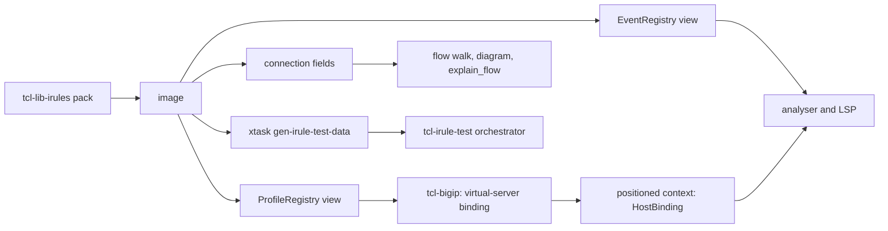
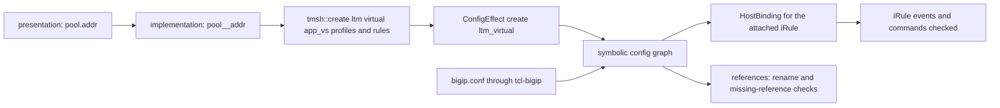
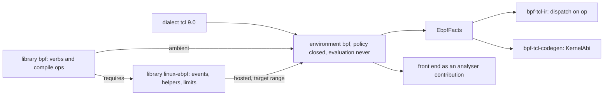

# 8. Domains: F5, SslicTcl and eBPF

Three domains use SpecTcl 3 for more than command surfaces. F5 states its
events, flows, profiles, connection fields and configuration effects as pack
content. SslicTcl states a declaration language and its data. eBPF states a
restricted language, its kernel ABI and its compile ops. This chapter
consolidates [304](../model/304-f5-libraries.md), [360](../model/360-spectcl-f5-integration.md),
[361](../model/361-spectcl-f5-iapps-tmsh.md), [365](../model/365-spectcl-sslictcl.md)
and [380](../model/380-spectcl-ebpf.md).

## F5

### Libraries, builds and policy

| Library | Axis | Compatible | Placement | Crate |
|---|---|---|---|---|
| `iRules` | tracks host | `{any on f5-tcl -build tmm}` | ambient in `f5-irules` | `tcl-lib-irules` |
| `iApps` | tracks host | `{any on f5-tcl -build scriptd}` | ambient in `f5-iapps` | `tcl-lib-iapps` |
| `tmsh` | tracks host | `{any on f5-tcl -build scriptd}` | ambient in `f5-iapps` and `f5-tmsh` | `tcl-lib-tmsh` |
| `f5.iapp` | own (versions from F5's convention, Q22) | `{… on f5-tcl -build scriptd}` | hosted; `loaded-by {tmsh::include f5.iapp.$version.cli}` | `tcl-lib-f5-iapp` |
| F5-bundled iApp packages (`http`, `uri`, `sha256`, …) | own, versions unknown (Q12) | `scriptd` | bundled in `f5-iapps` | `tcl-lib-iapps` data |

The iRules library owns its `LibraryPolicy`: realms (`RuleLoader`,
`InterpreterRuntime`), the 15 compiler-refused commands, closed world, a
declaration-only top level, load-time resolution and no operators as
commands. The 16 interpreter-absent commands are a property of the `tmm`
build's core surface. A query with no iRules library never sees a rule-loader
realm. The BIG-IP schema stays in item 118's crate; `tcl-lib-irules` has no
edge to it, and `tcl-bigip`, which depends on both, does every join.

**Load-time failures match the appliance** (owner decision). Under `tmm`, an
unknown, absent or refused command head and `proc` inside `when` are errors
where the rule loader refuses the rule, even inside `catch`. Anything the
appliance accepts is not an error: the inert `{*}` loads and runs, `list
{*}{a b}` returning `* {a b}` with code 0 in TMM, iApp, iCall and tmsh
(`evidence/tcl/bigip-r2286l-g-expansion.md`; measurements §1, "2 elements, no
warning"), so it is a **warning** about the misparse (item 431). Only BIG-IP
releases in public support per K5902 are modelled, and facets start at the
oldest of them; an event with no row inherits that line (item 432).

### Events, flows and profiles as pack content

`tcl-lib-irules` is one SpecTcl 3 pack, upgraded once from
`equivalent_f5_irules.tclspec` (item 330). Every Rust table becomes a view
over its image: `EventRegistry::from_image` and `ProfileRegistry::from_image`
keep today's methods (today: 176 `EventProps` rows,
`rust/tcl-registry/src/events.rs:158`).

- **Events.** `side`, `transport`, `profiles {any …}` (alternatives) or
  `{all …}`, `phase`, `message request|response` (which side's fields a
  side-neutral command reads), `multiplicity`, `frame connection`,
  `establishes {FIELD…}`, `setup`, `collect`, `category`, availability on the
  BIG-IP axis.
- **Order is a measured partial order.** A `flow` is a measured or
  documented trace for one profile set; `precedes A B -evidence E` records a
  measured pair. The order is the transitive closure of all flows and
  `precedes` rows; a cycle is a pack error. Two events with no path between
  them are **unordered**, and so is every event that appears in no flow and
  no `precedes` row: a consumer that needs a sequence (the simulator, the
  diagram, `explain_flow`) reports such an event as unordered rather than
  placing it. Today's flows name 27 events and two `precedes` rows are
  measured, against 74 hand-ordered rows (`events/event_order.rs`) and 176
  events, so the hand order is not reproduced. A test lists every pair where
  the 74 rows and the derived order disagree or the derived order has no
  answer, as input to Q13 and Q14.
- **Command validity** stays on the command: `event_requires`,
  `excluded_events`, and `rule_init warn`.
- **Profiles.** `implies`, `forbids`, `conflict`, `namespace NS -also {…}`, and
  `schema-kind` joining a profile to the schema's kinds; `transport-default
  TCP -unless {ip-protocol udp}`.



### The connection graph

`connection { field ID -side S -lifetime L -origin O -target T }` names the
per-connection state: `http.request.uri`, `lb.pool`, `persist.record`, and so
on. Lifetimes are `event`, `request`, `connection`, `message` and `table`
(shared across connections and TMMs). Each field refines a
`SideEffectTarget`, so the coarse effect rows are derived. Forms declare
`effect reads|writes connection F`, `decision CATEGORY ACTION`, `ends
connection -reset|-silent`, `disables events` and `enables events` (each
with `-scope rule|connection`, `unmeasured` until Q16), and `emits EVENT
-certainty`.
`-origin client` makes every getter of that field a taint source, replacing
`TAINTED_REFS`.

**The host binding.** `tcl-bigip` resolves each `ltm virtual`'s profiles
through the schema to kinds, maps them through `schema-kind`, and gives the
positioned context a `HostChoice`: `Unbound` (file-level, today's
behaviour), `Bound` with one `HostBinding { virtual_server, profiles, rules,
release }` per virtual server, or `Unknown`. `rules` is every rule on that
virtual server with its `priority` (0–1000, default 500, from the `when`
grammar), so the binding derives, per event, the handler order across rules
as F5 documents it: ascending priority, then the order of the virtual
server's rules list. A rule on two virtual servers reports per server. None
of the cross-rule behaviour is measured here: the handler order, variables
shared by every rule on one connection, and what `event disable` stops are
F5-documented only. `event disable` therefore carries `disables
events -scope rule|connection`, with its scope `unmeasured (Q16)` until a
probe, and `event enable` is modelled beside it.

### iApps and tmsh

- `template-section implementation -language tcl -environment f5-iapps`,
  `presentation -language apl`, `html-help -language html`: the formatter
  formats only the Tcl section, and APL regions are left alone.
- `apl-variable -root :: -separator __`: `pool.addr` is `$::pool__addr`.
- `-role tmsh-command -verb V` over a run of words is a tmsh command line. The
  role is data in `tcl-lib-tmsh`; its resolution against the schema
  (`kind_for_header`, property specs, references) is a contribution from
  `tcl-bigip`, registered by the entry points that link BIG-IP support.
  Without it, the words are an opaque string, as today.
- `effect writes config -verb create` yields a `ConfigEffect { verb, kind,
  name, properties, references }`; `transition tmsh begin|commit|cancel` are
  binding transitions. What a transaction refuses is unmeasured (Q21), so
  nothing is reported about transactions until it is.

One symbolic config graph holds parsed SCF objects plus every iApp
implementation's `ConfigEffect`s. A virtual server an iApp creates with
literal profiles and an iRule gives that iRule a `HostBinding` marked
`Why::IApp`. A rename of `/Common/web_pool` edits SCF, iRules and iApp
implementations; a name built from a variable is reported, not rewritten.



### The iRules test framework from facts

The simulator's sequencing comes from the derived order and `flow` rows; its
state layer is generated (`_fields.tcl`: one variable per field, reset by
lifetime); getters and setters are generated mocks per form with
`reads`/`writes` and `decision`; complex mocks are `mock -tcl PROC` or `mock
-native ID`; topology comes from the `HostBinding`; fakeCMP shares `-lifetime
table` fields across TMMs. `test` rows with `-profiles` and `-setup` run
through the orchestrator, and the config mode runs iApp implementations and
`cli script`s on mocks of `tmsh::` that apply `ConfigEffect`s (361d).

### Example: an iRule under today's tools

**Source:**

```tcl
proc clamp {v} { return $v }
when CLIENT_ACCEPTED {
    set l {a b c}
    set m [list {*}$l]
    set n [clamp 12]
    namespace eval ::x {}
    proc late {} { return 1 }
}
```

**In memory:**

```rust
// design sketch: chapters 4 and 8
ResolvedEnvironment { point: DialectPoint { release: f5(21.1), build: Tmm, .. },
    libraries: LibraryWorld { versions: { "iRules": {21.1} }, .. } }
ScriptGrammar { expand: Off, brace_separator: Optional, line_continuation: BraceLine, .. }
IrulesPolicy.admits("namespace", RuleLoader) == Admit::Refused      // one of the 15
```

**Bytecode (tclsh 9.1.0):** C Tcl compiles `{*}` to expansion, which TMM
does not have:

```text
  Command 3: "list {*}$l..."
    (17) push 0 	# "l"
    (22) loadStk 
    (23) listRangeImm 0 end 
```

**Result:**

```text
$ ./target/debug/tcl diag --dialect f5-irules ex3.irul
ex3.irul:5:12: error   IRULE5005 iRules procs must be invoked with 'call': call clamp 12
ex3.irul:7:5: warning IRULE5006 'proc' is only valid at the top level of an iRule.
diagnostics=2 across 1 input(s)
```

The appliance (21.1.0.1, `bigip-irule-parser-measurements.md` §1, §4c, §5)
reads `list {*}$l` as `* {a b c}`, refuses `namespace` with `command is
disabled`, and refuses `proc` in `when` with `not valid in the current
scope`. The rule loads, so under this specification line 4 is a warning
(inert `{*}` misparse, item 431), line 6 is an error (refused), and line 7's
severity becomes an error.

## SslicTcl

SslicTcl is a never-evaluated TLS declaration language in Tcl syntax. It is
internal to this project, with no shims. It has three parts:

- the namespaced pack dialect `sslictcl/decl`, defined by `tcl-lib-sslictcl`
  at the BundledPack tier (chapter 4's trust table): `tcl` 9.0's axes with one
  changed, `grammar script { substitution reject }`. A dialect owns how source
  is read, and `DialectPoint::grammars` takes only the point, so this is the
  one place the axis can change;
- the library `sslictcl`, placed ambient;
- the environment `sslictcl`, on `sslictcl/decl`, with policy `closed
  -evaluation never` and the library's document grammar as the root. The
  document's `substitution reject -code SSLIC1002` row maps the reader's
  finding to its code; it does not set the axis.

The library's pack carries the rest:

- **One pack** (`tcl-lib-sslictcl/sslictcl.tclspec`) states the vocabulary
  once: words are member-only commands, blocks are `definition_body`
  grammars, value domains are named once (`domain BOOL {values … -nocase
  -closed}`), and `document` maps each check to a code.
- **Data in its own vocabulary.** `data catalogue -source
  data/catalogue.sslictcl` replaces the estimator's hand tables (protocol
  scores, cipher patterns first-match-wins, signature OIDs, key scores,
  methodology weights); the trust store is one generated document per program
  snapshot. Both compile into the image's `DATA` section, and `make
  check-source-data` runs the compile with `--check`.
- **No shims.** Vocabulary 2 replaces 1 in one change with its consumers. A
  lower header is the new error `SSLIC1013`; a higher one stays `SSLIC1102`.
- **A generic declaration reader** checks any document grammar from an image
  (domains, arity, openness, `required`, `exclusive`, references, header) and
  serves completion, hover, tokens, folding, outline, definition, references
  and rename. Whether it is the same component as SpecTcl 3's own reader is
  open decision D13.
- **Crates.** `tcl-lib-sslictcl` holds the vocabulary image and its one hook;
  `tcl-sslictcl` keeps the model, engines, importers and the data images.

### Example: a declaration document today

**Source:**

```tcl
sslictcl 1
endpoint /Common/www {
    hostname www.example.test
    hsts { enabld true }
}
```

**In memory:**

```rust
// design sketch: DeclDocument is 365's
DeclDocument { header: Some(DocHeader { version: 1 }),
  items: [Decl { word: "endpoint", key: Some("/Common/www"), members: [
    Member { word: "hostname", value: Text(..) },
    Member { word: "hsts", block: Some(Decl { members: [] }) }] }],
  findings: [DocFinding { check: UnknownMember, code: Sslic1007, span: 75..86 }] }
```

**Result:**

```text
$ ./target/debug/tcl diag m.sslictcl
m.sslictcl:4:12: error   SSLIC1007 unknown `hsts` member `enabld`
diagnostics=1 across 1 input(s)
$ tclsh9.1 m.sslictcl
invalid command name "sslictcl"
```

The document is not a program, so there is no bytecode to show. Today `tcl
dis` compiles it as Tcl calls (`samples/sslictcl/example.sslictcl` gives 68
instructions, exit 0); after item 457 `tcl dis` and `tclvm` refuse an
`evaluation never` environment instead.

## eBPF

BPF-Tcl is a closed, typed packet language with Tcl syntax, lowered by
`bpf-tcl-ir` to eBPF. It is two libraries and an environment, not a dialect:

- library `bpf` (train 1): the verbs, each with `compile ebpf OP -K V` naming
  an op in `bpf-tcl-ir`'s closed catalogue (`scalar`, `packet-load`,
  `map-get`, `verdict`, `loop`, `declare`, …) and ordinary `effect` rows;
- library `linux-ebpf`, versioned by kernel release: `event` rows with
  `program-type`, `capabilities`, `verdict NAME N`, `default`,
  `out-of-bounds`, `attach`; `context` field offsets; `helper` ids; `map-type`;
  `limit` facets (`stack-bytes 512`, `back-edges bounded` from 5.3);
- environment `bpf`: `tcl` 9.0, `bpf` ambient, `linux-ebpf` hosted at the
  target range, policy `closed -evaluation never`, extension `.bpftcl`. No
  Tcl engine runs a `bpf` document: item 457's refusal covers it, as it
  covers `sslictcl`. Today `tcl dis --dialect bpf` compiles `when` as a
  plain `invokeStk1 3`. The Tcl model that runs BPF-Tcl under tclsh (380,
  reason 5) is a test runner with its own procs, not this environment.

**A missing recipe means "not in the subset".** The eBPF target has no plain
invoke, so `BpfPolicy` refuses any command with no `compile ebpf` row
(`while`, `proc`, `thread::send`), worded by effect class. That rule replaces
the declaration-only top level and `is_thread_command`. `compile ebpf` is a
fact naming a closed op, not a template or hook (Reconciliation R10). "No
plain invoke" holds inside `bpf-tcl-ir`; the Tcl engines are kept off by
`evaluation never`. The expression sublanguage is selected per role:
`-expr-profile ebpf-int64` selects the Rust value `ebpf-int64` of chapter 4's
expr `arithmetic` axis (`/` and `%` truncate, integers wrap at 64 bits), so a
folder abstains under it. The pack selects the value; it supplies no operator
table and no division rule, as for every grammar.



Verifier constraints map onto the rungs: map kinds and byte order are closed
value sets (rung 1); `loop` counts against `limit unroll` and verdict validity
`{within event E}` are `check` rules (rung 2); missing verdicts, back edges
and stack reuse stay in `bpf-tcl-ir`'s front end, registered as a
contribution. `BPF001`–`BPF017` become pack codes with the old numbers as
aliases. Kernel facts are generated from the UAPI headers; `rbpf`'s helper
ids stay in `bpf-tcl`, the harness that defines them.

## Review fixes (26 November 2026)

- **D2:** the inert `{*}` is a warning about the misparse, not a load-time error; the appliance accepts it (`bigip-r2286l-g-expansion.md`). The example's line 4 follows.
- **D7:** SslicTcl's `substitution reject` is set by the namespaced pack dialect `sslictcl/decl`; the environment no longer changes an axis.
- **D8:** `ebpf-int64` is a Rust value of the expr `arithmetic` axis that a role selects; no pack supplies a table.
- **D9:** the event order is the measured partial order; events in no flow and no `precedes` row are unordered; the 74-row reproduction requirement is dropped.
- **D10:** `HostBinding` carries `rules` with priorities; cross-rule order and `event disable` scope are F5-documented, unmeasured (Q16); `event enable` and `-scope rule|connection` are modelled.
- **D15:** present-tense `tcl dis` claims are marked as today versus after items 434 and 457; `bpf` is `evaluation never`.
