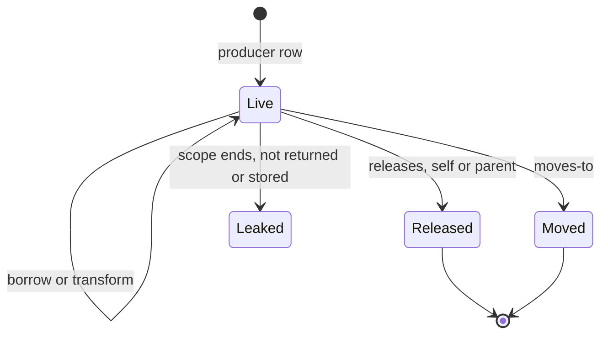
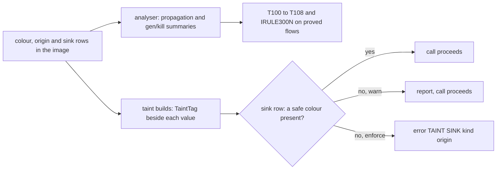

# 9. Package surfaces

What a package's users run into is mostly outside a command's words: the
commands a command makes, the errors it throws, the shape of what it returns,
the arguments a callback receives, the SQL inside a string, what changes at
the next major version, and where tainted data may go. This chapter
specifies all thirteen areas of [390](../model/390-package-surfaces.md), the
full designs of [391](../model/391-handle-types.md) (handles) and
[392](../model/392-error-codes.md) (error codes), and the taint section.

| | Area | Form | Minor |
|---|---|---|---|
| A | handle types | `handle`, `result -handle`, `arg … -handle -creates -releases` | 3.0 |
| B | error codes | `errorclass`, `throws` | 3.0 |
| C | structured results | `result -dict -list -pairs`, `arg … -array-of` | 3.0 |
| D | embedded-language ranges | `arg … -embedded LANG` | 3.0 |
| E | API migration | `migrate` | 3.0 |
| F | callback signatures | `arg … -callback -appends {…}` | 3.0 |
| G | msgcat catalogues | `catalogue` | 3.1 |
| H | project policy packs | `scope project` | 3.1 |
| I | Tk names beyond commands | `virtual-event`, `style`, `option-class` | 3.1 |
| J | more importers | tooling (`spec_import`) | — |
| K | test doubles | `mock`; packaging fakes for `tcltest` users is tooling | 3.0 |
| L | upgrade report | tooling over E | — |
| M | token categories and snippets | `token` (3.1); `snippet` (3.0, item 320) | 3.0, 3.1 |
| — | taint | `colour`, `origin`, `sink`, `header-class`, `refines`, `-sink`, `result -origin`/`-adds` | 3.0 |

## A. Handle types

A handle is a value that names a live thing: a channel, a `zlib` stream, a
SQLite connection, a Tk window, an `after` id, an iRules HSL connection, a
TclOO object. A pack declares each type:

```spectcl
handle zlib-stream {
    kind command
    lifetime scope
    subcommand put   { arity 1..2 ; option -flush ; option -fullflush ; option -finalize }
    subcommand get   { arity 0..1 }
    subcommand close { arity 0 ; releases self }
}
command {zlib stream} { result -handle zlib-stream }
command puts  { arg channelId -handle channel -needs writable -optional-first }
command close { arg channelId -handle channel -releases }
```

- **Kinds**: `token` (a string other commands accept), `command` (a command
  name with its own subcommands), `object` (a TclOO object; the class is the
  type, and user classes become types from source), `path` (a hierarchical
  name; `destroy .a` releases `.a.b`).
- **Lattice**: `is SUPERTYPE` gives subtyping (`file`, `pipe`, `socket` are
  `channel`); `capability` narrows (`open … r` gives a `file` that is
  `readable`, not `writable`). Classes carry `superclass`, `mixin` and
  `filter` rows (Reconciliation R15).
- **Children**: `parent TYPE -released-with` and `result -handle T -child-of
  self`: closing a connection releases its statements and result sets.
- **Lifetimes**: `scope`, `interp`, `thread`, `connection` (iRules: valid in
  any later event on that connection), `event`, `static`.
- **Effects** on an argument: borrow (none), `-releases`, `-moves-to`,
  `-transforms`, `-stores`.
- **Channels on rows.** `ChannelKind` and its option tables become per-type
  option tables, and `TaintColour::CHANNEL` is derived as "has a handle type
  under `channel`" (391c). There is no separate `channel-driver` form.

`ObjectHandleFacts` becomes `HandleFacts`: a `HandleValue` holds a type, its
capabilities, a state (`Live`, `Released`, `Moved`, `Unknown`), `Must`/`May`
certainty and its origin, and the state is a flow fact. Proc summaries record
the type returned, the type each parameter needs, inferred from the body, and
the body's frame effects (`upvar`, `global`, `uplevel`, `namespace upvar`,
`rename`, `interp alias`). A call whose summary has a frame effect, or whose
callee is unknown, demotes every handle fact in scope from `Must` to `May`, so
a closed `$f` that a helper reopens through `upvar` is never "used after
release" (391).



| Condition | Severity |
|---|---|
| wrong handle type, `Must` | error |
| missing capability | warning |
| use after release or move | error on every path, warning on some |
| double release | warning |
| leak (lifetime `scope` or `event`) | information |
| a handle outliving its lifetime (`static::` holding an `hsl`) | error |
| a hard-coded handle literal matching `spelling` | warning |

**Source:**

```tcl
set s [zlib stream deflate]
$s put -finalize hello
puts [string length [$s get]]
$s close
puts [catch {$s get} m]:[string match {invalid command name*} $m]
```

**In memory:**

```rust
// design sketch: 391's types
HandleType { id: HandleTypeId("zlib-stream"), kind: HandleKind::Command, supertypes: &[],
             parent: None, lifetime: Lifetime::Scope, spelling: None,
             subcommands: &[SubId("put"), SubId("get"), SubId("close")], .. }
HandleValue { var: (Global, "s"), ty: "zlib-stream", state: Released, certainty: Must } // at line 5
```

**Bytecode (tclsh 9.1.0):**

```text
  Command 2: "zlib stream deflate..."
    (5) startCommand +35 1 	# next cmd at pc 40, 1 cmds start here
    (14) push 1 	# "zlib"
    (19) push 2 	# "stream"
    (24) push 3 	# "deflate"
    (29) push 4 	# "::tcl::zlib::stream"
    (34) invokeReplace 3 2 
    (40) storeStk 
  Command 3: "$s put -finalize hello..."
    (42) push 0 	# "s"
    (47) loadStk 
    (48) push 5 	# "put"
    (53) push 6 	# "-finalize"
    (58) push 7 	# "hello"
    (63) invokeStk 4 
```

**Result:**

```text
$ tclsh8.6 zs.tcl      (tclsh9.1 prints the same)
7
1:1
$ ./target/debug/tclvm zs.tcl
invalid command name "zlib"
```

The analyser reports line 5 as a use after release. To the engine a handle is
only a string in a slot; its type exists in the analyser, from the pack. The
VM has no `zlib` (engine scope, item 213).

## B. Error codes

An error code is a list pattern with typed fields; patterns form a prefix
lattice, and `trap` matches by prefix in the same way. Classes and codes are
facets with release windows. Jim's dialect point declares that built-ins
raise only `NONE`.

```spectcl
errorclass POSIX { code ENOENT -fields {message} -message {no such file or directory} }
errorclass TCL {
    code {LOOKUP COMMAND} -fields {name:command}     { available core tcl 8.6- }
    code {LOOKUP DICT}    -fields {key}              { available core tcl 8.6- }
    code {VALUE INDEX}                               { available core tcl 8.6- }
}
errorclass ARITH { code DIVZERO -fields {message} }
command open   { throws {POSIX} }
command {dict get} { throws {TCL LOOKUP DICT} -when {argc >= 2} }
default        { throws {TCL WRONGARGS} -on wrong-args }
command error  { throws {arg 2} -default {NONE} }
command {string length} { throws -complete core tcl 8.6- }
```

Proc summaries record an error set and the completion codes a body can
produce (0–4, any `return -code N`, and what `return -level` and `finally`
do to them, 392). At `catch BODY ?m? ?o?` and `try`, `CatchFacts` holds the
completion codes, the error set (the patterns the body may raise, open
unless every call claims `throws -complete`, always with chapter 3's
implicit codes), the options dict's keys for the release (8.5 has no
`-errorstack`; 8.4 has no options variable), and the type of `$::errorCode`.
An unknown command raises `Any`, because an `unknown` proc can raise any
code. The analyser follows them into `dict get`, `lindex`, `switch` and
comparisons: a `trap` arm or comparison that cannot match a **complete** set
is a warning; a code a declared target release never raises, or a form a
declared target dialect lacks, is in the portability class (chapter 3). An
open set never yields "cannot match". `{string length}` claims a complete
set: besides wrong-args and the implicit codes it raises nothing.

**Source:**

```tcl
proc show {script} {
    set rc [catch $script m]
    puts [format "%-26s rc=%s ec=%s" $script $rc $::errorCode]
}
show {expr {1/0}}
show {nosuchcmd}
show {open /nonexistent/x}
show {dict get {a 1} b}
show {lindex {a b} x}
```

**In memory:**

```rust
// design sketch: 392's types, for `show {lindex {a b} x}` over targets tcl 8.4-9.2
CatchFacts { completion: CodeSet::of(&[0, 1]),
             errors: ErrorSet { patterns: &[ErrorPattern(&["NONE"])               /* 8.4, 8.5 */,
                                            ErrorPattern(&["TCL", "VALUE", "INDEX"]) /* 8.6- */,
                                            ErrorPattern(&["TCL", "WRONGARGS"]),     /* default row */
                                            ErrorPattern(&["TCL", "LIMIT"])],        /* implicit */
                                other: true /* lindex claims no throws -complete */ }, .. }
// `show {nosuchcmd}`: ErrorSet { patterns: &[], other: true }: an unknown command raises Any
```

**Bytecode (tclsh 9.1.0):** `show`'s `catch` compiles inline:

```text
  Command 2: "catch $script m..."
    (0) loadScalar %v0 	# var "script"
    (5) beginCatch 0 
    (10) dup 
    (11) evalStk 
    (12) swap 
    (13) pop 
    (14) push 0 	# "0"
    (19) swap 
    (20) jump +8 	# pc 28
    (25) pop 
    (26) pushReturnCode 
    (27) pushResult 
    (28) endCatch 
```

**Result:**

```text
$ tclsh8.4 codes.tcl          (tclsh8.5 the same)
expr {1/0}                 rc=1 ec=ARITH DIVZERO {divide by zero}
nosuchcmd                  rc=1 ec=NONE
open /nonexistent/x        rc=1 ec=POSIX ENOENT {no such file or directory}
dict get {a 1} b           rc=1 ec=NONE
lindex {a b} x             rc=1 ec=NONE
$ tclsh8.6 codes.tcl          (tclsh9.1 the same)
expr {1/0}                 rc=1 ec=ARITH DIVZERO {divide by zero}
nosuchcmd                  rc=1 ec=TCL LOOKUP COMMAND nosuchcmd
open /nonexistent/x        rc=1 ec=POSIX ENOENT {no such file or directory}
dict get {a 1} b           rc=1 ec=TCL LOOKUP DICT b
lindex {a b} x             rc=1 ec=TCL VALUE INDEX
$ tmp/jimtcl-oracle/jimsh codes.tcl
expr {1/0}                 rc=1 ec=NONE
nosuchcmd                  rc=1 ec=NONE
open /nonexistent/x        rc=1 ec=NONE
dict get {a 1} b           rc=1 ec=NONE
lindex {a b} x             rc=1 ec=NONE
$ ./target/debug/tclvm codes.tcl
expr {1/0}                 rc=1 ec=ARITH DIVZERO {divide by zero}
nosuchcmd                  rc=1 ec=TCL LOOKUP COMMAND nosuchcmd
open /nonexistent/x        rc=1 ec=NONE
dict get {a 1} b           rc=1 ec=TCL LOOKUP DICT b
lindex {a b} x             rc=1 ec=TCL VALUE INDEX
```

The `errorclass` rows are the one table both engines raise from (392f). The
run still shows the VM bug 392 found: `open` raises `NONE`.

## C. Structured results

`result -dict ?-open? {KEY TYPE …}`, `-list TYPE`, `-pairs`, and `arg NAME
-array-of {KEY …}` for commands that fill an array (`file stat`). Keys can be
versioned. The analyser follows the value into `dict get`, `dict exists` and
`$arr(key)`; completion offers the keys; a key outside a closed shape is a
warning.

## D. Embedded-language ranges

`arg sql -embedded sql -dialect sqlite` says a word's text is in another
language. **No parser for it is linked by any crate** (owner decision). We
generate, from the image: a TextMate injection grammar and `embeddedLanguages`
map for VS Code; tree-sitter `injections.scm` for Zed, Helix and Neovim; a
language-injection configuration for JetBrains; and for every client an
`embedded` semantic-token modifier and a `tcl/embeddedRanges` request.
Literal text is injected as written; a substitution is shown as a
placeholder. `-sink sql` on the same row makes a Tcl substitution inside the
string a taint sink (T107, from the `sink sql` row of the sqlite3 library), so
`db eval "… '$id'"` with a tainted `$id` warns, while `db eval {… :id}` and
`$id` inside a braced word, which SQLite binds itself, do not.

## E. Migration rows

```spectcl
migrate trace-variable {
    library core tcl 8.4-9
    on {trace variable}
    when {value {arg 1} in {w}}
    rewrite {trace variable $name w $cmd} {trace add variable $name write $cmd}
    note {trace variable is gone in 9.0; the callback's op argument changes from w to write}
}
```

A `migrate` row uses the proved rewrite templates, but may change behaviour
across a version boundary and applies only when a file's positioned context
moves across that boundary. The LSP offers one workspace action; a `note` the
rewrite cannot prove becomes a review comment at the site.

## F. Callback signatures

`arg command -callback -appends {name1 name2 op}` says what the caller
appends to a command prefix; `-appends N` is the count-only spelling, and
`-percent-subst` is the `bind` case. The analyser resolves the prefix to a
proc when it can and checks the proc's arity against the prefix's words plus
the appended ones. Change signature (chapter 6) inserts a new required
parameter before the appended ones.

**Source:**

```tcl
proc tracer {name1 name2 op} { puts "trace $name1 $op" }
proc bad {name} { puts $name }
set v 1
trace add variable v write tracer
set v 2
trace remove variable v write tracer
trace add variable v write bad
catch {set v 3} m
puts $m
```

**In memory:**

```rust
// design sketch: 390F's CallbackSig on `trace add variable`'s last word
CallbackSig { appends: AppendedArity::Named(&["name1", "name2", "op"]) }
// call-site check at line 7: `bad` takes 1 argument, is called with 0 + 3
```

**Result:**

```text
$ tclsh8.6 cb.tcl      (tclsh9.1 and ./target/debug/tclvm print the same)
trace v write
can't set "v": wrong # args: should be "bad name"
```

The analyser reports line 7 at analysis time; today it is a run-time error.

## G–M, the additive areas

- **G. `catalogue DIR`** indexes `mcset` keys per locale: `mc "key"` gets
  completion, hover per locale, and a missing-translation warning.
- **H. `scope project`**: a pack placed by `tclpkg.tcl` holding `check` rules
  that belong to no library.
- **I. `virtual-event`, `style`, `option-class`**: `bind`, `event generate`,
  `ttk::style` and `option add` get completion and unknown-name warnings.
- **J. Importers**: doctools `.man` `[call …]` lines, C extensions
  (`Tcl_CreateObjCommand`, `Tcl_WrongNumArgs`), and run-time introspection,
  each emitting SpecTcl 3 through the one printer.
- **K. `mock`**: a package ships fakes for `tcltest` users.
- **L. `tcl pkg upgrade-report foo 1.4 2.0`** lists every call site a
  `migrate`, `deprecated`, facet or `throws` row changes.
- **M. `token CATEGORY`** and `snippet PREFIX LABEL BODY`; a snippet is
  checked against the command's arity at pack compile time.

## Taint

Taint is one fact family read by the static analyser and by an optional
run-time mode in `tclvm` and the runtime. Its full design is
[393](../model/393-taint.md); plan items 465–479 carry its steps (chapter 12).
This section fixes its place in the specification.

**Today.** The registry spells taint field by field: 15 `CommandSpec` fields
plus `taint_sink_gate` (a function pointer) and `callback_taint_inputs`
(`rust/tcl-registry/src/spec.rs:483`, `:957`–`:1070`), and a closed 17-atom
`bitflags` colour set (`TaintColour`, `rust/tcl-registry/src/taint.rs:50`)
copied by the compiler, the summaries and hover. Sinks are diagnostic codes,
not kinds; origin and mitigation share one set (`TAINTED` is a "may" bit among
"must" bits); validators do not exist.

### The model

A value's taint fact is a pair:

| Part | Lattice | Join at a merge | Examples |
|---|---|---|---|
| **origins** | a "may" set | union | `client`, `channel`, `env`, `argv`, `user`, `secret`, a pack's own |
| **colours** | a "must" set under `implies` closure | intersection over the tainted inputs | `crlf-free`, `shell-atom`, `sql.bound` |

A sink fires when the value has an origin the sink cares about and lacks every
colour in its `-safe` list. A `-discloses` sink also fires on the `secret`
origin (T108), whatever the colours.

| Concern | Form | Replaces |
|---|---|---|
| colours | `colour NAME { core? ; concat all\|first\|none ; implies … }`; core colours bare, pack colours `LIBRARY.NAME` | `TaintColour` bitflags and its five copies |
| origins | `origin NAME { discloses? }`; attached by `result -origin`, `arg … -writes -origin`, `-callback-origin {%P user}`, `variable env -kind Array -access ReadWrite -provider Environment -origin env`, connection fields (360), and a channel handle's type (391) | `taint_source`, `TAINTS_VAR_WRITES`, `callback_taint_inputs`, `IRULES_TAINT_SOURCE_PREFIXES`, `TAINTED_REFS` |
| sinks | a `sink KIND { -origins -safe -code -severity -discloses }` catalogue, named per word by `arg … -sink KIND ?-safe+ C?` | `taint_*_sink*` fields, `Traits::TAINT_SINK`, the per-code masks |
| sanitisers and transforms | `result -adds C ?-when {native ID}?`, `arg … -double-encodes C`, `result -clean` | `taint_transform`, `taint_transform_when`, `is_sanitiser`'s numeric rule |
| validators | `refines WORDREF -adds C -on true\|false`, `-adds-from-pattern`; sound per switch and per condition shape (393) | none today |
| propagation | built-in identity and `concat` rules; `result -from`, `-element-of`, `-elements-from`; `errors -message-from` | `shape_unproven` and ad hoc rules |
| summaries | a gen/kill `ProcTaintSummary` per parameter: `passes_origins`, `keeps`, `adds`, `param_sinks`, `validates` | 17 runs per parameter per `TaintBasis` |
| gates | `-sink … -when PRED` under `SinkWhen`: suppressed only when proved false | `taint_sink_gate` (`HookFamily::TaintSinkGate`) |
| secrets | `option … -secret`, `header-class sensitive {…}`, `-secret-header-of` | `credential_options`, `sensitive_headers` |

`channel` is not a colour: it is "has a handle type under `channel`" (391),
and a channel read's origin comes from the handle (`socket` is `client`,
`stdin` is `user`). The security floor holds: a pack may widen a core sink's
`-safe` only by a colour that implies one already there.

### The run-time mode

A `taint` cargo feature in `tcl-vm` and `runtime/rust` adds the code; without
it nothing changes. With it, `tclvm --taint=off|warn|enforce` picks the mode.

- **A tag beside the value.** Each object carries a feature-gated `TaintTag`
  (a `u32` index into an interned, append-only `TaintFact` table per
  interpreter; 0 is clean). It is not a reference: no retain or release.
  Literals are always clean, and a source duplicates a shared object before
  colouring it.
- **One table.** The VM reads the same `TaintTable` and taint rows from the
  image as the analyser. Sources and `-adds` run after a successful invoke;
  sinks are checked before it, against the selected form; propagation follows
  each colour's `concat` rule. `refines` does not run at run time.
- **A violation is a typed error.** `enforce` raises `TAINT SINK <kind>
  <origin>`, an `errorclass TAINT` row (392), so `catch` and `try … trap {TAINT
  SINK}` see it. `warn` reports through `::tcl::taint::report` and proceeds,
  and must leave results byte-identical to C Tcl.
- **Codegen reads no taint facts** and tbcx units carry none: taint is
  run-time state. The optimiser and minifier treat a call with an `-adds`,
  `refines` or `-clean` row as a barrier.
- **Oracles.** The iRules simulator runs with `enforce`; `tcl-fuzz` runs
  `--taint=warn` beside the analyser, so a run-time report with no static
  warning is a confirmed false negative.



### Example: one word redirects `exec`

From 393, example 1: no shell runs, yet one argv word redirects `exec`'s
output into a file. That is why `exec`'s sink is `shell`, not `code`.

**Source:**

```tcl
set arg [lindex $argv 0]
catch {exec echo hello $arg} out
puts "out=<$out> exists=[file exists stolen.txt]"
```

**In memory:**

```rust
// design sketch: 393's types
SinkRow { id: SinkKindId(/* shell */), safe: ColourSet::of(&["shell-atom"]),
          origins: OriginSet::ANY, discloses: false, code: Facet::one(DiagCode::T100), .. }
TaintFact { origins: OriginSet::of(&["argv"]), colours: ColourSet::EMPTY }   // $arg at line 2
```

**Bytecode (tclsh 9.1.0):** the call as `proc p {arg} {exec echo hello $arg}`:

```text
    (0) push 0 	# "exec"
    (5) push 1 	# "echo"
    (10) push 2 	# "hello"
    (15) loadScalar %v0 	# var "arg"
    (20) invokeStk 4 
    (25) done 
```

**Result:**

```text
$ tclsh8.4 ex1r.tcl '>stolen.txt'      (tclsh9.1 and tmp/jimtcl-oracle/jimsh print the same)
out=<> exists=1
$ ./target/debug/tcl diag ex1r.tcl
ex1r.tcl:2:24: warning T100     Tainted variable $arg flows into exec; possible code injection
ex1r.tcl:3:6: warning T101     Tainted variable $out flows into puts; output may contain injected content
```

`invokeStk 4` is where the run-time mode checks the `shell` sink.

## Consumers

| Consumer | A | B | C | D | E | F | taint |
|---|---|---|---|---|---|---|---|
| analyser | release, leak, type checks | dead `trap` arms | key typos | sinks | — | callback arity | flows |
| completion, hover | handle subcommands, state | `trap` codes, raises | keys | — | — | — | colours |
| code actions | — | `catch` to `try` | — | — | migrations | — | — |
| editor packaging | — | — | — | injection grammars | — | — | — |
| optimiser | no use moved past a release | prunes dead arms | — | — | — | — | — |
| engines | — | the one raise table | — | — | — | — | run-time mode, `TAINT SINK` errors |
| Rust (332) | `HandleType` | `Throws` | `ResultShape` | `Embedded` | `Migration` | `CallbackSig` | `TaintTable`, `TaintRow` |

## Review fixes (26 November 2026)

- **G6, A2.** `default` rows union; `throws -complete` shown; error sets are open with implicit codes; dead arms need a complete set (area B).
- **G11.** Codes a target never raises and missing forms are the portability class (area B).
- **G12.** `{dict get}` uses `argc >= 2`, `error` `{arg 2}`, the migration `{arg 1}`: 0-based after the `CMDPATH`.
- **G13, A11.** The `CatchFacts` sketch has no certainty field; an unknown command raises `Any`, and the default `-on unknown-command` row is gone.
- **G14.** `mock` is 3.0 (area K).
- **G15.** `name:command`; `variable env` carries its required flags and `-provider`.
- **A6.** Frame effects and unknown callees demote handle facts to `May` (area A).
- **A14.** Completion codes account for `return -level` and `finally` (392).
