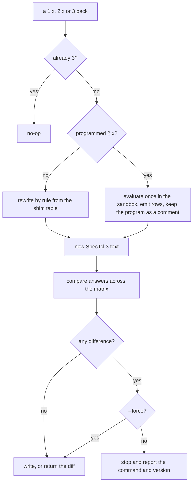
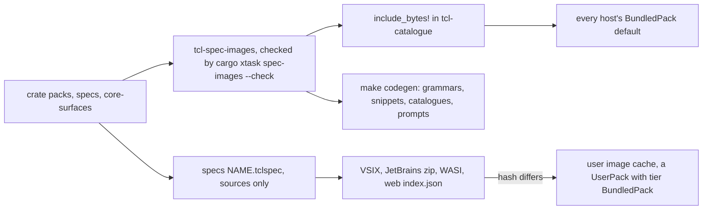

# 10. Tooling and migration

This chapter specifies how 1.x and 2.x packs keep working, how they become 3,
the one printer, the authoring and AI tooling, the editor bundles, and the
`.tclspec` editor. It consolidates [305](../model/305-spectcl-3.md),
[306](../model/306-expect-spike.md), [309–310](../model/309-310-migration-and-authoring.md),
[319](../model/319-consumer-migration.md) and [333](../model/333-spectcl-3-gap-analysis.md).

## Shims

1.x and 2.x packs load through translation into `Pack3`, then into an image
like any 3 pack. Upgrading is never required to keep working. Today's
vocabularies are `1, 1.0, 1.1, 1.2, 2, 2.0, 2.1, 2.2, 2.3`
(`KNOWN_VOCABULARY_VERSIONS`, `rust/tcl-spectcl/src/loader.rs:727`), and the
compiled-cache key is `VOCABULARY_VERSION = "2"`
(`rust/tcl-spectcl/src/lib.rs:132`).

| Old construct | 3 |
|---|---|
| `dialects {tcl8.6 …}`, `TRANSLATIONS`: `tclX.Y`, `tclX.Y+`, `all-tcl`, `tcl8.x` | `available core tcl RANGE` in the algebra: `tcl8.5+` → `8.5-`, `tcl8.6` → `8.6-8.7`, `tcl8.x` → `8.4-9` |
| `dialects {f5-irules}`, `{tk}`, membership tokens `f5-iapps`, `f5-tmsh`, `expect`, `spectcl`, `bpf` | `available iRules 0-`, `Tk 0-`, `iApps 0-`, … |
| `f5-bigip` | still refused |
| `required_package P`, `tcllib_package P` | `available P 0-` |
| `introduced_version`, `deprecated_version`, `retired_version` | `available P RANGE`, `deprecated`, `retired` |
| `-deprecation-fix`, `versioned_arg_value` | `deprecated -fix`, `versions {P RANGE} { arg … -values+ }` |
| `ambient_package NAME V` | `environment OWNER { library NAME V -placement ambient }` |
| `file_extension … -dialect D` | `environment D { file_extension … }` |
| `available {PROVIDER WINDOW}` (2.0) | `available LIB-RANGE`, the window carried (D17-P fixed) |
| `available {jim 0.78-}` | `available core jim 0.84` (Jim is one point) |
| `provides NAME V…`, `co_provides` | `library NAME { versions …; train … }`, `provides` rows |
| `environment NAME {core F R; ambient\|hosted …}` | `environment NAME { dialect F R; library … -placement … }` |
| `dialect NAME { release; axis }` | `dialect` with `grammar` blocks; `axis` read as a grammar row |
| `include from tcl into jim …` | `roster from tcl into jim …` |
| `special_var` | `variable` |
| `const_fold_versioned` | `const_fold`, reading `ctx dialect` |
| `-variable-scope`, `appended_arity` | `-scope`, `-appends` |
| every other 2.3 row | unchanged (`legacy-row`, chapter 2) |
| pack-level `proc`, `foreach`, `set`, `[format]` | expanded once at tool time; the static rows are written out |

A programmed 2.x pack (one that computes rows) needs the 2.x evaluator. The
LSP and the compiler never run it: it sits behind a `tool-eval` feature that
only `tcl spec upgrade` and the bundling xtask enable. The LSP shows a notice
offering the upgrade, and loads the pack through the tool evaluator only if
the user turns that on.

SslicTcl gets no shim: vocabulary 2 replaces 1 with its consumers, and a
lower header is `SSLIC1013`. The equivalence packs, generated instruments,
get none either.

**Deprecation timing** for the shims (when the loader starts warning on 1.x
packs) is the owner's: open decision D17.

## `tcl spec upgrade`: one engine with a proof

`tcl_spectcl::upgrade_to_3(source, options) -> UpgradeResult` produces the new
text, a diff and an equivalence report, and every surface calls it.

- **Declarative packs** are rewritten by rule from the shim table, keeping
  comments and layout around rewritten rows (`--restyle` re-emits
  canonically). Ranges written in the old whole-line reading are translated
  into the algebra.
- **Programmed 2.x packs** are evaluated once in the sandbox; the resulting
  registrations become literal 3 rows, and the original program survives in a
  `# generated by` header naming the source hash. If the author still wants
  to generate, the program moves to a generator script outside the pack,
  which ships as user tooling.
- **Proof before writing.** The old text is loaded through the shim and the
  new through reader3, and their answers are compared across the release
  matrix: visibility, arity, roles, every versioned facet and documentation,
  widened to every manifest word (332). The matrix is the fixed points (tcl
  8.4–9.1, jim 0.84 under both builds, the f5-tcl matrix under each build,
  each library's trains) plus every bound a row names and the line before
  it. Any difference stops the write and names the command and version;
  `--force` writes and keeps the report. Upgrading a 3 pack is a no-op.



| Surface | Behaviour |
|---|---|
| CLI | `tcl spec upgrade [--to 3] [--check \| --diff \| --write] PATH…`; `--check` exits non-zero when anything would change |
| LSP | an information diagnostic on a 1.x or 2.x pack, a code action returning a `WorkspaceEdit`, and a workspace command "Upgrade all packs to SpecTcl 3" |
| editors | the command and code action through the LSP; Spec Studio's "Upgrade to 3" button with the diff and report |
| MCP | `spectcl_upgrade` with `dry_run` (default true) |
| `tcl pkg` | reports a project's packs below 3 |

Nothing writes a user's file without an explicit user action.

### Example: a templated 2.x pack, expanded

**Before:**

```spectcl
speclib rows 2.0 {
    command sortish {
        arity 1..
        traits {CSE_CANDIDATE}
        foreach {flag prose} {
            -ascii {Compare in code-point order.}
            -integer {Compare as integers.}
            -real {Compare as floating-point values.}
        } {
            option $flag -detail $prose
        }
    }
}
```

**After:**

```spectcl
speclib rows 3 {
    command sortish {
        arity 1..
        report redundant
        option -ascii -detail {Compare in code-point order.}
        option -integer -detail {Compare as integers.}
        option -real -detail {Compare as floating-point values.}
    }
}
```

**In memory:**

```rust
// design sketch: both forms load to this
VersionedSpec {                                   // sortish
    availability: Availability { providers: &[ProviderRow { library: None, window: ItemHistory::ALL, dialect: None }] },
    arity: Facet { rows: &[(FacetKey::ANY, Arity::new(1, None))] },
    options: Facet { rows: &[(FacetKey::ANY, &[OptionId("-ascii"), OptionId("-integer"), OptionId("-real")])] },
    report: ReportFlags::REDUNDANT,               // the diagnostic half of CSE_CANDIDATE
    ..
}
```

**Result:**

```text
$ ./target/debug/tcl spec export rust/tcl-spectcl/tests/fixtures/templated/rows.tclspec
speclib rows 2.0 {
    command sortish {
        arity 1..
        traits {CSE_CANDIDATE}
        option -ascii -detail {Compare in code-point order.}
        option -integer -detail {Compare as integers.}
        option -real -detail {Compare as floating-point values.}
    }
```

Today's `tcl spec export` already writes the expansion (the fixture's
`joinish` command follows in its output); `upgrade_to_3` adds the 3 header,
the trait split (`CSE_CANDIDATE` becomes the derived CSE permission plus
`report redundant`, chapter 6) and the proof. A pack has no bytecode.

## One printer

A single SpecTcl 3 printer in `tcl-spectcl`, over the model types (item 404),
writes the canonical form: grammar order, defaults omitted, facets as compact
window rows, `check` rules, `alias` as `provides`. `upgrade_to_3`, `tcl spec
export`, MCP `spectcl_expand` and `spec_import`, Spec Studio's renderer and
the equivalence-pack generator (until item 330 deletes it) all use it. Named
descriptors print by `DescriptorId`, native hooks by `NativeHookId`.

## Authoring and AI tooling

| Tool | 3 behaviour |
|---|---|
| `spec_import` (MCP) | from version snapshots: a `library` block with trains and `compatible` rows from each snapshot's `package require Tcl`, facets from the differences; guessed rows marked `version-gate:` |
| `spectcl_check` (MCP), `tcl spec check` | validates 3; reports the upgrade for an older pack; rejects templating; `--consumer C` reports missing facts for that consumer |
| `tcl spec compile PACK… [-o DIR] [--check]` | builds images on demand, as the user cache does |
| `tcl spec test`, `tcl spec prove [--consumer C]` | runs `test` rows; runs the differential corpus under each real `tclsh` (and jimsh) and records `PROOFS` |
| `command_info` (MCP) | facets for the caller's positioned context |
| Spec Studio | edits 3 in place; form schema generated from reader3; releases from the catalogue; no `render_spectcl` |
| `spec-author` skill | rewritten for 3: the lowest rung first, `check` before hooks, `-inputs` on every Tcl hook, no templating, a `spectcl_check` and equivalence loop, and an eval suite |
| AI system prompts | the `spectcl` text describes 3, regenerated through `ai/prompts/manifest.json` |

**Generators and hand edits.** Generators ship as user tooling beside `tcl
spec upgrade` and `tcl spec compile`. Editing a generated pack by hand is
allowed; reconciling hand edits with a regenerated library update is the
user's or the AI tooling's job. The skill's "regenerate and re-apply" flow
diffs the old generated output against the hand-edited pack, regenerates,
replays the diff and reports conflicts.

## Editor bundles

`tcl-spec-images` (`cargo spec-images`) compiles every shipped pack once per
build into `tcl-catalogue/images/`; `cargo xtask spec-images --check` (item
119) fails on any byte difference, naming the pack and section.

Shipped packs resolve the same way on every host (D-H): the image that
`tcl-catalogue` embeds is the BundledPack default for the native server, the
WASM and WASI builds, the explorer and every editor. A `specs/` source on disk,
or in the browser's mount, overrides it only when its hash differs from the
embedded image's `source_hash`; it is then compiled into the user image cache
and installed as a `UserPack` input with tier BundledPack. No `.tclimg` ships
beside a binary: the binary already embeds the same build's bytes.

| Artefact | Ships |
|---|---|
| VS Code VSIX (universal and platform targets) | `specs/*.tclspec` beside each server binary, sources only |
| VS Code web | `dist/web/specs/*.tclspec`, listed in `index.json`; a changed source compiles into an in-memory per-session cache |
| VS Code WASI server, JetBrains `.zip` | the sources, beside the module or binary |
| Zed, Neovim, Emacs, Helix, Sublime and other bare-binary clients | the images embedded by `tcl-catalogue`; Sublime's LSP-Tcl downloads the native `tcl-lsp-server` from the release (`editors/sublime-text/README.md`) |

Every artefact that ships packs ships them as sources (owner decision), so a
user can read and replace a vendor pack. The user image cache is rooted
through `tcl-userdirs`; the browser keeps it in memory for the session.
Editor keyword grammars, snippets,
diagnostic catalogues and AI prompts are generated from the catalogue and
every image (item 328): each library's words get their own scope
(`support.function.library.<lib>.tcl`), on by default only for ambient
libraries, and semantic tokens carry a `library` modifier for the precise
answer.



## The `.tclspec` editor

`.tclspec` documents are read by reader3, not analysed as Tcl programs (item
401). The `spectcl` environment places the SpecTcl library ambient with policy
`closed -evaluation never`, and its features come from the manifest:

- diagnostics from reader notices, each with a `SpecCode` and a span,
  recovering per top-level item;
- hover on a row shows the manifest's documentation, and on a `versions` block
  the resolved facet per version;
- completion of row words, roles, families, libraries and versions;
- go to definition from `check on CMD` and `extend command CMD` to the
  command, from `available L R` to the library, and from a hook `-ref` to its
  `hook`;
- formatting by the printer's layout.

Unknown words keep 2.x's `VocabularyClass` treatment. Today's notices carry
only `{context, line, message}` (`Notice`, `rust/tcl-spectcl/src/loader/notices.rs:34`).

## Review fixes (26 November 2026)

- **Rust/integration fixer handoffs (a43df812).** `tcl-spec-images` (`cargo spec-images`) generates the images into `tcl-catalogue/images/`; bare-binary clients get the images embedded by `tcl-catalogue`.

## Review fixes (26 November 2026, deep review)

- **C2 (D-H).** Editor bundles ship sources only; the embedded image is every host's BundledPack default; a differing source compiles into the `tcl-userdirs` cache (in memory in the browser). Sublime is a bare-binary client: LSP-Tcl downloads `tcl-lsp-server` (`editors/sublime-text/README.md`).
