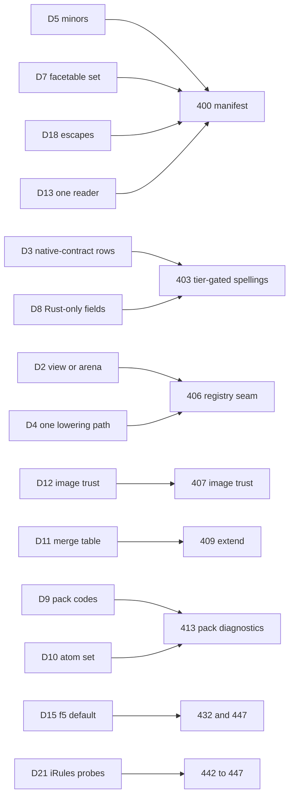

# 11. Open decisions

These are the questions this specification does not decide. Each row gives
the source's recommendation and this specification's. Where a chapter needs
an answer to be implementable, it uses the recommendation and names the
decision (`D7`); a different answer changes that chapter only. The owner
decisions in chapter 1 are not reopened here.

## Decisions for the owner

| # | Question | Source and its recommendation | This spec recommends | Blocks |
|---|---|---|---|---|
| D1 | In which dialect does a Tcl hook body run? (333 #14) | 333: bodies are Tcl 9.1; the target reaches them as `ctx dialect` and the `evaluate` route. 313 wanted an engine per release | 333's, which the owner's 9.1 VM decision implies; release-exact folds go through `evaluate` routes and kernels, and abstain without one | 430 |
| D2 | The registry's consumer API: a `SpecRef<'r>` view, or a per-surface arena that materialises a `CommandSpec` on first lookup? (333 #2) | 333: owner | **closed: views only (`SpecRef<'g>`).** An arena would need `&'static` over run-time bytes, a leak step 14 forbids; 277 files outside `tcl-registry` name `CommandSpec` today, and they move to views | 406 |
| D3 | Are the native-contract rows (`successful_handler`, `native_compilation`, `procedure_definition`) accepted from bundled images? (333 #3) | 333: yes, as `-native ID` from BuiltIn and BundledPack only | yes: without it iRules (8 files) and the stdlib cannot move to images | 403, 307 |
| D4 | One lowering path: every pack an image? (333 #13) | 333: one path | one path; the in-memory image costs one compile per pack per process | 406 |
| D5 | Vocabulary minors and forward reading (333 #15) | 333: `speclib NAME 3.N`; each word carries `since` and a `VocabularyClass` | as chapter 2: unknown newer words classified by scope and name as in 2.x; new flags take exactly one word; a minor never changes a word's meaning; a major other than 3 refused | 400 |
| D6 | The equivalence and parity scope (333 #16, 332) | 332: every manifest word, over fixed points plus every bound a row names | 332's | 405, 309 |
| D7 | Which facts are facetable (333 #7) | 333: the manifest marks them; the reader refuses the rest inside `versions` | chapter 3's list; identity rows (`alias_of`, `runtime_backing`, `implementation`) not facetable | 400 |
| D8 | Which fields stay Rust-only, and so which libraries stay native under 307 (333 #8) | 333: spell each or mark it Rust-only and block that library's move | spell them all tier-gated (332b); Rust-only only for `native_lowering`, `native_lowering_windows` and `dispatch_dependencies`, as `Derived` tables in `tcl-dialect-tcl`, which only the Tcl core sets; native lowering is keyed by the `operation` row's `OP-ID`, not by command (D32) | 403, 307 |
| D9 | The pack code spelling and its registration (333 #9, 319 Q2) | 333: `PACK/ID`, registered as `DiagCode::Pack(PackCodeId)` with a default severity and category | 333's; BuiltIn packs may keep stable built-in codes (`BPF001` as an alias of `bpf/unbounded-loop`) | 413 |
| D10 | Is the `check` atom set closed after 337's additions? (333 #10) | 333: yes; a new atom needs a design note | yes | 413 |
| D11 | The merge table per fact kind, and library ownership (333 #11) | 333: library rows from the owner only, prose by precedence, security by the floor, facets prepended | chapter 3's order-free table: the pack declaring `library L` owns it; set-valued facts select per pack and union; single-valued facts need `-override`; `extend` is additive; no `extend library` (R57, R61) | 409 |
| D12 | Image tier-neutrality, and which images are trusted from disk (333 #12) | 333: tier-neutral, filtered at install; only bundled images from disk | 333's | 407 |
| D13 | Is SpecTcl 3's reader the same component as 365's generic declaration reader? (365, and this task) | 365: settled by comparing 333's productions with the reader's checks | one component with two front tables: both read Tcl words with no substitution against a closed grammar and emit coded notices with spans; SpecTcl 3's own grammar becomes the first `document` the generic reader checks. Keep them separate only if the comparison shows a production the document model cannot state | 400, 453 |
| D14 | `SSLICTL` codes into `DiagCode`, and Oracle Java folded into `openjdk`? (365) | 365: owner | `SSLICTL` codes become pack codes of the `sslictcl` library (D9); keep Oracle Java folded until a separate trust program is published | 455 |
| D15 | f5-tcl's default release, now that the ladder follows K5902 (303 decision 4 chose 16.1) | 303: 16.1 default, 15.0 baseline, to keep today's answers | the newest K5902 line with appliance evidence (21.1 today); the baseline is the oldest K5902 line | 432, 447 |
| D16 | `linux-ebpf` as its own library, or a build axis on `bpf`? (380) | 380: settled by whether a second front end shares the kernel facts | its own library (and crate): kernel versions are a library axis, and the facts are useful to any eBPF front end | 458 |
| D17 | When do the 1.x and 2.x shims start warning? (309) | 309: owner; not scheduled | no warning while any bundled or test pack is below 3; then warn on 1.x from the next minor release, and keep 2.x silent while programmed packs exist in the wild | 309 |
| D18 | Does reader3 decode backslash escapes in quoted words, so any prose has a spelling? (332) | 332: settled by the 37 `hover` losses printing and reading back equal | decode in quoted words, keep braced words verbatim; the printer quotes prose that needs it | 400, 404 |
| D19 | Wire `bpf-tcl-ir`'s semantic bridge, or delete it? (380) | 380: settled by whether its audit catches anything the recipe policy does not, over `tcl-fuzz`'s `bpf_diff` corpus | measure, and delete if it finds nothing | 464 |
| D20 | 370's implied questions: the f5-tcl character model; whether a build overrides any grammar value; the tmsh build (Q11) | 370 had marked the f5-tcl `chars` column unmeasured | **resolved**: `chars` is `bmp-else-bytes`, measured under `tmm`, and a build override exists (`scan int_width tmm-long32 -build tmm`); Q11 is still decided by 301's wordSize probe | 417, 427 |
| D21 | The iRules lab probes of 360: both-leg event order (Q13), the event set per release (Q14), the command × event matrix (Q15), what `drop`, `discard`, `reject` end (Q16), field lifetimes (Q17), profiles admitting HTTP events (Q18), implicit `tcp` (Q19) | 360: lab probes on 17.1, 17.5 and 21.1 | run them in that order; Q16 first, because the registry and the simulator disagree on `discard` | 442–447 |
| D22 | The iApps and tmsh probes of 361: inventory (Q20), transactions (Q21), `f5.iapp` versions (Q22), return shapes (Q23), `tmsh mv` (Q24), `.app` folders (Q25) | 361: lab probes | Q20 and Q22 with Q12 in one session; until then mocks stay labelled unmeasured | 448–451 |
| D23 | Error codes in iRules (Q26) | 392: lab probe | probe before 392d's f5-tcl forms | 392 (392d) |
| D24 | Version-gate findings over a declared target range (review G11) | 392, 09: warn when a code test or form misses some release in the range | a separate **portability** class, opt-in, keyed to declared targets; warnings over uncertainty need every case to fail (chapter 3, R51) | 392 (392c), 413 |
| D25 | Error-code field types (review G15) | 09: argument roles; 392: types | a closed `FIELD-TYPE` set: `command`, `variable`, `integer`, `path`, `text` (R55) | 392 (392a) |
| D26 | How a validator stays sound per switch (review A7) | 393: none | `refines … -switches LIST` allow-lists the switches; no list means no switch; refinement only for the call, `!call` and decomposed `&&`/`||` | 469 |
| D27 | The origin of argument references (review G12) | three conventions in use | 0-based after the `CMDPATH`, options included; `NAME` for positional arguments after options; `argc` the same (R52) | 400, 413 |
| D28 | Where the Tcl core's facts live (review, build-time) | 307 | **decided and applied**: the Tcl core's facts and release facts are an image in `tcl-catalogue`; `tcl-dialect-tcl` holds hooks only (307 decision 1) | 307, 481 |
| D29 | How images are built (review, build-time) | 307 | **decided**: `tcl-spec-images` generates them into an untracked catalogue directory; a build-dependency was rejected because it would compile the reader twice under build-override | 307 |
| D30 | What rung 5 tabulates (review, build-time) | 313 | **decided**: Tcl bodies only; native hooks answer live | 430 |
| D31 | Does `tcl-vm` split after all? (deep review, D-J) | [291](../../build-time/291-vm.md#should-tcl-vm-split): not as part of 291, because VM edits were rare on `work` while engine work was deferred; the trigger is item 259's fifth (VM) edit exceeding the analyser edit's test cycle after step 12 | **reopened for the owner.** Engine work is now in scope on this branch (117/291's crate moves, 311, 312 with the 9.1 default release and the missing 9.1 commands, 313's VM half, 392f, 420's engine leg, 436), so VM edits are expected and 291's first reason no longer holds. Recommended: keep 291's crate move as designed and unsplit, so it gates nothing in Now 1–5, and measure the VM edit cycle with 259's fifth edit alongside; design the split on item 88's seams (`Frames`, `Namespaces`, command identity) only when that measurement crosses 291's trigger. Decide before 312's VM steps (312 work list step 6); the measurement runs alongside from Now 1 and blocks nothing | 291, 88 |
| D32 | One vocabulary freeze: item 120's operation field and effect descriptor, item 242's native lowering, and items 86, 210 and 211 (deep review W2, W10; D-K) | the plan had 120 and 242 in stage 6, after 3.0 froze, so either 3.0's parity gate (405) breaks or they never land; 86, 210 and 211 had no SpecTcl spelling or parity row | **decided and applied** in chapter 2: `operation` is the one operation statement, from which the lowering, codegen, inline-codegen, native-compilation and successful-handler hooks derive; native lowering is a `Derived` table keyed by the operation (D8 unchanged); the effect rows are the one effect descriptor, and `pure`, `mutator`, `assigns_variable_at` and `semantic_operation` are shim words; the synopsis is stated once by a printer rule. 86 folds into 391a (classes as `handle` blocks of kind `object`) and 402 (`lookup NATIVE-ID`); 210 folds into 391c (per-type `option` rows with `available` facets); 211 gets `-callback -protocol` and `required`. All land with 400/402 in Now 6, after the splits | 400, 402, 405, 391a, 391c |

## Other questions carried from the sources

| Source | Question | Recommendation |
|---|---|---|
| 301 | Do any f5-tcl lines differ in the core surface? | run the feature matrix on one 17.x appliance |
| 302 | Is Thread 2.8 loadable on Tcl 9.0? | read `pkgs/thread*/configure.ac` once `fetch-tcl-source` keeps `pkgs/` |
| 304 | Is iCall a library? | yes, when an iCall surface is authored; no environment until then |
| 307 | The BIG-IP schema crate's form: images or Rust? | settled with item 118 |
| 308 | Procedure entry state across files; the query's cost | item 68's cross-file world; budget under 5% of analysis time |
| 319 | Consumer-specific facts (`translate xc …`); library words in static grammars; `gen_*` in the gate | a waived table until a second translator appears; ambient libraries only; yes |
| 331 | itk, BWidget and tklib requires; which provider hover leads with when providers differ | fetch their sources; lead with the provider that holds at the position (example below) |
| 332 | Do `native_lowering` and `dispatch_dependencies` get spellings or a `Derived` mark? | `Derived`, Tcl core only (D8) |
| 334 | Effect-specialised calls; `LIBRARY_UNITS` in crate images or the user cache; reopening inline templates | measure on a release `tclvm`; the user cache first; reopen only at 10% of time in non-inlinable library calls |
| 335 | iRules local scope across rules on one virtual server; a shadowed `list`; where `example` rows live; Tk in CI | a BIG-IP run; abstain on a user `list`; in the pack as `test` rows (R11); Tk rows skip and report where `wish` is missing |
| Q11, Q12 | The tmsh interpreter's build; F5-bundled package versions | lab probes |
| 393 | its own open points: none listed; its corrections to 313, 332, 334, 360, 390, 391 and 392 are applied in this specification | — |
| integration | which compiler pass reads each fact family; the shared interprocedural lattice | the [integration design](../../compiler/compiler-analyser-spectcl-integration.md); its steps are plan items 480–487, with INT-d, f, i, k and l folded into 308, 470, 318, 464 and 465 |

## Example: two providers that answer differently

331's open question is which answer hover leads with when an item has two
providers. `file home` is core from 9.0 and `file::home`'s extension on 8.x.

**Source:**

```tcl
lappend auto_path tmp/tcllib-2.0/modules
puts [catch {file home} msg]
puts [package require file::home]
puts [file home]
```

**In memory:**

```rust
// design sketch: chapter 7's Availability
ItemPath::Subcommand("file", "home") => Availability { providers: &[
    ProviderRow { library: None, window: ItemHistory("9.0-"), dialect: None },
    ProviderRow { library: Some(LibraryId("file::home")), window: ItemHistory("1-"),
                  dialect: Some(DialectConstraint { ranges: &[tcl("8.5-9")], caps: &[] }) },
] }
```

**Bytecode (tclsh 9.1.0):**

```text
  Command 7: "file home..."
    (84) startCommand +19 1 	# next cmd at pc 103, 1 cmds start here
    (93) push 9 	# "::tcl::file::home"
    (98) invokeStk 1 
```

**Bytecode (tcl dis):**

```text
$ ./target/debug/tcl dis --dialect tcl9.1 --source 'file home'
    (0) push 0	# "file"
    (5) push 1	# "home"
    (10) invokeStk 2	# file
    (15) done
```

**Result:**

```text
$ HOME=/home/u tclsh8.6 home.tcl
1
1
~
$ HOME=/home/u tclsh9.0 home.tcl      (tclsh9.1 and ./target/debug/tclvm print the same)
0
1
/home/u
```

On 8.6 the extension answers `~`; on 9.x the core answers the expanded path.
Over a target range of 8.6–9.1 hover shows a `Differs` line, and the
recommendation is to lead with the provider that holds at the position's
release, then the other.

## How the decisions gate the plan



## Review fixes (26 November 2026)

- **G9, G15.** D11 records the order-free merge table and library ownership.
- **G14.** D5 records the forward-reading rules.
- **G11, G12, G15, A7.** D24–D27 record the decisions this review applied with the recommended option.
- **Dialect fixer handoff (399f9915).** D20 resolved.
- **Rust/integration fixer handoffs (a43df812).** D2 closed (views only), D8's Rust-only fields corrected, D28–D30 added (the handoff named them D24–D26, which this review had already used).
- **P7, P9 (plan review).** The *Blocks* column names plan items: D15 blocks 432 and 447 (the Jim items 427–429 never depended on it), D23–D25 name item 392 with its step, D26 is item 469, D28 also blocks 481; the integration row names items 480–487. Each blocked item in the plan now says "blocked by D*n*".

## Review fixes (26 November 2026, deep review)

- **D-J.** D31 reopens 291's "no VM split", recommending a measurement alongside rather than a Now 1–5 gate.
- **D-K, W2, W10.** D32 records the one vocabulary freeze (120, 242, 86, 210, 211); D8 notes native lowering is keyed by the operation.
- **Plan pass (D31).** D31's row says when it must be decided: before 312's VM steps, with the measurement alongside from Now 1, blocking nothing.
