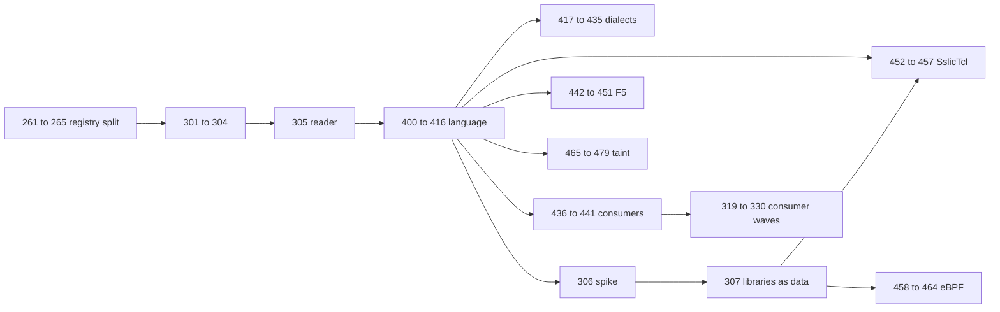

# 12. Plan crosswalk

The source designs proposed plan numbers that collide with each other and
with existing items: 331a–d, 332a–e, 333's 336–344, 334's 340–346, 335's
345–355, 350's 356–365, 360a–f, 361a–d, 365a–f, 370's 370–378, 380's
380–386 and 393's 393a–j and 393x1–x5. Only 301–330 and 390–392 were plan
items. This chapter allocates fresh, contiguous plan numbers from 400, in
dependency order, merges duplicate work, and records the crosswalk. The items
are in [the plan](../../../work/name-handling/plan.md) after item 392, and each
source doc carries a "Plan numbers" note.

## Allocation

| Block | Group | Runs after |
|---|---|---|
| 400–416 | the language: manifest and grammar, notices, hooks by ID, tier-gated spellings, the printer, the parity gate, the registry seam, image trust, identity and composition, dependencies, pack diagnostics, tests and proofs, content forms, load at scale | 305's reader (and item 251), the registry split (261–265) |
| 417–435 | dialects: grammar profiles, D5, kernels, the writer, engines, conformance, portability, semantic axes, Jim, dialect-aware hooks, f5-tcl severities and rows, per-dialect consumer and codegen rules, the catalogue gate | 301, 303, 304, 418 after 400 |
| 436–441 | consumers: the VM and runtime from facts; name and frame facts, rename, extract and inline, edge cases | 311, 313, 437 after 400 |
| 442–451 | F5: iRules forms, pack, profiles, connection fields, test framework, release facets; iApps, tmsh, the config graph, the config-mode simulator | 304, 330, 400, 118 |
| 452–457 | SslicTcl | 400; with 307's DSL step |
| 458–464 | eBPF | 307's DSL step, last |
| 465–479 | taint: static (465–474) and run-time (475–479) | 400, 391, 392, 313 |
| 480–494 | **reserved** for the compiler and analyser integration design (`compiler/compiler-analyser-spectcl-integration.md`, steps INT-a to INT-m, 13 so far), written in parallel and not yet committed; allocated when it lands | 400, 406 |



## Merges

| Proposed in two places | Became |
|---|---|
| 333's 336 (manifest, grammar completion) and 332c (reader coverage, grammar gaps) | 400 |
| 332b (tier-gated spellings) and 333's 340 gap 4 (native-contract rows from bundled images) | 403 |
| 333's 339 (`extend`, merge table) and 331d (`extend`, `ProviderRow`) | 409 |
| 333's 342 (`test`, `--prove`) and 335 work item 7 (`example` rows, `prove --consumer`) | 414 |
| 333's 338 `event`/`flow` and 360a | 442 |
| 333's 338 `channel-driver` and 391c | 391c (no new item) |
| 333's 338 `class` and 390a/391a | 391a (no new item) |
| 350's 359 `{*}` axis and character model, and 370's grammar profile | 417 |
| 334 work items 1 and 3 (`library_versions`, `implementation`) and 313 | 313 (no new item) |
| 335's `-appends N` and 390f's `-callback -appends` | 390f (no new item) |
| 390's `throws-prefix` and 392's `throws` | 392a (no new item) |

## Crosswalk

| Proposed ID | Design | Plan item | Title |
|---|---|---|---|
| 333's 336; 332c | [333](../model/333-spectcl-3-gap-analysis.md) | 400 | The vocabulary manifest and the closed SpecTcl 3 grammar |
| 333's 341 | [333](../model/333-spectcl-3-gap-analysis.md) | 401 | Reader notices with codes and spans, and the `.tclspec` editor |
| 332a | [332](../model/332-rust-spectcl-parity.md) | 402 | Native hooks by ID |
| 332b; 333's 340 (gap 4) | [332](../model/332-rust-spectcl-parity.md) | 403 | Tier-gated spellings |
| 332d | [332](../model/332-rust-spectcl-parity.md) | 404 | The printer over the model |
| 332e | [332](../model/332-rust-spectcl-parity.md) | 405 | The parity gate |
| 333's 344 | [333](../model/333-spectcl-3-gap-analysis.md) | 406 | The registry seam |
| 333's 340 | [333](../model/333-spectcl-3-gap-analysis.md) | 407 | Trust in images |
| 333's 339 (identity) | [333](../model/333-spectcl-3-gap-analysis.md) | 408 | Pack identity and file composition |
| 333's 339 (composition); 331d | [331](../model/331-library-dependencies.md) | 409 | `extend` and provider rows |
| 331a | [331](../model/331-library-dependencies.md) | 410 | Library dependencies |
| 331b | [331](../model/331-library-dependencies.md) | 411 | Dependency rows generated from `pkgIndex.tcl` guards, `ifneeded` chains and each source's top-level and `catch`-wrapped requires, with `--check`; it replaces `TcllibModule.core_floor` |
| 331c | [331](../model/331-library-dependencies.md) | 412 | Positioned dependency closures and diagnostics |
| 333's 337 | [333](../model/333-spectcl-3-gap-analysis.md) | 413 | Pack diagnostics |
| 333's 342; 335 work item 7 | [333](../model/333-spectcl-3-gap-analysis.md) | 414 | Tests in packs and the proof harness |
| 333's 338 (part) | [333](../model/333-spectcl-3-gap-analysis.md) | 415 | Library content forms |
| 333's 343 | [333](../model/333-spectcl-3-gap-analysis.md) | 416 | Load at scale |
| 370's 370; 350's 359 (character model, `{*}`) | [370](../model/370-dialect-grammars.md) | 417 | Grammar profiles in `tcl-dialect` |
| 370's 371 | [370](../model/370-dialect-grammars.md) | 418 | `grammar` blocks in reader3 |
| 370's 372 | [370](../model/370-dialect-grammars.md) | 419 | Pack dialects reach every parser (D5) |
| 370's 373 | [370](../model/370-dialect-grammars.md) | 420 | Kernels take their grammar |
| 370's 374 | [370](../model/370-dialect-grammars.md) | 421 | Lexer and segmentation |
| 370's 375 | [370](../model/370-dialect-grammars.md) | 422 | The writer takes the profile |
| 370's 376 | [370](../model/370-dialect-grammars.md) | 423 | Engines read the profile, and a compiled unit records its `GrammarProfileId`; an engine refuses a profile it cannot run instead of running it as Tcl 9 |
| 370's 377 | [370](../model/370-dialect-grammars.md) | 424 | The grammar conformance area (`grammar/<grammar>/<axis>/`) and `cargo xtask grammar-axes --check`, which fails on a value no real run discriminates |
| 370's 378 | [370](../model/370-dialect-grammars.md) | 425 | Portability diagnostics over any grammar axis across a target range |
| 350's 359 (semantic axes) | [350](../model/350-spectcl-across-dialects.md) | 426 | Dialect semantic axes |
| 350's 356 | [350](../model/350-spectcl-across-dialects.md) | 427 | Jim 0.84 full and minimal |
| 350's 357 | [350](../model/350-spectcl-across-dialects.md) | 428 | The Jim core surface generated from jimsh 0.84 probes, as inherited Tcl rows plus measured deltas (`-dialect {jim 0.84}` facets, `mode-default`) |
| 350's 358 | [350](../model/350-spectcl-across-dialects.md) | 429 | Jim extensions as tracks-host libraries with capability predicates, and the 31-name `Extension` |
| 350's 362 | [350](../model/350-spectcl-across-dialects.md) | 430 | Dialect-aware hooks |
| 350's 360 | [350](../model/350-spectcl-across-dialects.md) | 431 | f5-tcl load-time severities |
| 350's 361 | [350](../model/350-spectcl-across-dialects.md) | 432 | Versioned iRules command rows from evidence, starting with `proc` and `call`, for the BIG-IP releases in public support per K5902 only |
| 350's 363 | [350](../model/350-spectcl-across-dialects.md) | 433 | Consumer rules per dialect |
| 350's 364 | [350](../model/350-spectcl-across-dialects.md) | 434 | Codegen per dialect |
| 350's 365 | [350](../model/350-spectcl-across-dialects.md) | 435 | The catalogue refusal gate (an environment may not place a library with no row for its family), and the F5-bundled iApp packages as libraries with unknown versions (Q12) |
| 334 work items 2, 4, 5 and 6 | [334](../model/334-spectcl-codegen-vm-runtime.md) | 436 | The VM and runtime from facts |
| 335 work items 1–2 | [335](../model/335-spectcl-source-tools.md) | 437 | Name and frame facts in the registry and reader |
| 335 work item 3 | [335](../model/335-spectcl-source-tools.md) | 438 | Name and frame rows on the core and Tk surfaces |
| 335 work item 4 | [335](../model/335-spectcl-source-tools.md) | 439 | Rename on the word classifier; `prepareRename` returns `Abstain` with its reason |
| 335 work item 5 | [335](../model/335-spectcl-source-tools.md) | 440 | Extract and inline on `-scope caller` and `-frame`, then change signature (through `-appends`) and move to namespace |
| 335 work item 6 | [335](../model/335-spectcl-source-tools.md) | 441 | Formatter, minifier and optimiser edge cases, row by row from 335's table |
| 360a; 333's 338 (event, flow) | [360](../model/360-spectcl-f5-integration.md) | 442 | iRules forms in the reader and manifest |
| 360b | [360](../model/360-spectcl-f5-integration.md) | 443 | The iRules pack |
| 360c | [360](../model/360-spectcl-f5-integration.md) | 444 | Profile resolution through `schema-kind` in `tcl-bigip`, and `HostBinding` in the positioned context |
| 360d | [360](../model/360-spectcl-f5-integration.md) | 445 | Connection fields and form effects (`reads`/`writes connection`, `decision`, `ends`, `emits`), read by the flow walk, the diagram, `explain_flow` and MCP |
| 360e | [360](../model/360-spectcl-f5-integration.md) | 446 | The iRules test framework from facts |
| 360f | [360](../model/360-spectcl-f5-integration.md) | 447 | iRules release facets from the Q6 audit, one probe batch at a time, for K5902 lines only |
| 361a | [361](../model/361-spectcl-f5-iapps-tmsh.md) | 448 | iApps forms |
| 361b | [361](../model/361-spectcl-f5-iapps-tmsh.md) | 449 | The `tmsh-command` role, `ConfigEffect`, tmsh transactions, and the resolver contribution in `tcl-bigip` |
| 361c | [361](../model/361-spectcl-f5-iapps-tmsh.md) | 450 | The symbolic config graph, iApp-created `HostBinding`s, the missing-reference check and the cross-domain rename |
| 361d | [361](../model/361-spectcl-f5-iapps-tmsh.md) | 451 | The simulator's config mode |
| 365a | [365](../model/365-spectcl-sslictcl.md) | 452 | SslicTcl forms in the manifest |
| 365b | [365](../model/365-spectcl-sslictcl.md) | 453 | The generic declaration reader in `tcl-spectcl`, on `tcl-source` |
| 365c | [365](../model/365-spectcl-sslictcl.md) | 454 | `tcl-lib-sslictcl` |
| 365d | [365](../model/365-spectcl-sslictcl.md) | 455 | SslicTcl vocabulary 2 data, the Rust trust generator, and the compile step in `make update-source-data` and `check-source-data` |
| 365e | [365](../model/365-spectcl-sslictcl.md) | 456 | `tcl-sslictcl` builds `SslicModel` from `DeclDocument` and the images; documents migrate to vocabulary 2, and a lower header is `SSLIC1013` |
| 365f | [365](../model/365-spectcl-sslictcl.md) | 457 | SslicTcl consumers |
| 380 | [380](../model/380-spectcl-ebpf.md) | 458 | eBPF packs |
| 381 | [380](../model/380-spectcl-ebpf.md) | 459 | `compile ebpf` rows |
| 382 | [380](../model/380-spectcl-ebpf.md) | 460 | `EbpfFacts` and `KernelAbi` |
| 383 | [380](../model/380-spectcl-ebpf.md) | 461 | eBPF analysis |
| 384 | [380](../model/380-spectcl-ebpf.md) | 462 | eBPF `test` rows and the Tcl model as a runner, with privileged rows behind the ignore gate |
| 385 | [380](../model/380-spectcl-ebpf.md) | 463 | eBPF explorer views (`ebpf-ir`, `ebpf-asm`, `verifier`, `chain`) and CLI and MCP routing |
| 386 | [380](../model/380-spectcl-ebpf.md) | 464 | Drop `bpf-tcl-ir`'s `tcl-analysis` and `tcl-native-plan` edges; wire or delete the semantic bridge (open decision D19) |
| 393a | [393](../model/393-taint.md) | 465 | The taint colour table |
| 393b | [393](../model/393-taint.md) | 466 | Sink kinds |
| 393c | [393](../model/393-taint.md) | 467 | Origins and secrets |
| 393d | [393](../model/393-taint.md) | 468 | Taint spelling and parity |
| 393e | [393](../model/393-taint.md) | 469 | Taint validators |
| 393f | [393](../model/393-taint.md) | 470 | Gen/kill taint summaries and pack-declared transfers |
| 393g | [393](../model/393-taint.md) | 471 | Taint gates |
| 393h | [393](../model/393-taint.md) | 472 | The optimiser taint barrier |
| 393i | [393](../model/393-taint.md) | 473 | Package and F5 taint |
| 393j | [393](../model/393-taint.md) | 474 | Taint consumers |
| 393x1 | [393](../model/393-taint.md) | 475 | Run-time taint tag |
| 393x2 | [393](../model/393-taint.md) | 476 | Run-time taint sinks at dispatch |
| 393x3 | [393](../model/393-taint.md) | 477 | Run-time taint propagation |
| 393x4 | [393](../model/393-taint.md) | 478 | The taint warn-mode conformance lane |
| 393x5 | [393](../model/393-taint.md) | 479 | Taint oracles |
| 333's 336–344, 334's 340–346, 335's 345–355, 350's 356–365, 370's 370–378, 380's 380–386 as numbers | — | retired | the numbers are not plan items; the rows above map their work |

The model documents keep their own numbers (`331-library-dependencies.md`
is still "331"); only proposed plan numbers are retired. Items 301–330 and
390–392 are unchanged. Item 305's plan text stays, marked as superseded in
detail by this specification.

## Example: one plan row and its crosswalk entry

**Source:**

```text
413. **[designed]** (with 305's `check`; was 333's 337; [design](../../design/registry/model/333-spectcl-3-gap-analysis.md), [spec](../../design/registry/spectcl-3/05-checks-hooks-abi.md)) Pack diagnostics. …
   - Done when: 305's four example rules load with pack codes, a user setting changes one's severity, and the editor catalogues list pack codes at run time.
```

**In memory:**

```rust
// rust/xtask/src/plan_rows.rs parses each row into its Item (real fields)
Item { number: 413, status: "designed", text: "413. **[designed]** (with 305's `check`; …" }
// the crosswalk row, as this chapter's table states it
("333's 337", "333-spectcl-3-gap-analysis.md", 413, "Pack diagnostics")
```

`cargo xtask plan-rows` reads every row with the pattern `^(\d+)\.
\*\*\[([a-z ]+)\]\*\*` (`rust/xtask/src/plan_rows.rs`); the new items sit
outside the working order's migration stages, so it asks no conformance rows
of them yet. A plan row has no bytecode or Tcl result.

## Where they run in the working order

The plan's working order gains one bullet, beside the dialect and library
model's: the SpecTcl 3 items run after the registry crate split (261–265) and
items 301–305, with 400–416 landing with 305's reader and before 306–307's
per-surface moves; 417–435 follow 301, 303 and 304; 436–441 run in the
consumer waves of 319–330 beside 313; 442–451 follow 304 and 330's iRules
upgrade; 452–464 run with 307's last step; 465–479 follow 391 and 392; and
480–494 are reserved for the integration design's steps.
