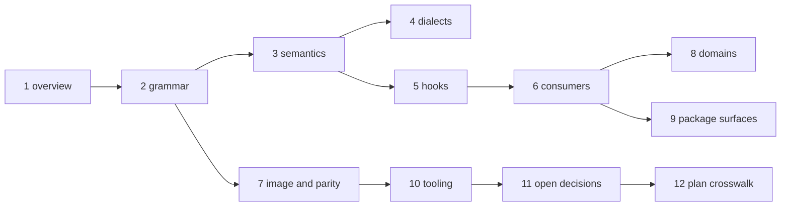

# SpecTcl 3: the consolidated specification

Status: consolidated specification, 26 November 2026. It supersedes in detail
the grammar, model and plan rows proposed across the SpecTcl 3 designs in
[`../model/`](../model/) (305 to 393), which stay as rationale and evidence.
Where they differ, this specification wins; chapter 1 lists every conflict it
settled.

SpecTcl 3 is a declarative pack language: read, never run. Packs compile to
binary images once per build, and the Rust registry and SpecTcl 3 describe one
model at parity, serving every consumer across C Tcl 8.4–9.1, Jim and f5-tcl.

| Chapter | Contents |
|---|---|
| [1. Overview and principles](01-overview.md) | read-not-run, the three kinds, the rungs, images, trust tiers, where packs come from, owner decisions, reconciliations |
| [2. Lexical rules and the grammar](02-grammar.md) | words without substitution, the `vsatisfies` range algebra, one closed EBNF for every form, taint forms, forms by vocabulary minor |
| [3. Semantics](03-semantics.md) | axes and windows, facets, precedence and the merge table, resolution, library dependencies, the positioned context, certainty |
| [4. Dialects and grammar profiles](04-dialects-and-grammars.md) | families, releases and builds, the grammar axes per family, semantic axes, trust, the negative controls |
| [5. Checks, hooks and the hook ABI](05-checks-hooks-abi.md) | the five rungs, `check`, the hook context and protocols, native IDs, one `hook_abi`, tbcx bodies, the 9.1 VM |
| [6. Consumers](06-consumers.md) | what each consumer reads and how it abstains, the optimiser's permissions and proofs, codegen's facts, the VM and runtime |
| [7. The image format and Rust parity](07-image-and-rust-parity.md) | the image, caching and trust, the model's Rust types and their names, the round-trip gate, the parity map, the ratchet |
| [8. Domains](08-domains.md) | F5 (iRules, iApps, tmsh, the config graph, the test framework), SslicTcl, eBPF |
| [9. Package surfaces](09-package-surfaces.md) | handles, error codes, results, embedded ranges, migrations, callbacks, the additive areas, taint (static and run time) |
| [10. Tooling and migration](10-tooling-and-migration.md) | shims, `tcl spec upgrade`, the printer, authoring and AI tooling, editor bundles, the `.tclspec` editor |
| [11. Open decisions](11-open-decisions.md) | the questions left to the owner, with each source's and this spec's recommendation |
| [12. Plan crosswalk](12-plan-crosswalk.md) | plan items 400–487 (480–487 from the integration design), merges, the review's renumbering, and the map from every proposed ID |

Every Tcl result and disassembly in these chapters is a real run on tclsh
8.4.20–9.1.0, jimsh 0.84 (`tmp/jimtcl-oracle/jimsh`), and the built
`./target/debug/tcl` and `./target/debug/tclvm`. A Rust block marked "design
sketch" shows proposed types; one marked "today" shows the code as it is.

## Review fixes (26 November 2026)

- **P7:** chapter 12 now covers items 400–487; the integration design's steps are 480–487.
