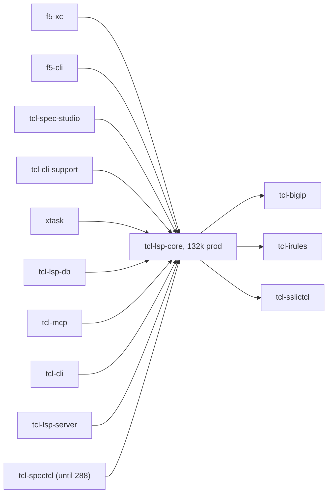
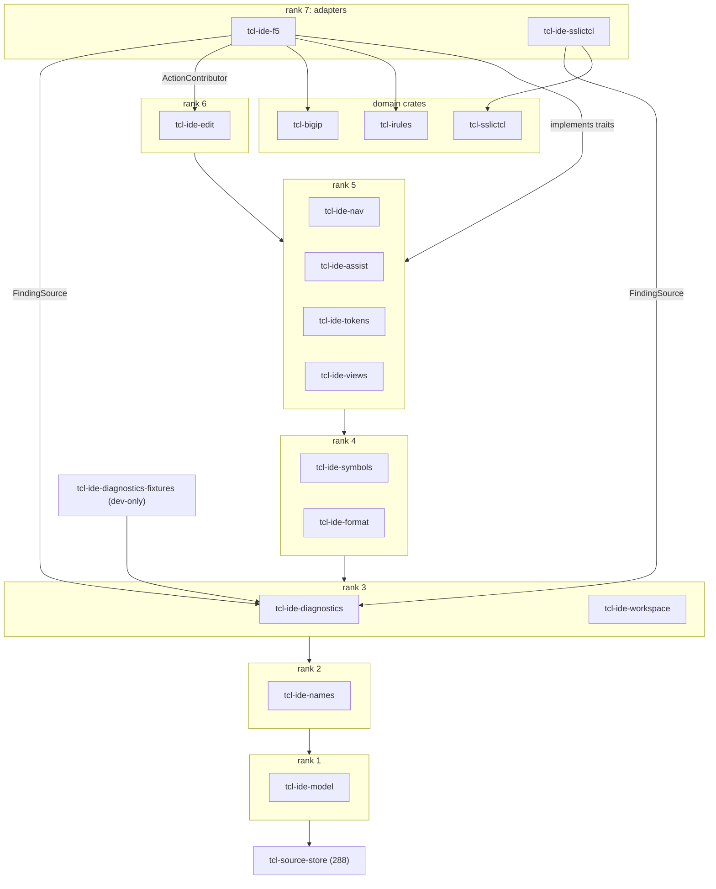
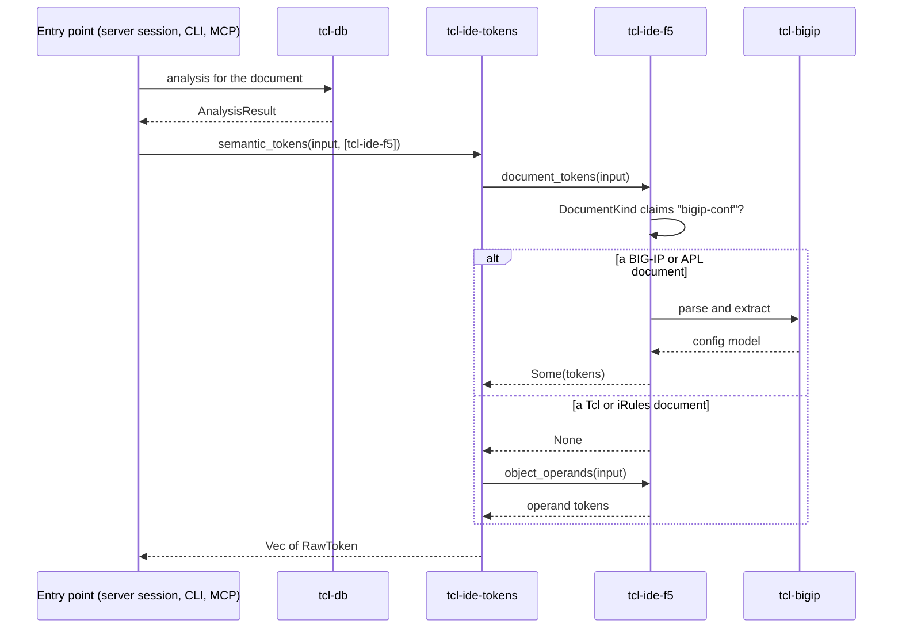

# 289: split tcl-lsp-core into feature crates

Status: designed 26 November 2026. Plan item 289, with item 270 (its tests'
dependencies). Builds on [288](288-spectcl-edge.md) (the source store and the
notice types leave first) and on item 90's step 5 (`tcl-model`). [290](290-lsp-server.md)
builds on it, and so do [293](293-mcp.md) and [295](295-hub-crates.md).

## Problem

`tcl-lsp-core` is 245k lines in `src`: 132k production and 113k in test files
and `#[cfg(test)]` modules, plus 33k in `tests/` (a brace-matching scan, 26
November 2026). It has 80 top-level modules, and 49 of them form one
strongly connected graph of `crate::` references (Tarjan over production
code). An edit to any feature rebuilds all of it and its 10 direct
dependents: `tcl-lsp-db`, `tcl-lsp-server`, `tcl-mcp`, `tcl-cli`,
`tcl-cli-support`, `f5-cli`, `f5-xc`, `tcl-spec-studio`, `xtask` and, until
288, `tcl-spectcl`.

Most consumers want a sliver (`rg tcl_lsp_core::`, production code):

| Consumer | Modules it names |
|---|---|
| `f5-xc` | `diagnostic_policy` (1 use) |
| `f5-cli` | `formatting`, `minify`, `file_uri`, `profile_for_dialect` |
| `bigip-query-wasm` | `formatting` |
| `tcl-spec-studio` | `formatting`, `procedure_symbol`, `optional_profile_for_dialect` |
| `tcl-cli-support` | `source_decode`, `SourceSyntaxStructure`, `context_for_dialect_profile` |
| `xtask` | `semantic_tokens`, `file_uri`, `source_style`, `source_decode`, profile helpers |
| `tcl-lsp-db` | `semantic_tokens`, `folding`, `document_symbols`, `workspace_index`, `source_graph`, `diagnostic_policy`, profile helpers (item 286 removes the edge) |
| `tcl-mcp` | 21 modules, led by `refactor` (20), `diagnostic_policy` (10), `formatting`, `graphs`, `document_symbols` |
| `tcl-lsp-server` | 40 modules |

It also links three domain crates in its normal dependencies:

| Domain crate | Where `tcl-lsp-core` names it |
|---|---|
| `tcl-bigip` (52k prod) | `bigip.rs` (parser, rule extraction), `semantic_tokens/config_documents.rs` (BIG-IP and APL tokens), `diagnostic_policy.rs:39,340` (`ConfigDiagnostic` → `Finding`), `code_actions.rs:653` (partition rename) |
| `tcl-irules` (3k prod) | `ilx_navigation.rs`, `irules_object_refs.rs` (a re-export), `semantic_tokens/irules_document.rs`, `semantic_tokens/original.rs:1117` (object operands) |
| `tcl-sslictcl` (8k prod) | `sslictcl_diagnostics.rs` |

So every consumer, whatever sliver it wants, builds all of `tcl-lsp-core` and
the three domain crates beneath it:



Its dev-dependencies cascade: `tcl-spectcl` (one test,
`completion/inherited_registry_roster_completion_tests.rs:43`,
`core_surfaces::ensure`) and `tcl-codegen` (one test,
`tests/it_5/issue_2507.rs:84,295`, `codegen::helpers::tcl_list_element`, a
re-export of `tcl_compiler::codegen_helpers`). Its two test features,
`truth-table` and `transport-fixtures`, are enabled by the dev-dependencies
of `tcl-cli`, `tcl-lsp-server` and `tcl-mcp`, so a worktree that builds and
tests the server compiles `tcl-lsp-core` and its dependents twice.

Seventeen modules run the analyser themselves (86 `Analyser::new` /
`.analyse(` sites in production code: `semantic_tokens`, `formatting`,
`minify`, `workspace_index`, `refactor`, `graphs`, `tk_preview` and ten more),
rather than taking an `AnalysisResult` from their caller.

## Design

### The groups

The groups come from the module graph. A rank is assigned to each group, and
the production `crate::` references from a lower or equal rank to a higher
one are counted. With the assignment below they total 86 references over 47
module pairs; the next section lists how each kind is cleared. Sizes are
production lines.

| Crate | Rank | Modules | Prod | Test |
|---|---|---|---|---|
| `tcl-source-store` (288) | — | `vfs`, `file_uri`, `source_decode`'s decoder | 2.5k | 1.5k |
| `tcl-ide-model` | 1 | positions (`LspRange`, `byte_offset_at`, `span_to_range`, `utf16_*` out of `definition`), `source_structure`, `original_context`, `original_invocation`, `executable_regions`, `expr_context`, `inert_text`, `document_floor`, `pattern_components`, `format_template`, `wire_session`; the plug-in traits | 5.5k | 3.1k |
| `tcl-ide-names` | 2 | `definition`'s resolution half (`CallResolution`, `resolve_*`, `lookup_var_*`), `original_declaration`, `original_indexed_location`, `original_name_edit`, `original_oo`, `oo_body`, `oo_dispatch`, `receiver_identity`, `registered_instance`, `caller_frame`, `method_symbol`, `variable_symbol`, `namespace_symbol`, `procedure_symbol`, `math_function_symbol`, `vendor_declaration`, `namespace_import`, `original_source_views`, `declaration_outline`; `refactor::FrameWalk` | 19.4k | 15.4k |
| `tcl-ide-diagnostics` | 3 | `diagnostic_policy`, `diagnostic_subject`, `diagnostic_report`, `check_payload`, `source_style` with the W107/W109 renderer | 6.1k | 4.7k |
| `tcl-ide-workspace` | 3 | `workspace_index`, `package_resolver`, `source_graph`, `config_ini`, `tcl_install`, `workspace_symbols` | 20.3k | 16.6k |
| `tcl-ide-symbols` | 4 | `document_symbols`, `folding`, `selection_range` | 3.2k | 3.5k |
| `tcl-ide-format` | 4 | `formatting`, `minify` | 10.9k | 7.3k |
| `tcl-ide-nav` | 5 | the goto half of `definition`, `declaration`, `implementation`, `type_definition`, `type_hierarchy`, `call_hierarchy`, `original_call_hierarchy`, `references`, `document_links`, `code_lens`, `linked_editing_range` | 13.6k | 14k |
| `tcl-ide-assist` | 5 | `completion`, `snippets`, `signature_help`, `hover`, `inlay_hints`, `irules_context` | 12.8k | 16k |
| `tcl-ide-tokens` | 5 | `semantic_tokens` less its two domain files | 8.5k | 8.5k |
| `tcl-ide-views` | 5 | `graphs`, `tk_preview` | 3.5k | 1.3k |
| `tcl-ide-edit` | 6 | `refactor` (less `FrameWalk`), `code_actions`, `rename`, `rename_safety`, `namespace_rename`, `original_command_rename`, `original_member_rename`, `file_ops` | 23.4k | 19.4k |
| `tcl-ide-f5` (adapter) | 7 | `bigip`, `ilx_navigation`, `irules_object_refs`, `semantic_tokens/config_documents.rs`, `semantic_tokens/irules_document.rs`, the `ConfigDiagnostic` conversion, the partition-rename action | 2.6k | 1k |
| `tcl-ide-sslictcl` (adapter) | 7 | `sslictcl_diagnostics` | 0.1k | 0.1k |

The ranks as a graph. An arrow means "may depend on": each group may name the
groups below it, never one beside it. The adapters are the only crates that
see both the traits and the domain crates; the fixtures crate sits above the
crate it serves.



The prefix is `tcl-ide-`, not `tcl-lsp-`: these crates are protocol-neutral
(no `ls-types` or `tower` dependency today), and the CLI, MCP and the spec
studio use them as much as the server does. `tcl-lsp-*` is kept for the
server stack in 290.

`lib.rs`'s profile helpers (`environment_for_dialect`, `profile_for_dialect`,
`registry_for_dialect`, `context_for_dialect_profile` and six more,
`lib.rs:167–338`) select surfaces by name. That is an entry point's job
(registry split rule), so they move to `tcl-catalogue` (item 264), as item
286 already expects. The ten feature-internal calls
(`crate::profile_for_dialect`) become a profile in the feature's input.

### Clearing the back-edges

| Kind | References | Fix |
|---|---|---|
| names → `hover` (`original_source_views`, `method_symbol`, `definition`) | 12 | the hover rendering they call (`hover::hover` for documentation regions) moves to `tcl-ide-names` as `source_documentation`; `tcl-ide-assist` keeps the request |
| names → `workspace_index`, `source_graph`, `package_resolver` | 14 | the index's data types (`WorkspaceIndex`, `MethodAccess`, `RunOrder`, `RunEdge`, `RunEdgeKind`) move to `tcl-ide-names`; the builders stay in `tcl-ide-workspace` |
| names → `references`, `call_hierarchy`, `type_hierarchy`, `code_lens` | 16 | `MAX_DISPATCH_SCAN_DEPTH`, `dispatch_source_context` and the three `original_declaration` lens helpers move down with their one caller |
| nav, model, names, tokens → `refactor` | 17 | `FrameWalk` (32 uses in all), `RefactorEdit` and `source_rewrite` move to `tcl-ide-names` |
| names, format, nav → the rename modules | 7 | `rename::TextEdit` moves to `tcl-ide-model`; `OriginalLinkedSourceSpelling` to `tcl-ide-names` |
| model and store → names and nav | 7 | `source_structure` and `expr_context` use position helpers, which move to `tcl-ide-model`; `executable_regions` → `oo_body` (1) moves down with its helper |
| tokens, assist → domain | 3 | become plug-in calls (below) |
| the rest | 10 | one or two references each (`minify` and `graphs` → `references`, `workspace_index` → `call_hierarchy`); each helper moves to the lower side |

Equal ranks do not name each other, so `tcl-ide-diagnostics` and
`tcl-ide-workspace` (rank 3) lose their two references to each other
(`diagnostic_policy` → `config_ini`): the config layer's policy section moves
into `tcl-ide-diagnostics`.

### What each crate depends on

Each crate names only the compiler crates its modules use today
(`tcl_compiler::X` references per group, mapped through CSD's table):

| Crate | Compiler crates |
|---|---|
| `tcl-ide-model` | `tcl-source`, `tcl-model`, `tcl-binding` (`original_invocation`'s registry words), `tcl-ir` |
| `tcl-ide-names` | `tcl-source`, `tcl-names`, `tcl-model`, `tcl-binding`, `tcl-ir` |
| `tcl-ide-diagnostics` | `tcl-model`, `tcl-diagnostics` (the code catalogue and `run_all_checks`' result types), `tcl-optimiser` (rewrite findings) |
| `tcl-ide-workspace` | `tcl-binding`, `tcl-model`, the unit crate (`auto_path_eval`, `compilation_unit`: 30 uses) |
| `tcl-ide-format` | `tcl-binding`, `tcl-model`, `tcl-lowering` (`minify`), `tcl-ir`, `tcl-analysis` (3), `tcl-optimiser` (1) |
| `tcl-ide-nav`, `tcl-ide-assist`, `tcl-ide-edit` | `tcl-binding`, `tcl-model`, `tcl-source`, `tcl-ir`, the unit crate; `tcl-lowering` for `assist` and `edit` |
| `tcl-ide-tokens`, `tcl-ide-symbols` | `tcl-binding`, `tcl-model`, `tcl-source`, `tcl-ir` |
| `tcl-ide-views` | `tcl-analysis`, `tcl-lowering`, `tcl-ir`, the unit crate |

No feature crate depends on `tcl-diagnostics` to run analyses. The 86
analyser calls become an `&AnalysisResult` (from `tcl-model`) in the input,
which the caller gets from `tcl-db` or runs itself. Seven compiler modules
the groups name are not in CSD's table (`lambda_literal` 20 uses,
`object_types`, `value_shapes`, `types`, `def_use`, `dataflow_graph`,
`taint_interproc`); item 247's ledger places them.

### Domain crates plug in

Each feature crate that takes a contribution defines its trait beside its
entry point, and takes the set as an argument. Sketches:

```rust
// tcl-ide-model
pub struct DocumentInput<'a> {
    pub text: &'a str,
    pub environment: &'a DocumentEnvironment,
    pub analysis: Option<&'a AnalysisResult>,
}
pub trait DocumentKind: Send + Sync {
    fn id(&self) -> &'static str;             // "bigip-conf", "apl", "sslictcl"
    fn claims(&self, input: &DocumentInput<'_>) -> bool;
}
// tcl-ide-tokens
pub trait TokenContributor: Send + Sync {
    fn document_tokens(&self, input: &DocumentInput<'_>) -> Option<Vec<RawToken>>;
    fn object_operands(&self, input: &DocumentInput<'_>) -> Vec<OperandToken>;
}
pub fn semantic_tokens(input: &DocumentInput<'_>, plugins: &[&dyn TokenContributor]) -> Vec<RawToken>;
// tcl-ide-diagnostics
pub trait FindingSource: Send + Sync {
    fn findings(&self, input: &DocumentInput<'_>) -> Vec<Finding>;
}
// tcl-ide-nav and tcl-ide-edit: NavigationContributor (ILX method calls),
// ActionContributor (BIG-IP stanza actions)
```

A semantic-token request then runs like this. The caller supplies the
analysis; the feature crate never runs the analyser, and it learns about
BIG-IP only through the contributor it is handed:



The call sites change with it. Today `semantic_tokens` has 14 public entry
points, one per combination of inputs the caller holds (`coarse` runs the
analyser itself), and its document paths call `tcl_bigip` and `tcl_irules`.
After, there is one entry point, and the input carries what the caller has.

**Before:**

```rust
let tokens = tcl_lsp_core::semantic_tokens::full_with_cu_and_analysis(
    source, profile, &registry, Some(&unit), Some(&analysis),
);
```

**After:**

```rust
// sketch; f5_tokens is tcl-ide-f5's TokenContributor, linked by the entry point
let input = DocumentInput { text: source, environment: &environment, analysis: Some(&analysis) };
let tokens = tcl_ide_tokens::semantic_tokens(&input, &[&f5_tokens]);
```

`tcl-ide-f5` implements them over `tcl-bigip` and `tcl-irules`;
`tcl-ide-sslictcl` over `tcl-sslictcl`. Entry points (the server session, the
CLI, MCP) link the adapters they want and pass them in. `f5-cli`, which needs
formatting but no LSP features, links `tcl-ide-format` and no adapter.

`diagnostic_policy`'s `Producer` enum keeps one variant per producer family,
but each producer owns its conversion into `Finding`, as `f5-xc` already does.
`ConfigDiagnostic`'s conversion moves into `tcl-ide-f5`.

### Tests and dev-dependencies

- **`tcl-codegen`** is dropped: `issue_2507.rs` calls the owner,
  `tcl_compiler::codegen_helpers::tcl_list_element` (to `tcl-native-plan` in
  step 11).
- **`tcl-spectcl`** is dropped: the roster test takes `tcl-dialect-jim`
  (item 264) as a dev-dependency; until that crate exists it moves to
  `tcl-lsp-it` (288).
- **The test features go.** `diagnostic_policy::truth_table` and
  `check_payload::family_fixtures` move to a dev-only crate,
  `tcl-ide-diagnostics-fixtures`, above `tcl-ide-diagnostics`. `tcl-cli`,
  `tcl-mcp` and the server's handler crates take it as a dev-dependency, and
  nothing compiles `tcl-ide-diagnostics` twice. In each of the three
  manifests:

**Before:**

```toml
[dev-dependencies]
tcl-lsp-core = { path = "../tcl-lsp-core", features = ["truth-table", "transport-fixtures"] }
```

**After:**

```toml
[dev-dependencies]
tcl-ide-diagnostics-fixtures = { path = "../tcl-ide-diagnostics-fixtures" }
```
- **`src` tests** move with their module.
- **`tests/`** (53 files, 33k lines): 10 files name one group and move to it;
  27 (22k lines) name several; the rest name only crate-root items or
  harness code. Each of those goes to the highest crate it
  names when that crate's normal cone holds the others, and otherwise to
  `tcl-lsp-it`. `tests/conformance` (`libtest-mimic`, `harness = false`)
  moves to `tcl-lsp-it`.

No crate's dev-dependencies then name a crate above it. `tcl-test-support`
(layer 2) stays a dev-dependency where the C Tcl oracle tests need it.

### Decisions

- **Groups by graph, not by LSP request.** `definition` is split, because 34
  modules use its position helpers (`LspRange` 129 uses, `byte_offset_at` 96)
  and 20 use its resolution (`CallResolution` 121). Keeping it whole would put
  every feature above navigation.
- **One names crate below the features.** Navigation, hover, completion,
  rename and tokens all resolve names. Today that layer is spread over 20
  modules; under item 84 it becomes the client of the one binding walk.
- **Adapters, not domain crates implementing the traits.** If `tcl-bigip`
  implemented `TokenContributor` itself, `f5-cli` and `bigip-report-gen`
  would build the feature crates. Adapters keep the domain crates below the
  features and the features free of the domain.
- **Inputs, not runs.** A feature crate never runs the analyser, so an
  analyser edit rebuilds `tcl-diagnostics` and the database, not the
  features (CSD's "an edit to the analyser" gain extends up the stack).

### Open questions

- **Is `tcl-ide-names` too large at 19k?** Settle with item 259's edit
  measurement: if a names edit and a hover edit rebuild the same set, split
  `definition`'s resolution from the symbol modules.
- **Do the fixture functions need private access?** If `truth_table` reads
  private policy state, it needs a narrow public constructor. Settle by
  moving it and listing what fails to compile.
- **Merge `tcl-ide-symbols` into `tcl-ide-model`?** It is 3.2k lines. Merge
  if its edits never isolate (item 259).
- **Where does the workspace index's cache live?** `workspace_index` holds
  memos. Item 90's last step decides between deletion and `tcl-db`.

## Work list

1. Seed a `module-layers` ledger for `tcl-lsp-core`
   (`docs/work/name-handling/ownership/lsp-core-module-layers.tsv`) with the
   table above; the gate reports the back-edges.
2. Move the domain code into `tcl-ide-f5` and `tcl-ide-sslictcl` behind the
   traits; drop `tcl-bigip`, `tcl-irules` and `tcl-sslictcl` from
   `tcl-lsp-core`'s dependencies.
3. Clear the back-edges in the table, in `tcl-lsp-core`, one kind per change.
4. Replace the 86 analyser calls with an `&AnalysisResult` input, module by
   module; the callers in the server and MCP run or fetch the analysis.
5. Move the profile helpers to `tcl-catalogue`; rewrite their callers.
6. Move the test features into `tcl-ide-diagnostics-fixtures`; drop
   `tcl-codegen` and `tcl-spectcl` from the dev-dependencies (item 270).
7. Extract the crates bottom up: `tcl-ide-model`, `tcl-ide-names`,
   `tcl-ide-diagnostics` and `tcl-ide-workspace`, `tcl-ide-symbols` and
   `tcl-ide-format`, the rank-5 crates, `tcl-ide-edit`. Each extraction
   rewrites its consumers; no `tcl-lsp-core` re-export stays. `tcl-lsp-core`
   is deleted after the last.
8. Update `deny.toml` and the rank ledger; regenerate the four WASM
   lockfiles.

## Verification

Done when `tcl-lsp-core` no longer exists, the rank gate passes with no
exception for these crates, and:

- `cargo tree -p tcl-ide-tokens -e normal` lists no `tcl-bigip`, `tcl-irules`
  or `tcl-sslictcl`, and no `tcl-ide-*` crate's tree does;
- no `tcl-ide-*` crate names `Analyser`;
- `cargo tree -p tcl-ide-X` (all edges) lists no crate above it for every X;
- the LSP end-to-end suite and the semantic-token goldens pass, and MCP and
  CLI JSON output is byte-identical on the golden corpus.

Record:

- each crate's cone (deduplicated); today `tcl-lsp-core` is 134 normal, 199
  with dev-dependencies;
- rebuild count for a `hover.rs` edit (today `tcl-lsp-core` plus 10 direct
  dependents; target `tcl-ide-assist` and its dependents only, which today's
  uses make the server's navigation crate and MCP, not the CLI, `f5-cli` or
  the spec studio), and for a `tcl-bigip` model edit (target: no `tcl-ide-*`
  crate but `tcl-ide-f5`);
- analysis latency on the corpus, release build: the inputs-not-runs change
  must not add an analysis per request.

## Risks

- **Analyses run twice.** Where a feature ran its own analysis it may have
  used different inputs from the server's. Making it an input can change
  results. Golden diffs catch it; each difference is a bug in one of the two.
- **Generic `pub(crate)` items become `pub`.** Every cross-group reference
  (thousands, not only the 86 back-edges) crosses a new boundary. Each crate exposes an `api` module (CSD principle 3).
- **Concurrent edits.** `hover.rs` and others are being edited now (the tree
  has uncommitted changes in `tcl-lsp-core/src/hover.rs`). Moves wait for
  that work to reach a clean point.
- **WASM.** `tcl-lsp-server-wasm` and `tcl-spec-studio-wasm` gain about 13
  path crates in their lockfiles; `tcl-explorer-wasm` loses `tcl-lsp-core`
  after 288 and gains none. `tcl-spec-studio-wasm` drops `tcl-bigip`,
  `tcl-irules` and `tcl-sslictcl`, since the studio needs only
  `tcl-ide-format` and `tcl-ide-names`.

## Corrections to the overview

- The task and plan describe `tcl-lsp-core` as "245k lines of production
  code". 245k is `wc -l` over `src` including tests; production is 132k.
- The tidy plan's dependency rule names `tcl-bigip`, `tcl-irules` and
  `tcl-sslictcl` as contributing "registry and profile data and hooks". In
  `tcl-lsp-core` they contribute document kinds, tokens, findings, navigation
  and actions; the registry data part belongs to items 118 and 264.
