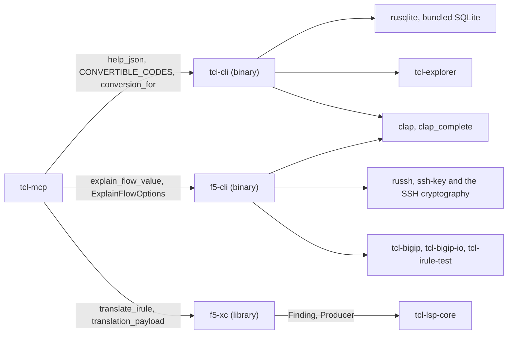
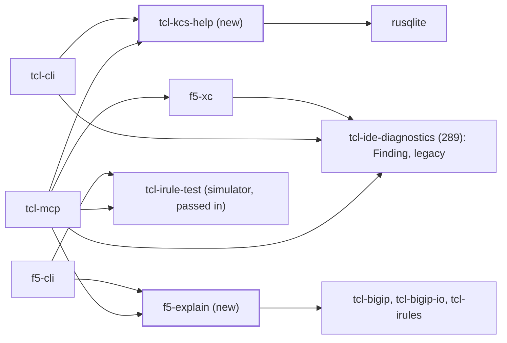

# 293: tcl-mcp off the CLIs

Status: designed 26 November 2026. Plan item 293. Builds on the
[workspace overview](overview.md) (rule 6: nothing depends on a binary).
Independent of 289 and 290, though `f5-xc`'s own fix uses 289's
`tcl-ide-diagnostics`. [295](295-hub-crates.md) builds on it.

## Problem

`tcl-mcp` (12k lines in `src`, 6.5k production) depends on two binary crates,
`tcl-cli` and `f5-cli`, for five items. Every repository MCP client starts
the server through `scripts/tcl-mcp`, which runs `cargo run --locked -p
tcl-mcp` (`.mcp.json`), so every worktree with an agent session builds
`tcl-mcp`, and an edit to either CLI rebuilds it.

What MCP names (`rg 'tcl_cli::|f5_cli::|f5_xc::' rust/tcl-mcp/src`, 26
November 2026):

| Item | Defined at | MCP use | What it needs |
|---|---|---|---|
| `tcl_cli::help_json` | `tcl-cli/src/commands/help.rs:133` | `tools.rs:431` (`help` tool) | the KCS help database: FTS5 tables built by `tcl-cli/build.rs` from `docs/kcs/features/*.md` and embedded with `include_bytes!` (`help.rs:45`); `rusqlite` with the bundled SQLite |
| `tcl_cli::CONVERTIBLE_CODES`, `conversion_for` | `tcl-cli/src/commands/misc.rs:44,50` | `tools/diagnostics.rs:246–257` (`find_legacy` tool) | nothing: a six-code table and its hints |
| `f5_cli::explain_flow_value`, `ExplainFlowOptions` | `f5-cli/src/commands/explain_flow.rs:1600,1624` (1,810 lines) | `bigip.rs:155,175` (`explain_flow` tool) | `tcl-bigip` (flow, model, policy evaluation), `tcl-bigip-io` (config loading), `tcl-irules`, `tcl-irule-test` (the simulate pass), `tcl-registry`, `f5-cli`'s `commands::explain` (580 lines) and `cli::PassphraseArgs` (clap) |
| `f5_xc::translate_irule`, `translation_payload`, `DEFAULT_LB_NAME`, `DEFAULT_NAMESPACE`, `OutputFormat` | `f5-xc/src/translator.rs:320`, `report.rs:31–105` | `xc.rs:26–35` | — |

`f5-xc` is a library, not a CLI (no `[[bin]]`), so MCP's edge to it is
allowed. Its own problem is `f5-xc` → `tcl-lsp-core` for `Finding` and
`Producer` (`f5-xc/src/diagnostics.rs:27`).

The cost, measured with `cargo tree -p tcl-mcp -e normal,build --prefix
none`, deduplicated:

- `tcl-mcp`'s cone is 341 crates, 43 of them workspace crates.
- Pruning `tcl-cli` and `f5-cli` leaves 270. The 71 crates reached only
  through them are the SSH stack and its cryptography (`russh`,
  `russh-sftp`, `ssh-key`, `ed25519-dalek`, `curve25519-dalek`, `ml-kem`,
  `argon2` and more), `clap` and `clap_complete`, the `rusqlite` family (7
  crates, including the bundled C SQLite build), and the workspace crates
  `tcl-explorer`, `tcl-irule-test`, `tcl-bigip-io`, `tcl-bigip-query` and
  `tcl-f5mku`.

Today's edges, with what each binary brings along:



## Design

Two new library crates at layer 9, and two moves into existing libraries.

### `tcl-kcs-help` (new)

The KCS help database and its queries.

| Moves in | From |
|---|---|
| the FTS5 build (`build_database`, `parse_feature`, `parse_applies_to`, `applies_to_category`, `normalise_tag`) | `tcl-cli/build.rs:159–335`, as this crate's `build.rs` |
| `load_db`, `list_features`, `search_help`, `Feature`, `help_json` | `tcl-cli/src/commands/help.rs` |

```rust
pub fn help_json(query: &str, dialect: &str, limit: usize) -> serde_json::Value;
pub fn search(query: &str, limit: usize) -> Result<Vec<Feature>, HelpError>;
pub fn sections() -> Result<Vec<(String, Vec<Feature>)>, HelpError>;
```

It depends on `rusqlite`, `serde_json` and `tcl-dialect` (`DialectProfile`
for dialect filtering). `tcl-cli`'s `help` verb keeps its text rendering and
calls `search` and `sections`. `tcl-cli/build.rs` keeps only `embed_gui`.

### `f5-explain` (new)

The explain and explain-flow reports as values, for `f5-cli`, MCP and the
LSP's BIG-IP commands.

| Moves in | From |
|---|---|
| `compute_explain`, `full_path_of`, `format_text`, `ExplainKind` and their helpers | `f5-cli/src/commands/explain.rs` |
| `explain_flow_value`, `ExplainFlowOptions`, the session pairing, virtual-server matching and simulate glue | `f5-cli/src/commands/explain_flow.rs` |

```rust
pub struct ExplainFlowOptions<'a> {
    pub paths: &'a [PathBuf],
    pub passphrase: &'a tcl_bigip_io::PassphraseOptions,  // was built from clap args
    pub tshark: bool,
    pub keylog: Option<&'a Path>,
    pub tshark_filter: Option<&'a str>,
    pub simulate: bool,
    pub no_event_bodies: bool,
    pub max_event_lines: usize,
}
pub fn explain_flow_value(pcap: &Path, options: &ExplainFlowOptions<'_>)
    -> Result<serde_json::Value, String>;
pub fn compute_explain(config: &BigipConfig, path: &str, kind: Option<ExplainKind>)
    -> ExplainReport;
```

`explain_flow_value` builds its passphrase options from
`crate::cli::PassphraseArgs::default()` today (`explain_flow.rs:1634` and `1687`), which
ties it to clap. The options become a parameter; `f5-cli` builds them from
its arguments, and MCP passes options that cannot prompt.

That default is also a bug in MCP today. `PassphraseArgs::default().to_options()`
(`f5-cli/src/cli.rs:77`) sets `allow_prompt: true` and wires
`tcl_cli_support::prompt::read_ucs_passphrase`, which calls
`rpassword::prompt_password`. So the `explain_flow` tool, given an encrypted
UCS and no passphrase variable, prompts on the MCP server process's
controlling terminal, if it has one, and blocks there. `PassphraseOptions::default()` is no answer either: it also sets
`allow_prompt: true`, with no prompt function. MCP sets `allow_prompt: false`
itself.

**Before:**

```rust
// f5-cli/src/commands/explain_flow.rs:1634, reached from tcl-mcp/src/bigip.rs:175
let opts = crate::cli::PassphraseArgs::default().to_options();
```

**After:**

```rust
// tcl-mcp/src/bigip.rs
let passphrase = tcl_bigip_io::PassphraseOptions {
    allow_prompt: false,
    ..Default::default()
};
let options = f5_explain::ExplainFlowOptions { paths: &paths, passphrase: &passphrase, /* … */ };
let result = f5_explain::explain_flow_value(Path::new(pcap_path), &options);
```

It depends on `tcl-bigip`, `tcl-bigip-io`, `tcl-irules`, `tcl-registry` and
`tcl-cli-support` (output targets), and not on `tcl-irule-test`: the simulate
pass is a parameter, `simulator: Option<&dyn RuleSimulator>`, and the iRules
facts are a `FactView` its caller passes (workspace rule 8). `f5-cli` and MCP
pass `tcl-irule-test`'s simulator and the facts from the `tcl-catalogue` they
install, so no library selects surfaces (rule 4) and an iRules fact edit
rebuilds neither `f5-explain` nor `tcl-irule-test`. `f5-cli` keeps the clap
definitions, the remote commands (`ureq`, `russh`) and printing.

### Moves into existing libraries

- **`CONVERTIBLE_CODES` and `conversion_for`** move to
  `tcl-ide-diagnostics` (289) as a `legacy` module, with the filter both
  callers repeat: the findings whose code is convertible, each with its hint.
  Both `tcl-cli`'s `find-legacy` verb and MCP's `find_legacy` tool call it.
  Until 289 lands, the module goes into `tcl-lsp-core`'s `diagnostic_policy`.
- **`f5-xc`'s `Finding` conversion** names `tcl_ide_diagnostics::Finding`
  after 289, so `f5-xc` depends on one small crate instead of `tcl-lsp-core`.

### Analysis without a session

MCP and the CLI run analyses one call at a time, with no server session.
They do not name `salsa` (workspace rule 7) and do not run the analyser
themselves. `tcl-db` offers them a batch constructor (coordinator decision
D-C):

```rust
// design sketch: tcl-db, session-free
pub struct BatchInputs<'a> {
    pub files: &'a [(DocumentPath, Arc<str>)],   // the documents and what they source
    pub surfaces: &'a SurfaceSet,                // what the entry point installs
    pub packs: &'a [UserPackSource],             // workspace and user packs, document stubs
    pub lockfile: Option<&'a Lockfile>,          // tclpkg.lock, for the packs' tiers
}
pub struct Batch { /* a private database, dropped with the value */ }
impl Batch {
    pub fn run(inputs: BatchInputs<'_>) -> Batch;
    pub fn generation(&self) -> &Generation;
    pub fn document(&self, path: &DocumentPath) -> Option<BatchDocument<'_>>;
}
pub struct BatchDocument<'b> {
    pub facts: &'b dyn DocumentFacts,          // tcl-model's record (tcl-semantic implements it)
    pub context: &'b ContextIntervals,         // the positioned context, 308
    pub entry: &'b FacetSelection,             // the file's entry selection
}
```

The caller builds 289's `DocumentInput` from a `BatchDocument`, exactly as
the server does from its session's analysis, so MCP, the CLI and the LSP
give one answer for one input. Dialect selection and configuration come from
the shared `tcl-session` crate (decision D-M, [290](290-lsp-server.md)), as
they do in the server.

This follows the extraction, after `tcl-semantic` and items 480 and 484. Until
then MCP keeps today's analyser calls, and the crate moves below do not wait
for it (owner priority, 26 November 2026).

### After

`tcl-mcp` depends on `tcl-kcs-help`, `f5-explain`, `f5-xc`, `tcl-irule-test`
(the simulator it passes in), `tcl-session`, `tcl-db` (the batch constructor
only) and the feature crates it uses, and on no binary. The rank gate's rule 6 enforces it. The two
binaries become callers of the same libraries:



| Edit | Rebuilds `tcl-mcp` today | After |
|---|---|---|
| a `tcl-cli` verb, its TUI or the explorer GUI assets | yes | no |
| an `f5-cli` verb, the SSH or HTTP client | yes | no |
| a KCS feature page | yes (through `tcl-cli/build.rs`) | yes (through `tcl-kcs-help`) |
| the explain-flow logic | yes | yes, and `f5-cli` |

### Decisions

- **Two crates, not one "tool-shared" crate.** The KCS database needs only
  SQLite; explain-flow needs the BIG-IP model and the iRule simulator. One
  crate would put the simulator into every `help` user's cone and SQLite into
  every BIG-IP user's.
- **`f5-explain`, not a module of `tcl-bigip`.** The flow report runs the
  simulator, which links the VM; `tcl-bigip` sits below the VM-using tools
  and is used by `tcl-lsp-core` and `bigip-report-gen`.
- **MCP keeps `simulate`.** The tool schema exposes it (`bigip.rs:163`), and
  MCP links the hook runner, and so the VM, anyway (decision D-I names MCP
  among the entry crates that link it). `f5-explain` takes the simulator as a
  parameter, so the library itself links no VM; MCP and `f5-cli` link
  `tcl-irule-test` and pass it in. This settles the open question this design
  had.
- **The legacy table goes with the diagnostics, not with the CLI.** It is a
  property of diagnostic codes, so it lives where the codes are projected.

### Open questions

- **Do other MCP tools duplicate CLI logic without naming it?** `irule_gen.rs`
  (1,151 lines) and `fakecmp.rs` are MCP-only today. Settle with `rg` for
  each MCP tool's CLI counterpart verb; a duplicate moves to the shared
  crate in the same way.

## Work list

1. Create `rust/tcl-kcs-help`; move the build-script half and `help.rs`'s
   database code; rewrite `tcl-cli`'s `help` verb and MCP's `help` tool.
2. Move the legacy table and filter into `diagnostic_policy` (then
   `tcl-ide-diagnostics`); rewrite both callers; delete
   `tcl-cli/src/lib.rs:45`'s re-export.
3. Create `rust/f5-explain`; move `explain.rs` and `explain_flow.rs`'s
   computation; make the passphrase options a parameter; rewrite `f5-cli`
   and MCP.
4. Drop `tcl-cli` and `f5-cli` from `tcl-mcp/Cargo.toml`; add the two
   crates.
5. After 289: re-point `f5-xc`'s `Finding` import.
6. Add the rank ledger rows; rule 6 then rejects any new edge to a binary.

## Verification

Done when:

- `cargo tree -p tcl-mcp -e normal` lists neither `tcl-cli` nor `f5-cli`,
  nor `russh`, `clap` or `tcl-explorer`;
- `cargo tree -p f5-explain -e normal` lists no `tcl-irule-test`, `tcl-vm` or
  `tcl-catalogue`;
- once the batch constructor exists, `rg 'salsa::|Analyser::new' rust/tcl-mcp/src`
  is empty;
- the MCP tool tests (`tools/*_tests.rs`, `bigip`, `xc`) and the CLI
  `help`, `find-legacy` and `f5 explain-flow` tests pass, with byte-identical
  JSON on their fixtures.

Record:

- `tcl-mcp`'s cone: today 341, projected about 289 (the 270 left after
  pruning both CLIs, plus `rusqlite`, `tcl-irule-test`, `tcl-bigip-io` and
  `tcl-f5mku`, measured as the union of their cones);
- the crates rebuilt by a `tcl-cli` edit for `cargo build -p tcl-mcp`
  (today `tcl-cli` and `tcl-mcp`; after, none);
- MCP's cold start time through `scripts/tcl-mcp` in a fresh worktree.

## Risks

- **Build scripts.** Moving the FTS5 build changes which crate reruns on a
  KCS edit, not whether one does. The `rerun-if-changed` lines move with it.
- **Secure prompts.** `PassphraseArgs`'s TTY prompt must stay out of the
  library, so MCP can never block on a terminal read. The options type makes
  "no prompt" the only thing MCP can pass.

## Corrections to the overview

- The plan item groups `f5-xc` with the CLIs. It is a library; MCP may
  depend on it. What is wrong is `f5-xc`'s own edge to `tcl-lsp-core`.
- The plan's five functions are seven items: `help_json`,
  `CONVERTIBLE_CODES`, `conversion_for`, `explain_flow_value`,
  `ExplainFlowOptions` from the CLIs, and `translate_irule` and
  `translation_payload` from `f5-xc` (with three constants and an enum).

## Review fixes (26 November 2026, deep review)

- **C1 (workspace side):** new section *Analysis without a session*: `tcl-db`'s
  session-free batch constructor (`Batch::run`) gives MCP and the CLI the same
  `DocumentFacts`, `ContextIntervals` and generation the server reads, with
  no salsa in their code (decision D-C). It follows the extraction and does
  not gate it (owner priority).
- **C7:** `f5-explain` takes the simulator and the iRules `FactView` from its
  caller, so `tcl-irule-test` selects no surfaces and `f5-explain` links no
  VM. The `simulate` open question is settled: MCP keeps it, since it links
  the hook runner and so the VM anyway (decision D-I).
- **W5:** MCP selects dialects and configuration through `tcl-session`.
