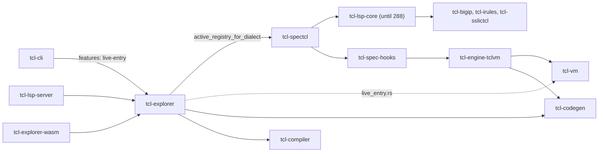
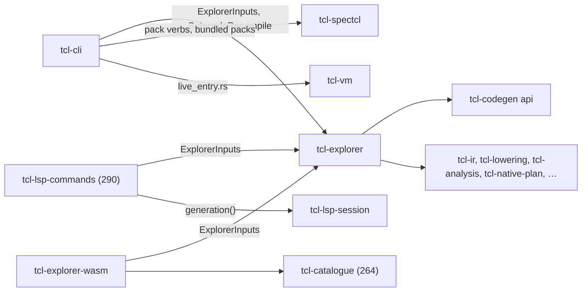

# 294: tcl-explorer's dependencies

Status: designed 26 November 2026. Plan item 294. Builds on the
[workspace overview](overview.md) (rule 8: callers choose the registry) and
on [288](288-spectcl-edge.md). Its registry change needs item 264
(`tcl-catalogue`); its compiler edges follow item 90's extractions.
[295](295-hub-crates.md) records its effect on `tcl-cli`.

## Problem

`tcl-explorer` (13k lines in `src`, 9.7k production) is the compiler explorer
behind `tcl explore`, the server's document views and the browser explorer
(`tcl-explorer-wasm`). Its normal dependencies are `tcl-lexer`, `tcl-syntax`,
`tcl-dialect`, `tcl-registry`, `tcl-compiler`, `tcl-codegen`, `tcl-spectcl`,
and `tcl-vm` behind the optional `live-entry` feature, which `tcl-cli`
enables (`tcl-cli/Cargo.toml`, `features = ["live-entry"]`).

What it uses (`rg`, 26 November 2026):

| Dependency | Where | What |
|---|---|---|
| `tcl-spectcl` | `lib.rs:62`, `serialise/irules.rs:30` (2 files) | `bundled::active_registry_for_dialect`: the registry with the bundled packs installed, chosen from a dialect string |
| `tcl-vm` | `live_entry.rs` (1 file, 104 lines, `live-entry` only) | `Vm`, `Vm::with_native_core`, `host_native::NativeHost`, `Code`: a live interpreter that recompiles each procedure through the real compile service, so the bytecode view matches what the VM runs |
| `tcl-codegen` | 5 production files: `asm.rs` (`codegen_module_with_command_mutations`, `format_function_asm`, `instruction_operand_text`, `FunctionAsm`, `Op`, `Operand`), `wasm_explorer.rs` and `serialise/wasm.rs` (`compile_wasm`, `WasmModule`, `WasmFunction`, `WasmOp`, `ValType`, `WasmCompileOptions`, `WasmCodegenPlan`, `WasmSemanticDecline`), `serialise.rs`, `live_entry.rs` (`ModuleAsm`, `compile_service::BytecodeCompileService`); and 2 test files | the bytecode and WASM emitters |
| `tcl-compiler` | 41 modules named, led by `ir` (21), `executable_ir` (20), `world_state_ssa` (12), `ssa` (11), `def_use` (9) | every pipeline stage, since that is what it shows |

The cost is mostly `tcl-spectcl`. It links `tcl-spec-hooks`,
`tcl-engine-tclvm` and `tcl-vm` (normal edges), and until 288 also
`tcl-lsp-core`, `tcl-bigip`, `tcl-irules` and `tcl-sslictcl`. So the browser
explorer ships the VM and the BIG-IP model for one registry lookup:

| `tcl-explorer-wasm` (wasm32, normal, deduplicated) | Crates | Workspace crates |
|---|---|---|
| today | 159 | 30 |
| `--prune tcl-lsp-core` (after 288) | 102 | 26 |
| `--prune tcl-spectcl` (after this item) | 82 | 17 |

The paths, today. The dotted edge is the optional `live-entry` dependency;
`tcl-cli` turns it on.



## Design

### The caller chooses the registry

The explorer already has the right function, privately:
`run_pipeline_with_inputs(source, dialect, &registry, profile, lexer_config,
analysis_input)` (`lib.rs:249`). `run_pipeline(source, dialect)`
(`lib.rs:215`) wraps it by calling `tcl_spectcl`, and
`run_pipeline_with_analysis_input` (`lib.rs:233`) by taking the registry from
the analysis input. The inputs form becomes the public entry point and the
dialect-string wrapper leaves the crate.

```rust
pub struct ExplorerInputs<'a> {
    pub dialect: &'a str,                  // the label ExplorerResult carries
    pub registry: &'a CommandRegistry,
    pub profile: &'static DialectProfile,
    pub lexer: LexerConfig,
    pub analysis: Option<&'a ResolvedAnalysisInput>,
}
pub fn run_pipeline(source: &str, inputs: &ExplorerInputs<'_>) -> ExplorerResult;
pub fn serialise_result(result: &ExplorerResult) -> Value;     // unchanged
```

Each caller builds the inputs from what it already has:

| Caller | Today | After |
|---|---|---|
| `tcl-cli` (`tcl explore`, 7 `run_pipeline` uses) | `run_pipeline(source, dialect)` | the CLI's registry, from `tcl-catalogue` and the bundled packs it already links through `tcl-spectcl` |
| `tcl-lsp-server` (`commands/document_views.rs:338–423`) | `run_pipeline_with_analysis_input` or `run_pipeline` | the session's facts for the document (`Session::generation` and the analysis's entry selection, [290](290-lsp-server.md)), so the view matches the document's diagnostics |
| `tcl-explorer-wasm` | `run_pipeline(source, dialect)` | the same installed set as the server: `tcl-catalogue`'s embedded images, the vendor packs included, as the BundledPack default (decision D-H); a `specs/` source in the browser mount overrides one only when its hash differs |

`serialise/irules.rs:164` gets its registry from `ExplorerResult` instead of
looking one up again.

Until item 480's `FactView` exists, `registry` is the `&CommandRegistry`
built from that set; the field becomes a `FactView` (workspace rule 8) after
the extraction, which does not wait for it.

`dialect` stays in the inputs because `ExplorerResult` keeps the label
(`lib.rs:294`) and the serialisers read it (`serialise.rs:298`). The browser
explorer's call, for example:

**Before:**

```rust
// tcl-explorer-wasm/src/lib.rs:82
let result = tcl_explorer::run_pipeline(source, dialect);
```

**After:**

```rust
// interim: the core registry; after item 264, tcl-catalogue's installed set,
// the embedded vendor images included (decision D-H), as the server uses
let environment = tcl_registry::model::resolve_environment(dialect);
let profile = environment.unit_profile();
let context = environment.default_context_registry();
let inputs = tcl_explorer::ExplorerInputs {
    dialect,
    registry: context.commands(),
    profile,
    lexer: tcl_lexer::LexerConfig::for_file_grammar(profile.grammar),
    analysis: None,
};
let result = tcl_explorer::run_pipeline(source, &inputs);
```

### The live interpreter leaves the crate

`live_entry.rs` moves to `tcl-cli`, its only user (`compile.rs:103`, and
`asm.rs:92` under the feature). The explorer's bytecode view takes an
optional hook:

```rust
pub trait BytecodeRecompile {
    fn recompile(&self, ir: &tcl_ir::Module, module: &mut ModuleAsm);
}
pub fn bytecode_view(result: &ExplorerResult, live: Option<&dyn BytecodeRecompile>) -> Value;
```

`tcl-cli` implements it over `tcl-vm`; the server and the browser pass
`None`, as their build does today. The `live-entry` feature is deleted, so
the explorer has one build, and `tcl-cli` no longer compiles a second
variant of it.

After both changes, each caller hands the explorer what it needs, and the
explorer reaches neither the loader nor the VM:



### Compiler and codegen edges

After item 90 the explorer names the split crates its views read, not the
unit crate's re-exports:

| View | Crates |
|---|---|
| IR, CFG | `tcl-ir`, `tcl-lowering` (`cfg_builder`, `cfg_layout`) |
| SSA family, def-use | `tcl-lowering` |
| SCCP, types, shimmer, taint, GVN, intervals | `tcl-analysis` |
| diagnostics, iRules checks | `tcl-diagnostics` |
| optimiser and semantic optimisation | `tcl-optimiser` |
| executable IR, native lowering, AOT plan | `tcl-native-plan` |
| the unit (`CompilationUnit`, `FunctionUnit`) | the unit crate |
| bytecode and WASM | `tcl-codegen`'s `api` module |

`tcl-codegen` exposes one `api` module with exactly the items listed in the
problem table, so codegen's internals can move without touching the
explorer. If `tcl-codegen` later splits into bytecode and WASM emitters
(item 292's design), the explorer takes both.

The explorer legitimately depends on most of the compiler: it is a view of
every stage. What it gains is not a small cone but freedom from the loader,
the VM and the domain crates.

### Decisions

- **Invert the registry, don't move it.** A library that picks its own
  registry from a dialect string ignores the caller's packs and
  configuration; the server's view could then disagree with its
  diagnostics. The `_with_inputs` form exists for that reason already.
- **Move the live interpreter to its only user** rather than keep an
  optional dependency. A feature that one consumer enables makes every
  worktree that builds both that consumer and another compile the crate
  twice (item 296).
- **Bundled packs in the browser: none.** `tcl-explorer-wasm` shows the
  compiler pipeline; EDA pack commands change resolution, not what the
  pipeline views show.

### Open questions

- **Does the browser explorer need the bundled packs?** If a user expects
  pack commands to resolve in the browser explorer, `tcl-explorer-wasm`
  takes `tcl-spectcl` itself (and the VM with it). Settle by comparing
  `serialise_result` for the explorer's sample corpus with and without packs;
  if no sample differs, the answer is no.
- **One `api` module in `tcl-codegen` or two?** Settled by item 292's
  design.

## Work list

1. Add `ExplorerInputs`; make `run_pipeline` take it; move the
   dialect-string wrapper into each caller; thread the registry into
   `serialise/irules.rs`.
2. Move `live_entry.rs` into `tcl-cli`; add `BytecodeRecompile`; delete the
   `live-entry` feature and the optional `tcl-vm` dependency.
3. Drop `tcl-spectcl` from `tcl-explorer/Cargo.toml`.
4. As item 90 extracts each crate, re-point the explorer's imports to it
   (part of each extraction's "rewrite its consumers").
5. Add `tcl-codegen`'s `api` module and import only from it (with item 283).
6. Regenerate `tcl-explorer-wasm/Cargo.lock` and `tcl-lsp-server-wasm`'s and
   `tcl-lsp-server-wasi`'s; build `make explorer-wasm`.

## Verification

Done when:

- `cargo tree -p tcl-explorer -e normal` lists no `tcl-spectcl`, `tcl-vm`,
  `tcl-spec-hooks`, `tcl-engine-tclvm`, `tcl-lsp-core` or `tcl-bigip`;
- `rg 'tcl_codegen::' rust/tcl-explorer/src` names only `tcl_codegen::api`;
- `tcl explore` output (text and JSON) is byte-identical on the explorer
  test corpus, with and without the live interpreter, and the server's
  document views match;
- `make explorer-wasm` builds and the browser explorer test passes.

Record:

- `tcl-explorer-wasm`'s cone (target 82 crates, 17 workspace crates) and its
  `.wasm` size before and after (release, `wasm-opt` as the Makefile runs
  it);
- `tcl-explorer`'s cone (today 148 deduplicated);
- the crates rebuilt by a `tcl-spectcl` edit for `cargo build -p
  tcl-explorer` (today `tcl-spectcl` and `tcl-explorer`; after, none).

## Risks

- **A different registry in the browser.** Today the browser explorer and
  the LSP diagnostics can disagree on an EDA file, because the explorer has
  no vendor packs. After decision D-H both read the catalogue's embedded
  images, so they agree; golden diffs of the browser views show the change.
- **A different registry in the server's view.** Switching the server's view
  from `active_registry_for_dialect` to the session's registry is a
  deliberate behaviour change: the view follows the document's packs and
  configuration. Golden diffs of `tcl-lsp.explore` responses show it.
- **The CLI's `tcl explore` defaults.** The CLI must build the same registry
  `active_registry_for_dialect` built (bundled packs installed) to keep its
  output unchanged.

## Corrections to the overview

- The plan and CSD say `tcl-vm` has "one use, `host_native`". It is four
  items in one file behind an optional feature.
- The plan says the bytecode view "uses one named `tcl-codegen` API". The
  WASM views use the WASM emitter as well (`compile_wasm` and its types, in
  three files).

## Review fixes (26 November 2026, deep review)

- **C2 (workspace side):** `tcl-explorer-wasm` uses the same installed set as
  the server, with the catalogue's embedded vendor images as the BundledPack
  default (decision D-H), not "no packs".
- **C1, O3 (workspace side):** the server passes its generation-backed facts
  (`Session::generation`), and `ExplorerInputs.registry` becomes a `FactView`
  after item 480, without gating the extraction.
