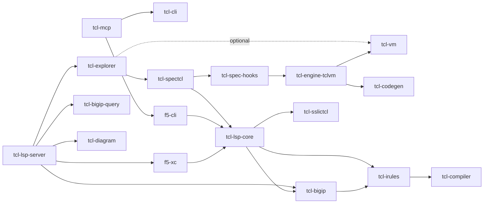
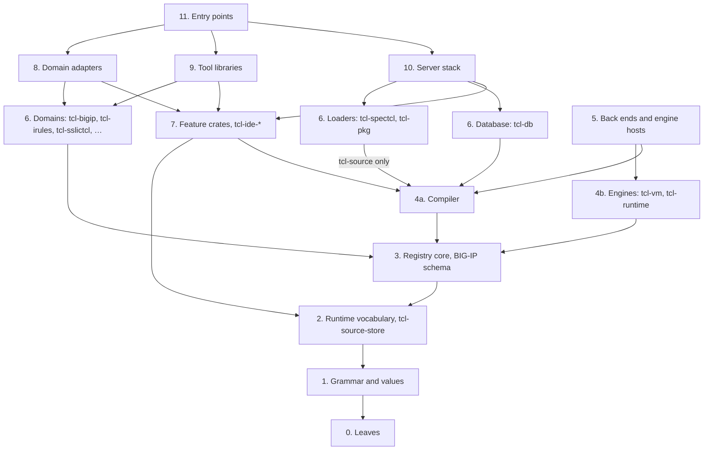
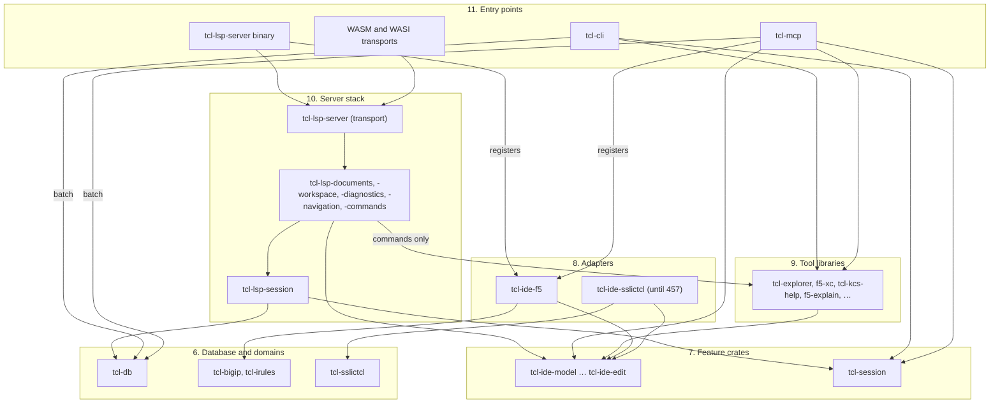

# The whole workspace: target layers

Status: designed 26 November 2026. The overview for plan items 288–295, "the
rest of the workspace" in [splitting tcl-compiler](../compiler/crate-split-design.md#the-rest-of-the-workspace)
(CSD). Builds on CSD (item 90) and the [registry split](../registry/registry-split-design.md)
(items 261–265). The step designs build on it:
[288](288-spectcl-edge.md), [289](289-lsp-core.md), [290](290-lsp-server.md),
[293](293-mcp.md), [294](294-explorer.md) and [295](295-hub-crates.md).
Items 291 (`tcl-vm`) and 292 (`tcl-codegen`) are placed here and get their own
designs when they start.

## Problem

CSD designs the compiler's layers, and the registry split designs the
registry's. Above them the workspace has no target. The edges that cost every
worktree a large build today (cargo metadata and `cargo tree`, 26 November
2026; normal dependencies unless marked):

| Edge | Why it is wrong |
|---|---|
| `tcl-spectcl` → `tcl-lsp-core` | a loader above a feature crate (item 288) |
| `tcl-spectcl` → `tcl-spec-hooks` → `tcl-engine-tclvm` → `tcl-vm`, `tcl-codegen` | the pack loader evaluates packs in the VM, so every crate that takes `tcl-spectcl` links the VM and the code generator |
| `tcl-lsp-core` → `tcl-bigip`, `tcl-irules`, `tcl-sslictcl` | domain crates linked into the feature core (289) |
| `tcl-bigip` → `tcl-irules` → `tcl-compiler` | the BIG-IP config model sits above the whole compiler for five iRules functions |
| `f5-cli`, `f5-xc`, `tcl-cli-support`, `tcl-spec-studio`, `xtask`, `bigip-query-wasm` → `tcl-lsp-core` | each needs one or two modules of a 132k-line crate |
| `tcl-mcp` → `tcl-cli`, `f5-cli` | a tool above two binaries (293) |
| `tcl-lsp-server` → `tcl-explorer`, `f5-xc`, `tcl-bigip`, `tcl-bigip-query`, `tcl-diagram` | domain commands linked into the one server crate (290) |
| `tcl-explorer` → `tcl-spectcl`, `tcl-vm` (optional) | the explorer chooses its own registry (294) |
| dev: `tcl-registry`, `tcl-compiler`, `tcl-lsp-core`, `tcl-lsp-db` → `tcl-spectcl`; `tcl-lsp-core`, `tcl-lsp-db`, `tcl-vm` → `tcl-codegen` | tests pull the upper stack (items 246, 269–272) |
| features: `tcl-lsp-core`'s `truth-table` and `transport-fixtures`, enabled by `tcl-lsp-server`'s and `tcl-mcp`'s dev-dependencies | a worktree that builds and tests the server compiles `tcl-lsp-core` and everything above it twice (item 296) |

The result is that the top crates' cones hold almost the whole workspace.
`tcl-mcp`'s normal cone is 43 of the 56 workspace members; see
[295](295-hub-crates.md) for each hub's numbers.

Drawn as a graph, the main edges of the table chain into each other: a crate
that takes `tcl-spectcl` also gets the feature core, the domain crates, the VM
and the code generator.



## Design

### Layers

Each crate has one layer. A crate depends only on crates of lower layers;
inside a layer, the gate's ledger (below) gives each crate a rank, and a crate
may depend only on lower ranks.
"New" marks a crate a step creates; the item that creates it is in brackets.

| Layer | Crates |
|---|---|
| 0. Leaves | `tcl-core-types`, `tcl-platform`, `tcl-version`, `tcl-userdirs`, `tcl-dialect`, `tcl-f5mku`, `tcl-sandbox` |
| 1. Grammar and values | `tcl-lexer`, `tcl-numeric`, `tcl-value-syntax`, `tcl-expr`, `tcl-syntax`, `tcl-pkg-model`, `tcl-source` (new, 251: CST and segmenter, over `tcl-lexer`, `tcl-syntax` and `tcl-dialect` only) |
| 2. Runtime vocabulary and kernels | `tcl-names` (new, 248; it enters this layer, below `tcl-runtime-api`, when item 274 moves the `*Ref` types, `IdentityInterner` and the issuers into it after Now 5, and sits in 4a until then), `tcl-runtime-api`, `tcl-cmd-core`, `tcl-regex`, `tcl-bytecode-tables` (new: literal and local tables, `ErrorRegion`, native literals), `tcl-bytecode` (`Op`, layout, encoder, tbcx), `tcl-engine-api`, `tcl-host-c-abi`, `tcl-host-native`, the native-model crate (new, item 117), `tcl-source-store` (new, 288); test-only: `tcl-test-support` |
| 3. Registry | `tcl-registry` (core), the BIG-IP schema crate (new, item 118). Beside it, used by entry points and tests only: `tcl-dialect-tcl`, `tcl-dialect-jim`, `tcl-dialect-f5`, the `tcl-lib-*` crates, `tcl-catalogue` (new, item 264) |
| 4a. Compiler | CSD's crates in CSD's order (`tcl-source` and, after 274, `tcl-names` sit lower): `tcl-values`, `tcl-model`, `tcl-ir`, `tcl-binding` (`tcl-invocation` stays inside it, item 282), `tcl-lowering`, `tcl-analysis`, the unit crate `tcl-unit` (step 13), then `tcl-semantic` (item 85, the one analysis query API), `tcl-native-plan` and `tcl-optimiser`, then `tcl-diagnostics` (rules over `tcl-semantic`) |
| 4b. Engines | `tcl-vm` (291), `tcl-runtime` (`runtime/rust`) |
| 5. Back ends and engine hosts | `tcl-codegen` (292, emitters), then `tcl-compile` (new, 292: the drivers, over `tcl-codegen`, `tcl-optimiser` and `tcl-unit`), `bpf-tcl-ir`, `bpf-tcl-codegen`, `bpf-tcl`, `tcl-engine-tclvm`, `tcl-engine-wasm`, `tcl-cshim`, `tcl-spec-hooks` |
| 6. Database, domains and loaders | `tcl-db` (today's `tcl-lsp-db`, item 286); `tcl-sslictcl`, `tcl-irules`, `bpf-tcl-rules` (new, 464: BPF diagnostics over `tcl-diagnostics`' rule traits), `tcl-bigip`, `tcl-bigip-io`, `tcl-bigip-query`, `tcl-diagram`; `tcl-spectcl`, `tcl-pkg` |
| 7. Feature crates (protocol-neutral) | `tcl-ide-model`, `tcl-ide-names`, `tcl-ide-diagnostics`, `tcl-ide-workspace`, `tcl-ide-symbols`, `tcl-ide-format`, `tcl-ide-nav`, `tcl-ide-assist`, `tcl-ide-tokens`, `tcl-ide-views`, `tcl-ide-edit` (all new, 289, from `tcl-lsp-core`) |
| 8. Domain adapters | `tcl-ide-f5`, `tcl-ide-sslictcl` (new, 289); dev-only: `tcl-ide-diagnostics-fixtures` (new, 289) |
| 9. Tool libraries | `f5-xc`, `tcl-spec-studio`, `tcl-explorer`, `tcl-cli-support`, `tcl-kcs-help` (new, 293), `f5-explain` (new, 293), `tcl-irule-test`, `tcl-debugger`, `tcl-fuzz`, `bigip-report-gen-rust` |
| 10. Server stack | `tcl-lsp-session`, `tcl-lsp-documents`, `tcl-lsp-diagnostics`, `tcl-lsp-navigation`, `tcl-lsp-workspace`, `tcl-lsp-commands` (all new, 290), `tcl-lsp-server` (transport) |
| 11. Entry points | binaries: `tcl-cli`, `f5-cli`, `tcl-mcp`, `tcl-vm-cli`, the `tcl-lsp-server` binary; `xtask`; test-only: `tcl-compiler-it` (item 266), `tcl-lsp-it` (new, 289), `tcl-vm-it` and `tcl-db-it` (new, 292; 292 calls the second `tcl-lsp-db-it`); outside the workspace: `tcl-lsp-server-wasm`, `tcl-lsp-server-wasi`, `tcl-explorer-wasm`, `tcl-spec-studio-wasm`, `tcl-vm-wasm`, `bigip-query-wasm`, `bigip-report-gen/wasm`, `bigip-report-gen/python`, `zed-query-check`, `editors/zed` |

`f5-xc` and `tcl-spec-studio` are tool libraries, not domain crates: after
289 and 293 they use feature crates (`tcl-ide-diagnostics`, `tcl-ide-format`,
`tcl-ide-names`), so they sit above layer 7.

Layers 4a and 4b are siblings: the engines do not depend on the compiler
(`tcl-vm`'s normal dependencies hold no compiler crate today), and the compiler
does not depend on an engine. Layer 6's three groups are siblings too.

The stack, with the main edges between layers once the steps land. What is
missing matters as much: no feature crate (7) reaches a domain crate, a loader
or the database (rules 5 and 7), and only the adapters (8) join features and
domains.



Above layer 6 sits the LSP stack: the transport over the handler crates, all
of them over the session, which alone holds the database. Entry points
register the adapters they link.



### Dependency rules

1. **Downward only.** A normal, build or dev dependency names a crate of a
   lower layer, or of a lower rank inside the layer. Sibling groups (4a and
   4b; the three groups of layer 6) do not name each other.
2. **Dev-dependencies obey rule 1.** A test that needs a higher crate moves
   to a test-only crate at layer 11 (`tcl-compiler-it`, `tcl-lsp-it`), or into
   the higher crate's own tests. Today's cases are a known list that may only
   shrink (items 246, 269–272).
3. **No test-only API features.** `test-support`, `truth-table` and
   `transport-fixtures` change a crate's API, so a worktree that builds and
   tests compiles the crate and its dependents twice (item 296). Fixtures move
   into dev-only crates that depend on the crate they serve
   (`tcl-ide-diagnostics-fixtures`, see [289](289-lsp-core.md)).
4. **Generic crates take the registry core only.** Only entry points and
   tests select surfaces (`tcl-catalogue`, or the dialect and library crates
   they need). Item 265's gate.
5. **Domain crates plug in.** `tcl-bigip`, `tcl-irules`, `tcl-sslictcl` and
   `f5-xc` never sit under a feature crate. Feature crates define traits in
   `tcl-ide-model`; the adapter crates of layer 8 implement them; entry points
   register the adapters they link.
6. **Nothing depends on a binary.** No crate depends on `tcl-cli`, `f5-cli`,
   `tcl-mcp` or `tcl-vm-cli`. Logic two tools share lives in a layer-9
   library. `tcl-lsp-server` has a library that the WASM transports use; only
   layer 11 depends on it.
7. **One database.** Only `tcl-db` and `tcl-lsp-session` name `salsa` (today
   21 `tcl-lsp-server` files do). Feature crates are pure functions over
   inputs and never name `tcl-db` or `tcl-diagnostics`: their analysis
   arrives in 289's `DocumentInput`, as a `&dyn DocumentFacts` from
   `tcl-model` (below). The CLI and MCP reach the database only through its
   session-free batch constructor, so they name no salsa either.
8. **Callers choose the facts.** A library takes a `FactView` (the
   generation plus a `FacetSelection`, item 480), and a `&ContextIntervals`
   when it answers per position, from its caller. It does not call a
   `registry_for_dialect(&str)` of its own (`tcl-explorer` and `tcl-mcp` today
   call `tcl_spectcl::bundled`'s), and it never selects surfaces itself:
   `tcl-irule-test`, a library with no `[[bin]]`, takes the iRules facts from
   the tool that calls it rather than linking `tcl-catalogue` (rule 4).
   Until a crate's extraction reaches item 480's view, a `&CommandRegistry`
   from the caller satisfies the rule.

### Analysis and facts reach the consumers

One interface serves the server, the CLI and MCP (coordinator decision D-C):

- **`tcl-model` defines `DocumentFacts`**, a binding-free record of what a
  document's analysis found (diagnostics, symbols, resolved invocations,
  findings). `AnalysisResult` projects into it. `tcl-semantic` (item 85),
  between `tcl-unit` and `tcl-diagnostics`, implements it as the single
  analysis query API, and the diagnostics become rules over it.
- **Feature crates take `DocumentInput`** ([289](289-lsp-core.md#domain-crates-plug-in)):
  the text, the environment, a `FactView`, the document's
  `&ContextIntervals` and the `&dyn DocumentFacts`. They depend on
  `tcl-model` and the registry core, never on `tcl-db` or `tcl-diagnostics`,
  so an analyser edit rebuilds no `tcl-ide-*` crate.
- **The server** gets all of it from `tcl-lsp-session`. Its `PackState` is
  the pack watcher that sets `tcl-db`'s `UserPack` inputs, and a
  generation-backed `FactView` replaces `registry_for -> Arc<CommandRegistry>`
  ([290](290-lsp-server.md#interfaces)). A document's `# tcl-lsp: stub`
  lines compile to a per-file `UserPack` input.
- **The CLI and MCP** run `tcl-db`'s batch constructor once, with no session
  and no salsa in their own code ([293](293-mcp.md#analysis-without-a-session)),
  and read the same records from it.
- **Dialect selection, the configuration stack and the rename tiers** live in
  the shared `tcl-session` crate (decision D-M; items 104, 109, 113 and 204),
  which all three surfaces use. `tcl-lsp-session` holds only LSP state.

None of this gates an extraction (owner priority, 26 November 2026). 289 and
290 move the code with today's inputs: the feature crates take the caller's
`&AnalysisResult` and `&CommandRegistry`, and the `tcl-ide-*` →
`tcl-diagnostics` edges are exception rows until `DocumentFacts` exists.
290 creates `tcl-session` from the server's `dialects` and `configuration`
modules, and the CLI and MCP adopt it once it exists. `DocumentInput`'s final
fields and the batch constructor follow `tcl-semantic` and items 480 and 484,
after Now 5. The Now 8 consumer waves then migrate once, onto that API
([319](../registry/model/319-consumer-migration.md#the-consumer-interface)).

### The gate

Today's `crate-layer` gate (`rust/xtask/src/semantic_ownership/layering.rs`)
protects four crates (`PROTECTED`, line 27) through `deny.toml`'s hand-written
`wrappers` lists (`deny.toml:119–135`). It reads `cargo metadata` for the root
workspace and `runtime/rust` only, so the excluded WASM crates are not
checked, and it treats every dependency kind alike.

It becomes a rank gate:

- A ledger, `docs/work/name-handling/ownership/crate-layers.tsv`, with one row
  per crate: `crate`, `layer`, `rank`, `role`. Roles are `vocabulary`
  (layers 0–1: no per-feature data), `generic`, `surface`, `domain`,
  `adapter`, `tool`, `entry`, `test`.
- The gate reads `cargo metadata --no-deps` for the root workspace,
  `runtime/rust`, and each excluded manifest. It fails on an edge that breaks
  rule 1, 2, 4, 5 or 6, on a crate without a row, and on a
  `[features]` entry used only from a dev-dependency (rule 3).
- `crate-layer-exceptions.tsv` lists today's violations with their item. A
  new one fails; a fixed one must be deleted from the list.
- `deny.toml`'s `[bans] deny` entries are generated from the ledger by
  `cargo xtask crate-layer --write`, and the gate checks they agree, so
  `cargo deny` and the gate never disagree.
- Rule 7 is a token check, like `walker-ownership`: `salsa::` outside the two
  crates fails.
- The ledger has a row for every crate the target names, not only those in
  the layer table above. The workspace steps add:
  - `tcl-session` (layer 7, rank 1, `generic`; created by 290);
  - `tcl-decl-reader`, the generic declaration reader (item 453), in layer 4a
    ranked directly above `tcl-source` and below every other compiler crate,
    over `tcl-source` and the registry core only, so `tcl-spectcl`,
    `tcl-sslictcl` and the feature crates all read it without a sibling edge;
  - `tcl-lsp-it` and `tcl-db-it` (layer 11, `test`; 292 calls the second
    `tcl-lsp-db-it`);
  - `tcl-ide-sslictcl` (layer 8, `adapter`) until item 457 deletes it.

  The registry and compiler steps add `tcl-spec-images`,
  `tcl-catalogue-core`, `tcl-lib-bpf`, `tcl-lib-linux-ebpf`,
  `tcl-lib-sslictcl`, `tcl-vm-it`, and `tcl-semantic` between `tcl-unit` and
  `tcl-diagnostics`.
- `tcl-spectcl` has one place: the loaders group of layer 6. It reads packs
  on `tcl-source` and the registry core and links no VM, because the hook
  runner (`tcl-spec-hooks`) is a separate dependency that named entry crates
  link (decision D-I). So the loaders group has no edge to layer 5. It sits
  above the core and beside the compiler, and no compiler crate names it.

For example, the ledger rows of layer 7, with [289](289-lsp-core.md)'s ranks:

```text
crate	layer	rank	role
tcl-ide-model	7	1	generic
tcl-ide-names	7	2	generic
tcl-ide-diagnostics	7	3	generic
tcl-ide-workspace	7	3	generic
tcl-ide-symbols	7	4	generic
tcl-ide-format	7	4	generic
tcl-ide-nav	7	5	generic
tcl-ide-assist	7	5	generic
tcl-ide-tokens	7	5	generic
tcl-ide-views	7	5	generic
tcl-ide-edit	7	6	generic
```

and how the gate judges four edges against them:

| Edge | Verdict |
|---|---|
| `tcl-ide-nav` → `tcl-ide-names` | passes: rank 5 over rank 2 |
| `tcl-ide-diagnostics` → `tcl-ide-workspace` | fails rule 1: equal ranks (today's `diagnostic_policy` → `config_ini`, which 289 clears) |
| `tcl-ide-tokens` → `tcl-bigip` | fails rule 5 whatever the ranks: the target's role is `domain` |
| `tcl-lsp-server` (dev) → `tcl-lsp-core` with `truth-table` | fails rule 3; listed in `crate-layer-exceptions.tsv` until 289 |

Inside a crate, item 247's `module-layers` gate keeps the modules in order. It
gets one ledger per split crate family: CSD's for `tcl-compiler`, and
[289](289-lsp-core.md)'s for `tcl-lsp-core`.

### The WASM builds

The excluded crates have their own `Cargo.lock`, and `check-host-lockfiles`
(`scripts/dev/check-host-lockfiles.sh`) resolves each with `--locked`. Every
path crate in a cone is a lockfile entry, so every step that adds, removes or
renames a crate in a WASM facade's cone regenerates that lockfile in the same
change. Today's cones (`cargo tree --target wasm32-unknown-unknown -e
normal,build`, deduplicated):

| Facade | Crates | Workspace crates | Notes |
|---|---|---|---|
| `tcl-lsp-server-wasm` | 213 | 36 | the whole server stack |
| `tcl-explorer-wasm` | 159 | 30 | `tcl-lsp-core`, `tcl-bigip`, `tcl-irules`, `tcl-sslictcl` and the VM, all through `tcl-spectcl` |
| `tcl-spec-studio-wasm` | 169 | 30 | the same, plus `tcl-lsp-core` directly through `tcl-spec-studio` |
| `tcl-vm-wasm` | 72 | 19 | the VM, `tcl-compiler` and `tcl-codegen` |

Each step design says what it does to these four.

## Work list

The steps run beside item 90, each when the crates it names exist (the
plan's working order):

1. **288** first. It needs nothing from item 90 and unblocks 270.
2. **289** after 288. Its extraction moves the modules with today's inputs
   (the caller's `&AnalysisResult` and `&CommandRegistry`) and waits for no
   new type: `DocumentFacts`, `FactView` and `ContextIntervals` reach
   `DocumentInput` later, without moving a crate again. The profile helpers
   move to `tcl-catalogue` once item 264 exists; until then they stay in
   `tcl-ide-model`. Its first part (domain adapters and the ledger) can start
   at once.
3. **290** after 289's `tcl-ide-model`, and after item 286 (`tcl-db`). It
   creates `tcl-session` from the server's dialect and configuration modules.
4. **293** and **294** at any time; 294's registry inversion needs item 264.
5. **295** is the acceptance record: it re-measures each hub when its crates
   build.
6. **291** and **292** follow items 117 and 256 (`tcl-native-plan`).
7. The rank gate lands with 288, seeded from the tree with every current
   violation in the exception list.

## Verification

Done when:

- the rank gate passes on the tree with an empty exception list;
- every WASM facade builds, and `check-host-lockfiles` passes;
- each hub's cone in [295](295-hub-crates.md) is at or below its target.

Measured per step, against item 259's baseline: crates compiled and wall time
for the four representative edits, plus an `tcl-ide-*` edit and a BIG-IP model
edit; peak RSS; release binary sizes of the four shipped binaries and the WASM
modules; and analysis latency on the analysis-performance corpus (release
builds).

## Risks

- **Crate count.** About 30 new crates. Each costs a manifest and a lockfile
  entry, and very small crates add link and metadata overhead. Merge two
  crates when item 259's measurement shows no edit isolates them.
- **Long-lived broken state.** The steps move code directly, as item 90's do.
  Failsets run when each crate first builds again.
- **Two layer ledgers.** `crate-layers.tsv` and the module ledgers can
  disagree about a module's destination. The crate ledger wins; the module
  ledger names only crates that exist in it.

## Corrections to the overview

- CSD's "Cone size" figures (`tcl-registry` 54, `tcl-compiler` 80,
  `tcl-lsp-core` 179) count `cargo tree --prefix none | sort -u` lines, which
  list a crate twice when it appears both expanded and as `(*)`. The
  deduplicated normal cones are 42, 64 and 134 crates (54, 83 and 185 by
  the undeduplicated count on today's tree; see
  [295](295-hub-crates.md#measurement)). Later steps should report both.
- CSD's table gives sizes as `wc -l` over `src`, test files included. The
  production sizes (test files and `#[cfg(test)]` modules excluded) are:
  `tcl-lsp-core` 132k of 245k, `tcl-lsp-server` 70k of 120k, `tcl-spectcl`
  30k of 43k, `tcl-mcp` 6.5k of 12k, `tcl-explorer` 9.7k of 13k.
- CSD names `tcl-vm`'s explorer use as `host_native`. It is `Vm`,
  `Vm::with_native_core`, `host_native::NativeHost` and `Code` in one file,
  `live_entry.rs`, behind the optional `live-entry` feature that `tcl-cli`
  enables ([294](294-explorer.md)).
- The `tcl-spectcl` → `tcl-spec-hooks` → `tcl-engine-tclvm` edge (the pack
  loader runs packs in the VM) is not in CSD's table, and it puts the VM and
  `tcl-codegen` into the server, the explorer, the spec studio and MCP. No
  plan item covers it; items 305–307 (SpecTcl 3, packs as images) may remove
  the need. Recorded here as an open question for the owner. Settled since:
  item 318 and decision D-I make the hook runner a dependency that only
  named entry crates link, so the loader links no VM.

## Review fixes (26 November 2026, deep review)

- **C1, O2, O3 (workspace side):** new section *Analysis and facts reach the
  consumers* (decision D-C). `DocumentInput` carries a `FactView`, the
  `ContextIntervals` and a `&dyn DocumentFacts`; `PackState` is the
  `UserPack` watcher; the CLI and MCP use `tcl-db`'s batch constructor.
  Rule 7 forbids `tcl-ide-*` → `tcl-diagnostics`, and rule 8 takes a
  `FactView`. The LSP-stack diagram gains the batch edges and `tcl-session`.
  None of it gates 289's or 290's extraction (owner priority).
- **C7:** rule 8 says `tcl-irule-test` takes its iRules facts from its caller.
- **O8:** `tcl-spectcl` has one place (layer 6, over `tcl-source` and the
  core, no layer-5 edge; the stack diagram's `L6load --> L5` is now
  `L6load --> L4a`). The declaration reader is its own crate,
  `tcl-decl-reader`, directly above `tcl-source`. `tcl-ide-sslictcl` is
  interim until item 457.
- **O15 (workspace side):** *The gate* lists the ledger rows the workspace
  steps add. The layer-table rows are handed to the table's owner.
- **W5:** `tcl-session` (D-M) holds dialect selection, the configuration stack
  and the rename tiers for all three surfaces; 290 creates it.
- The open question on `tcl-spectcl` → `tcl-spec-hooks` is marked settled.
