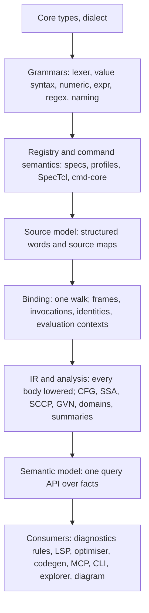

# Tidying the architecture: one pipeline, one set of facts

A rough plan. It ties together the [parser plan](parser-crate-plan.md), the [command](command-lookup-centralisation.md) and [variable](variable-lookup-centralisation.md) lookup plans, the [call frame](frame-design.md), [namespace](namespace-design.md), [expression](expression-design.md), [package](package-design.md), [rename and alias](rename-alias-design.md), [scripts and words](words-scripts-design.md) and [lists, dicts and arrays](lists-dicts-arrays-design.md) studies, the [TclOO and Tk root causes](oo-tk-root-causes.md), the [object systems plan](object-systems-plan.md) and the [structured procedure plan](structured-procedure-plan.md), and adds what none of them covers: analyses that re-walk source beside the compiler pipeline, the crate layout, caching, and the shared structures every consumer needs.

**The rule:** source is read once into a structured model; one binding walk turns it into frames, invocations and identities; every body is lowered; SSA, SCCP, GVN, value domains and interprocedural summaries produce facts; diagnostics, editor features, the optimiser, codegen and the tools *query those facts*. Nothing downstream re-walks source or re-derives a fact that has an owner. Where the pipeline cannot answer yet, the answer is an explicit "unknown", and the gap is fixed in the pipeline, not patched in a consumer.

## Where things stand

Evidence gathered on `0de6cc6d`–`e045b91f`; counts come from read-only censuses with the decisive lines spot-checked, and from the behavioural probes in [`oo-dispatch-probe/`](handover/oo-dispatch-probe/README.md).

- **Four walks of the same source.** The analyser walk (scope tree, string-typed classes and methods), the command-binding walk, the signature scan, and `tcl-lsp-core`'s `visit_analysis_executable_commands` (23 production consumers) each build their own picture.
- **About 42 name resolvers** (≈22 command, ≈20 variable; the later code inventories count about 60 command and 70 variable implementations, [validation](name-resolution-validation.md)) sharing only the low-level order and geometry; the frame for a body is chosen in 4 places for commands and 7 for variables.
- **Lists, dicts and arrays have one engine kernel but no shared static model** ([lists, dicts and arrays](lists-dicts-arrays-design.md)): the engines delegate to `tcl-cmd-core` (bar a missing `lremove` in the VM and a stale-representation bug in the runtime), while analysis evaluates in two tiers, reads indices with several grammars, keeps at least nine container representations with no dict key sets in use, and computes `dict with` binders three ways.
- **Reading Tcl text has owners; writing it does not** ([scripts and words](words-scripts-design.md)): segmentation, completeness, substitution and list reading now delegate to shared owners, but code that builds Tcl source uses fragmented or ad hoc writers (SslicTcl can emit unbalanced braces), several rules are copied without release policy (escape widths, `concat` trimming, character counts), analysis re-splits Tcl text on whitespace, and neither the parser census nor the drift gates can see writers.
- **Rename and alias tracking has five identity schemes and about five analysis models** ([rename and alias](rename-alias-design.md)); the engines are sound bar one alias-registration detail, navigation follows the common cases, and the editor rename is safe where it acts but refuses most programs that use `rename`, aliases, imports, callbacks or qualified calls, without a reason.
- **Packages have one Tcl-correct owner and three other version schemes** ([packages](package-design.md)): the engines are right (bar a silent VM exit loading `msgcat` and a runtime runner without the standard library), but analysis and tooling compare versions prerelease-blind or as semver, match package names byte for byte (the false W120 for `itcl`), cannot see Tcl modules, search in a different order from Tcl, and have no single bundled-package roster.
- **Expressions have one parser but several precedence tables** ([expressions](expression-design.md)); the parser's table is wrong for `in`/`ni`, giving wrong answers in both engines and a false I230 in the analyser on every release, while the renderer, hover and W154 use a second, correct table; floor division is written five times, math-function lists seven times, and most expression diagnostics and editor features re-parse source text.
- **Frames and namespaces have no shared model** ([call frames](frame-design.md), [namespaces](namespace-design.md)). The engines behave correctly except two VM bugs (`next`-chained methods get an extra level; `filter` in class scripts), but run two different frame models and two different namespace models behind traits that omit selection and namespace operations, with copied selection, ensemble and subcommand code. Analysis has about a dozen frame types, nine frame and six namespace choosers, three frame-effect models (behind false W210s for callee `uplevel 2`, alias-then-`upvar` and `catch` options variables), about seven implementations of import/export/forget, four namespace models mostly keyed by name (no `namespace delete` in the analyser), several level-word readers despite the shared one, and frame and namespace vectors (including a 172-row namespace-operation table) that drive no analysis consumer.
- **About 45 further semantic walkers**: 24 duplicate a fact that already has a pipeline owner, 21 are fallbacks for something the pipeline does not cover, and about 5 groups are legitimately separate (presentation: tokens, folding, formatting, symbols).
- **The IR keeps command words as flat text.** Nested `[…]` and `$x` are re-discovered by text scanners (`var_refs`, `word_subst`, `scan_nested_command_heads`, which takes no lexer configuration) used from 143 files, including SSA construction, SCCP, GVN and codegen.
- **Coverage gaps force fallbacks**, ranked by the walkers each would delete: nested substitutions (≈10), method bodies with no SSA and no recorded invocations (≈7), unentered and deferred bodies with no "potential execution region" owner (≈5), code after an unproven call (≈5), cross-file facts (≈3–4). Eleven more walkers need no new coverage: their owner exists and only the consumer must switch (frame effects, purity, dead stores, call edges).
- **Facts held twice disagree.** `upvar` level (parameter traits carry none; the frame-effect owner records it; interprocedural code assumes 1). Purity of a user procedure in a substitution (GVN asks only the registry; O109/O126 use the interprocedural summary; the inliner uses escape analysis). Nested call heads (byte scan versus lexer). Call-graph sites versus edges (different walkers; methods have edges without sites). iRules test paths (no SCCP pruning) versus iRules flow checks (pruned). Three dead-store implementations. And the measured ones: `next` answered three ways, hover's reference count versus find-references, W210 versus go to definition.
- **Crates.** `tcl-compiler` is one 904k-line crate holding the CST, three walks, binding, lowering, SSA, the optimiser, interprocedural analysis, taint, diagnostics and the signature scan. Dependencies point upward: `tcl-spectcl` (a spec loader) depends on `tcl-lsp-core` and `tcl-compiler`; `f5-xc` depends on `tcl-lsp-core`; `tcl-lsp-core` links `tcl-bigip`, `tcl-irules` and `tcl-sslictcl` directly; `tcl-mcp` depends on two CLIs.
- **Caching.** `tcl-lsp-db` is a salsa database meant to be "a single memoised query graph", but it wraps whole compiler and LSP functions; inside them about 40 hand-written memo types (mostly `Mutex<Option<…>>` with private staleness stamps, 52 files in `tcl-compiler`) are invisible to salsa's invalidation and memory accounting. The open memory-growth issue (#2543) lives in this gap.
- **No gate tracks any of this.** `owner-resolution` records owners but not competing walkers; `parser-ownership` covers grammars only; `segmentation-drift`, `resolution-drift`, `registry-axes` and `value-transfers` each police one axis.

## Target layers

| Layer | Owns | Does not |
| --- | --- | --- |
| Grammars (L1) | text grammars and their spans ([parser plan](parser-crate-plan.md)) | decide what a name means |
| Registry (L2) | command, option, value-grammar, effect, evaluation-context and object-system data; SpecTcl compiles into it | hold analysis state |
| Source model (L3) | the CST and **structured words**: each word a tree of literal, variable, command-substitution and expansion parts with spans, under the selected lexer configuration | interpret names |
| Binding (L4) | the single walk: frame values, per-invocation records for every reached command however nested, evaluation contexts applied from the registry, the command and variable lookup owners, instance values (objects, widgets, images, fonts) with creation and destruction effects, body-unit identities | run apart from value analysis: binding and SSA/SCCP are one bounded fixpoint per body unit over the shared value kernel ([design integration](design-integration.md)) |
| IR and analysis (L5) | lowering of every body kind as a unit with entry facts (procedures, methods, lambdas, caller-frame scripts, deferred callbacks, `namespace eval`, one-member definitions), lowering that continues past unproven calls with per-name unknowns, SSA and memory SSA, SCCP and value domains, GVN, one purity, one frame-effect, one call-graph and one escape summary | know about editors |
| Semantic model (L6) | a query API with one answer type per question, joining facts to source positions | walk source |
| Consumers (L7) | presentation, edits, rules | re-derive facts |

## Shared structures

| Structure | Replaces | Main consumers |
| --- | --- | --- |
| Annotated command (L4) | per-consumer registry role lookups by name; string-keyed pass tables ([analysis data structures](analysis-data-structures.md)) | every pass, diagnostics, the optimiser, codegen |
| Structured word (L3) | flat-text Call arguments and the text re-scanners | SSA construction, SCCP, GVN, taint, codegen inlining, diagnostics, tokens |
| Source map (L3) | per-feature offset arithmetic and UTF-16 conversions | every editor feature |
| Frame value (L4) | the partial frame types, the nine frame and six namespace choosers, string-keyed namespace tables ([call frames](frame-design.md), [namespaces](namespace-design.md)) | lookup owners, SSA entry facts, frame-effect summaries, LSP |
| Invocation record (L4) | top-level-only retained statements, `scan_nested_command_heads`, analyser `command_invocations` | every command check, references, call hierarchy, graphs |
| Lookup answers (L4) | ~42 resolvers' `bool`/`Option`/guess returns | W123, W002, E002, W210, definition, hover, references, rename, completion |
| Instance value (L4) | TclOO proof stores, class-name strings, Tk path sets, analyser candidate lists | W307, W308, W001, Tk checks, navigation, taint |
| Effect descriptors (L2) | hand-written variable-creating and frame-effect cases | binding, SSA, W210, interprocedural |
| Value grammars (L2) | free-text hints and one-off option scanners | option and value checks, code-in-data (lambdas in dictionaries) |
| Body-unit identity (L4–L5) | name-derived function contexts and `trivial_guarded` units | SSA, diagnostics, navigation, the optimiser |
| Typed class model (L4) | string `kind`/`visibility` and per-kind lists | method checks, hierarchy, rename |
| Summaries (L5) | GVN's registry-only purity, `var_escape` purity, parameter traits, three dead-store passes | GVN, LICM, O109/O126, inliner, W220, explorer |

Each answer carries provenance and an explicit unknown, so a consumer can abstain instead of guessing, and two consumers asking the same question cannot disagree.

## Crates

A proposal to measure, not a fixed layout. Split `tcl-compiler` along the layers where doing so removes a cycle or a duplicate, not for its own sake.

| Proposed crate | From | Notes |
| --- | --- | --- |
| `tcl-source` | CST, segmenter, structured words, source maps | depends on grammars only |
| `tcl-binding` | `command_binding`, frame and lookup owners, instance values | absorbs the analyser and signature-scan walks |
| `tcl-ir` | lowering, CFG, SSA, memory SSA | every body kind |
| `tcl-analysis` | SCCP, value domains, intervals, GVN, interprocedural, escape, taint engine | one summary per fact |
| `tcl-semantic` | the query API and fact store | the only analysis interface consumers see |
| `tcl-diagnostics` | rules over the semantic model | no walking |
| `tcl-optimiser` | passes and rewrites | reads the same facts |

Dependency rules, enforced by a gate: data and loaders sit below features (`tcl-spectcl` must not depend on `tcl-lsp-core`); domain crates (`tcl-bigip`, `tcl-irules`, `tcl-sslictcl`) contribute registry and profile data and hooks through interfaces rather than being linked into the LSP core; tools (`tcl-mcp`, `f5-xc`) depend on the semantic model and feature APIs, not on CLIs. Measure native and WASM build times and binary size before and after each split.

## Caching

One memoisation layer: salsa, at the granularity of the units above — source file, structured words, binding per file, body unit, summaries per unit, query results — so invalidation follows real dependencies and memory is accounted per ingredient. The hand-written memos are converted into salsa queries or deleted; a gate forbids new `Mutex`/`OnceLock` memo types outside the database. The existing incremental-versus-fresh comparisons become the acceptance test, alongside #2543's allocator trace.

The measured costs, the inventory of about 110 caches outside salsa and the step-by-step plan are in [caching](caching-design.md).

## Third-party building blocks

Anything that defines Tcl semantics stays in-house, because it must match the C Tcl and Jim oracles byte for byte: numbers, list and dictionary grammar, ARE regexp, glob, `format`/`scan`, `clock`, command and variable lookup rules. Third-party crates fit the machinery around them. Today the workspace depends on little (salsa, serde, `rustc-hash`, `indexmap`, `smallvec`, `num-bigint`, `regex`, `syn`, `tower-lsp-server`); the compiler already has its own red/green syntax tree (`parsing/syntax/green.rs`) and dominators (`ssa/dominators.rs`), and `deny.toml` bans nothing.

| Need | Candidates | Use |
| --- | --- | --- |
| Structured words and the source tree | `rowan`, `cstree`, `text-size` | Optional replacement for the home-grown green tree; evaluate during phase 2, adopt only if it removes code or speeds incremental reparse |
| Source maps and UTF-16 positions | `line-index` | Replace per-feature offset arithmetic |
| Typed identities | `slotmap` (generational keys), `la-arena`, `typed-index-collections` | Generations model a recreated namespace or command under the same name; arenas hold dense per-unit tables |
| Name interning | salsa interned structs; `lasso`, `smol_str`/`compact_str` | Prefer salsa so names live in the one cache layer; keep byte names (`NameBytes`) |
| Fine-grained world transitions | `imbl`, `rpds` | Persistent maps with structural sharing for per-point command, class and frame state (root cause 3) |
| Dataflow sets | `fixedbitset`, `bitvec`, `roaring` | Liveness, reaching definitions, W210/W211/W220 on SSA |
| Graph algorithms | `petgraph` | SCC order for interprocedural summaries, call-graph queries, cycle checks; keep tuned SSA dominators |
| Facts and rules | `ascent` (Datalog with lattices), `datafrog`, `crepe` | Trial for phase 6 on one analysis (call edges or taint), measured native and WASM |
| Caching and memory | salsa (finer granularity), `dhat` | One cache layer; heap profiling for #2543 |
| Per-analysis allocation | `bumpalo` | Optional arenas for transient fact tables |
| Crate layering gate | `cargo-deny` `[bans]` with `wrappers`; `cargo-modules`, `cargo-depgraph` | Name the crates allowed to depend on each layer; visualise the graph |
| Walker, memo and resolver ratchets | the existing `syn`-based xtask gates; `ast-grep` or `dylint` | Follow the `registry-axes`/`value-transfers` pattern |
| Agreement harness | `insta` or `expect-test`, `libtest-mimic` or `datatest-stable`, `proptest` | One reported test per vector row; generated graphs and scripts for differential tests |
| Dependency housekeeping | `cargo-machete`/`cargo-udeps`, `cargo-hakari` | During the crate split |

Order of adoption by payoff: `imbl` and `slotmap`; `cargo-deny` wrappers; `insta` with `libtest-mimic` for the harness; a time-boxed `ascent` trial; `rowan`/`cstree` only if the structured-words work shows the home-grown tree is the bottleneck. Each candidate is checked against the `deny.toml` licence allowlist and the native and WASM builds when it is added. All are MIT, Apache-2.0, Zlib or similar except `imbl` and `rpds`, which are MPL-2.0 (file-level copyleft, usable from a permissive project and already allowed by `deny.toml`).

### Generic code replacements

Found by searching for implementation signatures (hash constants, CRC tables, alphabets, escape writers) outside the Tcl-semantic owners.

| Code | What it is | Replacement | Condition |
| --- | --- | --- | --- |
| `tcl-bigip-io/src/openpgp.rs` | AES-CFB decryption | RustCrypto `aes` and `cfb-mode` | migrated in phase 1 with known-answer tests for all key widths and partial blocks |
| `tcl-bigip-io/src/openpgp.rs` | dependency-free OpenPGP symmetric decryptor with its own inflate | `pgp` (rPGP, MIT/Apache) with `flate2` | not `sequoia-openpgp` (LGPL) |
| `tcl-lexer/src/line_index.rs`, UTF-16 helpers in `tcl-lsp-core/src/definition.rs` | offset to line and UTF-16 column | `line-index` | becomes the source-map structure |
| `tcl-lsp-server/src/uri_norm.rs`, percent encoding in `tcl-lsp-core/src/document_links.rs` and `f5-cli` | URI normalisation and percent encoding | `fluent-uri` or `url`, `percent-encoding` | editor URI round-trip tests |
| ANSI escapes in `tcl-cli-support` (output, sink, highlight), `tcl-explorer/src/render.rs`, `tcl-pkg/src/ui.rs` | terminal colour | `anstyle`/`anstream` (already a transitive dependency of `clap`) | adds Windows and `NO_COLOR` handling |
| `tcl-registry/src/snapshot.rs` | hand-written JSON escaping | `serde_json` | byte-identical snapshot output |
| `tcl-cmd-core/src/base32.rs` | RFC 4648 base32 as tcllib reads it | `data-encoding` | tcllib oracle: padding and error cases |
| `tcl::idna` punycode (`tcl-registry/src/commands/tcl/tcl_idna.rs`) | RFC 3492 punycode | `idna`'s punycode module | Tcl 9.0/9.1 oracle |
| CRC-32 and Adler-32 in `runtime/rust/src/cmd_zlib.rs` | checksums (DEFLATE uses `flate2`) | `crc32fast`, `adler2` | migrated in phase 1 and checked against Tcl initial-value and empty-input cases |
| `tcl-compiler/src/text.rs` | text similarity for suggestions | `strsim` | migrated in phase 1 with agreement on transpositions and Unicode |
| `tcl-userdirs` | per-user directory conventions | `etcetera` or `dirs` | only if their conventions match ours |
| DOT writers (`tcl-bigip/src/graph.rs` and other graph output) | Graphviz text | `petgraph::dot` once `petgraph` is adopted | diagram goldens |

Kept on purpose: `tcl-cli-support/src/difflib.rs` (byte-for-byte Python `difflib` output), `tcl-fuzz`'s reproducible xorshift generator, `uri_split.rs` (an iRules diagnostic, not a parser), and every Tcl-semantic owner (numbers, lists, dictionaries, ARE regexp, glob, `format`/`scan`, `clock`, `encoding` tables, Unicode case and class data, which follow each release's own tables).

## Licence change

Relicensing from AGPL-3.0-or-later to a permissive licence is under consideration. The common Rust choice is `MIT OR Apache-2.0` (Apache adds a patent grant); the Tcl licence (SPDX `TCL`) matches upstream Tcl and is equally permissive, with a US-government clause. Inbound code is compatible either way: the C Tcl ports (Tcl licence), Jim (BSD-2-Clause) and tcllib-derived code are permissive. Relicensing the project's own code needs every copyright holder's agreement, so check the history for outside contributions first.

Decide before phase 1, because it settles which licences new dependencies may carry. The change itself touches:

- `LICENSE` and the `license` field of every crate's `Cargo.toml`.
- The AGPL header on every source file, `scripts/dev/check-license-headers.py` and its exemptions, `rust/xtask/src/util.rs`'s generated-file banner, and the AGENTS.md rule requiring the header.
- `deny.toml`: drop `AGPL-3.0-or-later` from the allowlist; keep `GPL-3.0-or-later` only while the Zed extension is distributed separately under GPLv3.
- Editor marketplace manifests (VS Code, JetBrains, Zed) and any packaging metadata that states the licence.
- Dependency choices: prefer MIT, Apache-2.0, BSD, ISC or Zlib; MPL-2.0 (`imbl`, `rpds`) remains usable; avoid LGPL and GPL crates in shipped binaries.

## Foundations

The [cross-cutting review](cross-cutting-review.md) reorders this plan: phase 0 builds the probe harness and conformance matrix, the answer and outcome types and the identity layer, and fixes the correctness backlog; release facts, registry descriptors and abstract-value kernels follow before the pipeline phases. The phases below keep their content but assume those foundations.

## Phases

Each phase ends with its walkers deleted, its gates tightened and the agreement tests green; nothing is left half-migrated across a phase boundary.

0. **Inventory, gates and the licence decision.** Settle the licence (see above) so dependency choices follow it. Turn the censuses into a walker manifest beside the owner manifest (fact, owner, competing walkers, disposition), and add a `walker-ownership` ratchet modelled on `registry-axes`/`value-transfers`: the known set may only shrink; a waiver names its fact and owner. Add the agreement harness: one fixture table, every consumer asked the same question, compared with each other and with tclsh. Add the crate-dependency and memo gates.
1. **Switch to owners that already exist** (about 11 walkers), fix the `in`/`ni` precedence wrong answer in the shared expression parser, and fix the two VM frame bugs with their fixtures added to both engines' suites: frame effects (parameter traits, interprocedural `upvar`, LSP caller-frame), purity (GVN, `source_purity`, `var_escape`), dead stores (one implementation for O109, W220 and the explorer), call edges (taint, tail calls, call hierarchy, graphs). Fixes the `upvar`-level and purity disagreements.
2. **Structured words.** Lower command words as structured parts; migrate the 143 users of the text scanners; delete about 10 walkers. The largest single change; do it before anything else that touches SSA construction.
3. **Frames, namespaces and lookup.** One frame value with its namespace identity, one level reader, frame and namespace operations in the engine traits, one frame-effect model, one analysis model of namespace operations, and the frame and namespace vectors driven through every consumer. Frame specifics, including two VM bugs and the engines' copied selection code, are in [call frames](frame-design.md); namespace specifics, including four analysis namespace models and an unused 172-row vector table, are in [namespaces](namespace-design.md). The frame value, registry-declared evaluation contexts, the command and variable lookup owners and their conformance vectors through every consumer ([command plan](command-lookup-centralisation.md), [variable plan](variable-lookup-centralisation.md)); the frame splits into a per-activation `Frame` and a per-point `NameWorld`, the analyser walk and signature scan stop resolving here (not in phase 5), and the reverse index and cross-file exports are built with the owners ([validation](name-resolution-validation.md), plan items 66–73).
4. **Every body is a unit.** Methods, one-member definitions, `initialise`, `itcl::body`, deferred callbacks, caller-frame scripts and `namespace eval` bodies lowered with entry facts; lowering continues past unproven calls. Deletes the method, unentered-body and unseen-call fallbacks (about 17), including W156's own.
5. **One binding walk.** Fold the analyser walk, the signature scan and `visit_analysis_executable_commands` into binding; typed class model; instance values with creation and destruction effects ([root causes](oo-tk-root-causes.md) 2, 3, 5).
6. **The semantic model.** One query API; diagnostics become rules over it; LSP features, MCP, the diagram and the explorer move onto it; the agreement harness covers every feature.
7. **Crates and caching.** Split along the layers, enforce the dependency rules, move all memoisation into salsa.
8. **Object-system profiles and value grammars** ([object systems plan](object-systems-plan.md)): itcl, snit, Jim, Clay, NX, stooop, critcl and Tk megawidgets as data; code-in-data such as override dictionaries.

Alongside phase 1, replace the hand-rolled generic code above, the AES and OpenPGP code first, each behind its condition. Phases 1 and 2 can start at once and in parallel; 3 and 4 depend on 2; 5 and 6 on 3 and 4; 7 can begin with the leaf crates (`tcl-source`) as soon as 2 lands.

## Measuring progress

- Walker manifest count, by category, per phase.
- Agreement harness: rows where consumers disagree with each other or with tclsh, per release.
- The existing compiler, LSP and VM baselines (no new failures; fixed tests listed), the C Tcl 8.4–9.1 and Jim oracle matrix, and `make xtask-gates`.
- Analysis time and memory on the analysis-performance corpus, native and WASM build times and binary sizes.

## Risks

- **Scale.** This touches most of the compiler. Keep each phase deliverable on its own, behind the agreement harness, and never leave two owners live for one fact at a phase boundary.
- **Precision loss while migrating.** A consumer moved onto a pipeline fact that the pipeline cannot yet supply must abstain (unknown), not fall back to a private guess; track abstentions as a measured cost, separately from wrong answers.
- **Performance.** Structured words and more body units add work; salsa granularity must pay for itself. Measure before and after each phase.
- **Coordination.** Area owners and existing rulings in [current-state.md](current-state.md) and the handovers stay authoritative; this plan orders the work and does not re-open decided questions.
