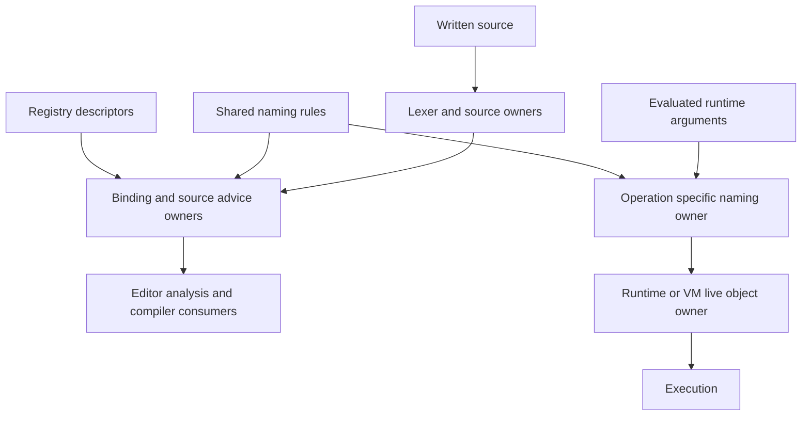
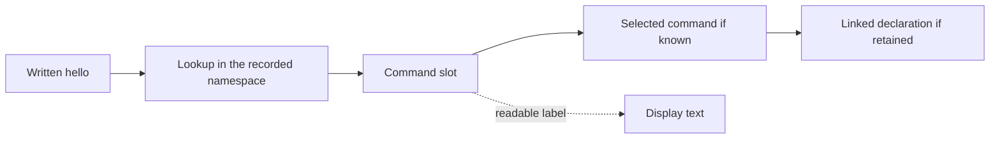
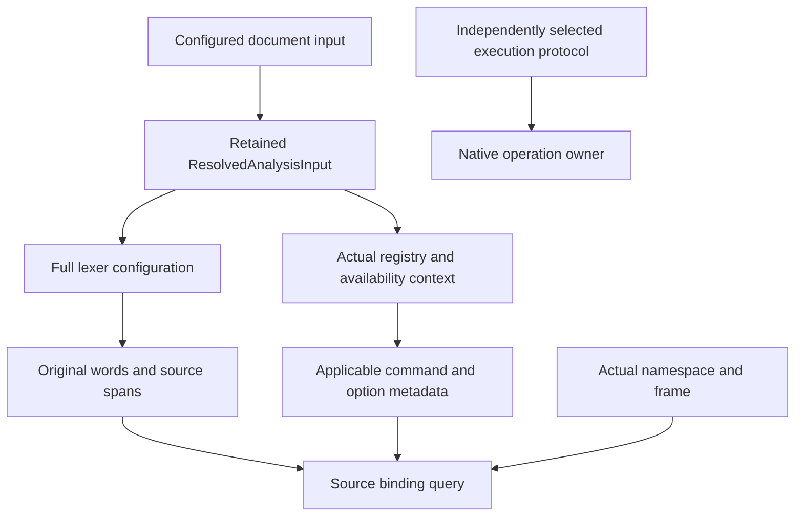
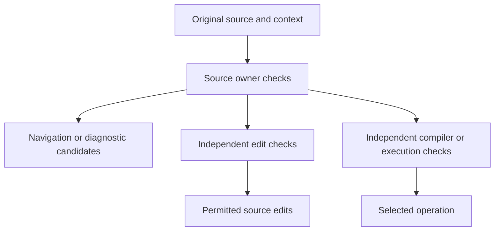
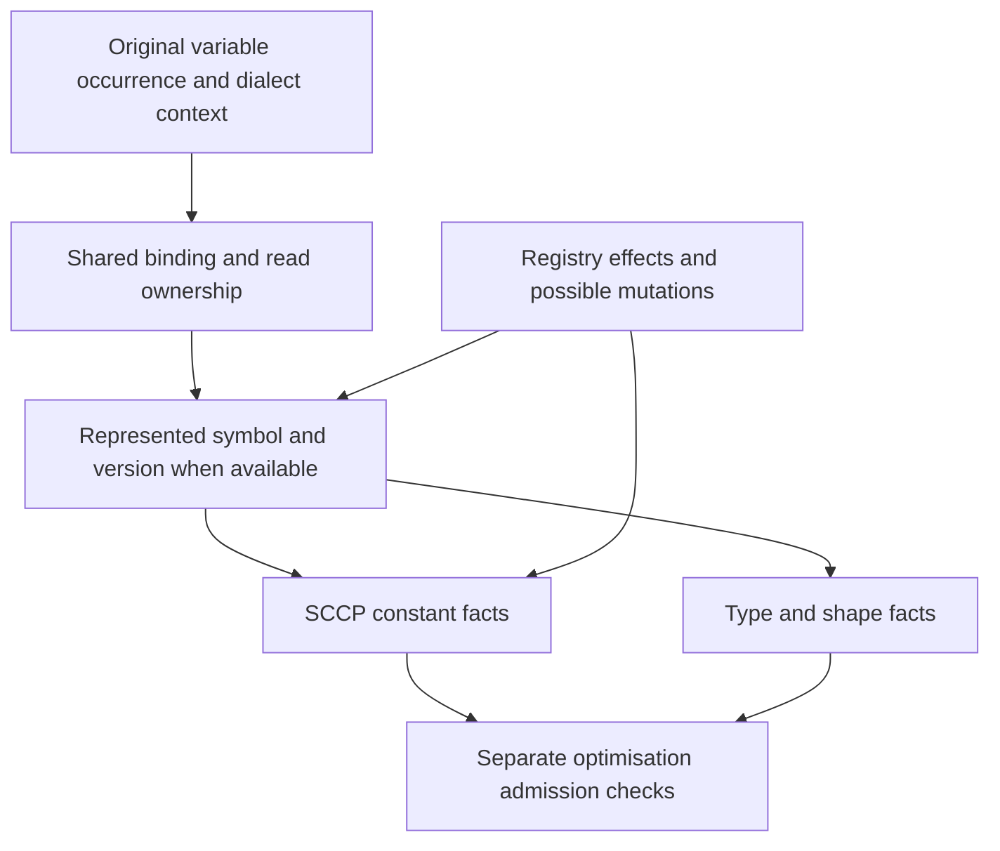
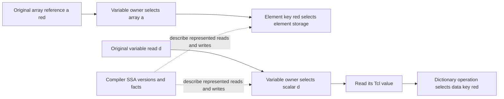
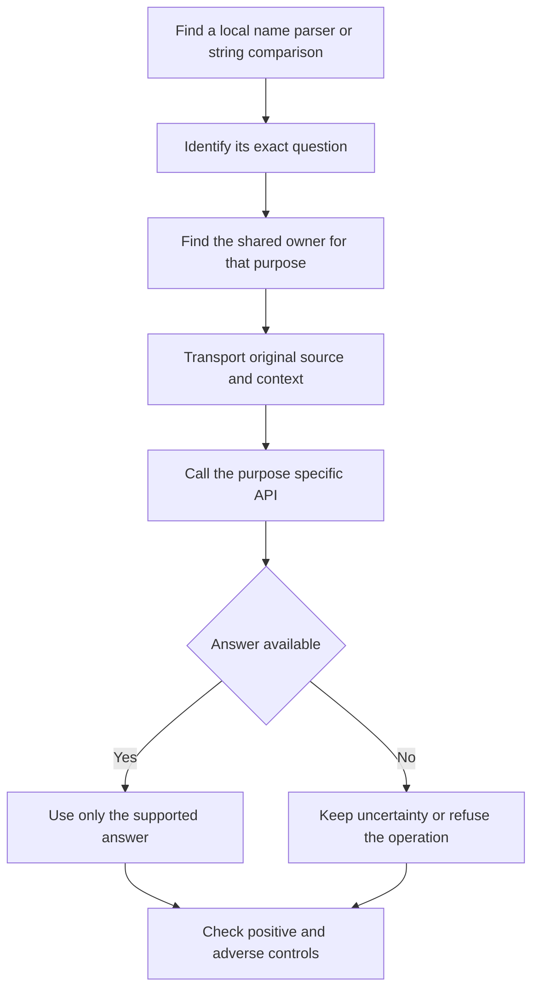

# Tcl naming architecture and API guide

Names in Tcl depend on where they appear, which interpreter rules apply, and what is currently bound to them. The centralised architecture gives each part of that problem a shared owner. Editor features, analysis and execution then ask those owners for the particular answer they need.

The practical rule is: **keep the original name and its context together, and ask for the smallest answer your feature needs.**

# How the parts fit together



A **namespace** is a named scope. A **variable frame** holds one call's local variables. An **owner** is the module responsible for interpreting one kind of information. For example, the lexer owns variable-reference boundaries, while a runtime owns its live namespace objects. A consumer is a feature that uses the answer, such as Go to Definition or a compiler pass.

These layers exchange typed values. A typed value can retain the original source, configuration and selected object, so later code can check whether the answer still applies.

# The different things a name can mean

Consider a call written as `hello` inside namespace `app`.

| Information | What it means | Main representation |
| --- | --- | --- |
| Written source | The exact word `hello`, with its original location and syntax | `NativeWord`, `CommandTokens`, `SourceImage` |
| Name bytes | The exact bytes of a name after the relevant operation selects them | `NameBytes` |
| Namespace path | Components whose boundaries are already known | `ByteNamespacePath` |
| Command slot | A namespace path plus a simple command name, such as the slot for `app` and `hello` | `ByteCommandSlot` |
| Selected command | The particular declaration or live command selected at this point | Binding and command identity owners |
| Variable location | A local, namespace variable, array element or alias target in its actual frame | Variable binding and place owners |
| Display text | A readable label for a person | A rendered string |

A slot is an address. A live command is the object occupying that address. Deleting and recreating a namespace can reuse the same readable name while creating a different namespace object.



The lookup must retain the actual interpreter and namespace generation where those are required. A selected builtin or live command may have no source declaration. The dotted display path is for presentation. Code keeps the structured slot and selected identity rather than trying to recover them from the label.

# How dialect changes the answers

Dialect enters before a name is interpreted and stays attached to the answer. It affects several different questions:

| Question | Owner and retained input | Example |
| --- | --- | --- |
| How is this source word parsed | The lexer and its full `LexerConfig` | Variable-reference boundaries and whether `{*}` expansion is supported |
| Which command metadata applies | The actual `ContextRegistry`, including environment, availability and packs | Whether a command or option is available in this configured Tcl or F5 context |
| Which operation rules apply | `InvocationDialect` and purpose-specific naming protocols | The selected C Tcl or Jim lookup, publication, abbreviation or input-extent rules |
| Which live thing does it refer to | The binding or runtime owner with the actual namespace and frame | Which `x` a procedure reads, or which current command occupies a slot |

The last row needs actual context as well as dialect. Knowing that a document is Tcl 8.6 does not identify a particular procedure call's locals or a live interpreter's namespace objects.



`ResolvedAnalysisInput` is the compiler's existing package for these editing inputs. `lexer_config()` returns the retained configuration; `context_registry()` shares the actual immutable context; `unit_profile()` returns the compilation-unit profile. Genuine nested bodies use the existing body-purpose projection of that retained input, including the required source-position adjustments. Consumers do not rebuild a default context from a dialect name.

Source parsing, command availability and execution permission remain separate. An F5 command's source metadata can support editor advice without proving that a TMM event ran. Similarly, choosing a C Tcl grammar for source analysis does not create a live C interpreter or its variables.

# The API in small pieces

## Keep bytes and components intact

`tcl-core-types` provides storage and coordinates. These types alone grant no lookup, binding or execution authority. This small Rust example uses real APIs:

```rust
use tcl_core_types::name_bytes::{ByteNamespacePath, NameBytes};

let name = NameBytes::from("hello");
assert_eq!(name.as_bytes(), b"hello");

let path = ByteNamespacePath::from_segments(["app", "tools"]);
assert_eq!(path.as_segments().len(), 2);
```

`NameBytes` preserves bytes, including values that Rust cannot display as UTF-8. `try_utf8()` asks whether a readable UTF-8 view is available. A failed conversion does not make the native name invalid.

`from_segments` expects boundaries that the caller already knows. When starting from a written Tcl name, let the selected naming policy interpret it first.

## Ask the shared syntax owner about spelling

`tcl-syntax::naming` contains small reusable operations for specific jobs:

```rust
use tcl_syntax::naming::split_element_ref;

assert_eq!(split_element_ref("items(red)"), Some(("items", "red")));
assert_eq!(split_element_ref("items"), None);
```

This separates an already evaluated element name into its root and index. It does not locate an actual variable or read an array cell. Written source such as `$items(red)` first needs the lexer and variable-reference APIs.

For generating source, use the spelling constructor. Here `config` is the full configuration retained by the original document parser; this example is a fragment to place inside that consumer:

```rust
use tcl_syntax::naming::scalar_source_reference_followed_by;

// Use the original document's full LexerConfig in a real consumer.
let reference = scalar_source_reference_followed_by("total count", "::suffix", config);
assert_eq!(reference.as_deref(), Some("${total count}"));
```

Pass the entire following fragment to this constructor. It checks that the proposed scalar reference ends at the intended boundary under the original configuration. The minifier also checks the ordered components of the whole replacement word. These checks establish syntax; independent binding and edit checks still decide whether changing the source is permitted.

## A concrete source example

In Tcl, `${short}::suffix` reads the variable `short` and follows it with literal `::suffix`. `$short::suffix` instead names a different, namespace-qualified variable. An optimisation that creates a shorter name must preserve the first meaning when it constructs replacement source. This is why the minifier uses the shared reference constructor and checks the complete following fragment.

## Select the rule for the actual operation

`NativeNameProtocol` separates operations such as `command_lookup_slot` and `command_publication_slot`. Lookup asks where an existing command should be sought. Publication asks where a command should be installed.

The interpreter and operation select the protocol. Consumers retain that selection instead of choosing rules from a display label or assuming that C Tcl and Jim use interchangeable rules. These geometry APIs do not prove that a command exists.

## Ask for a binding at the original source point

`NativeWord` retains original word geometry; its name alone supplies no execution permission. The compiler's `SourceCommandBindings` retains command facts at source positions. The query has this shape:

```rust
let invocation = bindings.invocation_at_source(head, offset);

if let Some(target) = invocation.proved_target() {
    // Use the selected target for a purpose this binding supports.
}
```

Here `bindings`, `head` and `offset` come from the existing analysis and original command word. This is an integration sketch, not a complete standalone program.

The query uses the namespace recorded for that source region. `proved_target()` returns a target only when every represented path reaches the same target, with no unknown or possibly absent alternative. The return type is `Option`, so callers must handle a missing answer.

The shared command-reference APIs retain linked declarations, including the declaration captured by an alias or rename. A later declaration with the same spelling cannot replace that captured identity.

# Source advice and execution have different requirements

The code uses **Logical** for source reasoning and **Native** for interpreter-specific handling whose source, compiler or runtime evidence is required independently. A Native representation alone does not establish that a handler ran or that a physical cell is available. Logical advice can support an editor candidate without establishing that a command executed or that a physical variable cell exists.



Each branch has its own requirements. Source coverage alone cannot authorise rename edits, and a runtime lookup answer cannot automatically supply an earlier compiler-selection decision.

A **receipt** is a value retaining the origin and conditions of an answer. Code rechecks those conditions before using it. Conditions can include the same source image, full lexer configuration, original argument vector, registry snapshot, namespace generation, variable frame or live object.

Rust expresses many of these boundaries with `Option<T>` and `Result<T, E>`:

- `Some(answer)` supplies an answer for the API's stated purpose.

- `None` means that this API could not supply that answer. It does not mean the command or variable is absent.

- `Result` separates success from a reported error or refusal.

# How naming connects to SSA and SCCP

Naming answers **which variable or command this occurrence refers to**. Value analysis answers **what value can reach this operation**. Both answers are needed before an optimisation can safely use a value.

SSA means *Static Single Assignment*. It gives each represented assignment a version, so two writes to `n` are distinguishable during analysis:

```tcl
set n 1
if {$flag} { set n 2 }
puts $n
```

An illustrative SSA view is:

```text
n1 = 1
n2 = 2                  # on the branch that writes n
n3 = merge(n1, n2)
puts reads n3
```

Those labels are explanatory. In the implementation, `ValueKey` is `(Symbol, Version)`. A `Symbol` identifies an analysis variable within its owning SSA function, and `Version` distinguishes its represented contents over time. The printed name `n3` is not a new Tcl variable or a runtime object. Different spellings linked by a proved alias can refer to the same cell; two occurrences of `n` in different frames can refer to different cells. Symbols can represent either a location or a retained source variable. The same SSA engine handles both, including branch and loop merges. `ssa.cell_key(symbol)` returns `Some(key)` when a location is represented and `None` for source-only identity. In Rust, that `Option` forces the caller to handle the missing case. Even `Some(key)` still needs independent execution checks before it can stand for an actual live cell.



The existing `SsaSourceView::read_reference` API joins the actual source site and spelling with the SSA operation. Where an exact read is required, a consumer cannot replace a missing record with a variable-name lookup. An identified attempted read also does not prove that the read completed successfully.

SCCP means *Sparse Conditional Constant Propagation*. It follows paths considered potentially executable and keeps abstract value facts for SSA keys. Its existing `LatticeValue` alternatives are:

| State | Plain meaning |
| --- | --- |
| `Unknown` | The initial state before a value fact has been established |
| `Const(value)` | One known constant |
| `ConstSet(values)` | A small set of possible constants |
| `Overdefined` | No useful constant bound remains; the value may be anything in the domain |

The current `ConstValue` variants are integer, floating-point, Boolean and string constants. That is an abstract constant domain; it does not give every dictionary member its own SSA variable.

For the example, the final value might be tracked as the alternatives 1 and 2. Additional effects can require widening it. An unknown call, trace, alias mutation or missing source correspondence must not be treated as proof that an earlier constant survives. A source-only possible write widens knowledge; it does not create runtime storage or prove a constant, completed read or normal return.

## Where values are stored

There are three different levels of information:

- **Runtime storage** holds actual Tcl objects and variable cells. The Runtime and VM retain their own object, frame and lifetime owners.

- **SSA** identifies represented definitions and reads inside the compiler. It does not allocate a physical Tcl cell.

- **SCCP and type analysis** associate abstract facts with those SSA values. Their maps are compiler knowledge, not the interpreter's object store.

For example, knowing the constant text `42` does not prove that an actual runtime object currently has an integer internal representation, a particular cache or a particular reference count.

# Arrays dictionary members and Tcl types

An array element and a dictionary entry can look similar in Tcl code, but they belong to different kinds of storage:

```tcl
set a(red) 1
set d [dict create red 1]

set x $a(red)
set y [dict get $d red]
```

| Expression or operation | Variable naming question | Value question |
| --- | --- | --- |
| `$a(red)` | Which array variable and element does this original reference select in this frame | What value reaches that element read |
| `dict get $d red` | Which variable does `$d` read | Does its value contain the exact dictionary key `red`, and what value is stored there |
| `dict set d red 2` | Which variable is the write target `d` | How does replacing that dictionary value change the tracked contents |

In **C Tcl**, an array is variable storage, not a first-class Tcl value. Its elements have variable aliasing, trace and unset behaviour. **Jim uses a different container model:** its array entries belong to an ordinary dictionary-valued root, so reading or replacing that root can read or replace the dictionary. The shared `VariableContainerModel` selects this policy; adapters must retain the actual dialect and cell lifetime.

The Registry's abstract `PlaceKind` distinguishes `Scalar`, `Element { base, key }` and `Array`. `PlaceRef` describes planned targets; constructing one does not create or prove ownership of a live cell.

A **dictionary is a Tcl value**. Its keys are data. Keys such as `::red` or `a(b)` are not namespace paths or array-element references merely because they contain those characters. A dictionary member is therefore selected by the dictionary operation's key rules, not the variable-name splitter. Updating a dictionary held in `d` writes the containing variable's value; compiler analyses can retain additional shape or key facts when their owners establish them.



Commands such as `dict with` and `dict update` also bind local variables. That extra naming behaviour comes from the command's Registry semantics and actual operands. Ordinary dictionary lookup does not acquire it.

Array indices need not be numbers: `a(red)` is valid. A computed index can contain substitutions, so the source owner must preserve that original syntax. For a nested dictionary read such as `dict get $d outer inner`, only `$d` names a variable; `outer` and `inner` select keys inside values. Those keys do not become separate Tcl variables or automatically receive separate SSA storage.

## Type facts do not replace naming facts

The Registry supplies coarse `TclType` information and `TypeFacts`. The compiler refines this with `TypeShape` and `TypeLattice`. `TypeShape::Dict` tracks facts about the types of its values; exact key sets live in separate shape facts such as `ValueShape::DictKeys`. Notice the distinction: `TypeShape::Dict(...)` describes a value, while `PlaceKind::Array` describes variable storage.

Tcl objects can gain or change an internal representation when an operation interprets them as an integer, list or dictionary. This is often called **shimmering**. The compiler's type and representation-commit analyses track the applicable facts separately. A type prediction does not itself prove a physical object's current representation, a successful conversion or the absence of callbacks.

The integration order is therefore: resolve the actual name and place, identify the represented read or write, apply the selected command's value and effect semantics, then use only the constant and type facts supported at that program point. Dialect, source ownership and runtime currentness remain attached throughout.

# How a feature integrates

## An editor feature

For Go to Definition, retain the current document and original word location, query its shared binding or source-reference owner, then ask that reference for its linked declaration. Convert the resulting source location into an editor location at the end.

References and rename need more information. Rename also needs complete relevant occurrence coverage, collision checks, original edit spans and independent transformation permission. The current Logical formal and alias migrations deliberately retain an edit obligation until that separate permission is available.

## A workspace diagnostic

The compiler's `source_logical_command_candidates` entry enumerates retained Logical call occurrences. Its `external_header_coordinates()` facet answers the narrower question needed by external declaration indexes. `WorkspaceIndex::logical_command_candidates` consumes that facet.

Local commands, builtins, aliases, deletions and earlier unknown effects can change which external declarations are relevant. An unresolved-name list alone cannot prove that a project declaration occupies the call's slot. Project aggregates also require every supplied member's source ownership before offering a complete combined answer.

## The Runtime and VM

Execution adapters supply their own actual namespace, frame, argument objects and lifetimes. They call the central operation owner and retain its selected result throughout the operation.

Jim namespace dispatch illustrates why this matters. The shared table owns the ordered native entries and matching rules. The adapter owns the actual object cache and getters. `lookup_using` lets the shared table request each physical comparison in the correct order, retaining the selected row without selecting it again from rendered text.

Deleting a namespace, invoking a getter or publishing a result can affect currentness. The execution adapters therefore transport checks through those stages, including callbacks, and retain the actual object identities and result-storage rules.

# A recipe for migrating another consumer



1. Identify whether the feature needs syntax, an evaluated name, a candidate, a binding, a live object or an edit.

2. Reuse the matching shared API. If it lacks a genuine requirement, extend that owner.

3. Pass the original bytes, spans, configuration and relevant source or runtime owner.

4. Preserve unknown, absent and conflicting alternatives as different states.

5. Keep existing regression assertions, and check changed source, aliases, shadows, configuration and lifetime changes where relevant.

6. Register the API and consumer in the shared contracts, then run the appropriate owner and repository gates.

# Where to read the implementation

| Start here | What it explains |
| --- | --- |
| [Name handling contract](https://github.com/bitwisecook/tcl-lsp/blob/work/docs/design/contracts/name-handling.md) | Representations and purpose boundaries |
| [Implementer guide](https://github.com/bitwisecook/tcl-lsp/blob/work/docs/design/compiler/name-resolution-implementer-guide.md) | How to choose and integrate APIs |
| [Consumer matrix](https://github.com/bitwisecook/tcl-lsp/blob/work/docs/design/contracts/naming-consumer-matrix.md) | Which owner each consumer should use |
| [Shared utility contracts](https://github.com/bitwisecook/tcl-lsp/blob/work/docs/design/contracts/shared-utility-contracts-rust.md) | API owners and registered checks |
| [Name byte types](https://github.com/bitwisecook/tcl-lsp/blob/work/rust/tcl-core-types/src/name_bytes.rs) | Small foundational Rust types |
| [Variable spelling constructors](https://github.com/bitwisecook/tcl-lsp/blob/work/rust/tcl-syntax/src/naming/variable_spelling.rs) | Source construction with explicit configuration |
| [Command bindings](https://github.com/bitwisecook/tcl-lsp/blob/work/rust/tcl-compiler/src/command_binding.rs) | Point-specific targets and retained context |
| [Retained dialect inputs](https://github.com/bitwisecook/tcl-lsp/blob/work/rust/tcl-compiler/src/analyser/input.rs) | Full source configuration and actual availability context |
| [SSA source reads](https://github.com/bitwisecook/tcl-lsp/blob/work/rust/tcl-compiler/src/ssa.rs) | Symbols, versions and exact source-read joins |
| [SCCP constant domain](https://github.com/bitwisecook/tcl-lsp/blob/work/rust/tcl-compiler/src/analyses.rs) | Unknown, constants, bounded alternatives and widening |
| [Type shapes](https://github.com/bitwisecook/tcl-lsp/blob/work/rust/tcl-compiler/src/types.rs) | Value types and represented element information |
| [Abstract storage places](https://github.com/bitwisecook/tcl-lsp/blob/work/rust/tcl-registry/src/value_transfer/inputs.rs) | Scalar, array element and whole-array planning targets |

The shared architecture exists; migration is still in progress. The completed audit covers 110,709 tracked baseline paths plus reviewed changes on branch `work`. Its baseline catalogue contains 1,799 semantic changes, 305 validation repairs and 54 documentation corrections: **2,158 required changes**. In the current reviewed implementation, 108 baseline units have changes integrated (54 code and all 54 documentation), with **zero units verified complete**. A separately reconciled annex identifies 29 additional owner/caller obligations, all 29 integrated pending validation. This gives 2,187 recorded obligations and 137 integrated pending validation; demonstrated further requirements remain explicit until reconciled. Required repository gates are not green and #2286 remains open. The diagrams explain the contracts every integration must preserve; they do not claim that every consumer already follows them.

## A little Rust vocabulary

`&T` means a borrowed reference to a value of type `T`. `Arc<T>` lets several owners retain shared data. An `enum` represents a defined set of alternatives, such as different interpreter protocols. A lifetime describes how long a borrowed value can be used. In this architecture those Rust tools help keep names attached to the context that makes their answers valid.
